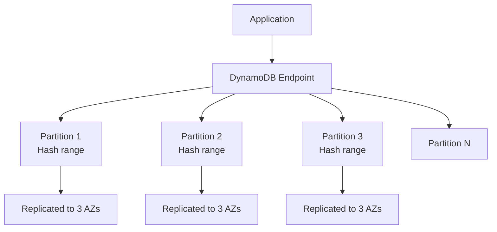
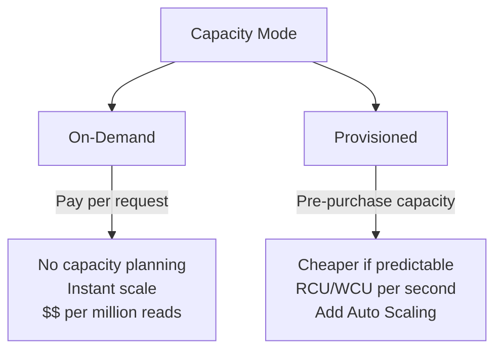
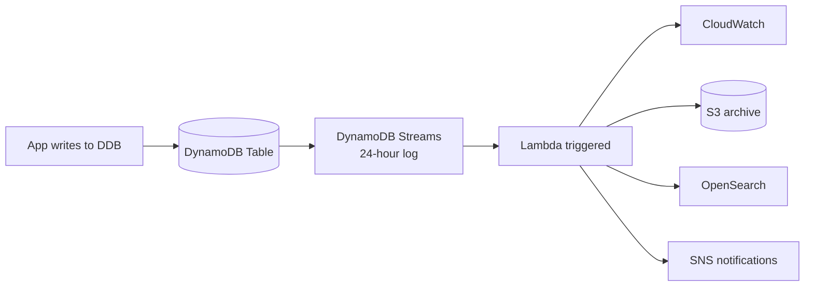
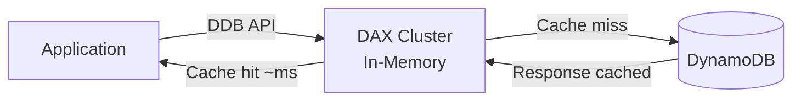

# DynamoDB — Design Patterns & Scaling

> 🔥 **Top 3 SAP-C02 service.** Know capacity modes, global tables, DAX, and Streams.

## Problem It Solves
Some workloads need **massive horizontal scale** (millions of req/sec), **predictable single-digit-millisecond latency**, and **don't fit a relational model** — IoT telemetry, gaming leaderboards, ad-tech, session storage. Relational DBs hit walls; sharding them is painful. DynamoDB is **born horizontally scaled** with no sharding decisions for you.

## How It Works



### Core Concepts

```
┌────────────────────────────────────────────────────────────┐
│ TABLE                                                      │
│   Collection of items (like rows)                          │
│   No fixed schema beyond Primary Key                       │
├────────────────────────────────────────────────────────────┤
│ PRIMARY KEY                                                │
│   Partition Key (PK) — hash key for distribution           │
│   OR                                                       │
│   Partition Key + Sort Key (composite) — same PK, ordered │
├────────────────────────────────────────────────────────────┤
│ ITEM                                                       │
│   Like a row, but flexible attributes                      │
│   Max size: 400 KB per item                                │
├────────────────────────────────────────────────────────────┤
│ ATTRIBUTES                                                 │
│   Like columns, but per-item                               │
│   Different items can have different attributes            │
├────────────────────────────────────────────────────────────┤
│ SECONDARY INDEXES                                          │
│   GSI (Global Secondary Index) — different PK, own RCU/WCU │
│   LSI (Local Secondary Index) — same PK, different sort   │
└────────────────────────────────────────────────────────────┘
```

### Capacity Modes



### On-Demand vs Provisioned

| | **On-Demand** | **Provisioned** |
|---|---|---|
| Pricing | Per-request | Per RCU/WCU per hour |
| Scaling | Instant, unlimited | Auto Scaling target % |
| Best for | Unknown / spiky / dev | Known / steady patterns |
| Reserved capacity | No | Yes (1 or 3 yr discount) |
| Cost | More expensive per request | Cheaper if utilized |
| Cold start risk | None | "Hot partition" if poor key design |

```
THE RULE OF THUMB:
─────────────────────────────────────────────
> 60% utilization predictable → Provisioned
< 60% utilization or spiky    → On-Demand

Provisioned with Auto Scaling = good middle ground
```

### Capacity Units Explained

```
1 RCU (Read Capacity Unit):
─────────────────────────────────────────────
• 1 strongly consistent read up to 4 KB per second
• 2 eventually consistent reads up to 4 KB per second
• 1 transactional read up to 4 KB per 2 seconds

1 WCU (Write Capacity Unit):
─────────────────────────────────────────────
• 1 write up to 1 KB per second
• 1 transactional write up to 1 KB per 2 seconds

Example:
  Item = 10 KB read, eventually consistent, 1000 reads/sec
  Calc: 10 KB / 4 KB = 2.5 → round up to 3
        3 / 2 (eventual) = 1.5
        1.5 × 1000 = 1500 RCU
```

### Consistency Models

```
EVENTUAL CONSISTENCY (default):
─────────────────────────────────────────────
- Reads might return stale data (~1 sec lag)
- Half the RCU cost of strong
- Use: "Latest data not critical" cases

STRONG CONSISTENCY:
─────────────────────────────────────────────
- Reads always return latest write
- 1x RCU cost
- Use: Financial counters, inventory

TRANSACTIONAL:
─────────────────────────────────────────────
- ACID across multiple items
- 2x RCU cost (read), 2x WCU cost (write)
- Use: Multi-item atomic operations
```

### The Hot Partition Problem

```
BAD PARTITION KEY DESIGN:
─────────────────────────────────────────────
Table tracks website hits. PK = "Year-Month" 
(e.g., "2026-05")

PROBLEM:
─────────────────────────────────────────────
All writes for May 2026 go to ONE partition
That partition gets throttled at its limit (~1000 WCU)
Other partitions sit idle

FIX:
─────────────────────────────────────────────
Use HIGH-CARDINALITY PK like UserId, SessionId, EventId
Or add a random suffix: "2026-05-RAND(1-100)"
```

### Indexes — GSI vs LSI

```
LOCAL SECONDARY INDEX (LSI):
─────────────────────────────────────────────
- Same Partition Key as base table
- Different Sort Key
- Up to 5 per table
- MUST be created at table creation (can't add later)
- Shares RCU/WCU with base table

GLOBAL SECONDARY INDEX (GSI):
─────────────────────────────────────────────
- Different Partition Key (and optional Sort Key)
- Up to 20 per table
- Can be added/removed anytime ✅
- Has own provisioned RCU/WCU
- Eventually consistent only
- Use: Query by different attribute (e.g., by email)
```

### DynamoDB Streams — Change Data Capture



**Streams capture every write** (Insert/Modify/Remove). View options:
- KEYS_ONLY (just the key)
- NEW_IMAGE (item after change)
- OLD_IMAGE (item before change)
- NEW_AND_OLD_IMAGES (both)

Retention: **24 hours**

**Common patterns:**
- Trigger Lambda to update OpenSearch (search)
- Replicate to S3 for analytics
- Send notifications via SNS
- Multi-region replication (used to be implemented this way)

### DAX — DynamoDB Accelerator



```
DAX SPEEDS UP DDB READS:
─────────────────────────────────────────────
✅ Microsecond latency (vs DDB's milliseconds)
✅ Drop-in compatible (same API)
✅ Write-through cache
✅ Item cache + query cache

DON'T USE DAX:
─────────────────────────────────────────────
❌ For strongly consistent reads (DAX is eventually)
❌ For write-heavy workloads (no perf gain)
❌ Just to "make DDB cheaper" — DAX adds cost
```

### Time to Live (TTL)

```
TTL automatically deletes expired items.
─────────────────────────────────────────────
Set attribute "ExpiresAt" = Unix timestamp
DDB deletes items within 48 hours after expiry
✅ No cost for delete (vs explicit delete which costs WCU)
✅ Streams DO capture TTL deletes (with userIdentity=DynamoDB)

Use: Session storage, temporary tokens, IoT data retention
```

### DynamoDB Global Tables

See dedicated note: [DynamoDB Global Tables & Streams](./04-dynamodb-global.md)

```
SHORT VERSION:
─────────────────────────────────────────────
✅ Active-Active multi-region replication
✅ Writes accepted in ANY region
✅ Conflict resolution: last-writer-wins (timestamp)
✅ Use: Globally distributed apps needing low write latency
```

### DynamoDB Backups

```
ON-DEMAND BACKUPS:
─────────────────────────────────────────────
Full backup at any time
Stored in DDB (not S3)
No performance impact
Retain as long as you want

POINT-IN-TIME RECOVERY (PITR):
─────────────────────────────────────────────
Continuous backups
Restore to any second within the last 35 days
No performance impact
✅ Always enable for production tables
```

## When to Use DynamoDB

| Scenario | Solution |
|---|---|
| User profile / session store | **DynamoDB On-Demand** |
| IoT telemetry, millions/sec | **DynamoDB Provisioned + Auto Scaling** |
| Gaming leaderboard | **DynamoDB + DAX** |
| Multi-region active-active | **DynamoDB Global Tables** |
| Need CDC to OpenSearch/S3 | **DynamoDB Streams + Lambda** |
| Temporary data (auto-cleanup) | **DynamoDB + TTL** |
| Complex aggregations / JOINs | ❌ Use RDS/Aurora instead |
| Long-running scans / analytics | ❌ Export to S3 + Athena |

## When NOT to Use

- ❌ Need JOINs, complex queries → Aurora
- ❌ Variable / unknown access patterns → schema-aware DB
- ❌ < 10 reqs/sec → overkill, RDS often cheaper
- ❌ Items > 400 KB → S3 with DDB pointer pattern
- ❌ Strong global consistency cross-region → impossible (use Aurora Global instead)

## Trade-offs

| Choice | Gain | Sacrifice |
|---|---|---|
| DynamoDB over Aurora | Insane scale, no ops | Limited query flexibility |
| On-Demand over Provisioned | No planning | More expensive per request |
| DAX | Microsecond reads | Eventually consistent only |
| Global Tables | Multi-region writes | Last-writer-wins conflicts |
| GSI vs new table | Query flexibility | Extra capacity costs |

## Real World Example

**Lyft** uses DynamoDB for ride state tracking:
- Each ride = one item, PK = RideId
- Global Tables across US regions for resilience
- Streams trigger Lambda → analytics pipeline (S3 → Athena)
- DAX in front for hot rides (active rides accessed many times/sec)

**Tinder** uses DynamoDB for user data:
- Swipes stored as items
- TTL for ephemeral data (older than 30 days)
- Global Tables to support international expansion
- On-Demand to handle nightly traffic spikes without planning

## 🎯 Exam Soundbite

> "DynamoDB is a serverless NoSQL database with single-digit-millisecond latency at any scale. Use On-Demand capacity for unknown or spiky workloads and Provisioned with Auto Scaling for predictable patterns. Add DAX for microsecond-latency reads, Streams for change-data-capture to other services, and Global Tables for true active-active multi-region writes. Design partition keys with high cardinality to avoid hot partitions."

---

## ⚡ Quick Recall Card

```
┌─────────────────────────────────────────────────┐
│ DYNAMODB KEY FACTS                               │
├─────────────────────────────────────────────────┤
│ Capacity modes        On-Demand / Provisioned    │
│ Item max size         400 KB                     │
│ Partition key purpose Hash for distribution      │
│ Read consistency      Eventual / Strong / Trans  │
│ DAX                   In-memory accelerator      │
│ Streams retention     24 hours                   │
│ TTL                   Auto-delete expired items  │
│ Global Tables         Active-active multi-region │
│ Backups               On-demand + PITR (35 days) │
│ Hot partition fix     Better PK design           │
└─────────────────────────────────────────────────┘
```

## 🎓 Common Exam Pattern

> **"Application receives 10,000 IoT messages per second, mostly nighttime. Some days have unpredictable spikes 10x. Need to scale automatically."**
>
> ✅ **DynamoDB On-Demand** — no capacity planning, handles spikes instantly. Alternative: Provisioned + Auto Scaling, but On-Demand is simpler for unpredictable patterns.
