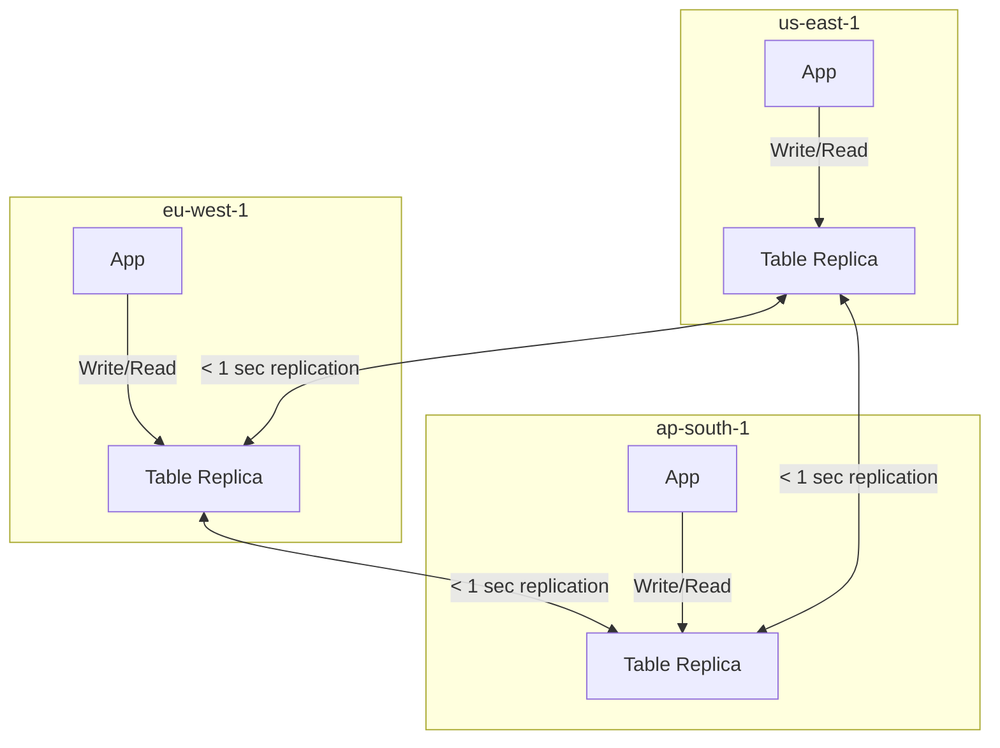
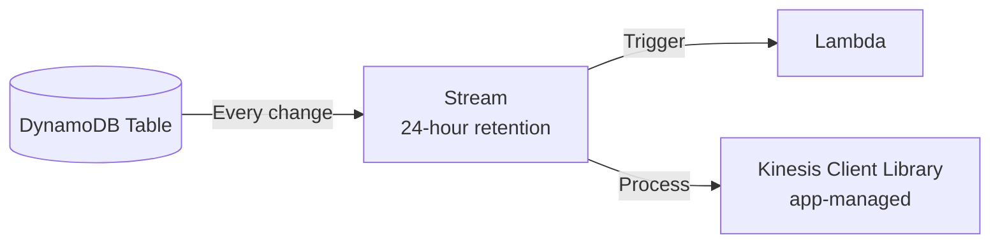

# DynamoDB Global Tables & Streams

> 🔥 **Always tested vs Aurora Global.** Know the active-active distinction and last-writer-wins.

## Problem It Solves
Globally distributed applications need:
- Low write latency from any region (users in EU shouldn't write to US-East)
- Resilience against region failure
- Multi-region disaster recovery without manual failover

Aurora Global only allows writes to one region. **DynamoDB Global Tables enable writes in any region, with automatic multi-master replication.**

## How It Works



### How Replication Works Under the Hood

```
1. App writes item to LOCAL region's replica
2. Local write succeeds immediately (low latency)
3. DynamoDB Stream captures the change
4. Replication infrastructure ships it to all peer regions
5. Peer regions apply the change (eventually consistent)
6. Typical lag: < 1 second under normal conditions
```

### Conflict Resolution — Last Writer Wins

```
SCENARIO:
─────────────────────────────────────────────
T+0:   us-east-1 writes  { id: 42, value: "A" }
T+0.1: eu-west-1 writes  { id: 42, value: "B" }
T+1:   us-east-1 receives the write from eu-west-1
T+1:   eu-west-1 receives the write from us-east-1


RESOLUTION:
─────────────────────────────────────────────
DynamoDB uses each item's WRITE TIMESTAMP
The later write WINS (eu-west-1's "B" in this example)
The other write is silently dropped


IMPLICATION:
─────────────────────────────────────────────
✅ Simple, fast, no application logic
❌ Conflicts CAN result in lost writes
❌ Don't use for ledgers, financial txns
   (use single-region Aurora for those)
```

### Aurora Global vs DynamoDB Global Tables

| | **Aurora Global** | **DynamoDB Global Tables** |
|---|---|---|
| Write topology | Active-PASSIVE | Active-ACTIVE |
| Writes accepted | One primary region only | **Any region** |
| Failover | Manual (or managed) promotion, < 1 min | Automatic — apps just keep writing |
| Consistency | Strong within region, async cross-region | Eventually consistent cross-region |
| Conflict handling | N/A (writes only in primary) | Last-writer-wins |
| Replication lag | < 1 second | < 1 second |
| Best for | OLTP with strong consistency + DR | Globally distributed apps, gaming, social |

### Setting Up a Global Table

```
PREREQUISITES:
─────────────────────────────────────────────
✅ DynamoDB Streams enabled (with NEW_AND_OLD_IMAGES)
✅ Empty tables (for original method)
   OR tables with no replicas (Version 2019.11.21 - modern)
✅ Same table name across regions
✅ Same primary key schema


CREATION:
─────────────────────────────────────────────
Console: Open table → Global Tables tab → Add region
CLI:     aws dynamodb update-table --replica-updates '[{"Create": {"RegionName": "eu-west-1"}}]'

DynamoDB automatically:
- Creates the table in target region
- Starts replicating
- Maintains schema parity (TTL, indexes, settings)
```

### What Replicates and What Doesn't

```
REPLICATED:
─────────────────────────────────────────────
✅ Items (every put/update/delete)
✅ TTL attribute (but TTL deletion happens per-region locally)
✅ DynamoDB Streams (per-region streams)
✅ Encryption (via KMS — separate keys per region)


NOT AUTOMATICALLY REPLICATED:
─────────────────────────────────────────────
❌ Auto Scaling settings (configure per region)
❌ Tags
❌ IAM policies
❌ CloudWatch alarms
❌ Backup settings (PITR is per-region)
```

---

## DynamoDB Streams Deep Dive



### Stream View Types

```
KEYS_ONLY:
─────────────────────────────────────────────
Only the primary key of the modified item
Smallest, cheapest
Use: Trigger external processes (e.g., re-fetch from DDB)

NEW_IMAGE:
─────────────────────────────────────────────
Entire item AFTER the change
Use: Replicate to other systems (search index, cache)

OLD_IMAGE:
─────────────────────────────────────────────
Entire item BEFORE the change
Use: Audit logs, undo functionality

NEW_AND_OLD_IMAGES:
─────────────────────────────────────────────
Both before and after — full picture
Required for Global Tables
Use: Most CDC scenarios
```

### Common Stream Patterns

```
PATTERN 1: Search Index Sync
─────────────────────────────────────────────
DDB → Stream → Lambda → OpenSearch
Keep search index in sync with DDB changes

PATTERN 2: Analytics Pipeline
─────────────────────────────────────────────
DDB → Stream → Lambda → Kinesis Firehose → S3
Land data in S3 for Athena/EMR queries

PATTERN 3: Multi-region Replication (legacy)
─────────────────────────────────────────────
DDB region A → Stream → Lambda → DDB region B
(Now obsolete — use Global Tables instead!)

PATTERN 4: Audit Log
─────────────────────────────────────────────
DDB → Stream (OLD + NEW images) → Lambda → 
Append-only audit log in S3 or CloudWatch Logs

PATTERN 5: Trigger Notifications
─────────────────────────────────────────────
DDB (order status change) → Stream → Lambda → 
SNS → SMS / Email
```

### Streams vs Kinesis Data Streams for DDB

```
DynamoDB STREAMS (legacy):
─────────────────────────────────────────────
- 24-hour retention
- Lambda integration native
- Simple to set up
- Free with DynamoDB

DynamoDB → KINESIS DATA STREAMS (newer option):
─────────────────────────────────────────────
- Up to 365 days retention (Extended Data Retention)
- Better for analytics pipelines
- Multiple consumers (enhanced fan-out)
- Pay for Kinesis Stream
- Configure via "Kinesis data stream destination"

WHEN TO USE KDS:
✅ Need retention > 24 hours
✅ Many consumers (fan-out)
✅ Replay/reprocess history
```

## When to Use Global Tables

| Scenario | Solution |
|---|---|
| Users worldwide, low write latency | **Global Tables** |
| Gaming with regional servers | **Global Tables** |
| Multi-region active-active SaaS | **Global Tables** |
| Multi-region DR for DynamoDB | **Global Tables** |
| Strict financial consistency cross-region | ❌ Use single-region Aurora |
| Cross-region read scale only | Aurora Global is fine |

## When NOT to Use

- ❌ Money / transactional consistency requirements — last-writer-wins can lose data
- ❌ Same item updated frequently from multiple regions — conflicts likely
- ❌ Cost-sensitive single-region apps — replication has cost
- ❌ Replacing application-managed CDC — use Streams + Lambda for cross-system sync

## Trade-offs

| Choice | Gain | Sacrifice |
|---|---|---|
| Global Tables | Active-active writes globally | Last-writer-wins conflicts |
| Streams to Lambda | Easy CDC | 24-hour retention limit |
| Stream to Kinesis | Long retention, fan-out | Extra Kinesis cost |
| Multiple regions | Resilience + low latency | 3x storage cost, replication cost |

## Real World Example

**Riot Games (League of Legends)** uses DynamoDB Global Tables:
- Player profiles, match history replicated globally
- Players in EU, NA, APAC each write to local region
- Low write latency essential for game state updates
- Last-writer-wins acceptable for player profile updates
- Streams trigger Lambda for analytics pipeline → S3 → Athena

**Tinder** uses Global Tables for user data:
- Profiles, swipes replicated across 3+ regions
- Local writes for "swipe right" actions — instant UX
- Streams power "people who liked you" backend computations

## 🎯 Exam Soundbite

> "DynamoDB Global Tables provide active-active multi-region replication with last-writer-wins conflict resolution and sub-second cross-region lag. They differ from Aurora Global Database, which is active-passive — writes only accepted in the primary region. Use Global Tables when you need writes in multiple regions for low latency or active-active resilience; use Aurora Global when you need strong consistency on writes with read scale across regions."

---

## ⚡ Quick Recall Card

```
┌─────────────────────────────────────────────────┐
│ GLOBAL TABLES vs AURORA GLOBAL                   │
├─────────────────────────────────────────────────┤
│ DDB GT          Active-Active, LWW conflicts     │
│ Aurora Global   Active-Passive, strong in primary │
│ DDB GT failover Automatic (write elsewhere)      │
│ Aurora failover Manual promotion (~1 min)        │
│ DDB GT lag      < 1 sec                          │
│ Aurora lag      < 1 sec                          │
├─────────────────────────────────────────────────┤
│ STREAMS                                          │
│ Retention       24 hours (extend with Kinesis)   │
│ Required for GT YES (NEW_AND_OLD_IMAGES)         │
│ Trigger         Lambda native                    │
│ View types      KEYS / NEW / OLD / BOTH          │
└─────────────────────────────────────────────────┘
```

## 🎓 Common Exam Pattern

> **"Mobile gaming app with users in 3 continents. Each player session generates writes — score, position. Need low write latency from each region and resilience. What database?"**
>
> ✅ **DynamoDB Global Tables** — active-active writes from any region, < 1 sec lag, automatic resilience. Last-writer-wins is acceptable for gaming state.

> **"Banking app needs strong consistency on writes, but users in EU should read with low latency. Acceptable for failovers to take ~1 minute."**
>
> ✅ **Aurora Global Database** — writes go to primary US region (strong consistency), EU users get fast reads from EU replicas, manual failover < 1 min for DR.
