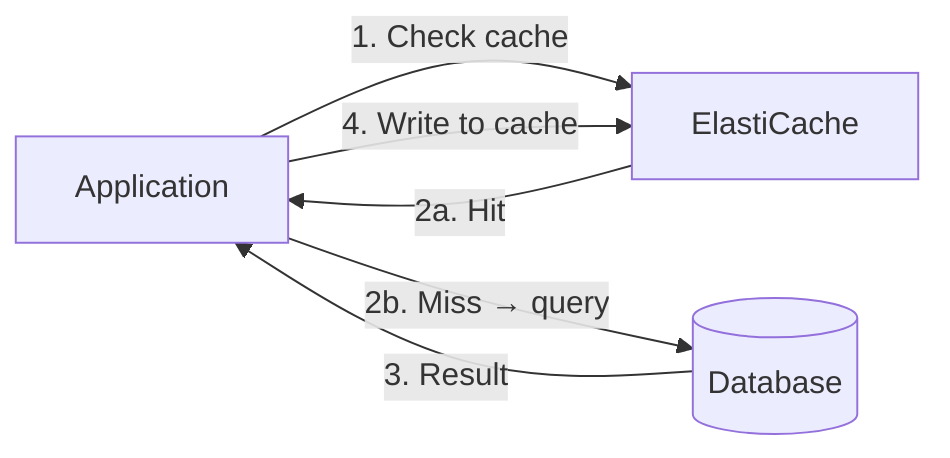
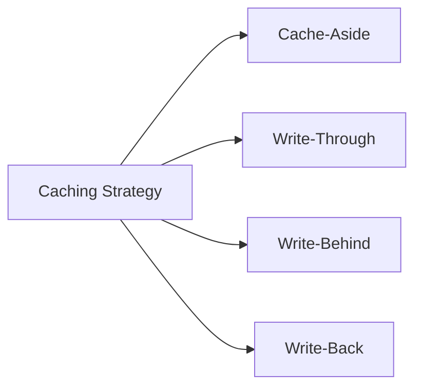

# ElastiCache — Redis vs Memcached

## Problem It Solves
Hot data accessed thousands of times per second causes database overload, slow response times, and runaway costs. **In-memory caching** stores frequently-accessed data in RAM near your compute — sub-millisecond reads, massive throughput, dramatic DB load reduction. ElastiCache is fully-managed Redis or Memcached.

## How It Works



### Redis vs Memcached — Side by Side

| | **Redis** | **Memcached** |
|---|---|---|
| Data structures | Strings, Hashes, Lists, Sets, Sorted Sets, Streams, Geospatial | Simple Key-Value strings |
| Persistence | ✅ Snapshots + AOF | ❌ None |
| Multi-AZ HA | ✅ Replication + automatic failover | ❌ |
| Replicas | Up to 5 read replicas | ❌ |
| Cluster mode | ✅ Sharded (horizontal scale) | ✅ Multi-node (no replication) |
| Backup/Restore | ✅ | ❌ |
| Pub/Sub | ✅ | ❌ |
| Transactions | ✅ (MULTI/EXEC) | ❌ |
| Geospatial | ✅ | ❌ |
| Lua scripting | ✅ | ❌ |
| Multithreaded | ❌ (single-threaded per shard) | ✅ |
| Encryption at-rest | ✅ | ❌ |
| Encryption in-transit | ✅ | ❌ |
| Use cases | Anything complex, session store, leaderboards, queues | Simple cache, ephemeral data |

```
THE MEMORABLE TRUTH:
─────────────────────────────────────────────
Use REDIS for anything serious.
Use MEMCACHED only if you specifically need
multi-threaded performance and don't need any
of Redis's features.

The exam often expects REDIS as the answer.
```

---

## Redis Cluster Modes

```mermaid
flowchart TB
    subgraph DISABLED[Cluster Mode DISABLED - "Replication Group"]
        P[Primary - 1 node, holds all data]
        R1[Replica 1]
        R2[Replica 2]
        P -.async repl.-> R1
        P -.async repl.-> R2
    end
    
    subgraph ENABLED[Cluster Mode ENABLED - "Sharded Cluster"]
        S1P[Shard 1 Primary]
        S1R[Shard 1 Replica]
        S2P[Shard 2 Primary]
        S2R[Shard 2 Replica]
        S3P[Shard 3 Primary]
        S3R[Shard 3 Replica]
    end
```

```
CLUSTER MODE DISABLED:
─────────────────────────────────────────────
- 1 primary, up to 5 replicas
- All data fits in primary's memory
- Limited to single-node memory (max ~600 GB)
- Use: Cache fits in one node

CLUSTER MODE ENABLED:
─────────────────────────────────────────────
- Data sharded across many shards (up to 500)
- Each shard = 1 primary + 0-5 replicas
- Massive horizontal scale (up to ~340 TB)
- Use: Cache too big for one node, need scale-out
```

### Redis HA Architecture

```
Multi-AZ Redis with Automatic Failover:
─────────────────────────────────────────────
Primary in AZ-a
Replica 1 in AZ-b   (sync replication)
Replica 2 in AZ-c   (sync replication)

If primary fails:
  Automatic failover (~30 sec)
  Replica is promoted
  DNS endpoint updates
  Application continues
```

### Redis Persistence Options

```
NONE (default):
─────────────────────────────────────────────
Pure cache. Restart = data lost.

SNAPSHOTS (RDB):
─────────────────────────────────────────────
Point-in-time snapshot to S3
Configurable schedule
Restore from snapshot

APPEND-ONLY FILE (AOF):
─────────────────────────────────────────────
Every write logged → replay on restart
Higher durability, lower performance
Not supported on all instance types in ElastiCache
```

---

## ElastiCache MemoryDB for Redis (Different Service!)

```
KEY DIFFERENCE FROM ELASTICACHE:
─────────────────────────────────────────────
ElastiCache Redis = CACHE (data can be lost)
MemoryDB for Redis = DURABLE DATABASE

MemoryDB writes synchronously to a transactional log
across multi-AZ before acknowledging.
Durability = 11 nines like S3.

USE MEMORYDB IF:
─────────────────────────────────────────────
✅ Redis is your PRIMARY database, not just cache
✅ Need microsecond reads + millisecond writes
✅ Cannot tolerate data loss
✅ Want Redis API with database guarantees

USE ELASTICACHE REDIS IF:
─────────────────────────────────────────────
✅ It's a cache (data is recoverable from source)
✅ Need fastest possible writes (no durable log overhead)
✅ Cost-sensitive
```

---

## Caching Strategies



### Cache-Aside (Lazy Loading) — Most Common

```
READ:
─────────────────────────────────────────────
1. App requests data
2. Check cache → MISS
3. App reads from DB
4. App writes to cache (with TTL)
5. Return to user

WRITE:
─────────────────────────────────────────────
1. App writes to DB
2. App INVALIDATES cache (delete the key)
   OR lets it expire via TTL

PROS: ✅ Resilient — cache failure doesn't break the app
      ✅ Only caches what's actually used
      
CONS: ❌ Cache miss adds latency
      ❌ Stale data possible (between DB write and cache invalidate)
```

### Write-Through

```
READ:
─────────────────────────────────────────────
Cache always has the latest data — never miss

WRITE:
─────────────────────────────────────────────
1. App writes to cache
2. App writes to DB synchronously

PROS: ✅ Cache always fresh
      ✅ No stale reads

CONS: ❌ Slower writes (two stores to update)
      ❌ Cache stores data that may never be read
```

### Write-Back (Write-Behind)

```
WRITE:
─────────────────────────────────────────────
1. App writes to cache
2. Cache async writes to DB later (queued)

PROS: ✅ Fast writes
      ✅ Batch writes to DB

CONS: ❌ Data loss risk if cache fails before flush
      ❌ Complex to implement
      ❌ Not typically used in ElastiCache directly
```

---

## Common Patterns

### Session Store

```
PROBLEM:
─────────────────────────────────────────────
EC2 instances behind ALB. Without sticky sessions,
each request can hit a different instance. Where to
store user session?

SOLUTION:
─────────────────────────────────────────────
Store session in Redis with TTL
All EC2 instances read/write the same Redis
Sticky sessions no longer needed
ALB can auto-scale stateless instances
```

### Database Query Caching

```
PROBLEM:
─────────────────────────────────────────────
Same expensive query runs thousands of times.
DB CPU pegged.

SOLUTION:
─────────────────────────────────────────────
Cache query results with hash of query as key
TTL = how stale is OK (5 sec? 5 min?)
Invalidate on relevant writes
✅ DB load drops 90%+
```

### Real-Time Leaderboard

```
PROBLEM:
─────────────────────────────────────────────
Show top 100 players globally, updating per second

SOLUTION:
─────────────────────────────────────────────
Redis Sorted Set: ZADD scores PlayerId
ZRANGE 0 99 → top 100 sorted automatically
Memcached can't do this — needs Redis ✅
```

### Distributed Locking / Rate Limiting

```
PROBLEM:
─────────────────────────────────────────────
Many instances, need atomic counter or lock

SOLUTION:
─────────────────────────────────────────────
Redis INCR for rate limiting
Redis SETNX for distributed locks (with expiry)
Memcached can't do this reliably
```

## When to Use What

| Scenario | Choice |
|---|---|
| Web session storage | **Redis** |
| Database query cache | **Either** (Redis if features needed) |
| Leaderboards / rankings | **Redis** (Sorted Sets) |
| Geospatial proximity | **Redis** (GEO commands) |
| Pub/Sub messaging | **Redis** (or MSK/SNS) |
| Counter / rate limiting | **Redis** (INCR) |
| Simple key-value cache, multi-threaded | **Memcached** |
| Need Redis API as a database (durable) | **MemoryDB** |
| Microservices distributed locks | **Redis** |
| Need encryption at-rest / in-transit | **Redis** (Memcached can't) |

## When NOT to Use

- ❌ Don't use ElastiCache as primary data store (use MemoryDB or DynamoDB)
- ❌ Don't use Memcached if you need persistence, HA, or any data structures
- ❌ Don't use ElastiCache for very low traffic — overkill, your DB is fine
- ❌ Don't cache write-heavy data without invalidation strategy

## Trade-offs

| Choice | Gain | Sacrifice |
|---|---|---|
| Redis over Memcached | Rich features, HA, persistence | Single-threaded per shard |
| Memcached over Redis | Multi-threaded, simpler | No features, no HA |
| MemoryDB | Durability + Redis API | Higher cost than ElastiCache |
| Cluster mode enabled | Massive scale | More complex client logic |
| Write-through | Always fresh cache | Slower writes |
| Cache-aside | Resilient, simple | Stale data possible |

## Real World Example

**Twitter** uses Redis heavily:
- Sorted Sets for the home timeline (latest tweets ranked)
- Lists for recently viewed
- Pub/Sub for real-time tweet delivery
- Cluster mode enabled for scale

**Instagram** uses Memcached:
- Simple key-value cache for user profiles, post metadata
- Multi-threaded perf for read-heavy workload
- No need for fancy data structures

**Coinbase** uses MemoryDB:
- Their primary user balance cache is in MemoryDB (not ElastiCache)
- They need durability + Redis API
- Microsecond reads, durable writes

## 🎯 Exam Soundbite

> "ElastiCache offers two engines: Redis for rich features like sorted sets, pub/sub, multi-AZ replication, encryption, and persistence — use it for sessions, leaderboards, and almost all caching needs; and Memcached for simple multi-threaded key-value caching only. For Redis as a durable database with eleven-nines durability and the same API, use Amazon MemoryDB."

---

## ⚡ Quick Recall Card

```
┌─────────────────────────────────────────────────┐
│ REDIS vs MEMCACHED                               │
├─────────────────────────────────────────────────┤
│ Multi-AZ HA?            Redis YES, Memcached NO  │
│ Persistence?            Redis YES, Memcached NO  │
│ Data structures?        Redis many, Memcached KV │
│ Pub/Sub?                Redis YES, Memcached NO  │
│ Multithreaded?          Redis NO, Memcached YES  │
│ Encryption?             Redis YES, Memcached NO  │
├─────────────────────────────────────────────────┤
│ ELASTICACHE  = cache (data loss OK)              │
│ MEMORYDB     = durable DB with Redis API         │
├─────────────────────────────────────────────────┤
│ Strategies: Cache-Aside (most common),           │
│             Write-Through, Write-Back            │
└─────────────────────────────────────────────────┘
```

## 🎓 Common Exam Pattern

> **"App needs to cache user sessions. Cache must survive node restart and AZ failure. Encryption at rest is required for compliance."**
>
> ✅ **Redis with Multi-AZ enabled + encryption at rest enabled**. Memcached fails on all three: no persistence, no Multi-AZ, no encryption.
