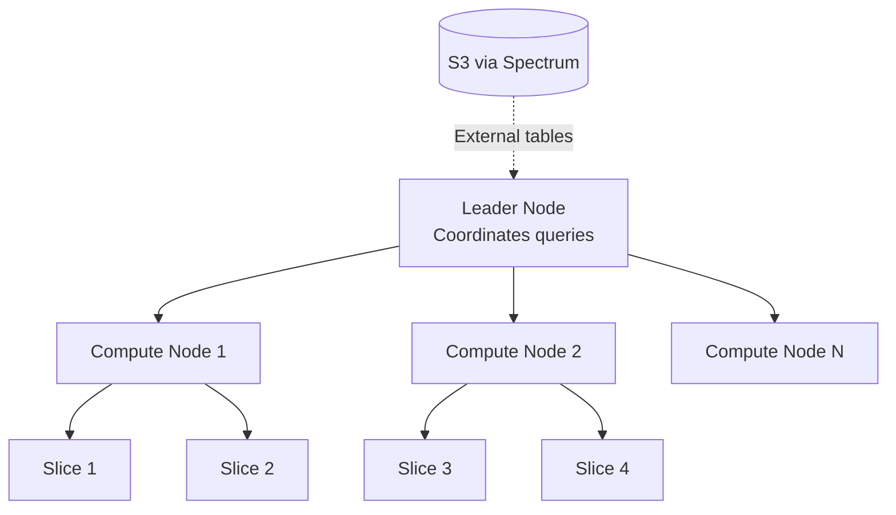
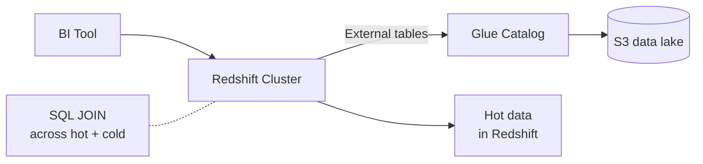

# Redshift — Data Warehouse

> 🔥 **Standard analytics question.** Know RA3, Serverless, Spectrum, and concurrency scaling.

## Problem It Solves
Operational databases (RDS, Aurora) are great for transactions but terrible at scanning billions of rows for analytics. Traditional data warehouses (Teradata, Oracle Exadata) are expensive and hard to scale. **Redshift is a columnar, MPP (Massively Parallel Processing) data warehouse** built for analytics workloads — petabyte-scale, fast queries, fits AWS ecosystem.

## How It Works



### Key Concepts

```
LEADER NODE:
─────────────────────────────────────────────
Parses queries, plans execution, distributes to compute nodes
Aggregates results
Single point of coordination

COMPUTE NODES:
─────────────────────────────────────────────
Hold data, do the actual processing
Each split into "slices" (parallel processing units)
Scale by adding more nodes

COLUMNAR STORAGE:
─────────────────────────────────────────────
Data stored by column (not row)
✅ Compresses well (same data type per column)
✅ Reads only needed columns (faster scans)
✅ Perfect for aggregations: SELECT SUM(sales) ...
```

### 🧠 Intuition (the "why" behind it)

```
COLUMNAR MENTAL MODEL:
─────────────────────────────────────────────
Think of it as: all names grouped, all ages grouped,
all emails grouped — each column stored as its own unit.
(NOT literally separate tables, but conceptually like it.)

Query "average age" → reads ONLY the age column,
skips every other column → far less data scanned.
Row storage would force reading every full row.

⚠️ TRADE-OFF:
Need name + age together? Redshift fetches BOTH
columns and stitches them back → the columnar win
SHRINKS when a query needs most/all columns.
Columnar shines when you touch FEW columns.

PARALLEL FETCH:
─────────────────────────────────────────────
Leader splits the query → every compute node (and
its slices) work on their OWN chunk AT THE SAME TIME
→ results aggregate back at the leader.
10 nodes = 10 chunks processed simultaneously = fast.

OLAP vs OLTP (when to reach for it):
─────────────────────────────────────────────
Live e-commerce taking orders  → RDS/Aurora (OLTP)
Analyzing millions of PAST orders for trends → Redshift (OLAP)
Structured data only. Unstructured (images/video) → S3.
(Semi-structured JSON is possible but not the sweet spot.)

HIGH AVAILABILITY (differs from RDS):
─────────────────────────────────────────────
NOT active primary/secondary like RDS Multi-AZ.
Single cluster per region; DR = cross-region snapshot copy,
restore into a NEW cluster on disaster.
```

---

## Redshift Node Types

```
RA3 NODES (recommended for new clusters):
─────────────────────────────────────────────
- Compute and storage SEPARATED
- Storage in S3 (managed)
- Local SSD = cache only
- Scale compute and storage independently
- Sizes: ra3.xlplus, ra3.4xlarge, ra3.16xlarge

DC2 NODES (legacy SSD):
─────────────────────────────────────────────
- Compute + local SSD storage
- For small workloads (< few hundred GB)
- Cheaper than RA3 for small data
- New deployments: prefer RA3

DS2 NODES (LEGACY HDD):
─────────────────────────────────────────────
- Don't use — RA3 always better
```

```
EXAM TIP:
─────────────────────────────────────────────
✅ Use RA3 — compute and storage separation = the modern way
✅ DC2 only for tiny workloads
```

---

## Redshift Serverless — No Cluster Management

```
REDSHIFT SERVERLESS:
─────────────────────────────────────────────
✅ No cluster to manage
✅ Auto-scales compute (RPUs - Redshift Processing Units)
✅ Pay per second of query execution
✅ Storage paid separately (same as RA3)
✅ Same SQL and features as provisioned

USE WHEN:
─────────────────────────────────────────────
✅ Variable/unpredictable workload
✅ Dev/test environments
✅ Don't want to plan capacity
✅ Smaller / occasional workloads

DON'T USE WHEN:
─────────────────────────────────────────────
❌ Steady, predictable 24/7 workload (Provisioned + RIs cheaper)
❌ Need fine-grained workload management (Provisioned)
```

---

## Redshift Spectrum — Query S3 Directly



```
SPECTRUM:
─────────────────────────────────────────────
✅ Query data in S3 directly from Redshift
✅ Use Glue Catalog (same as Athena)
✅ JOIN S3 data with Redshift tables
✅ Pay $5/TB scanned (same as Athena)
✅ No data movement needed

PATTERN:
─────────────────────────────────────────────
HOT DATA in Redshift cluster (last 90 days)
COLD DATA in S3 Parquet
Spectrum joins them transparently
✅ Reduces cluster size needed
✅ Reduces cost
✅ Same SQL queries work
```

### Spectrum vs Athena

```
ATHENA:
─────────────────────────────────────────────
- Pure serverless
- No cluster needed
- For ad-hoc, exploratory

SPECTRUM:
─────────────────────────────────────────────
- Extends a Redshift cluster
- For when you ALSO have warehouse data
- Combine hot + cold in single query
```

---

## Loading Data into Redshift

```
COPY COMMAND (best practice):
─────────────────────────────────────────────
COPY tablename
FROM 's3://bucket/data/'
IAM_ROLE 'arn:aws:iam::...:role/RedshiftLoad'
FORMAT AS PARQUET;

✅ Parallel load across all slices
✅ Compressed Parquet ideal
✅ S3 + Redshift in same region = free transfer

INGEST PATTERNS:
─────────────────────────────────────────────
1. Batch: Kinesis Firehose → S3 → COPY → Redshift
2. CDC: DMS → Redshift directly
3. Streaming Ingest: Kinesis → Redshift (newer feature)
4. Auto Copy: Auto-COPY from S3 path
```

---

## Workload Management (WLM)

```
WORKLOAD MANAGEMENT:
─────────────────────────────────────────────
Divide cluster resources between query queues:
- ETL queue (heavy loads)
- Reporting queue (analyst queries)
- BI queue (dashboard queries)

AUTOMATIC WLM (recommended):
─────────────────────────────────────────────
Redshift auto-manages priorities
Just set query priority labels

MANUAL WLM:
─────────────────────────────────────────────
Fixed memory % and concurrency per queue
For specialized tuning
```

---

## Concurrency Scaling

```
PROBLEM:
─────────────────────────────────────────────
Dashboard hits cluster at 9 AM → queue builds
Users wait, complain

SOLUTION — CONCURRENCY SCALING:
─────────────────────────────────────────────
Redshift transparently spins up extra compute
to handle overflow queries
Auto-scales DOWN when queue clears

FREE TIER:
─────────────────────────────────────────────
✅ 1 hour FREE per day of concurrency scaling
✅ Often enough for most workloads
✅ Beyond that, pay per second
```

---

## Redshift Data Sharing

```
DATA SHARING:
─────────────────────────────────────────────
Share LIVE data from one Redshift cluster
to another (or to Serverless) without copying

CROSS-ACCOUNT, CROSS-REGION:
─────────────────────────────────────────────
✅ Producer cluster owns the data
✅ Consumer clusters get read-only access
✅ No data duplication
✅ Live updates visible to consumers

USE:
─────────────────────────────────────────────
✅ Centralized data team owns warehouse,
   business units consume read-only
✅ Multi-cluster architecture for isolation
```

---

## Redshift Federated Queries

```
QUERY OPERATIONAL DBs DIRECTLY:
─────────────────────────────────────────────
Redshift can query RDS PostgreSQL/MySQL or Aurora live

USE:
─────────────────────────────────────────────
✅ Join warehouse data with current operational data
✅ Avoid copy/sync delays for some queries
✅ Reduces ETL complexity for some patterns
```

---

## Backups & Snapshots

```
AUTOMATED BACKUPS:
─────────────────────────────────────────────
✅ Continuous, incremental
✅ Stored in S3
✅ Retain 1-35 days
✅ Restore creates a NEW cluster

MANUAL SNAPSHOTS:
─────────────────────────────────────────────
✅ User-triggered, retained until deleted
✅ Can be copied to other regions
✅ Cross-account share supported

DISASTER RECOVERY:
─────────────────────────────────────────────
Configure cross-region snapshot copy
On disaster: restore in DR region
```

---

## Redshift vs Athena vs EMR

| | **Redshift** | **Athena** | **EMR** |
|---|---|---|---|
| Type | Data warehouse | Serverless SQL on S3 | Big data framework |
| Data location | Cluster + S3 (Spectrum) | S3 only | S3 / HDFS |
| Pricing | Per node-hour (or RPU-sec) | Per TB scanned | Per cluster-hour or per-DPU |
| Best for | BI dashboards, repeated queries | Ad-hoc exploration | Heavy ETL, Spark/Hadoop |
| SQL only | Yes | Yes | No — many engines |
| Latency | Optimized for query speed | Higher (scans S3 each time) | Depends on workload |

### How EMR Works (quick note)

```
EMR = Elastic MapReduce
─────────────────────────────────────────────
Spins up a CLUSTER of EC2 instances running
Spark / Hadoop. Submit a job → work spread across
nodes in parallel → cluster can shut down after,
pay only for what you used.

KEY DISTINCTION vs Redshift:
EMR = PROCESSING & TRANSFORMING data (ETL, ML).
Redshift = QUERYING data (SQL analytics).
Athena = serverless SQL on S3, no cluster.
```

## When to Use Redshift

| Scenario | Solution |
|---|---|
| BI dashboards (Tableau, QuickSight) | **Redshift** |
| Variable analytics workload | **Redshift Serverless** |
| Join warehouse + data lake | **Redshift + Spectrum** |
| Centralized analytics shared across teams | **Redshift Data Sharing** |
| Join warehouse with live RDS | **Federated Queries** |
| Need < 100ms query latency | ❌ Use Aurora (Redshift not for OLTP) |
| Ad-hoc S3 exploration | ❌ Use Athena |
| Complex Spark/ML ETL | ❌ Use EMR |

## When NOT to Use Redshift

- ❌ OLTP / transactional — Redshift is OLAP-only
- ❌ Single-record lookups by primary key — use Aurora/DDB
- ❌ Real-time updates (use streaming + materialized views instead)
- ❌ Tiny workloads (< 10 GB) — Athena cheaper

## Trade-offs

| Choice | Gain | Sacrifice |
|---|---|---|
| RA3 over DC2 | Storage scales independently | Slightly more $ for small workloads |
| Serverless over Provisioned | No capacity planning | More $ at steady high load |
| Spectrum | Query S3 transparently | Higher latency than native tables |
| Data Sharing | No data copy across clusters | Adds complexity |
| Concurrency Scaling | Handle traffic spikes | Cost beyond free tier |

## Real World Example

**A media company:**
- **Redshift RA3** cluster — 6 nodes, 100 TB total
- Hot data (last 6 months) in Redshift native tables
- Older data (5+ years) in S3 Parquet, queried via **Spectrum**
- **Concurrency Scaling** for morning dashboard rush
- **Data Sharing** with subsidiary BI clusters
- **QuickSight** dashboards on top
- **DMS** continuously replicates from Aurora (operational) into Redshift

**Pinterest:**
- Massive Redshift deployment for analytics
- Moved to **RA3** to handle data growth independently of compute
- Federated queries to keep some operational data joinable
- Uses Spectrum heavily for cost-effective historical data

## 🎯 Exam Soundbite

> "Redshift is a columnar MPP data warehouse for petabyte-scale analytics. Use RA3 node types to scale compute and storage independently — storage is in managed S3. Use Redshift Serverless for variable workloads with no capacity planning. Use Redshift Spectrum to query S3 directly and join data lake content with warehouse tables. For ad-hoc S3 queries without a cluster, use Athena; for heavy Spark or Hadoop workloads, use EMR. Concurrency Scaling handles transient load spikes with 1 hour free per day."

---

## ⚡ Quick Recall Card

```
┌─────────────────────────────────────────────────┐
│ REDSHIFT KEY FACTS                               │
├─────────────────────────────────────────────────┤
│ Type                Columnar MPP warehouse       │
│ Modern node type    RA3 (compute + S3 storage)   │
│ Serverless          Pay per RPU-second           │
│ Spectrum            Query S3 from Redshift       │
│ Data Sharing        Live share across clusters   │
│ Federated queries   Query RDS/Aurora live        │
│ Concurrency Scaling 1 hour/day free              │
│ Load command        COPY from S3 (parallel)      │
│ Best load format    Parquet (columnar)           │
│ Backups             1-35 days retention          │
│ Cross-region DR     Snapshot copy                │
└─────────────────────────────────────────────────┘
```

## 🎓 Common Exam Pattern

> **"Have 1 PB in S3 + 50 TB in Redshift. Want to JOIN them without copying S3 data into the cluster."**
>
> ✅ **Redshift Spectrum** — external tables on S3 (via Glue Catalog), joined in SQL with native Redshift tables. No data movement, pay per TB scanned on the S3 side.

> **"Analytics queries are unpredictable — sometimes idle for days, sometimes heavy. Want to avoid paying for unused cluster capacity."**
>
> ✅ **Redshift Serverless** — pay per second of query execution. No cluster to manage.
