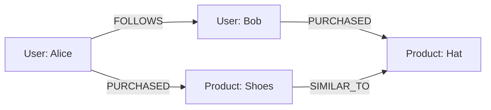
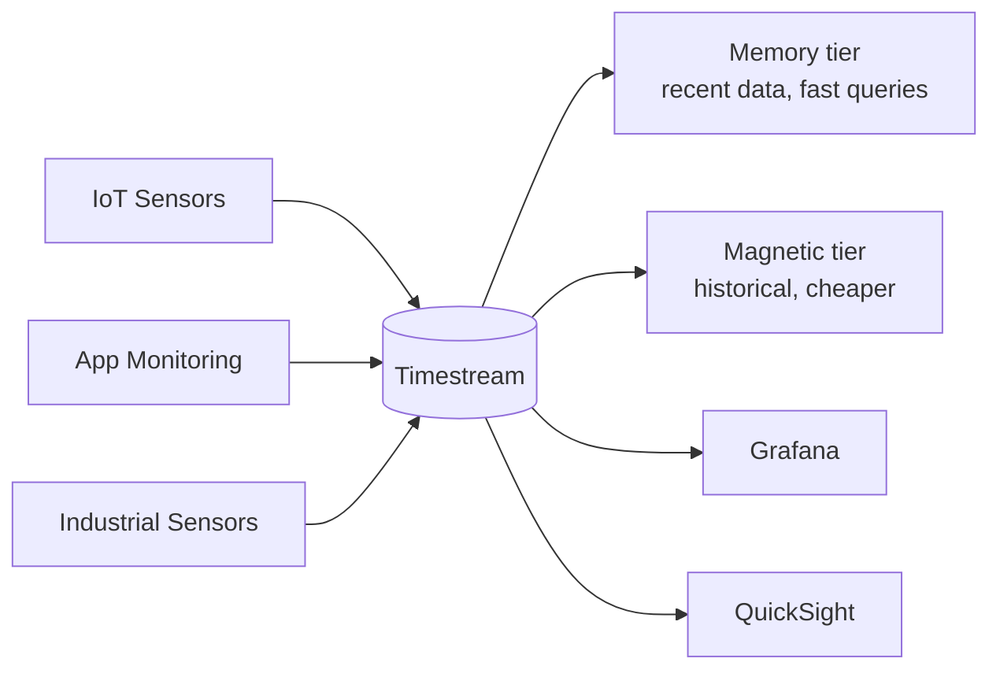
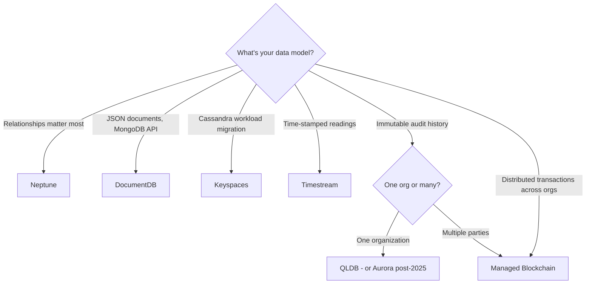

# Specialized Databases — Neptune, DocumentDB, Keyspaces, Timestream, QLDB

> 🔥 **SAP-C02 loves "purpose-built database" questions.** Know one-line use cases for each.

## Problem It Solves
Some data doesn't fit relational or generic key-value patterns. Forcing it into one mangles performance, cost, and developer experience. AWS offers **purpose-built databases** for graph relationships, MongoDB compatibility, Cassandra workloads, time-series data, and immutable ledgers.

---

## Amazon Neptune — Graph Database



```
WHAT IS GRAPH?
─────────────────────────────────────────────
Data modeled as NODES (entities) connected by EDGES (relationships)
Both nodes and edges can have properties

NEPTUNE FEATURES:
─────────────────────────────────────────────
✅ Property Graph (Apache TinkerPop / Gremlin)
✅ RDF (W3C, SPARQL queries)
✅ openCypher (similar to Neo4j)
✅ Fully managed, auto-scaling, multi-AZ
✅ Up to 15 read replicas
✅ Cross-region replication
✅ Encryption at rest + in transit

USE CASES:
─────────────────────────────────────────────
✅ Social networks (friend-of-friend)
✅ Fraud detection (suspicious connection patterns)
✅ Recommendation engines (collaborative filtering)
✅ Knowledge graphs (entities + relationships)
✅ Identity & access management graphs
✅ Network topology / IT asset graphs

NEPTUNE ANALYTICS (newer):
─────────────────────────────────────────────
For graph analytics workloads, ML on graphs
Faster bulk algorithms (PageRank, shortest paths)
```

---

## Amazon DocumentDB — MongoDB Compatible

```
DOCUMENT DATABASE:
─────────────────────────────────────────────
Stores JSON-like documents with flexible schemas
Each document can have different fields

DOCUMENTDB FEATURES:
─────────────────────────────────────────────
✅ MongoDB API 3.6/4.0/5.0 compatible
✅ Fully managed (storage auto-grows)
✅ Up to 15 read replicas, multi-AZ
✅ Same Aurora-style architecture (shared storage)
✅ NOT 100% feature parity with MongoDB

⚠️ KEY DIFFERENCE FROM MONGODB:
─────────────────────────────────────────────
DocumentDB is built on AWS, not the open-source MongoDB
Some commands and edge cases differ
Test compatibility BEFORE migrating

USE:
─────────────────────────────────────────────
✅ Existing MongoDB workloads being migrated
✅ Need MongoDB API but don't want to self-manage
✅ Greenfield document-oriented apps (consider DynamoDB)
```

---

## Amazon Keyspaces — Cassandra Compatible

```
WIDE-COLUMN DATABASE:
─────────────────────────────────────────────
Cassandra-style data model: rows with potentially many columns,
optimized for high write throughput

KEYSPACES FEATURES:
─────────────────────────────────────────────
✅ Apache Cassandra (CQL) compatible
✅ Serverless — auto-scaling capacity
✅ Provisioned mode also available
✅ Encryption at rest, in transit
✅ Point-in-Time Recovery
✅ Multi-AZ by default

USE:
─────────────────────────────────────────────
✅ Lift-and-shift from on-prem Cassandra
✅ Existing CQL applications
✅ High-throughput write workloads
✅ Time-series-ish data with partition keys

⚠️ DON'T USE FOR GREENFIELD:
─────────────────────────────────────────────
DynamoDB is usually a better choice for new apps:
- Cheaper
- More AWS integration
- Better tooling
Keyspaces is mainly for "we already have Cassandra" scenarios
```

---

## Amazon Timestream — Time-Series



```
TIMESTREAM PURPOSE:
─────────────────────────────────────────────
Optimized for time-stamped data:
- IoT telemetry (millions of sensors)
- Application metrics
- Industrial measurements
- Stock market data

ARCHITECTURE:
─────────────────────────────────────────────
Two-tier storage:
- MEMORY: Recent data (latest hours-days), fast queries
- MAGNETIC: Older data, cheaper, slower queries
Auto-tiers data based on lifecycle policy

KEY FEATURES:
─────────────────────────────────────────────
✅ Serverless — auto-scales ingestion + queries
✅ SQL-based queries (LIVE Analytics)
✅ Built-in time-series functions
   (last(), first(), interpolate(), bin())
✅ Up to 1000x faster than relational DB on time-series
✅ Up to 1/10 the cost of relational
✅ Encryption at rest + in transit

NEW: TIMESTREAM FOR INFLUXDB:
─────────────────────────────────────────────
Managed InfluxDB OSS — same API as influxdb.com
For workloads expecting InfluxDB compatibility

USE:
─────────────────────────────────────────────
✅ IoT device telemetry at scale
✅ DevOps metrics that exceed CloudWatch limits
✅ Industrial IoT, smart cities, fleets
✅ ANY data where time is the primary dimension

DON'T USE FOR:
─────────────────────────────────────────────
❌ Transactional data with relationships
❌ Small data (< few GB) — CloudWatch sufficient
```

---

## Amazon QLDB — Quantum Ledger Database

```
LEDGER DATABASE:
─────────────────────────────────────────────
Immutable, append-only, cryptographically verifiable
Every change is recorded with hash chain (like blockchain
but centralized — you trust AWS)

QLDB FEATURES:
─────────────────────────────────────────────
✅ Immutable, no UPDATE/DELETE — only new versions
✅ Cryptographic verification (SHA-256 chain)
✅ Built-in audit log
✅ PartiQL — SQL-like query language
✅ Full history of every record
✅ Streams to Kinesis for downstream processing

USE CASES:
─────────────────────────────────────────────
✅ Financial transactions (bank ledger)
✅ Supply chain (immutable provenance)
✅ Healthcare records (audit-compliant)
✅ Insurance claims (tamper-proof history)
✅ Regulatory compliance audit trails

QLDB vs BLOCKCHAIN:
─────────────────────────────────────────────
QLDB: Centralized, AWS-managed, no consensus
Blockchain (AMB): Decentralized, multi-party trust
Use QLDB when one party owns the ledger.
Use Blockchain when multiple untrusted parties need consensus.

⚠️ DEPRECATION NOTICE:
─────────────────────────────────────────────
AWS announced QLDB end of support July 2025.
Migrate to Aurora PostgreSQL.
But the EXAM may still test QLDB as a concept.
```

---

## Amazon Managed Blockchain

```
WHEN MULTIPLE UNTRUSTED PARTIES NEED CONSENSUS:
─────────────────────────────────────────────
Frameworks supported:
- Hyperledger Fabric (consortium chains)
- Ethereum (public chain access)

USE:
─────────────────────────────────────────────
✅ Multi-org supply chain tracking
✅ Trade finance with multiple banks
✅ Cross-organization records
✅ Decentralized identity

vs QLDB:
─────────────────────────────────────────────
QLDB = one organization's ledger
Blockchain = multiple organizations need consensus
```

---

## Decision Tree



---

## Quick Comparison Table

| Service | Data Model | Best For | Pricing Model |
|---|---|---|---|
| **Neptune** | Graph | Recommendations, fraud, social | Per node-hour |
| **DocumentDB** | Document (JSON) | MongoDB lift-and-shift | Per instance-hour |
| **Keyspaces** | Wide-column | Cassandra migration | Serverless or Provisioned |
| **Timestream** | Time-series | IoT, metrics, sensors | Per write + per query |
| **QLDB** | Ledger / Immutable | Financial, audit | Per request |
| **Blockchain** | DLT | Multi-org consensus | Per node-hour |

---

## When to Pick What — Decision Examples

### Example 1: Recommendation Engine

> "Build 'users who bought X also bought Y' feature with millions of users."

✅ **Neptune** — graph traversals naturally model these relationships.
- Alternative: DynamoDB with custom precomputed lists, but Neptune is purpose-built.

---

### Example 2: Migrating from MongoDB

> "Have a MongoDB 5.0 cluster on-prem, want managed AWS version."

✅ **DocumentDB** — compatible API, fully managed.
- Test compatibility — not 100% feature-parity with MongoDB.
- Alternative: stay on EC2 with self-managed MongoDB, or rewrite for DynamoDB (greenfield).

---

### Example 3: IoT Telemetry from 100k Sensors

> "Each sensor sends 1 reading/min. Need to query trends over months."

✅ **Timestream** — purpose-built, columnar storage, time-series functions, cheap.
- Alternative: DynamoDB (works but more expensive at scale, less ergonomic for time-series queries).

---

### Example 4: Bank Transaction Ledger

> "Need provable, immutable history of every transaction for regulatory audit."

✅ **QLDB** (until 2025) or **Aurora with append-only design** + cryptographic hashes.
- Alternative: write transactions to S3 with Object Lock in Compliance Mode (cheaper, simpler).

---

### Example 5: Cassandra App Lift-and-Shift

> "Have a Cassandra-based application on-prem, want managed AWS service."

✅ **Keyspaces** — CQL compatible, managed.
- Alternative: rewrite app for DynamoDB if greenfield.

---

### Example 6: Supply Chain Across 5 Companies

> "5 different companies need shared, trustless audit of shipments."

✅ **Managed Blockchain (Hyperledger Fabric)** — decentralized consensus across orgs.
- QLDB doesn't fit — only one org owns the ledger.

---

## Real World Example

**A logistics company** uses multiple specialized DBs:
- **Neptune** for shipment routing optimization (graph of warehouses, routes, vehicles)
- **Timestream** for vehicle telemetry (GPS, fuel, temperature every 5 sec from 10k vehicles)
- **Aurora PostgreSQL** for order management (relational)
- **DynamoDB** for tracking page (high-traffic public lookups)
- **Managed Blockchain** for shared logistics record with customers and carriers

## 🎯 Exam Soundbite

> "AWS offers purpose-built databases: Neptune for graph relationships like social networks and fraud detection; DocumentDB for MongoDB-compatible document workloads; Keyspaces for Cassandra workloads; Timestream for time-series data like IoT telemetry; QLDB for immutable cryptographically-verified ledgers within a single organization; and Managed Blockchain for multi-organization consensus. Always pick the database whose data model matches the workload — don't force everything into RDS or DynamoDB."

---

## ⚡ Quick Recall Card

```
┌─────────────────────────────────────────────────┐
│ SPECIALIZED DBs                                  │
├─────────────────────────────────────────────────┤
│ Neptune       Graph (Gremlin / SPARQL / Cypher)  │
│ DocumentDB    MongoDB API compatible             │
│ Keyspaces     Cassandra CQL compatible           │
│ Timestream    Time-series (IoT, metrics)         │
│ QLDB          Immutable ledger (one org)         │
│ Blockchain    Multi-org consensus DLT            │
├─────────────────────────────────────────────────┤
│ DECISION SIGNALS                                 │
│ "Recommendations"          → Neptune             │
│ "Fraud detection patterns" → Neptune             │
│ "MongoDB compatible"       → DocumentDB          │
│ "Cassandra workload"       → Keyspaces           │
│ "IoT sensor data"          → Timestream          │
│ "Time-series at scale"     → Timestream          │
│ "Immutable audit"          → QLDB (or S3+Lock)   │
│ "Multi-party trustless"    → Blockchain          │
└─────────────────────────────────────────────────┘
```

## 🎓 Common Exam Patterns

> **"Fraud detection: need to traverse relationships like 'cards used by this device, accounts using those cards, devices for those accounts'."**
>
> ✅ **Neptune** — graph traversal is the natural pattern; doing this in SQL with recursive CTEs becomes painful at scale.

> **"100,000 wind turbines reporting 50 metrics each every minute. Need to query last 24 hours, last 30 days, last year."**
>
> ✅ **Timestream** — purpose-built for time-series, columnar, multi-tier storage (memory + magnetic), built-in time-series functions.
