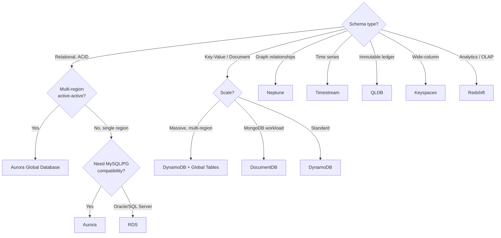

# 04 — Databases & Caching

> **Exam weight:** ⭐⭐⭐⭐ — Aurora Global vs DynamoDB Global Tables is a top SAP-C02 scenario. Know your database engine choices cold.

---

## 🗺️ Topic Map

```mermaid
graph TD
    A[Databases & Caching]
    A --> B[Relational - RDS/Aurora]
    A --> C[NoSQL - DynamoDB]
    A --> D[In-Memory - ElastiCache]
    A --> E[Data Warehouse - Redshift]
    A --> F[Specialized]
    
    B --> B1[RDS: MySQL, PG, Oracle, SQL Server, MariaDB]
    B --> B2[Aurora: MySQL/PG compatible]
    B --> B3[Aurora Serverless v2]
    B --> B4[Aurora Global Database]
    
    C --> C1[DynamoDB On-Demand vs Provisioned]
    C --> C2[Global Tables]
    C --> C3[DAX - Accelerator]
    C --> C4[Streams]
    
    D --> D1[Redis: rich features]
    D --> D2[Memcached: simple cache]
    
    E --> E1[Redshift cluster types]
    E --> E2[Redshift Serverless]
    E --> E3[RA3 + S3 separation]
    
    F --> F1[Neptune - Graph]
    F --> F2[DocumentDB - MongoDB compat]
    F --> F3[Keyspaces - Cassandra compat]
    F --> F4[Timestream - time series]
    F --> F5[QLDB - immutable ledger]
    F --> F6[MemoryDB - durable Redis]
```



---

## 📚 Notes in This Section

| # | Topic | Priority |
|---|---|---|
| 01 | [RDS — Multi-AZ, Read Replicas, Performance](./01-rds.md) | 🔥 |
| 02 | [Aurora Deep Dive — Global, Serverless](./02-aurora.md) | 🔥 |
| 03 | [DynamoDB — Design Patterns & Scaling](./03-dynamodb.md) | 🔥 |
| 04 | [DynamoDB Global Tables & Streams](./04-dynamodb-global.md) | 🔥 |
| 05 | [ElastiCache — Redis vs Memcached](./05-elasticache.md) | High |
| 06 | [Redshift — Data Warehouse](./06-redshift.md) | High |
| 07 | [Specialized Databases](./07-specialized-dbs.md) | Medium |

---

## 🎯 The Database Decision Framework



### SQL vs NoSQL on AWS

| Decision Factor | SQL (RDS/Aurora) | NoSQL (DynamoDB) |
|---|---|---|
| Schema | Fixed, relations | Flexible, key-value/document |
| Queries | Complex JOINs, aggregations | Simple key-based |
| Scale | Vertical (read replicas for horizontal reads) | Horizontal (auto) |
| Consistency | Strong (ACID) | Eventually consistent default; strong optional |
| Multi-region | Aurora Global (read replicas only by default) | Global Tables (active-active) |
| Use cases | OLTP, financial, anything needing JOINs | High-scale, simple access patterns, IoT |

---

## 🎯 The 5 Database Concepts SAP-C02 Loves

```
1. AURORA GLOBAL vs DYNAMODB GLOBAL TABLES
   Aurora Global = active-passive (writes to one region)
   DynamoDB GT   = active-active (writes any region)

2. RDS MULTI-AZ vs READ REPLICAS
   Multi-AZ = synchronous standby (HA, not scale)
   Read Replica = asynchronous (scale reads)
   Can combine: Multi-AZ + Read Replicas

3. DYNAMODB CAPACITY MODES
   On-Demand   = pay per request, no planning, instant scale
   Provisioned = cheaper if predictable, with Auto Scaling

4. ELASTICACHE REDIS vs MEMCACHED
   Redis     = rich features (Pub/Sub, Sorted sets, persistence, replication, multi-AZ)
   Memcached = simple cache, multi-threaded, no persistence

5. AURORA SERVERLESS v2 (the new default)
   Sub-second scaling, fine-grained ACU units
   Use for variable / unpredictable workloads
```
