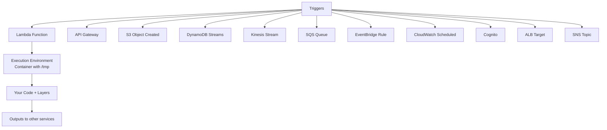
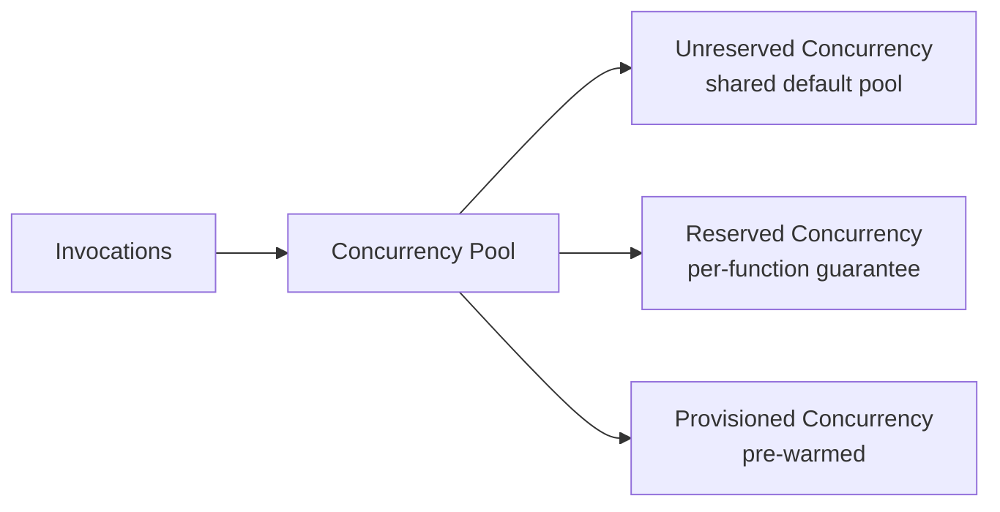
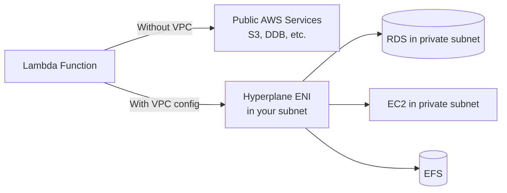
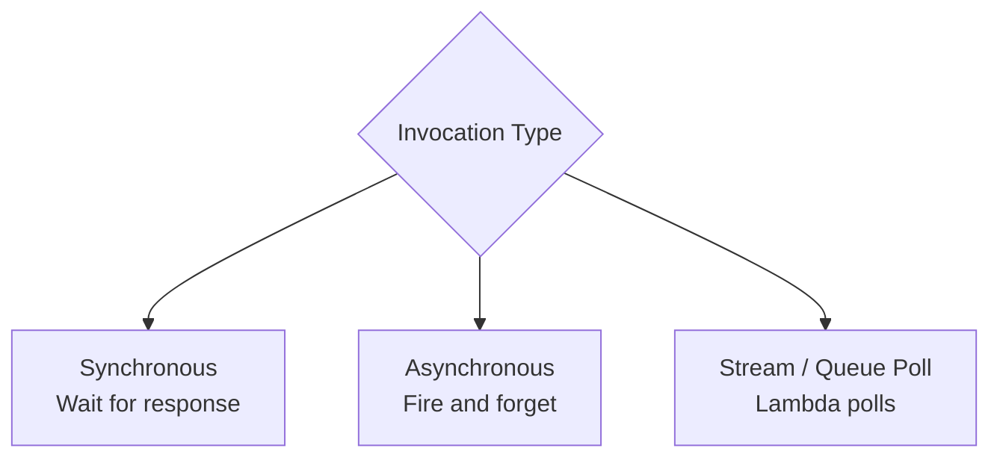
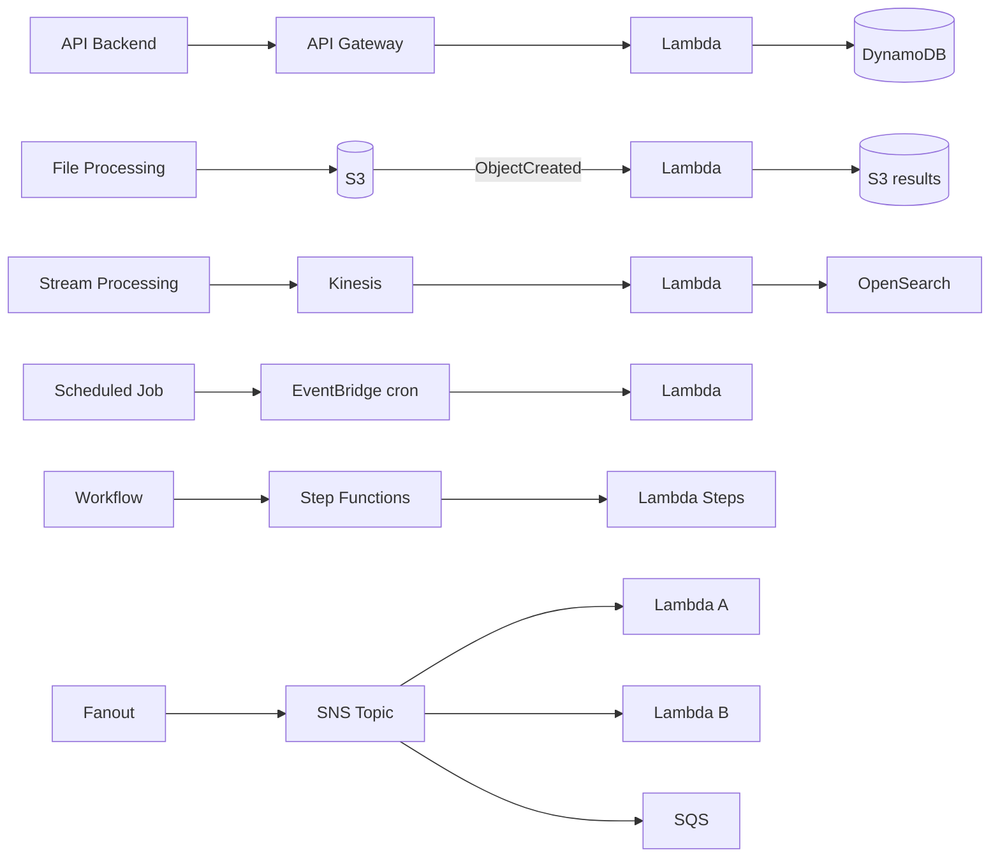

# Lambda Fundamentals & Patterns

> 🔥 **Lambda is everywhere on SAP-C02.** Know concurrency, VPC, integration patterns, and limits.

## Problem It Solves
Running code for short-lived events (API responses, file uploads, stream records, scheduled jobs) on always-on EC2 wastes money. **Lambda runs code only when needed** — pay per millisecond of execution, auto-scales to thousands of parallel invocations, no servers to manage.

## How It Works



### Core Lambda Concepts

```
┌────────────────────────────────────────────────────────────┐
│ FUNCTION                                                    │
│   Code package + configuration                             │
│   Languages: Node, Python, Java, Go, .NET, Ruby, custom    │
│              runtimes (via Layers)                         │
├────────────────────────────────────────────────────────────┤
│ MEMORY                                                      │
│   128 MB to 10,240 MB (10 GB)                              │
│   CPU scales with memory (no separate CPU setting)         │
│   More memory = often faster (also more cost per second)   │
├────────────────────────────────────────────────────────────┤
│ TIMEOUT                                                     │
│   1 second to 900 seconds (15 minutes)                     │
│   For longer workloads: Step Functions or Fargate          │
├────────────────────────────────────────────────────────────┤
│ EPHEMERAL STORAGE (/tmp)                                   │
│   512 MB default, configurable up to 10 GB                 │
│   Scratch space — wiped between invocations               │
├────────────────────────────────────────────────────────────┤
│ DEPLOYMENT PACKAGE                                          │
│   Zip up to 50 MB direct upload                            │
│   Zip up to 250 MB unzipped (via S3)                       │
│   Container image up to 10 GB                              │
├────────────────────────────────────────────────────────────┤
│ EXECUTION ROLE                                              │
│   IAM role assumed by Lambda                               │
│   Grants permissions to call other AWS services            │
└────────────────────────────────────────────────────────────┘
```

### Cold Starts vs Warm Starts

```
COLD START:
─────────────────────────────────────────────
1. Lambda receives first request (or after idle)
2. AWS provisions a new execution environment
3. Downloads code/image
4. Initializes runtime (~100ms to 1s+)
5. Runs your init code (top-level imports, etc.)
6. Finally invokes handler

Cold start time depends on:
- Runtime (Node/Python fast, Java/.NET slower)
- Package size
- VPC attachment (used to be slow, now < 1s)
- Memory size (more memory = often faster init)

WARM START:
─────────────────────────────────────────────
1. Lambda reuses existing environment
2. Skips init — just calls handler again
3. ~milliseconds invocation
```

### Concurrency Models



```
ACCOUNT CONCURRENCY LIMIT (default 1000):
─────────────────────────────────────────────
All Lambda invocations in account share this pool
Can request increase via support

RESERVED CONCURRENCY (per function):
─────────────────────────────────────────────
Sets a MAXIMUM number of concurrent executions
✅ Guarantees that quota for this function
✅ Throttles excessive invocations (protects DB downstream)
Set to 0 → effectively disable function

PROVISIONED CONCURRENCY:
─────────────────────────────────────────────
Pre-initialized execution environments
✅ NO cold starts for that many concurrent invokes
$ Pay for them whether used or not
Use: Latency-sensitive APIs, predictable traffic
Configure with Auto Scaling for cost optimization
```

### VPC Access — How Lambda Connects to Private Resources



```
WITHOUT VPC CONFIG (default):
─────────────────────────────────────────────
Lambda runs in AWS-managed VPC
Internet egress is free, fast
Can call public AWS APIs directly
✅ Best performance, simplest setup

WITH VPC CONFIG (when needed):
─────────────────────────────────────────────
Lambda gets a Hyperplane ENI in your subnet
Can access private resources (RDS, EFS, on-prem)
Cold starts used to be slow (~10s)
Now ~1s thanks to Hyperplane ENI architecture

⚠️ TRAP: When in VPC, no internet access UNLESS
   subnet has NAT Gateway. For AWS services,
   use VPC Endpoints (Gateway for S3/DDB, Interface for others).
```

### Lambda Layers — Reusable Code

```
LAYERS:
─────────────────────────────────────────────
A .zip with libraries / dependencies
Up to 5 layers per function
Total package + layers must be ≤ 250 MB unzipped

USE:
─────────────────────────────────────────────
Share common dependencies across many functions
Add custom runtimes (e.g. Rust)
Reduce deploy package size
```

### Lambda Destinations vs Dead Letter Queues (DLQ)

```
DESTINATIONS (newer, preferred):
─────────────────────────────────────────────
After async invocation, route success/failure to:
- SNS topic
- SQS queue  
- Lambda function
- EventBridge bus

Routes both ON_SUCCESS and ON_FAILURE
More flexible than DLQ

DEAD LETTER QUEUE (DLQ, legacy):
─────────────────────────────────────────────
SQS or SNS for failed invocations only
Older mechanism, still works
Lambda retries (twice for async) before sending to DLQ
```

### Invocation Models



```
SYNCHRONOUS:
─────────────────────────────────────────────
Caller waits for response
Use: API Gateway, ALB, direct invocation
Retries: Caller's responsibility

ASYNCHRONOUS:
─────────────────────────────────────────────
Caller doesn't wait
Lambda puts event in internal queue
Use: S3, SNS, EventBridge
Retries: Automatic (twice by default)
Then → Destination or DLQ if still failing

STREAM/QUEUE POLLING (Event Source Mapping):
─────────────────────────────────────────────
Lambda service polls source, batches events
Use: Kinesis, DynamoDB Streams, SQS, MSK, Kafka
Behavior: Process batch, checkpoint on success
Failure: Re-process batch or split it
```

### SQS Trigger Behavior

```
STANDARD SQS:
─────────────────────────────────────────────
Lambda polls and batches messages (up to 10,000)
Parallelism scales with queue depth (up to 1000 concurrent)
Failed batch goes back to queue
After visibility timeout, retried

FIFO SQS:
─────────────────────────────────────────────
Lambda processes messages in order per MessageGroupId
Lower throughput than Standard
```

### Common Lambda Patterns



### Common Limits

```
┌──────────────────────────────────────────────────────┐
│ LAMBDA LIMITS                                         │
├──────────────────────────────────────────────────────┤
│ Memory                  128 MB - 10,240 MB            │
│ Timeout                 15 minutes max                │
│ Payload (sync)          6 MB                          │
│ Payload (async)         256 KB                        │
│ /tmp                    512 MB - 10 GB                │
│ Package zip             50 MB direct / 250 MB S3      │
│ Container image         10 GB                         │
│ Env vars total          4 KB                          │
│ Layers per function     5                             │
│ Concurrent default      1000 per account              │
└──────────────────────────────────────────────────────┘
```

## When to Use Lambda

| Scenario | Solution |
|---|---|
| API backend < 15 min execution | **Lambda + API Gateway** |
| Process S3 uploads (resize, scan, transform) | **Lambda S3 trigger** |
| React to DDB changes | **Lambda + DynamoDB Streams** |
| Real-time stream processing | **Lambda + Kinesis** |
| Scheduled tasks (replace cron) | **Lambda + EventBridge** |
| Queue processor | **Lambda + SQS** |
| Microservice (stateless, < 15 min) | **Lambda** |
| Run code at edge | **Lambda@Edge** (CloudFront) |
| Customize Cognito flows | **Lambda Triggers** |

## When NOT to Use Lambda

- ❌ Long-running workloads (> 15 min) → **Fargate** or **Step Functions**
- ❌ Persistent connections (e.g. WebSocket server) → **ECS**/**App Runner**
- ❌ Heavy machine learning training → **SageMaker**/**EC2**
- ❌ High-memory in-memory workloads → **EC2 R-family**
- ❌ Cost-prohibitive at extreme scale (Lambda gets expensive at millions/min) → **Containers**

## Trade-offs

| Choice | Gain | Sacrifice |
|---|---|---|
| Lambda over EC2 | No servers, auto-scale, pay per ms | 15-min limit, cold starts |
| Provisioned Concurrency | No cold starts | Pay for idle |
| VPC config | Access private resources | Slight cold start overhead |
| Layers | Code reuse | Layer management complexity |
| Container image | Larger packages, custom runtimes | More setup than ZIP |

## Real World Example

**Coca-Cola Freestyle vending machines** use Lambda + IoT Core:
- Each machine sends telemetry → IoT Core
- IoT rule → Lambda → DynamoDB (state)
- Lambda → SNS → operations team (alerts)
- Lambda + EventBridge → daily aggregation reports

**iRobot (Roomba)** uses Lambda extensively:
- Each robot reports status → Lambda processes
- Cleaning maps stored in S3, processed by Lambda
- API Gateway + Lambda backend for mobile app
- Step Functions orchestrate firmware updates

## 🎯 Exam Soundbite

> "Lambda runs event-driven, stateless code without managing servers — pay per millisecond up to 15 minutes per invocation. Use Reserved Concurrency to limit a function's max parallelism, and Provisioned Concurrency to eliminate cold starts for latency-sensitive workloads. Attach functions to a VPC only when needed for private resource access. For workflows beyond 15 minutes, use Step Functions to orchestrate Lambda functions or switch to Fargate for long-running containers."

---

## ⚡ Quick Recall Card

```
┌─────────────────────────────────────────────────┐
│ LAMBDA KEY FACTS                                 │
├─────────────────────────────────────────────────┤
│ Max timeout            15 minutes                │
│ Max memory             10 GB                     │
│ Max package size       50 MB ZIP / 250 MB S3     │
│ Max container image    10 GB                     │
│ /tmp default           512 MB (up to 10 GB)      │
│ Account concurrency    1000 (request increase)   │
│ Reserved concurrency   Per-function cap          │
│ Provisioned conc       Pre-warmed, no cold start │
│ VPC cold start         ~1s (Hyperplane ENI)      │
│ DLQ → Destinations     Modern preferred          │
└─────────────────────────────────────────────────┘
```

## 🎓 Common Exam Pattern

> **"Lambda function takes too long for API responses. P95 latency = 800ms, of which 600ms is cold start. Needs P95 < 200ms."**
>
> ✅ Enable **Provisioned Concurrency** to keep N execution environments pre-warmed. Cold starts eliminated for first N concurrent invokes. Add Auto Scaling for Provisioned Concurrency based on traffic patterns.
