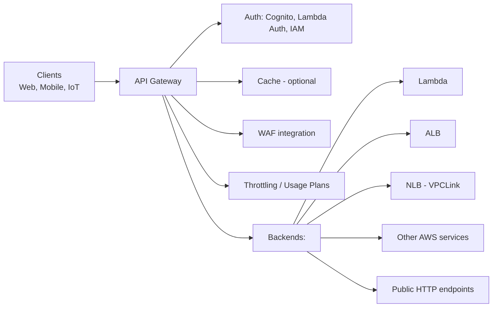
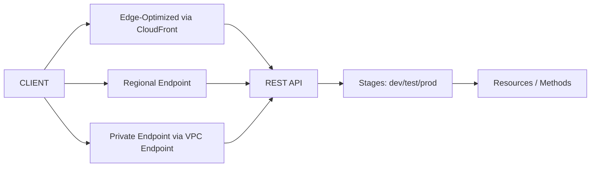
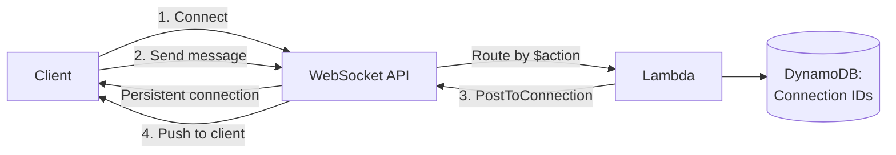
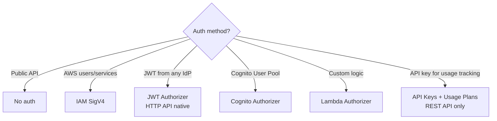

# API Gateway — Types & Patterns

> 🔥 **Common SAP-C02 question: pick REST vs HTTP vs WebSocket.** Know feature differences.

## Problem It Solves
Building an API requires: TLS termination, authentication, throttling, request transformation, monitoring, caching, versioning. Building this on EC2 is months of work. **API Gateway is managed API infrastructure** — bring your backend, get a production-ready API.

## How It Works



### Three API Types Side-by-Side

| | **REST API** | **HTTP API** | **WebSocket API** |
|---|---|---|---|
| Purpose | Full-featured RESTful | Lightweight, cheap REST | Bidirectional real-time |
| Cost | $3.50 per million calls | $1 per million (70% cheaper) | Per message + connection |
| Latency | Higher | Lower | Long-lived connection |
| Features | Full (transformations, validation, mock, etc.) | Subset (no transformations) | Connection management |
| Auth | All types | JWT, Lambda, IAM | IAM, Lambda |
| Caching | ✅ | ❌ | ❌ |
| Request validation | ✅ | ❌ | N/A |
| API Keys / Usage Plans | ✅ | ❌ | ❌ |
| Endpoint types | Edge / Regional / Private | Regional only | Regional only |
| Use case | Public APIs, complex needs | Simple Lambda backend | Chat, IoT, live updates |

```
QUICK PICK:
─────────────────────────────────────────────
Simple Lambda backend, lowest cost   → HTTP API
Complex API with transformations     → REST API
API keys + usage plans for monetization → REST API
Real-time client updates             → WebSocket API
Internal API in VPC only             → REST API (Private)
Edge-optimized global API            → REST API (Edge)
```

---

## REST API — Full Features



### REST API Endpoint Types

```
EDGE-OPTIMIZED:
─────────────────────────────────────────────
- Default for REST APIs
- Routes via CloudFront edge locations
- BEST for: Global APIs

REGIONAL:
─────────────────────────────────────────────
- Direct to API Gateway region
- BEST for: Mostly same-region clients
- Combine with CloudFront if needed

PRIVATE:
─────────────────────────────────────────────
- Accessible only via VPC Endpoint
- BEST for: Internal APIs not exposed to internet
```

### REST API Powerful Features

```
REQUEST/RESPONSE TRANSFORMATIONS:
─────────────────────────────────────────────
Use Velocity Template Language (VTL) to:
- Reshape JSON before forwarding to backend
- Transform response before returning to client
- Map URL params to backend params

REQUEST VALIDATION:
─────────────────────────────────────────────
Validate body against JSON Schema
Validate query parameters
Reject invalid requests at gateway (no Lambda invoke)

MOCK INTEGRATIONS:
─────────────────────────────────────────────
Return hard-coded responses (no backend)
Use: Front-end devs working before backend ready

CANARY DEPLOYMENTS:
─────────────────────────────────────────────
Route % of traffic to new stage version
Monitor metrics before full rollout

USAGE PLANS + API KEYS:
─────────────────────────────────────────────
Monetize APIs — different tiers (free, basic, premium)
Throttle per key
Track usage per customer
```

---

## HTTP API — Modern Lightweight

```
HTTP API STRENGTHS:
─────────────────────────────────────────────
✅ ~70% cheaper than REST API
✅ Lower latency (~60% reduction)
✅ Native JWT authorizer (no Lambda needed)
✅ CORS configuration built-in
✅ Auto-deployment
✅ Stage variables

HTTP API LIMITATIONS:
─────────────────────────────────────────────
❌ No request/response transformations
❌ No request validation
❌ No usage plans / API keys
❌ No caching
❌ No WAF integration (until recently)

USE WHEN:
─────────────────────────────────────────────
✅ Simple Lambda backend
✅ Cost-sensitive
✅ Don't need transformations
✅ Modern apps with JWT auth (Cognito, Auth0)
```

---

## WebSocket API — Real-Time



```
WEBSOCKET FEATURES:
─────────────────────────────────────────────
✅ Bidirectional communication
✅ Long-lived connections
✅ Route messages by route key ($connect, $disconnect, custom)
✅ Lambda processes each message
✅ "ManagementApi.PostToConnection" pushes to client

CONNECTION MANAGEMENT:
─────────────────────────────────────────────
Each connection gets a unique connectionId
Store connectionId in DynamoDB linked to userId/roomId
On disconnect, remove from DDB
To broadcast: query DDB, PostToConnection for each

USE CASES:
─────────────────────────────────────────────
✅ Chat applications
✅ Real-time gaming
✅ Live dashboards (stock prices, scores)
✅ IoT command/control
✅ Collaborative apps (Google Docs-style)
```

---

## Authentication Options



### Lambda Authorizer Pattern

```
PURPOSE:
─────────────────────────────────────────────
Custom authentication logic before backend invocation.
The Lambda returns:
- Effect: Allow / Deny
- Policy document
- Context (user info passed to backend)

USE:
─────────────────────────────────────────────
✅ Validate tokens from non-Cognito IdP
✅ Check custom token formats
✅ Look up user in DynamoDB / external DB
✅ Per-route or per-method authorization

CACHING:
─────────────────────────────────────────────
Result cached by token (default 5 min)
Reduces Lambda invocations for repeated calls
```

---

## Throttling & Quotas

```
ACCOUNT-LEVEL THROTTLING:
─────────────────────────────────────────────
Default: 10,000 RPS per region
Burst: 5,000 RPS
Can request increase

STAGE-LEVEL THROTTLING:
─────────────────────────────────────────────
Set lower limits per stage (dev/test/prod)

PER-METHOD THROTTLING:
─────────────────────────────────────────────
Different limits per resource/method

USAGE PLANS (REST API):
─────────────────────────────────────────────
Associate API keys with plans:
- Free tier: 100 req/sec, 10k req/month
- Premium: 1000 req/sec, unlimited
- Per-customer tracking
```

---

## Caching (REST API only)

```
CACHE BY STAGE:
─────────────────────────────────────────────
Configure per-stage:
- Cache size: 0.5 GB to 237 GB
- TTL: 0 to 3600 sec (default 300)

PER-METHOD OVERRIDES:
─────────────────────────────────────────────
- Enable/disable cache per endpoint
- Cache key from query params or headers

CACHE INVALIDATION:
─────────────────────────────────────────────
Header: Cache-Control: max-age=0 (require permissions)
Or programmatically via API

⚠️ COST:
─────────────────────────────────────────────
Cache memory is charged hourly regardless of usage
Don't enable for low-traffic endpoints
```

---

## Backend Integration Types

```
LAMBDA PROXY INTEGRATION:
─────────────────────────────────────────────
Default — request passed as-is to Lambda
Lambda returns response in specific format
Easiest to set up

LAMBDA CUSTOM INTEGRATION:
─────────────────────────────────────────────
Use mapping templates (VTL) to transform
More work but more flexibility (REST only)

HTTP / HTTP PROXY:
─────────────────────────────────────────────
Forward to any HTTP endpoint
Use: existing REST backend, microservices

AWS SERVICE INTEGRATION:
─────────────────────────────────────────────
Call AWS APIs directly (no Lambda!)
E.g., API Gateway → DynamoDB directly
Saves Lambda cost + latency for simple proxies

VPC LINK:
─────────────────────────────────────────────
Reach private resources in your VPC
REST: NLB only
HTTP: ALB or NLB
```

---

## API Gateway Patterns

### Pattern 1: Lambda-Backed API

```
Client → API Gateway → Lambda → DynamoDB
                          ↓
                       CloudWatch Logs
```

### Pattern 2: API Gateway Direct to AWS Service

```
Client → API Gateway → DynamoDB (no Lambda)
- Saves cost
- Lower latency
- Limited to simple CRUD patterns
```

### Pattern 3: Internal Microservices

```
Microservices in VPC → Private API Gateway
                    via VPC Endpoint
- Internal-only APIs
- No internet exposure
```

### Pattern 4: WebSocket Chat App

```
Connect:     Client → WebSocket → Lambda → DDB (store connectionId)
Message:     Client → WebSocket → Lambda → for each user → 
             PostToConnection → All connected clients
Disconnect:  Client → WebSocket → Lambda → DDB (remove connectionId)
```

---

## When to Use API Gateway

| Scenario | Best Choice |
|---|---|
| Simple Lambda backend | **HTTP API** |
| Full-featured public API with API keys | **REST API** |
| Real-time chat/gaming | **WebSocket API** |
| Internal private API | **REST API (Private)** |
| API for global audience | **REST API (Edge)** |
| API for monetization (tiered access) | **REST API + Usage Plans** |
| Lowest cost API | **HTTP API** |
| Need request validation / transformation | **REST API** |
| Replace existing API behind ALB | **HTTP API VPC Link** |

## When NOT to Use API Gateway

- ❌ Don't use for high-volume internal traffic — direct ALB cheaper
- ❌ Don't use for real-time bidirectional unless you need WebSocket
- ❌ Don't use REST when HTTP API suffices — 70% cheaper
- ❌ Don't use API Gateway just to proxy to ALB — direct CloudFront → ALB simpler

## Trade-offs

| Choice | Gain | Sacrifice |
|---|---|---|
| API Gateway over direct ALB | Auth, throttling, monitoring | Per-request cost |
| REST over HTTP | Full features | 3.5x more $$ |
| Caching | Less Lambda invocations | Hourly cost regardless |
| Private API | No internet exposure | More complex client config |

## Real World Example

**A SaaS API platform:**
- **REST API (Regional)** for the customer-facing API
- **Usage Plans + API Keys** for monetization (free / basic / premium tiers)
- **WAF** attached for OWASP protection
- **Lambda Authorizer** validates JWTs from their custom IdP
- **Caching** on read-heavy endpoints (5 min TTL) — reduces Lambda cost
- **CloudFront** in front for global edge distribution + DDoS mitigation
- **HTTP API** for internal microservice-to-microservice calls (cheaper, simpler)

## 🎯 Exam Soundbite

> "API Gateway provides three API types: REST API is fully featured with transformations, request validation, API keys, usage plans, and caching — use for public APIs needing these features. HTTP API is 70% cheaper with lower latency but fewer features — use for simple Lambda backends with JWT auth. WebSocket API supports bidirectional real-time communication via long-lived connections. Choose Edge-optimized REST for global users, Regional for in-region clients, and Private for VPC-internal APIs accessed via VPC Endpoint."

---

## ⚡ Quick Recall Card

```
┌─────────────────────────────────────────────────┐
│ API GATEWAY TYPES                                │
├─────────────────────────────────────────────────┤
│ REST API                                         │
│   Features      Full (transform, cache, keys)    │
│   Cost          $3.50 / M calls                  │
│   Endpoints     Edge / Regional / Private        │
│                                                  │
│ HTTP API                                         │
│   Features      Subset (no transform/cache)      │
│   Cost          $1 / M calls (70% cheaper)       │
│   Endpoints     Regional only                    │
│   Auth          Native JWT (no Lambda needed)    │
│                                                  │
│ WebSocket API                                    │
│   Use           Bidirectional real-time          │
│   Routes        $connect, $disconnect, custom    │
│   ManagementAPI PostToConnection to push         │
├─────────────────────────────────────────────────┤
│ INTEGRATION TYPES                                │
│   Lambda Proxy, Lambda Custom, HTTP, AWS Service │
│   VPC Link for private VPC backends              │
└─────────────────────────────────────────────────┘
```

## 🎓 Common Exam Patterns

> **"Building a simple Lambda backend for mobile app. Want lowest cost and lowest latency. JWT tokens from Cognito."**
>
> ✅ **HTTP API** — 70% cheaper than REST, lower latency, native Cognito JWT authorizer. No transformations or caching needed.

> **"Public API monetized by usage tier with different rate limits per customer."**
>
> ✅ **REST API + Usage Plans + API Keys** — usage plans tied to API keys, per-key throttling, per-customer billing data.

> **"Real-time multiplayer game needs to push updates from server to all connected players."**
>
> ✅ **WebSocket API** — persistent connection, server-initiated push via PostToConnection, store connectionIds in DynamoDB.
