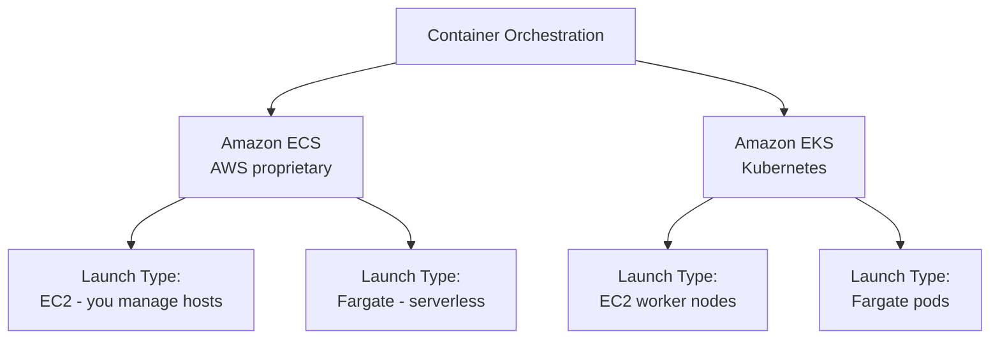
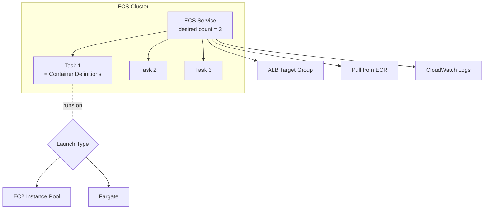
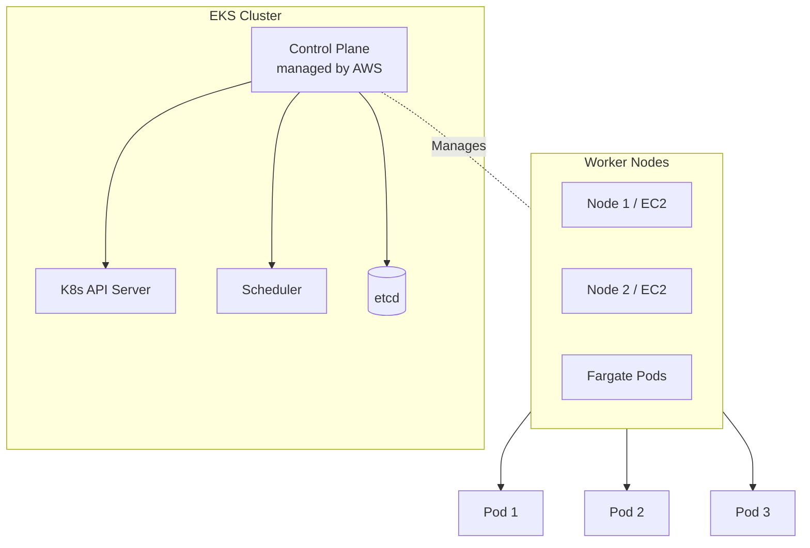
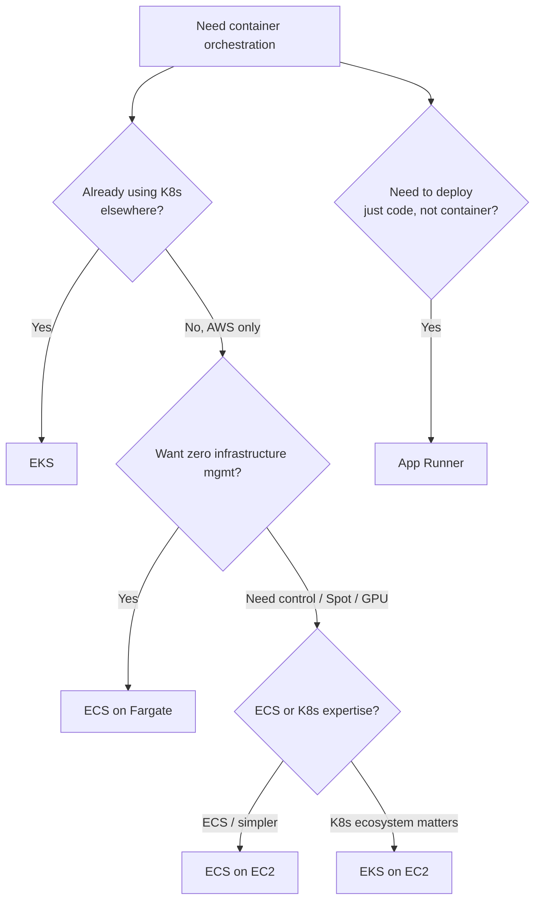

# ECS vs EKS vs Fargate

> 🔥 **Container choice is heavily tested.** Know the launch types and when to pick each.

## Problem It Solves
Containers offer dependency packaging, scaling, and portability — but you still need an orchestrator to schedule them across hosts, handle failures, and route traffic. AWS gives you three orchestration choices, two launch types, and a registry.

## How It Works



### ECS vs EKS Side by Side

| | **ECS** | **EKS** |
|---|---|---|
| Type | AWS-proprietary | Managed Kubernetes |
| Learning curve | Easier | Steeper (K8s ecosystem) |
| Portability | AWS only | Run anywhere K8s runs |
| Ops overhead | Lower | Higher (K8s upgrades, addons) |
| Control plane cost | Free | $0.10/hour per cluster |
| AWS integration | Tightest | Tight, but K8s-native ways |
| Use case | "Just run containers on AWS" | "K8s standard / multi-cloud / advanced needs" |
| Auto Scaling | ECS Service Auto Scaling | Cluster Autoscaler / Karpenter |
| Networking | awsvpc mode (one ENI per task) | VPC CNI (each pod gets ENI/IP) |
| Service mesh | App Mesh (or sidecar) | Istio, Linkerd, App Mesh |

### Launch Types — EC2 vs Fargate

```
EC2 LAUNCH TYPE:
─────────────────────────────────────────────
You manage the EC2 instances (cluster nodes)
- Pick instance type (CPU, RAM, GPU)
- Pay for EC2 instances regardless of container usage
- Spot Instances supported for cost savings
- Full control over OS, kernel, tooling
- More work: AMI updates, patching, capacity planning

USE EC2 LAUNCH TYPE WHEN:
─────────────────────────────────────────────
✅ Need GPU instances (Fargate has limited GPU)
✅ Need specific instance types (large memory, etc.)
✅ Want to use Spot for big savings
✅ Need privileged containers / sidecars
✅ Custom kernel modules or daemonsets


FARGATE LAUNCH TYPE:
─────────────────────────────────────────────
Serverless containers — no EC2 to manage
- Specify CPU + memory per task
- Pay per second of task execution
- Auto-scales with no capacity planning
- No SSH access to underlying hosts
- More expensive per CPU/RAM than reserved EC2

USE FARGATE WHEN:
─────────────────────────────────────────────
✅ Don't want to manage infrastructure
✅ Variable workload (no idle EC2 waste)
✅ Small to medium workloads
✅ Simpler operations matter more than cost
✅ Run tasks on demand (batch, ETL)
```

### ECS Architecture



```
TASK DEFINITION:
─────────────────────────────────────────────
Blueprint for a task — like a Docker Compose file
- Container images
- CPU/memory per container
- Port mappings
- Environment variables
- IAM Task Role (permissions for containers)
- IAM Execution Role (permissions for ECS to launch task)
- Networking mode (awsvpc, bridge, host, none)
- Mount EFS, FSx volumes

SERVICE:
─────────────────────────────────────────────
Ensures N tasks of a definition are always running
- Replaces failed tasks
- Integrates with ALB/NLB (registers tasks as targets)
- Deployment strategies: rolling, blue/green (with CodeDeploy)
- Service Auto Scaling on CPU, Memory, ALBRequestCount, etc.
```

### EKS Architecture



```
NODE TYPES IN EKS:
─────────────────────────────────────────────
1. SELF-MANAGED NODES (EC2)
   You create EC2 + worker AMI, register
   Most control, most work

2. MANAGED NODE GROUPS
   AWS manages EC2 lifecycle (rotation, updates)
   Still EC2 underneath — Auto Scaling Group

3. FARGATE PROFILES
   Pod-level Fargate — define pod selectors
   Some limitations: no DaemonSets, certain volumes
   Per-pod billing

4. KARPENTER (open-source from AWS)
   Modern node autoscaler
   Just-in-time node provisioning
   Replaces cluster-autoscaler with better packing
```

### EKS Networking — The VPC CNI

```
DEFAULT EKS NETWORKING (VPC CNI):
─────────────────────────────────────────────
Each pod gets its OWN ENI and VPC IP
Direct routing in VPC (no overlay network)

PROS:
✅ Pods are 1st-class VPC citizens
✅ Security Groups can apply to pods
✅ No NAT overhead

CONS:
❌ Burns VPC IPs fast — large clusters need /16 VPC
❌ ENI density limits (per instance type)

ALTERNATIVE: Calico, custom CNIs (less common)
```

---

## Fargate Deep Dive

```
PRICING MODEL:
─────────────────────────────────────────────
Per task per second:
- vCPU per second
- Memory (GB) per second

Spot Fargate available (~70% cheaper, interruption tolerant)

COMPARED TO EC2:
─────────────────────────────────────────────
Pure Fargate is ~20-30% more $$ than equivalent EC2 reservation
But: no idle capacity, no ops overhead

BREAK-EVEN: 
- High utilization (~70%+) → EC2 cheaper
- Variable workload → Fargate cheaper
- Small workload → Fargate often cheaper (no min EC2)
```

---

## ECS Anywhere & EKS Anywhere

```
ECS ANYWHERE:
─────────────────────────────────────────────
Run ECS-managed containers on YOUR hardware
(on-prem, edge, other cloud)
Single control plane for all containers

EKS ANYWHERE:
─────────────────────────────────────────────
Run EKS Kubernetes on your hardware
For air-gapped, edge, regulated workloads
```

---

## Decision Tree



## When to Use What

| Scenario | Solution |
|---|---|
| Just deploy containers, AWS-only | **ECS on Fargate** |
| Maximum cost optimization, can manage EC2 | **ECS on EC2 + Spot** |
| Need GPU instances | **ECS on EC2** with G/P instances |
| K8s standard, portability | **EKS** |
| Already on K8s elsewhere | **EKS** |
| Mostly serverless K8s | **EKS on Fargate** |
| Deploy code without container | **App Runner** or **Elastic Beanstalk** |
| Quick simple web service | **App Runner** |
| Lift-and-shift legacy app | **Elastic Beanstalk** |
| Hybrid (on-prem + cloud) | **EKS Anywhere** or **ECS Anywhere** |

## When NOT to Use

- ❌ Don't use Kubernetes if you don't need it — ECS is simpler
- ❌ Don't use Fargate for very large, predictable workloads — EC2 with RIs is cheaper
- ❌ Don't use ECS on EC2 for tiny dev/test — Fargate is simpler
- ❌ Don't use App Runner for complex multi-container apps — use ECS/EKS

## Trade-offs

| Choice | Gain | Sacrifice |
|---|---|---|
| ECS over EKS | Simpler, free control plane | AWS lock-in |
| EKS over ECS | K8s ecosystem, portability | Steeper learning, control plane cost |
| Fargate over EC2 | No infra management | Higher per-CPU/RAM cost |
| EC2 + Spot | Massive savings | Interruption handling |
| Karpenter over Cluster Autoscaler | Better packing, faster scale | Newer (less ecosystem maturity) |

## Real World Example

**Coca-Cola** uses ECS on Fargate:
- Microservices for inventory, vending, mobile app backends
- Variable load (peak during lunch hours)
- Fargate scales to zero in some envs
- Simpler than EKS — team isn't K8s-deep

**Snap (Snapchat)** uses EKS:
- Massive scale, K8s expertise in-house
- EKS for control plane management
- Karpenter for node autoscaling
- Multi-cloud strategy benefits from K8s

**HBO Max** uses ECS on EC2:
- Spot Instances for cost optimization
- Tight integration with AWS services (ALB, CloudWatch)
- Easier ops than running self-managed K8s

## 🎯 Exam Soundbite

> "Use ECS for AWS-only container workloads — it's simpler, has a free control plane, and integrates tightly with AWS services. Use EKS when you need Kubernetes portability, advanced features, or already run K8s elsewhere. Choose Fargate launch type for serverless containers — no EC2 to manage — and EC2 launch type when you need GPU, Spot pricing, or specific instance characteristics. For deploying code without container expertise, App Runner is the simplest path."

---

## ⚡ Quick Recall Card

```
┌─────────────────────────────────────────────────┐
│ CONTAINER PICKER                                 │
├─────────────────────────────────────────────────┤
│ Simple AWS containers      → ECS on Fargate      │
│ Want cost optimization     → ECS on EC2 + Spot   │
│ K8s portability            → EKS                 │
│ Mostly K8s on serverless   → EKS on Fargate      │
│ Just deploy code (no Docker)→ App Runner         │
│ Lift-and-shift web app     → Elastic Beanstalk   │
│ Hybrid on-prem + AWS       → ECS/EKS Anywhere    │
├─────────────────────────────────────────────────┤
│ FARGATE COSTS              Per second per task   │
│ ECS CONTROL PLANE          Free                  │
│ EKS CONTROL PLANE          $0.10/hr per cluster  │
│ EKS POD NETWORKING         VPC CNI (ENI per pod) │
└─────────────────────────────────────────────────┘
```

## 🎓 Common Exam Pattern

> **"Company runs a batch job a few times per day, lasting ~20 minutes each. They don't want to manage infrastructure. The job uses a custom container."**
>
> ✅ **ECS on Fargate** with scheduled tasks via EventBridge. No infra to manage, pay only for the 20 minutes per run, perfect for variable batch workloads.

> **"Company needs to run an existing Kubernetes-based workload on AWS. They want to use Spot for ~70% of capacity and on-demand for baseline."**
>
> ✅ **EKS with Managed Node Groups using mixed instances policy** (or Karpenter) for Spot + On-Demand mix.
