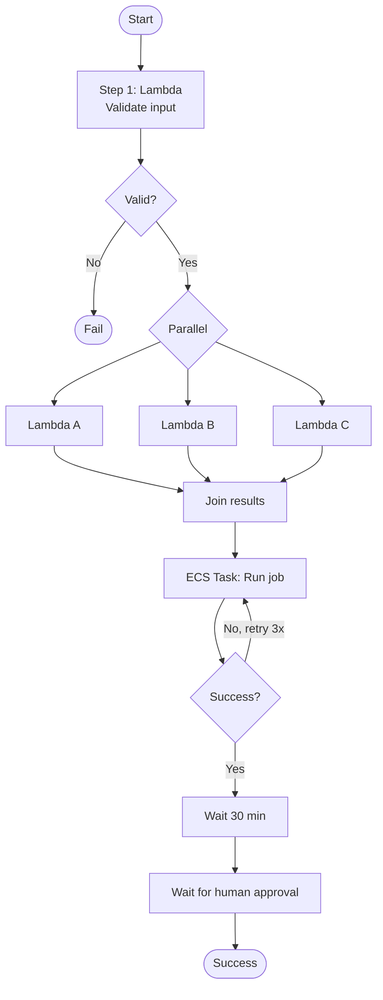
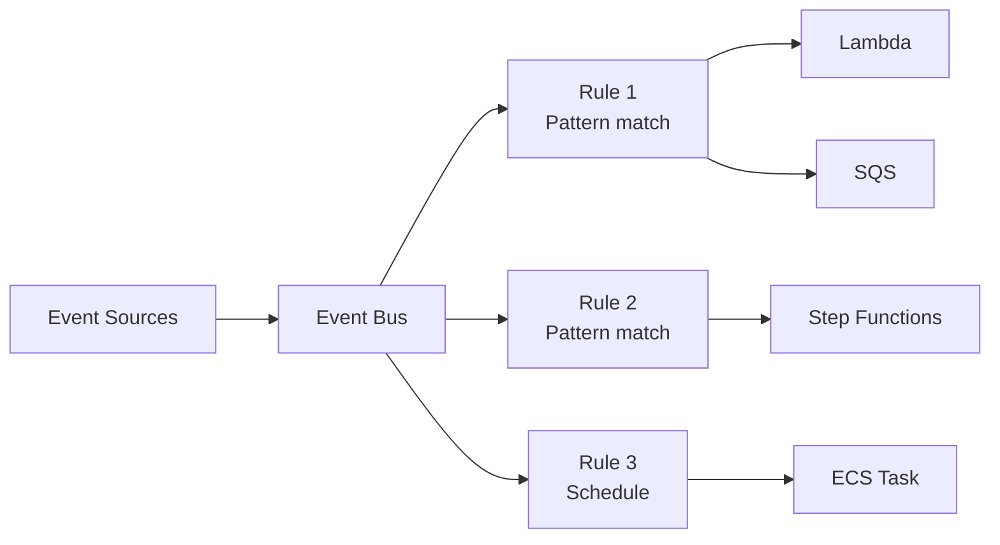
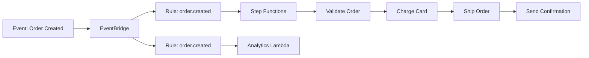

# Step Functions & EventBridge — Workflow Orchestration

> 🔥 **The "what's your orchestrator" question is common.** Know Standard vs Express, EventBridge vs SNS.

## Problem It Solves
Real applications aren't single Lambda functions — they're workflows of many steps with conditional branches, retries, parallel paths, and human approvals. Trying to orchestrate this inside Lambda code becomes a tangled mess. **Step Functions** is visual orchestration with state. **EventBridge** is event routing across services.

---

## AWS Step Functions



```
DEFINED IN AMAZON STATES LANGUAGE (ASL):
─────────────────────────────────────────────
JSON-based workflow definition
States:
- Task: Do work (call Lambda, ECS, etc.)
- Choice: Conditional branching
- Wait: Pause for time or until specific timestamp
- Parallel: Run branches in parallel
- Map: Iterate over collection (parallel)
- Pass: Pass-through, transform data
- Succeed / Fail: Terminal states
```

### Standard vs Express — Critical Distinction

| | **Standard Workflows** | **Express Workflows** |
|---|---|---|
| Max duration | 1 year | 5 minutes |
| Execution model | Exactly-once | At-least-once (sync) / asynchronous |
| Pricing | Per state transition ($0.025/1000) | Per execution + duration |
| Throughput | < 2000/sec start rate | > 100,000/sec |
| Audit | Full history in console | CloudWatch Logs only |
| Best for | Long-running, audit-heavy | High-volume, short workflows |
| Use cases | Order processing, ML pipelines | API backends, IoT |

```
WHEN TO USE STANDARD:
─────────────────────────────────────────────
✅ Workflow lasts minutes-hours-days
✅ Need exact-once semantics (financial)
✅ Audit trail critical
✅ Human approval steps
✅ ML training pipeline

WHEN TO USE EXPRESS:
─────────────────────────────────────────────
✅ High throughput (100k+/sec)
✅ Short workflows (< 5 min)
✅ Event processing pipelines
✅ IoT data routing
✅ Cost-sensitive at scale
```

### Step Functions Service Integrations

```
DIRECT INTEGRATIONS (no Lambda needed):
─────────────────────────────────────────────
✅ Lambda
✅ DynamoDB
✅ ECS / Fargate task
✅ SQS / SNS
✅ EventBridge
✅ Glue jobs
✅ Athena queries
✅ SageMaker
✅ Step Functions (call other state machines)
✅ ECS RunTask, RunTask.sync, RunTask.waitForTaskToken

PATTERNS:
─────────────────────────────────────────────
Request / Response: Fire and forget
.sync: Wait for task to complete
.waitForTaskToken: Pause until external system calls back
                   (e.g., human approval webhook)
```

### Error Handling

```yaml
"ProcessOrder": {
  "Type": "Task",
  "Resource": "arn:aws:lambda:...:function:ProcessOrder",
  "Retry": [
    {
      "ErrorEquals": ["States.Timeout"],
      "IntervalSeconds": 30,
      "MaxAttempts": 3,
      "BackoffRate": 2.0
    }
  ],
  "Catch": [
    {
      "ErrorEquals": ["States.ALL"],
      "Next": "HandleFailure"
    }
  ]
}
```

```
RETRY:
─────────────────────────────────────────────
Built-in retry logic, exponential backoff
Per-error-type configurable

CATCH:
─────────────────────────────────────────────
Send to error handler state on failure
Capture error info for routing/diagnosis
```

---

## EventBridge — Event Routing



### Event Buses

```
DEFAULT EVENT BUS:
─────────────────────────────────────────────
- One per account/region
- Receives AWS service events automatically
  (EC2 state changes, S3 events, CodePipeline, etc.)
- Receives custom application events

CUSTOM EVENT BUSES:
─────────────────────────────────────────────
- Create your own for app-specific events
- Useful for: event-driven microservice architectures
- Separate "domains" of events

PARTNER EVENT BUSES:
─────────────────────────────────────────────
- SaaS partners can deliver events directly
- Examples: Datadog, Zendesk, Auth0, Shopify, PagerDuty
- Eliminates webhook plumbing
```

### Event Patterns

```yaml
# Match S3 object created events
{
  "source": ["aws.s3"],
  "detail-type": ["Object Created"],
  "detail": {
    "bucket": {
      "name": ["my-bucket"]
    },
    "object": {
      "key": [{"prefix": "uploads/"}]
    }
  }
}
```

```
POWERFUL FILTERING:
─────────────────────────────────────────────
- Exact match
- Prefix match
- Anything-but (negate)
- Numeric comparisons (>, <, =)
- Array contains
- Nested fields

✅ Only relevant events reach targets
```

### Target Types (20+ supported)

```
COMMON TARGETS:
─────────────────────────────────────────────
✅ Lambda
✅ SQS queue
✅ SNS topic
✅ Step Functions state machine
✅ ECS Task
✅ Kinesis stream / Firehose
✅ Other EventBridge buses (cross-account routing)
✅ API destinations (any HTTP endpoint)
✅ SSM Run Command
✅ Systems Manager Automation
✅ CodePipeline
✅ Batch jobs

DEAD LETTER QUEUES:
─────────────────────────────────────────────
Failed invocations → DLQ for retry/inspection
```

### EventBridge Scheduler (Newer)

```
EVENTBRIDGE SCHEDULER:
─────────────────────────────────────────────
Successor to "scheduled rules"
✅ More scheduling options (cron, rate, one-time)
✅ Flexible time windows
✅ Better than CloudWatch Events for scheduled tasks
✅ Up to 1M scheduled events

USE:
─────────────────────────────────────────────
✅ Replace cron jobs
✅ Trigger workflows on schedule
✅ Daily reports, weekly aggregations
```

### EventBridge Archive & Replay

```
ARCHIVE:
─────────────────────────────────────────────
Store events for up to indefinite retention
Optionally with filter (archive only specific events)

REPLAY:
─────────────────────────────────────────────
Re-deliver archived events to any rule/target
Use:
✅ Test new event consumers with historical data
✅ Recover from event consumer failure
✅ Debug production issues
```

### Schema Registry

```
SCHEMA REGISTRY:
─────────────────────────────────────────────
Store JSON Schema definitions for events
Auto-discover schemas from existing events
Generate code bindings (Java, Python, TypeScript)

USE:
─────────────────────────────────────────────
✅ Document event contracts across teams
✅ Generate type-safe consumer code
✅ Versioning of event schemas
```

---

## Step Functions vs EventBridge

```
THEY SOLVE DIFFERENT PROBLEMS:
─────────────────────────────────────────────

STEP FUNCTIONS:
- Stateful workflow orchestration
- Sequential and parallel steps
- Knows where each execution is
- For: "run these steps in this order with these conditions"

EVENTBRIDGE:
- Stateless event routing
- Fan-out events to many subscribers
- Doesn't track workflow state
- For: "when X happens, also do Y, Z"
```

### When to Combine



```
PATTERN: Decouple via EventBridge, orchestrate via Step Functions
─────────────────────────────────────────────
1. Service emits "OrderCreated" to EventBridge
2. EventBridge fans out to:
   - Step Functions (orchestrates fulfillment workflow)
   - Analytics Lambda (data warehouse)
   - Notification Lambda (email customer)
3. Each consumer reacts independently
```

---

## When to Use What

| Scenario | Solution |
|---|---|
| Multi-step business workflow with branches | **Step Functions Standard** |
| Process 100k events/sec stateless | **Step Functions Express** or **Lambda** |
| Decouple microservices via events | **EventBridge** |
| Scheduled tasks (cron) | **EventBridge Scheduler** |
| React to AWS service changes | **EventBridge (default bus)** |
| SaaS partner integration | **EventBridge Partner Bus** |
| Cross-account event routing | **EventBridge custom bus + cross-account permissions** |
| Replay historical events | **EventBridge Archive + Replay** |
| Type-safe event contracts | **EventBridge Schema Registry** |
| Long-running workflow with human approval | **Step Functions + waitForTaskToken** |
| Coordinate parallel tasks | **Step Functions Parallel state** |

## When NOT to Use

- ❌ Don't use Step Functions for simple linear "do A then B" — Lambda chains are simpler
- ❌ Don't use EventBridge for high-throughput point-to-point — SQS is cheaper
- ❌ Don't use Express for long-running — 5-min limit
- ❌ Don't use EventBridge when no filtering needed — SNS is cheaper

## Trade-offs

| Choice | Gain | Sacrifice |
|---|---|---|
| Step Functions over Lambda chains | Visual, error handling, retries | Per-transition cost |
| Standard over Express | Audit trail, exactly-once | Per-transition cost |
| Express over Standard | High throughput, lower cost at scale | Less audit, at-least-once |
| EventBridge over SNS | Rich filtering, schemas | Slightly higher latency |
| Custom bus over default | Isolation per domain | More buses to manage |

## Real World Examples

### Pattern: Order Processing

```
1. POST /orders → API Gateway → Lambda → DynamoDB
2. DDB Stream → Lambda → EventBridge ("order.created")
3. EventBridge routes:
   - Step Functions (fulfillment workflow)
   - Analytics pipeline (S3 → Athena)
   - Customer notification (SNS → email)
4. Step Functions orchestrates:
   - Charge payment (Lambda)
   - Reserve inventory (Lambda → DDB)
   - If both succeed: Ship order
   - If fail: Refund + notify
```

### Pattern: ML Training Pipeline

```
EventBridge Scheduler → Trigger weekly
   → Step Functions:
     - Prepare training data (Glue Job)
     - Train model (SageMaker)
     - If accuracy > 0.85: Deploy model (Lambda)
     - Else: Notify team (SNS)
     - Archive results (S3)
```

### Pattern: Multi-Region Coordination

```
us-east-1 event → EventBridge → cross-region rule → eu-west-1 EventBridge
                                                    ↓
                                              Local processing
```

## 🎯 Exam Soundbite

> "Step Functions orchestrates multi-step workflows with built-in retries, error handling, and parallelism — use Standard for long-running stateful workflows with exactly-once semantics and Express for high-volume short workflows up to five minutes. EventBridge routes events between AWS services and SaaS partners with rich pattern filtering — use it to decouple producers from consumers in event-driven architectures. Combine them: EventBridge fans out events to multiple Step Functions workflows running in parallel."

---

## ⚡ Quick Recall Card

```
┌─────────────────────────────────────────────────┐
│ STEP FUNCTIONS                                   │
├─────────────────────────────────────────────────┤
│ Standard      1 yr max, exactly-once, $/transition│
│ Express       5 min max, at-least-once, $/exec   │
│ States        Task, Choice, Parallel, Map, Wait  │
│ Error handle  Retry + Catch                      │
│ Integrations  Lambda, ECS, DDB, SQS, SNS, Glue   │
├─────────────────────────────────────────────────┤
│ EVENTBRIDGE                                      │
├─────────────────────────────────────────────────┤
│ Default bus    AWS service events automatic      │
│ Custom buses   Per-domain event routing          │
│ Partner buses  SaaS event integration            │
│ Patterns       Prefix, anything-but, numeric...  │
│ Targets        20+ AWS services + API dests      │
│ Scheduler      Replaces CloudWatch Events cron   │
│ Archive/Replay Historical event replay           │
│ Schema Registry Type-safe event contracts        │
└─────────────────────────────────────────────────┘
```

## 🎓 Common Exam Patterns

> **"Workflow runs every night: extract data from RDS, transform with Spark, load to Redshift, run analytics, email report. Some steps can run in parallel."**
>
> ✅ **Step Functions Standard** with **Parallel state** for concurrent steps. **EventBridge Scheduler** triggers it nightly. Each step calls Glue, EMR, Lambda, etc.

> **"Need to process 200,000 IoT events per second, each going through a 3-step pipeline that takes under 1 minute."**
>
> ✅ **Step Functions Express** — designed for high throughput, short workflows. Or **Lambda chained via destinations** for simpler cases.

> **"Microservices in 5 teams need to react to 'user signed up' event from auth service."**
>
> ✅ **EventBridge** with "user.signedup" event published once, each team's service subscribes via own rule. Producers and consumers decoupled.
