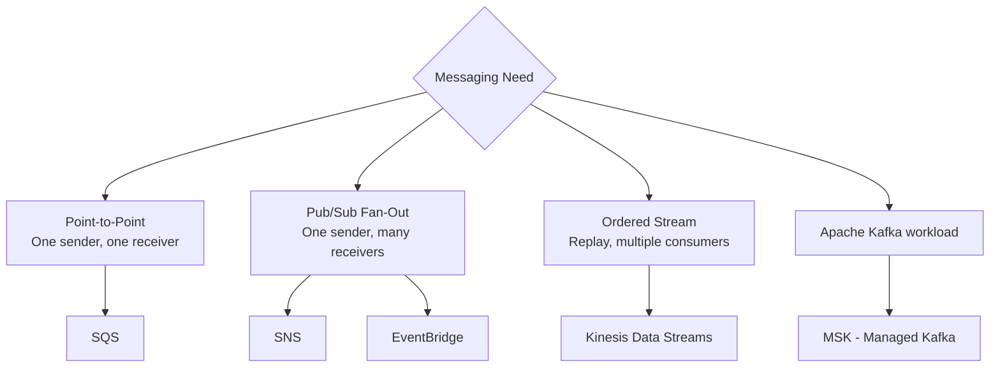
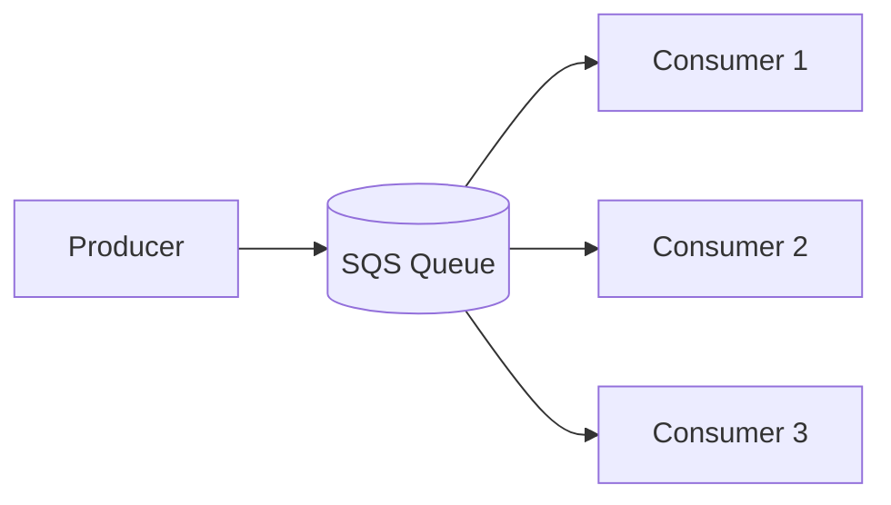
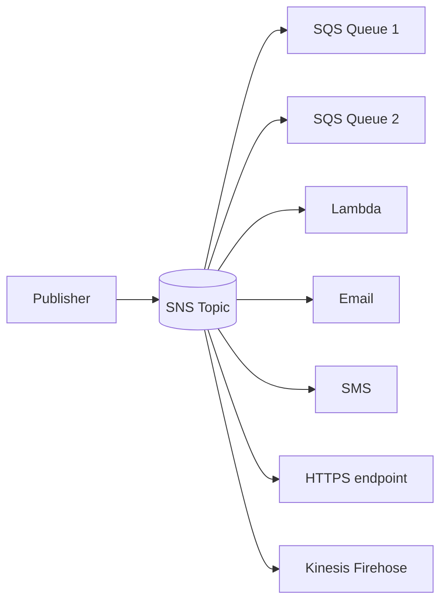
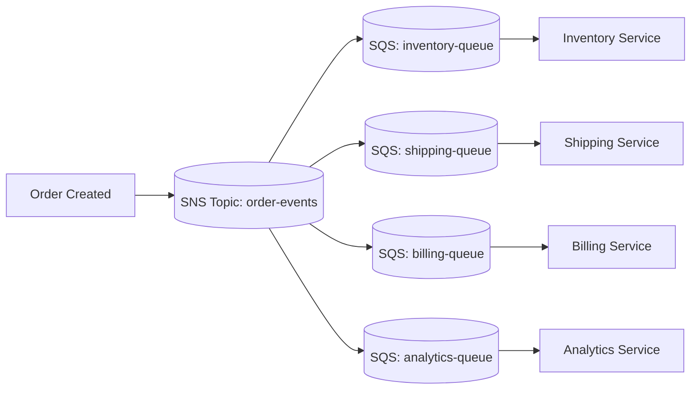
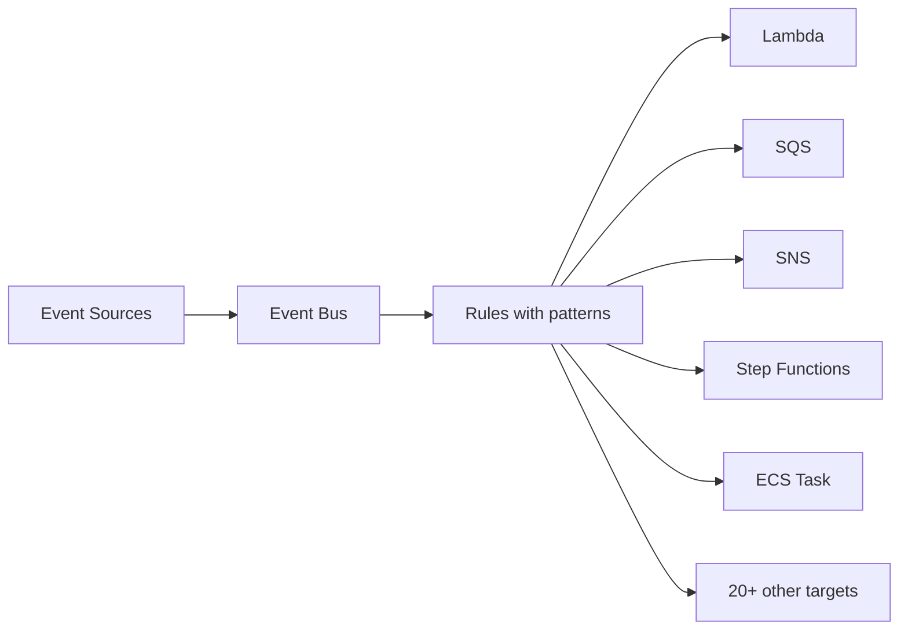
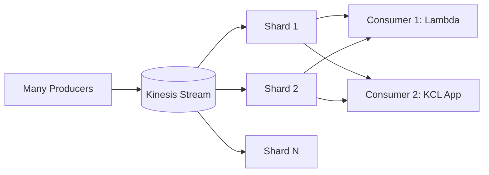
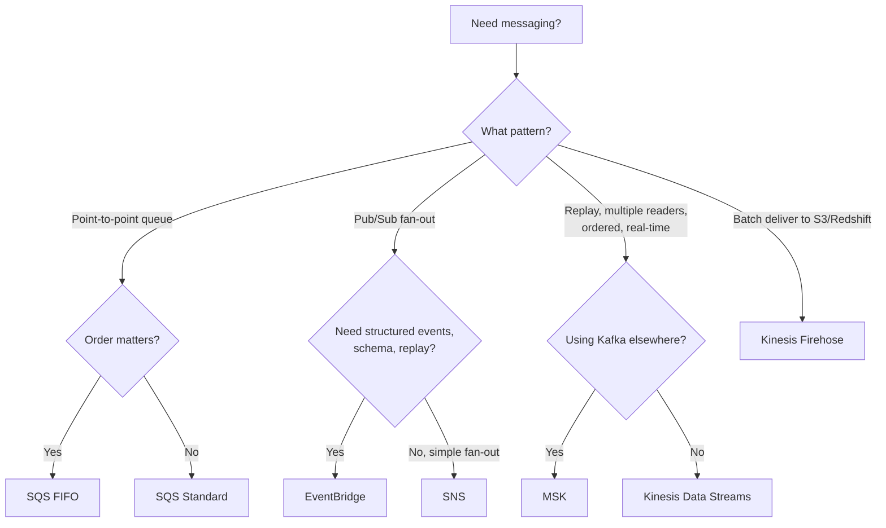

# SQS vs SNS vs Kinesis vs MSK — Messaging Decision

> 🔥 **The exam loves this comparison.** Know the differences cold.

## Problem It Solves
Microservices need to communicate asynchronously — to decouple, absorb traffic spikes, fan-out events, stream data. AWS offers 4 main messaging services, each with different semantics. Picking wrong = data loss, ordering bugs, or 10x overspending.

## How They Work



### Side by Side

| | **SQS** | **SNS** | **Kinesis Data Streams** | **MSK (Kafka)** |
|---|---|---|---|---|
| Model | Queue (point-to-point) | Pub/Sub fan-out | Ordered log stream | Distributed log |
| Order | FIFO option | No order | Per-shard order | Per-partition order |
| Retention | 1 min - 14 days | Not stored | 1-365 days | Configurable (days-forever) |
| Throughput | Standard: nearly unlimited / FIFO: 300-3000 TPS | High | Per-shard limits | Massive |
| Consumers | One consumer per message (multiple in parallel) | Many subscribers | Many readers, can replay | Many readers, can replay |
| Replay | ❌ Once consumed = gone | ❌ | ✅ | ✅ |
| Use case | Decouple producer from consumer | Fan-out notifications | Real-time analytics | Existing Kafka workloads |
| Delivery | At-least-once (Standard) / Exactly-once (FIFO) | At-least-once | At-least-once | At-least-once |
| Cost | Per request | Per request + per delivery | Per shard hour | Per broker hour |

---

## SQS — Simple Queue Service



### Two Queue Types

```
STANDARD QUEUE:
─────────────────────────────────────────────
- At-least-once delivery (duplicates possible)
- Best-effort ordering (often out of order)
- UNLIMITED throughput
- 256 KB per message
- Use: 99% of workloads

FIFO QUEUE:
─────────────────────────────────────────────
- Exactly-once processing (with dedup ID)
- Strict ordering within MessageGroupId
- 300 TPS (3,000 with batching, 70,000+ with high throughput mode)
- Queue name must end in .fifo
- Use: Order matters (financial transactions, sequential events)
```

### Key SQS Features

```
✅ VISIBILITY TIMEOUT
   Hide message from other consumers while one is processing
   Default 30s, max 12 hours
   Extend if processing takes longer
   
✅ DELAY QUEUE
   Delay message visibility for N seconds (0-900)
   Or set MessageGroupId-specific delay
   
✅ DEAD LETTER QUEUE (DLQ)
   Messages that fail N times → DLQ for inspection
   Doesn't auto-process — humans investigate
   
✅ LONG POLLING
   Wait up to 20s for messages (vs short polling = immediate empty)
   Reduces empty response cost ~100x
   
✅ SQS EXTENDED CLIENT
   For messages > 256 KB:
   Store payload in S3, send only pointer through SQS
   
✅ ENCRYPTION
   At-rest (KMS) and in-transit (TLS)
```

### Common SQS Pattern — Decoupling

```
WITHOUT SQS:
─────────────────────────────────────────────
Web tier → DB tier (synchronous)
DB overload → Web errors
Web scale and DB scale must match

WITH SQS:
─────────────────────────────────────────────
Web tier → SQS → DB worker tier (asynchronous)
Web tier doesn't wait → instant response to user
Workers scale independently to drain queue
Spike absorption — queue grows, eventually drains
```

---

## SNS — Simple Notification Service



### SNS Key Facts

```
✅ Fan-out: One publish → Many subscribers
✅ Subscriber types:
   - SQS (most common for fan-out)
   - Lambda
   - HTTP/S endpoint
   - Email
   - SMS
   - Kinesis Data Firehose
   - Application (mobile push)

✅ Message FILTERING
   Subscribers can specify filter policies
   Only matching messages delivered
   
✅ FIFO TOPICS
   Like FIFO queues — strict ordering
   Subscribed to FIFO SQS only
   
✅ MESSAGE ATTRIBUTES
   Metadata used for filtering and routing
   
✅ Encryption at-rest (KMS)
```

### Classic Fan-out Pattern



```
WHY FAN-OUT TO SQS (not direct to Lambda)?
─────────────────────────────────────────────
✅ Persistence — if consumer is down, messages wait
✅ Throttling — consumer can drain at its own pace
✅ Retries handled by SQS visibility timeout + DLQ
✅ Each consumer scales independently
```

---

## EventBridge (formerly CloudWatch Events)



### EventBridge vs SNS

```
EVENTBRIDGE:
─────────────────────────────────────────────
✅ Schema registry (events with structure)
✅ Rich filtering with content-based patterns
✅ Multiple event buses (default, custom, partner)
✅ Partner integrations (Datadog, Auth0, Zendesk)
✅ Archive and replay events
✅ Schedule expressions (replaces CloudWatch Events)

SNS:
─────────────────────────────────────────────
✅ Massive throughput (millions/sec)
✅ Lower latency
✅ Wider subscriber types (SMS, email, mobile push)

USE EVENTBRIDGE for: Application event routing, integrations
USE SNS for: Pure pub/sub fan-out, notifications
```

---

## Kinesis Data Streams



### Kinesis Concepts

```
SHARD:
─────────────────────────────────────────────
Unit of capacity in a stream
1 MB/sec input, 2 MB/sec output per shard
1000 records/sec input
Total stream throughput = shard count × per-shard limits

PARTITION KEY:
─────────────────────────────────────────────
Producer specifies on each record
Hash determines which shard
Same key → same shard → ordered

ORDERING:
─────────────────────────────────────────────
Strict ordering WITHIN a shard
No ordering across shards
For total order: 1 shard only (low throughput)

RETENTION:
─────────────────────────────────────────────
Default 24 hours
Extended up to 365 days (extra cost)

CONSUMERS:
─────────────────────────────────────────────
Standard (shared throughput) — 5 consumers max
Enhanced Fan-Out — 20 consumers, dedicated 2 MB/s each
```

### Kinesis Family

```
KINESIS DATA STREAMS:
─────────────────────────────────────────────
Real-time stream, custom processing
You manage shard count (or use On-Demand mode)

KINESIS DATA FIREHOSE:
─────────────────────────────────────────────
Fully managed delivery to:
- S3, Redshift, OpenSearch, Splunk, partner destinations
- Auto-batches, buffers, retries
- No code needed for ETL
- Near-real-time (1 min minimum buffer)

KINESIS DATA ANALYTICS (now Managed Apache Flink):
─────────────────────────────────────────────
SQL or Flink-based stream processing
Compute aggregations in-stream

KINESIS VIDEO STREAMS:
─────────────────────────────────────────────
Video ingestion for ML, streaming, etc.
```

---

## MSK — Managed Streaming for Kafka

```
USE MSK INSTEAD OF KINESIS WHEN:
─────────────────────────────────────────────
✅ Already on Kafka elsewhere — portable
✅ Need Kafka ecosystem (Kafka Connect, Streams)
✅ Need very long retention with low cost
✅ Higher throughput than Kinesis at some price points
✅ Need MirrorMaker / Schema Registry tooling

MSK SERVERLESS:
─────────────────────────────────────────────
No broker management
Auto-scales
Pay per usage
Good fit if you don't want capacity planning
```

---

## Decision Tree



## When to Use What

| Scenario | Solution |
|---|---|
| Decouple web tier from DB | **SQS Standard** |
| Process financial transactions in order | **SQS FIFO** |
| Notify multiple services on event | **SNS** (fan-out to SQS) |
| Cross-account / cross-service events | **EventBridge** |
| Real-time clickstream analytics | **Kinesis Data Streams** |
| Stream events to S3 / OpenSearch | **Kinesis Firehose** |
| Replace existing Kafka | **MSK** |
| Schedule tasks (cron) | **EventBridge Scheduler** |
| Mobile push notifications | **SNS** |
| SaaS partner integrations | **EventBridge** (partner buses) |
| Replay events for testing | **Kinesis** or **EventBridge Archive** |

## When NOT to Use

- ❌ Don't use SQS for fan-out — use SNS or EventBridge
- ❌ Don't use SNS for ordered events — use Kinesis or SQS FIFO
- ❌ Don't use Kinesis just for queuing — SQS is simpler and cheaper
- ❌ Don't use MSK for greenfield AWS — Kinesis is more integrated
- ❌ Don't use FIFO if you don't truly need order — 10x cheaper to use Standard

## Trade-offs

| Choice | Gain | Sacrifice |
|---|---|---|
| SQS FIFO | Exactly-once, ordered | Lower throughput |
| SNS fan-out | Wide subscriber types | No replay |
| EventBridge | Rich routing, schemas | Some latency, less throughput than SNS |
| Kinesis | Replay, ordering | Shard management complexity |
| MSK | Kafka ecosystem | More ops than Kinesis |

## Real World Example

**Stripe** uses:
- **SNS → SQS** fan-out for payment events (each downstream service gets its own queue)
- **Kinesis** for fraud detection real-time stream
- **EventBridge** for SaaS partner webhook integrations
- **SQS FIFO** for sequential ledger updates

**Netflix** uses:
- **MSK** (formerly self-managed Kafka) for the event backbone — billions of events/day
- **Kinesis** for some specialized real-time use cases
- **SNS** for operational notifications

## 🎯 Exam Soundbite

> "SQS is point-to-point queueing for decoupling — one message, one consumer. SNS is pub/sub fan-out — one publish to many subscribers. EventBridge adds rich filtering, schemas, and partner integrations to pub/sub. Kinesis Data Streams provides ordered, replayable streams with multiple consumers and is best for real-time analytics. MSK is managed Apache Kafka for workloads that need the Kafka ecosystem."

---

## ⚡ Quick Recall Card

```
┌─────────────────────────────────────────────────┐
│ MESSAGING SERVICE QUICK PICK                     │
├─────────────────────────────────────────────────┤
│ Decouple, durable queue   → SQS                  │
│ Strict order required     → SQS FIFO             │
│ Fan-out to subscribers    → SNS                  │
│ Rich event routing        → EventBridge          │
│ Real-time stream + replay → Kinesis Data Streams │
│ Stream to S3/Redshift     → Kinesis Firehose     │
│ Stream SQL processing     → Managed Flink        │
│ Existing Kafka workloads  → MSK                  │
│ Scheduled tasks           → EventBridge Scheduler│
└─────────────────────────────────────────────────┘
```

## 🎓 Common Exam Pattern

> **"Order events must be delivered to inventory, shipping, billing, and analytics services. Each can scale independently. If a service is down, events must not be lost."**
>
> ✅ **SNS topic → 4 SQS queues** (one per service). SNS fans out, each SQS persists for its consumer. If shipping service is down, messages wait in SQS up to 14 days.

> **"Need to ingest 10,000 IoT messages/sec, process in real time for anomaly detection, AND archive all to S3 for later batch analytics."**
>
> ✅ **Kinesis Data Streams** for ingestion + real-time consumers → **Kinesis Firehose** subscribes to the stream and writes to S3.
