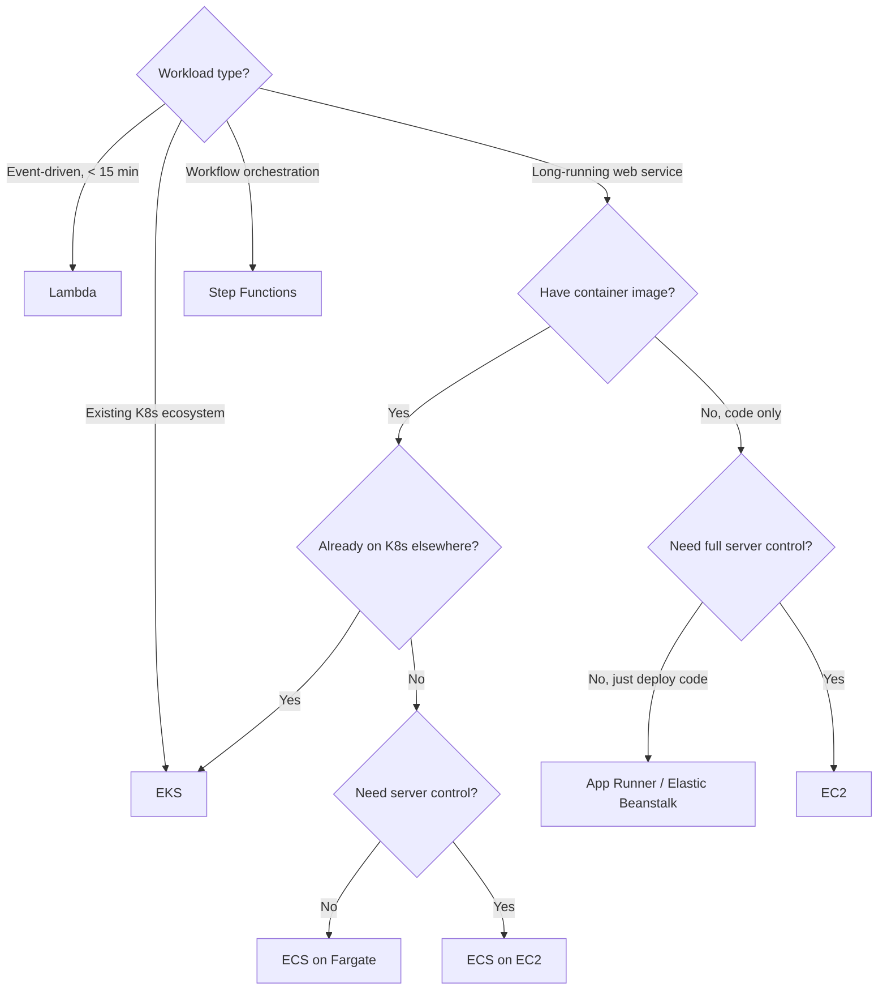

# 05 — Serverless & Containers

> **Exam weight:** ⭐⭐⭐⭐ — Lambda integration patterns and ECS/EKS/Fargate decisions are very common SAP-C02 questions.

---

## 🗺️ Topic Map

```mermaid
graph TD
    A[Serverless & Containers]
    A --> B[Compute]
    A --> C[Orchestration]
    A --> D[Integration]
    A --> E[Containers]
    
    B --> B1[Lambda]
    B --> B2[Lambda@Edge]
    B --> B3[Lambda Layers]
    
    C --> C1[Step Functions]
    C --> C2[EventBridge]
    
    D --> D1[API Gateway: REST/HTTP/WebSocket]
    D --> D2[SQS - Standard/FIFO]
    D --> D3[SNS]
    D --> D4[Kinesis]
    D --> D5[MSK - Managed Kafka]
    
    E --> E1[ECS - ECS-managed scheduler]
    E --> E2[EKS - Kubernetes]
    E --> E3[Fargate - serverless containers]
    E --> E4[ECR - Container registry]
    E --> E5[App Runner]
```

---

## 📚 Notes in This Section

| # | Topic | Priority |
|---|---|---|
| 01 | [Lambda Fundamentals & Patterns](./01-lambda.md) | 🔥 |
| 02 | [API Gateway Types & Patterns](./02-api-gateway.md) | 🔥 |
| 03 | [ECS vs EKS vs Fargate](./03-containers.md) | 🔥 |
| 04 | [Step Functions & EventBridge](./04-orchestration.md) | High |
| 05 | [SQS vs SNS vs Kinesis vs MSK](./05-messaging.md) | 🔥 |

---

## 🎯 The Serverless / Container Decision Framework



## 🎯 The 5 Serverless Concepts Tested on SAP-C02

```
1. LAMBDA CONCURRENCY
   - Reserved concurrency = guaranteed limit
   - Provisioned concurrency = pre-warmed, no cold starts
   - Unreserved pool = shared across functions

2. LAMBDA VPC ACCESS
   - Function runs in AWS-owned VPC by default
   - Can attach to your VPC for private resource access
   - Uses Hyperplane ENIs — fast cold starts now

3. EVENTBRIDGE vs SNS vs SQS
   EventBridge = event bus with rich filtering, schemas, partners
   SNS         = pub/sub fanout to subscribers
   SQS         = queue (point-to-point, durable)
   Kinesis     = ordered stream, replay, fan-out

4. STEP FUNCTIONS — STANDARD vs EXPRESS
   Standard = up to 1 year, exactly-once, audit-friendly
   Express  = high-throughput, at-least-once, short workflows

5. ECS vs EKS
   ECS = AWS-proprietary, simpler, tighter AWS integration
   EKS = open-source Kubernetes, portable, more ops
```
