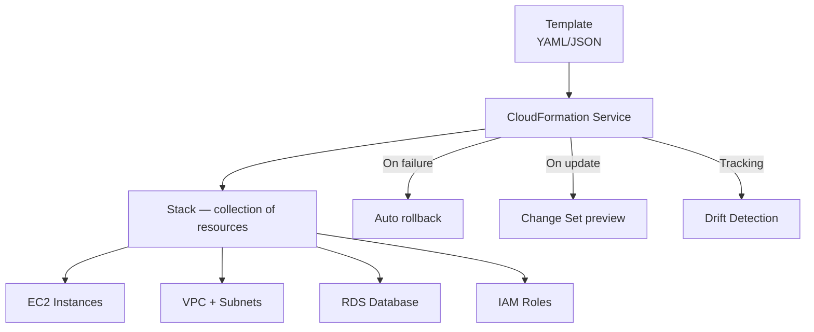
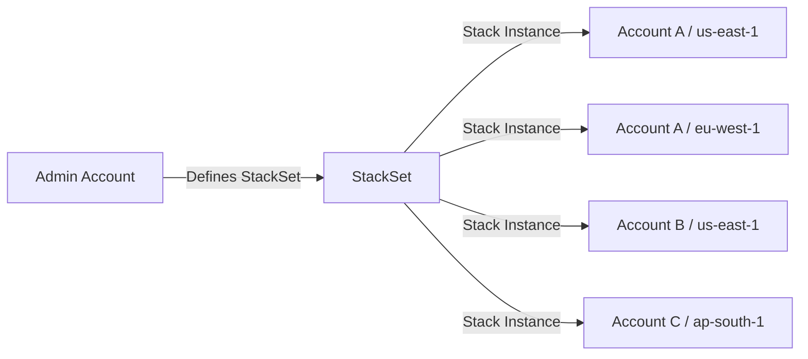
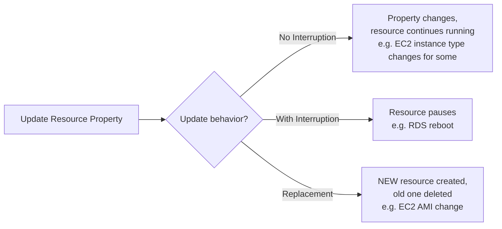

# CloudFormation Deep Dive

> 🔥 **CloudFormation appears in many SAP-C02 questions.** Know StackSets, drift detection, change sets, and nested stacks.

## Problem It Solves
Clicking around the console to build infrastructure: not repeatable, not auditable, not version-controlled. Manual scripts: drift over time, hard to roll back. **CloudFormation declares your infrastructure as code** — same template = same infrastructure every time, with full rollback on failure.

## How It Works



### Template Anatomy

```yaml
AWSTemplateFormatVersion: '2010-09-09'
Description: My infrastructure

Parameters:                    # Inputs at deploy time
  InstanceType:
    Type: String
    Default: t3.micro
    AllowedValues: [t3.micro, t3.small]

Mappings:                      # Static key-value lookups
  RegionMap:
    us-east-1:
      AMI: ami-0abc123
    eu-west-1:
      AMI: ami-0def456

Conditions:                    # Boolean logic for resources
  IsProd: !Equals [!Ref Env, "prod"]

Resources:                     # The actual infrastructure (required)
  MyVPC:
    Type: AWS::EC2::VPC
    Properties:
      CidrBlock: 10.0.0.0/16
  
  MyEC2:
    Type: AWS::EC2::Instance
    Properties:
      InstanceType: !Ref InstanceType
      ImageId: !FindInMap [RegionMap, !Ref "AWS::Region", AMI]
    Condition: IsProd

Outputs:                       # Values exported to other stacks
  VpcId:
    Value: !Ref MyVPC
    Export:
      Name: SharedVPC-Id
```

### Stacks vs Stack Instances vs Change Sets

```
┌──────────────────────────────────────────────────────────┐
│ STACK                                                     │
│   A deployed instance of a template                       │
│   Has resources, parameters, outputs                      │
│   Region-scoped                                           │
├──────────────────────────────────────────────────────────┤
│ CHANGE SET                                                │
│   Preview of changes BEFORE applying                      │
│   Shows: add, modify, replace (some changes destroy!)     │
│   Critical for production safety                          │
├──────────────────────────────────────────────────────────┤
│ NESTED STACKS                                             │
│   Stack within a stack                                    │
│   Use: Reusable components (VPC template, monitoring)    │
│   Limit: Treat as one logical stack                       │
├──────────────────────────────────────────────────────────┤
│ STACKSETS                                                 │
│   Deploy SAME template across many accounts AND regions   │
│   Two modes: Self-managed and Service-managed             │
│   Service-managed integrates with Organizations           │
└──────────────────────────────────────────────────────────┘
```

### StackSets — Critical SAP-C02 Topic



```
USE CASES:
─────────────────────────────────────────────
✅ Enable Config in every account/region
✅ Create logging buckets across accounts
✅ Deploy baseline IAM roles to new accounts
✅ Apply GuardDuty in every region
✅ Auto-deploy to NEW accounts when joined to Org

PERMISSION MODELS:
─────────────────────────────────────────────
SELF-MANAGED:
  You create IAM roles in each target account
  Used for standalone accounts

SERVICE-MANAGED:
  AWS Organizations handles IAM automatically
  ✅ Auto-deploy to new accounts (Organizational Unit-scoped)
  ✅ Most common for Org-wide deployments
```

### Drift Detection

```
DRIFT:
─────────────────────────────────────────────
Someone changed a resource OUTSIDE CloudFormation
(via console click, CLI, another tool)

Drift = mismatch between template and actual state.

DETECT:
─────────────────────────────────────────────
Run "Detect Drift" on stack
Returns: which resources drifted + their differences

RESOLVE:
─────────────────────────────────────────────
Option A: Update template to match reality
Option B: Update reality to match template (apply stack again)
Option C: Use "import" if resource was created manually

⚠️ EXAM TRAP: CloudFormation does NOT auto-prevent drift.
   You must detect periodically or use Config.
```

### Update Behaviors — What Happens When You Change?



```
⚠️ DANGER: REPLACEMENT!
─────────────────────────────────────────────
If a property change causes replacement:
- For stateless resources: usually fine
- For databases: DATA LOSS RISK!
  RDS replacement = new DB, old one deleted
  → Set DeletionPolicy: Retain or Snapshot

Always check Change Sets before updating!
```

### Critical Update Policies

```yaml
Resources:
  MyDB:
    Type: AWS::RDS::DBInstance
    DeletionPolicy: Snapshot           # On stack delete, snapshot first
    UpdateReplacePolicy: Snapshot      # On replacement, snapshot first
    Properties:
      ...
  
  CriticalDataBucket:
    Type: AWS::S3::Bucket
    DeletionPolicy: Retain             # Never delete this bucket
    UpdateReplacePolicy: Retain
  
  AutoScalingGroup:
    Type: AWS::AutoScaling::AutoScalingGroup
    UpdatePolicy:                      # Control rolling update behavior
      AutoScalingRollingUpdate:
        MinInstancesInService: 2
        MaxBatchSize: 1
        PauseTime: PT5M
```

### Cross-Stack References

```
TWO MECHANISMS:
─────────────────────────────────────────────

1. EXPORT / IMPORT (Fn::ImportValue)
   Stack A:  Output VpcId with Export: SharedVPC-Id
   Stack B:  !ImportValue SharedVPC-Id

   ✅ Strong coupling — Stack B can't be deleted before A
   ❌ Can't update if anyone imports
   ❌ Region-scoped

2. AWS::CloudFormation::Stack RESOURCE (nested stacks)
   Stack A includes Stack B as a resource
   B's outputs accessible via Fn::GetAtt
   
   ✅ Logical grouping
   ✅ Updates propagate easily
   ❌ Bigger blast radius (one stack to manage)

3. SSM PARAMETERS (loose coupling)
   Stack A writes to /shared/vpc-id
   Stack B reads via AWS::SSM::Parameter::Value<String>
   
   ✅ Loosely coupled
   ✅ Cross-region works
   ✅ Multiple accounts via Parameter Store sharing
```

### Helper Scripts (cfn-init, cfn-signal)

```
On EC2 instance launched by CloudFormation:

cfn-init:
─────────────────────────────────────────────
Reads CloudFormation::Init metadata
Installs packages, downloads files, runs commands

cfn-signal:
─────────────────────────────────────────────
Tells CloudFormation: "EC2 finished bootstrapping"
Use with CreationPolicy to wait for ready signal

cfn-hup:
─────────────────────────────────────────────
Daemon that checks for metadata updates
Re-runs cfn-init on changes
```

### CloudFormation vs CDK vs SAM vs Terraform

| | **CloudFormation** | **CDK** | **SAM** | **Terraform** |
|---|---|---|---|---|
| Language | YAML/JSON | TypeScript, Python, Java, Go, .NET | YAML (subset of CFN) | HCL |
| Backend | CloudFormation | CloudFormation (compiles to it) | CloudFormation | Own state |
| Multi-cloud | AWS only | AWS only | AWS only (serverless focus) | All providers |
| Use | Standard IaC | Programmatic IaC | Serverless apps | Multi-cloud, mature |
| Learning | Easy syntax | More complex (programming) | Simplified for serverless | Different syntax |

### StackSets vs Service Catalog

```
STACKSETS:
─────────────────────────────────────────────
Deploy infrastructure CENTRALLY
"I deploy this in every account"
Use: Baseline, security guardrails

SERVICE CATALOG:
─────────────────────────────────────────────
Self-service portal of approved products
"Devs choose from a menu of templates"
Use: Empower teams while controlling sprawl
```

## When to Use What

| Need | Solution |
|---|---|
| Define AWS infrastructure as code | **CloudFormation** |
| Use a programming language for IaC | **CDK** |
| Serverless app deployment | **SAM** |
| Deploy across many accounts/regions | **StackSets** |
| Reusable infra components | **Nested Stacks** or **CDK Constructs** |
| Self-service catalog for devs | **Service Catalog** |
| Detect manual changes to managed resources | **Drift Detection** |
| Preview infra changes before apply | **Change Sets** |
| Avoid destroying critical data | **DeletionPolicy: Retain/Snapshot** |
| Multi-cloud or want portability | **Terraform** (not AWS native) |

## When NOT to Use

- ❌ Don't use CloudFormation for one-off scripts — overkill, just use CLI
- ❌ Don't put secrets in templates — use Secrets Manager or Parameter Store
- ❌ Don't update production without Change Sets — easy to delete data
- ❌ Don't share state across regions via Export/Import — use SSM instead
- ❌ Don't run Drift Detection in real-time per resource — use AWS Config for that

## Trade-offs

| Choice | Gain | Sacrifice |
|---|---|---|
| CloudFormation over Terraform | AWS-native, free state | AWS-only |
| StackSets over ad-hoc deploy | Consistency, central control | More setup work |
| CDK over CloudFormation | Programming power, abstractions | More tooling complexity |
| Nested Stacks | Modularity | Bigger blast radius |
| Export/Import | Strong coupling | Harder to evolve |
| SSM Parameters | Loose coupling, multi-region | Slight indirection |

## Real World Example

**A typical enterprise multi-account setup:**

```
Mgmt Account
  StackSets (service-managed via Organizations):
    - "AccountBaseline" → Deploys to ALL accounts:
        - IAM admin roles
        - CloudTrail trail
        - Config aggregator
        - GuardDuty enabled
        - Default SCP-aware tags
    - "NetworkingBaseline" → Deploys to networking accounts:
        - Shared VPCs
        - Transit Gateway attachments
    - "MonitoringBaseline" → Deploys to all:
        - CloudWatch dashboards
        - Centralized log forwarding
```

**Stripe** uses CDK extensively:
- TypeScript constructs encapsulate common patterns
- One "Service" construct creates: ALB + ECS service + IAM + CloudWatch + alarms
- Devs write 50 lines of CDK instead of 500 lines of CloudFormation
- Compiles to CloudFormation under the hood

## 🎯 Exam Soundbite

> "CloudFormation defines AWS infrastructure declaratively in YAML or JSON templates. Use StackSets to deploy the same template across many accounts and regions — service-managed mode integrates with AWS Organizations to auto-deploy to new accounts. Use Change Sets to preview infrastructure changes before applying, and Drift Detection to identify resources modified outside of CloudFormation. Critical resources should have DeletionPolicy and UpdateReplacePolicy set to Retain or Snapshot to prevent data loss during stack operations."

---

## ⚡ Quick Recall Card

```
┌─────────────────────────────────────────────────┐
│ CLOUDFORMATION KEY FACTS                         │
├─────────────────────────────────────────────────┤
│ Template formats          YAML, JSON              │
│ Stack scope               Region                  │
│ StackSets scope           Multi-account/region    │
│ Change Sets               Preview before apply    │
│ Drift Detection           Detects external changes│
│ DeletionPolicy            Retain, Snapshot, Delete│
│ UpdateReplacePolicy       Same options            │
│ Helpers (EC2)             cfn-init, cfn-signal    │
│ Cross-stack               Export/Import or SSM    │
│ Service-managed StackSets Auto-deploy to new accts│
└─────────────────────────────────────────────────┘
```

## 🎓 Common Exam Pattern

> **"Need to deploy a baseline security configuration (CloudTrail + Config + GuardDuty) to all current and FUTURE AWS accounts in the organization."**
>
> ✅ **CloudFormation StackSets in service-managed mode**, deployed at the OU level with **auto-deployment enabled**. New accounts added to the OU automatically receive the baseline.

> **"During an update, our RDS database was replaced and we lost data. How to prevent this?"**
>
> ✅ Set **DeletionPolicy: Snapshot** AND **UpdateReplacePolicy: Snapshot** on the RDS resource. Use **Change Sets** before applying to see if replacement is planned.
