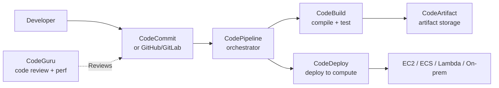
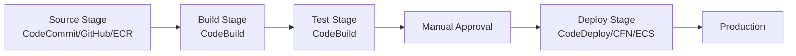
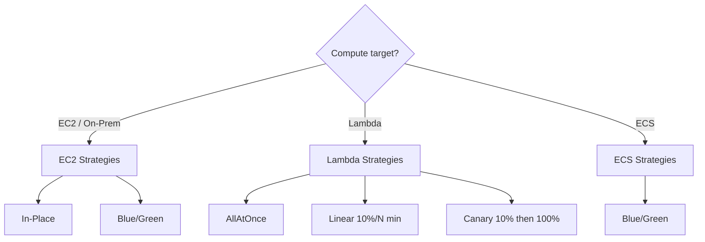
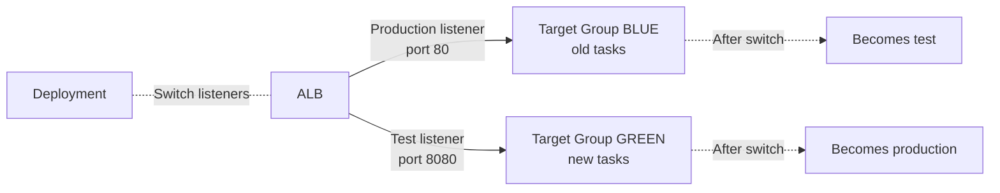
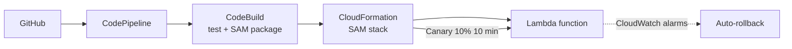
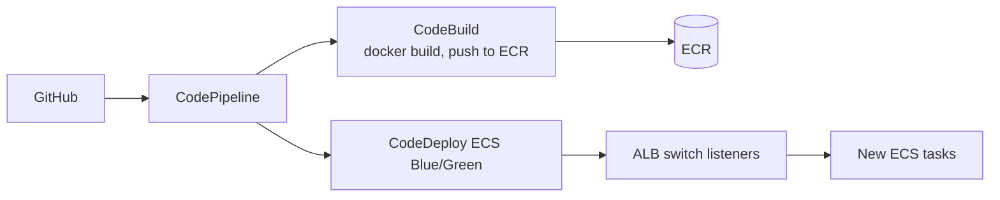
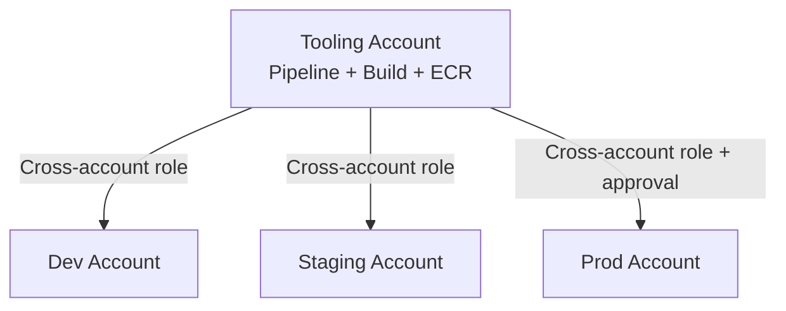

# CI/CD on AWS — CodePipeline, CodeBuild, CodeDeploy

> 🔥 **Deployment strategies (Blue/Green, Canary) are exam favorites.** Know CodeDeploy patterns.

## Problem It Solves
Manual deployments are slow and risky. Modern teams need:
- Code commits trigger automated tests
- Tests pass → automatic deploy to staging
- Staging healthy → automatic or one-click prod deploy
- Bad deploys auto-roll back

**The AWS CodeFamily handles all stages**, integrated end-to-end.

## The CodeFamily



| Service | Purpose |
|---|---|
| **CodeCommit** | Git repo (Hosted on AWS) — legacy, often GitHub used instead |
| **CodePipeline** | Orchestrate stages of CI/CD |
| **CodeBuild** | Run builds and tests in containers |
| **CodeDeploy** | Deploy to compute targets with strategies |
| **CodeArtifact** | Package registry (npm, PyPI, Maven, etc.) |
| **CodeGuru** | Automated code review + performance |

---

## CodePipeline — Orchestration



```
KEY CONCEPTS:
─────────────────────────────────────────────
PIPELINE   → Top-level workflow
STAGES     → Sequential phases (Source, Build, Deploy)
ACTIONS    → Steps within a stage (can be parallel)
ARTIFACTS  → Files passed between stages (stored in S3)
TRANSITIONS→ Conditions between stages

PIPELINE TYPES:
─────────────────────────────────────────────
V1: Original, less features
V2 (modern): Improved, supports trigger filters, etc.
```

### Common Stage Types

```
SOURCE STAGE:
─────────────────────────────────────────────
- CodeCommit (AWS git)
- GitHub (App connection or webhook)
- Bitbucket
- S3 (object trigger)
- ECR (container image push)

BUILD STAGE:
─────────────────────────────────────────────
- CodeBuild (compile, test, package)
- Jenkins (legacy integration)

DEPLOY STAGE:
─────────────────────────────────────────────
- CodeDeploy (EC2/ECS/Lambda/on-prem)
- CloudFormation (deploy stacks)
- ECS direct (blue/green via CodeDeploy)
- Elastic Beanstalk
- S3 (static site)
- App Runner / Amplify

APPROVAL STAGE:
─────────────────────────────────────────────
- Manual approval — pause for human OK
- Notifies via SNS
```

### Cross-Account / Cross-Region

```
CROSS-ACCOUNT:
─────────────────────────────────────────────
Pipeline in central account
Deploys to many target accounts
Uses cross-account roles + KMS keys

CROSS-REGION:
─────────────────────────────────────────────
Replicate artifacts to target regions
Or use single pipeline that hits multi-region deploys
```

---

## CodeBuild — Build & Test

```yaml
# buildspec.yml
version: 0.2
phases:
  install:
    runtime-versions:
      python: 3.11
    commands:
      - pip install -r requirements.txt
  pre_build:
    commands:
      - pytest tests/unit
  build:
    commands:
      - docker build -t myapp:$CODEBUILD_BUILD_NUMBER .
      - docker push $ECR_REPO:$CODEBUILD_BUILD_NUMBER
  post_build:
    commands:
      - echo "Build complete"
artifacts:
  files:
    - imageDefinitions.json
```

```
KEY FEATURES:
─────────────────────────────────────────────
✅ Serverless — no build server to manage
✅ Pre-built images (Linux, Windows, Python, Java, Node, etc.)
✅ Bring your own Docker image
✅ Parallel builds (batch builds)
✅ VPC integration (build with private resources)
✅ Caching (Docker layers, dependencies)

USE CASES:
─────────────────────────────────────────────
- Compile code
- Run unit/integration tests
- Build container images → push to ECR
- Static analysis / security scans
- Generate deployment artifacts
```

---

## CodeDeploy — Deployment Strategies 🔥



### Deployment Strategies Explained

```
ALL AT ONCE:
─────────────────────────────────────────────
Deploy to 100% immediately
✅ Fastest
❌ Highest risk
Use: Dev, low-stakes services

ROLLING (in-place):
─────────────────────────────────────────────
Update batches of instances at a time
✅ No extra infrastructure
❌ Mixed versions during deployment
Use: Cost-sensitive prod, stateless services

BLUE/GREEN:
─────────────────────────────────────────────
Stand up entirely new (green) fleet
Test, then switch traffic from blue → green
✅ Easy rollback (switch back)
✅ Zero downtime
❌ 2x infrastructure during deployment
Use: Critical production services

CANARY:
─────────────────────────────────────────────
Route % of traffic to new version
Monitor metrics
If healthy: shift more / 100%
If issues: roll back
✅ Limit blast radius of bad deploys
✅ Real-traffic validation
Use: APIs, services with measurable success metrics

LINEAR (Lambda only):
─────────────────────────────────────────────
Gradually shift X% every N minutes
e.g., 10% every 1 min over 10 min
Auto-rollback on alarm
```

### Lambda Traffic Shifting Patterns

```
NAMED PATTERNS (CodeDeploy built-in):
─────────────────────────────────────────────
LambdaAllAtOnce         → 100% instant
LambdaLinear10PercentEvery1Minute  → +10% every minute
LambdaLinear10PercentEvery2Minutes
LambdaLinear10PercentEvery3Minutes
LambdaLinear10PercentEvery10Minutes
LambdaCanary10Percent5Minutes      → 10% for 5 min, then 100%
LambdaCanary10Percent10Minutes
LambdaCanary10Percent15Minutes
LambdaCanary10Percent30Minutes
```

### Lifecycle Hooks

```yaml
# appspec.yml for Lambda
version: 0.0
Resources:
  - myFunction:
      Type: AWS::Lambda::Function
      Properties:
        Name: MyFunction
        Alias: live
        CurrentVersion: 1
        TargetVersion: 2
Hooks:
  - BeforeAllowTraffic: !Ref PreTrafficHook
  - AfterAllowTraffic: !Ref PostTrafficHook
```

```
LAMBDA HOOKS:
─────────────────────────────────────────────
- BeforeAllowTraffic: Run smoke tests BEFORE shifting
- AfterAllowTraffic: Validate AFTER shifting

EC2 HOOKS:
─────────────────────────────────────────────
- ApplicationStop, BeforeInstall, AfterInstall
- ApplicationStart, ValidateService
- Each runs custom scripts on the instance

ECS HOOKS:
─────────────────────────────────────────────
- BeforeInstall, AfterInstall
- BeforeAllowTestTraffic, AfterAllowTestTraffic
- AfterAllowTraffic
```

### Auto-Rollback

```
TRIGGERS FOR AUTO-ROLLBACK:
─────────────────────────────────────────────
- CloudWatch Alarms (e.g., error rate spike)
- Failed deployment events
- Manual revert via console/CLI

PATTERN:
─────────────────────────────────────────────
Deploy → Watch CloudWatch alarms during canary period
Alarm fires → Auto-revert traffic to old version
```

---

## ECS Blue/Green Deployments



```
ECS BLUE/GREEN STEPS:
─────────────────────────────────────────────
1. Two target groups: BLUE (live) and GREEN (new)
2. ALB has two listeners: prod (80) and test (8080)
3. CodeDeploy launches new tasks to GREEN target group
4. GREEN gets test traffic on 8080 — run tests
5. After validation, ALB swaps target groups
   - Prod listener now points to GREEN
   - Test listener now points to BLUE
6. Wait period (e.g., 5 min) before terminating BLUE
7. Rollback = just swap back
```

---

## CodeArtifact

```
PACKAGE REGISTRY:
─────────────────────────────────────────────
- npm (Node)
- PyPI (Python)
- Maven / Gradle (Java)
- NuGet (.NET)
- Generic (binaries)

USE:
─────────────────────────────────────────────
✅ Private internal package hosting
✅ Proxy public registries (with caching, security)
✅ Cross-account package sharing
✅ Vulnerability scanning integration
```

---

## CodeGuru

```
TWO PRODUCTS:
─────────────────────────────────────────────

CODEGURU REVIEWER:
- ML-based code review for pull requests
- Java, Python
- Identifies code quality issues, AWS best practice violations
- Integrates with GitHub, CodeCommit, Bitbucket

CODEGURU PROFILER:
- Production performance profiling
- Identifies CPU hotspots, memory leaks
- Recommendations for optimization
- Java, JVM languages
```

---

## Modern CI/CD Patterns

### Pattern 1: Lambda Function CI/CD



### Pattern 2: Container Service CI/CD



### Pattern 3: Multi-Account Deploy



```
SETUP:
─────────────────────────────────────────────
- Pipeline in tooling account
- Cross-account IAM roles for each target
- KMS key shared so artifacts are decryptable
- Manual approval before prod stage
```

---

## When to Use What

| Need | Solution |
|---|---|
| Source control on AWS | CodeCommit (or GitHub) |
| Run builds + tests | **CodeBuild** |
| Orchestrate multi-stage CI/CD | **CodePipeline** |
| Deploy with rollback to EC2/ECS/Lambda | **CodeDeploy** |
| Blue/green for ECS | **CodeDeploy ECS Blue/Green** |
| Canary deployments for Lambda | **CodeDeploy + Lambda alias shifting** |
| Private package registry | **CodeArtifact** |
| Automated code review | **CodeGuru Reviewer** |
| Production profiling | **CodeGuru Profiler** |
| Infrastructure as code in pipeline | **CodePipeline + CloudFormation** |
| Containerized builds | **CodeBuild with custom Docker image** |

## When NOT to Use

- ❌ Don't use CodeCommit if you're already on GitHub — GitHub integration is fine
- ❌ Don't roll your own deployment script when CodeDeploy strategies exist
- ❌ Don't skip canary/blue-green for critical services
- ❌ Don't deploy without auto-rollback configured

## Trade-offs

| Choice | Gain | Sacrifice |
|---|---|---|
| Blue/Green over Rolling | Easy rollback, zero downtime | 2x infra cost during deployment |
| Canary over All-at-once | Limit blast radius | Slower deployment |
| CodeBuild over Jenkins | Serverless, no maintenance | Less plugin ecosystem |
| CodePipeline over custom orchestration | Native AWS integration | AWS-only |
| Manual approval | Safety net | Slows deploys |

## Real World Example

**A SaaS startup:**
- **GitHub** for source (devs prefer GitHub UI)
- **CodePipeline** triggered on push to main
- **CodeBuild**: pytest, mypy, docker build, push to **ECR**
- **CodeDeploy ECS Blue/Green** to ECS Fargate cluster
- ALB swaps listeners on green → live
- **CloudWatch alarms** on 5xx error rate → auto-rollback
- **Manual approval** before prod stage
- All in one **CodePipeline** with cross-account deploys to staging/prod accounts

**An enterprise:**
- Multi-account pipeline (tooling + dev + staging + prod)
- Approval gates between stages
- CodeArtifact for internal Java packages
- CodeGuru Reviewer comments on every PR
- Canary 10% / 30 min for critical APIs
- Auto-rollback on synthetic canary failures

## 🎯 Exam Soundbite

> "AWS CodePipeline orchestrates CI/CD with stages — Source (CodeCommit/GitHub), Build (CodeBuild), Test, and Deploy (CodeDeploy/CloudFormation). CodeDeploy supports multiple deployment strategies: in-place rolling for EC2, blue/green for EC2 and ECS, and traffic-shifting linear or canary for Lambda. Use blue/green or canary with CloudWatch alarm-based auto-rollback for critical production services. For multi-account architectures, host the pipeline in a tooling account and use cross-account IAM roles to deploy to dev, staging, and production accounts with approval gates between stages."

---

## ⚡ Quick Recall Card

```
┌─────────────────────────────────────────────────┐
│ DEPLOYMENT STRATEGIES                            │
├─────────────────────────────────────────────────┤
│ All at once     100% instant — risky             │
│ Rolling         Batch update in-place            │
│ Blue/Green      New fleet, swap traffic          │
│ Canary          % traffic shift then 100%        │
│ Linear (Lambda) Gradual % over time              │
├─────────────────────────────────────────────────┤
│ COMPUTE TARGET → STRATEGY                        │
│ EC2 / On-prem   In-Place or Blue/Green           │
│ Lambda          AllAtOnce / Linear / Canary      │
│ ECS             Blue/Green                       │
├─────────────────────────────────────────────────┤
│ HOOKS                                            │
│ Lambda          BeforeAllowTraffic, After...     │
│ EC2             8 lifecycle events               │
│ ECS             3 main hooks                     │
├─────────────────────────────────────────────────┤
│ AUTO-ROLLBACK                                    │
│ Trigger on CloudWatch alarm                      │
│ Deployment failure                               │
│ Manual revert                                    │
└─────────────────────────────────────────────────┘
```

## 🎓 Common Exam Patterns

> **"Lambda function processing payments. Want to shift 10% to new version for 30 min before going to 100%. Auto-rollback on error rate spike."**
>
> ✅ **CodeDeploy Lambda Canary10Percent30Minutes** deployment with **CloudWatch alarm** on error rate triggering **auto-rollback**.

> **"ECS service deploys cause 2-3 min of mixed-version chaos. Want zero overlap."**
>
> ✅ **CodeDeploy ECS Blue/Green** — entirely new task set tested, then ALB listener swap = atomic cutover.

> **"Pipeline in tooling account needs to deploy CloudFormation stacks to 4 target accounts."**
>
> ✅ **Cross-account IAM roles** assumed by CodePipeline. Shared KMS key for artifact decryption. CloudFormation Deploy action in each stage targeting different account.
