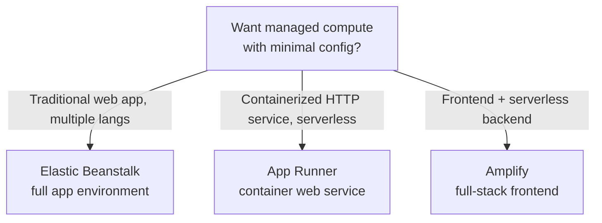
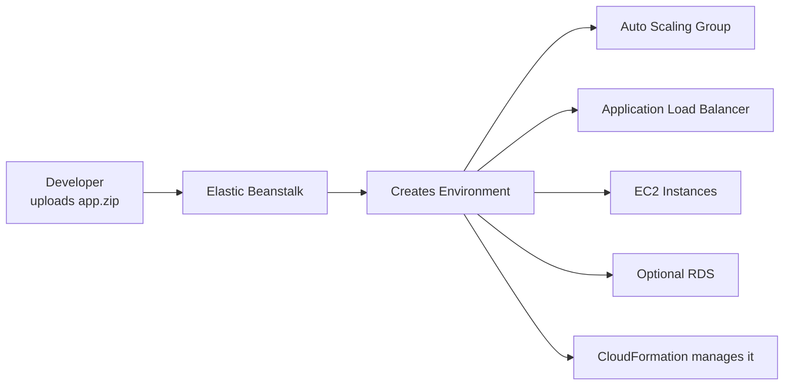
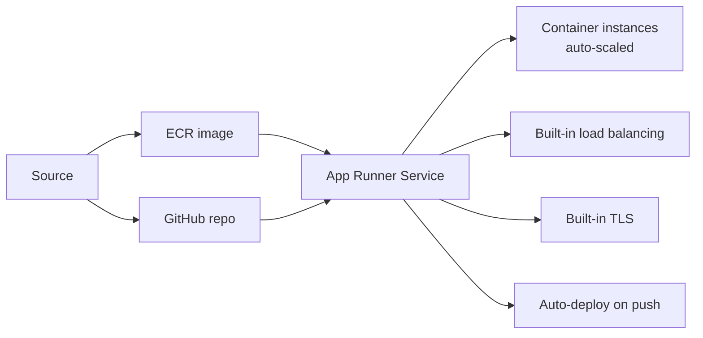
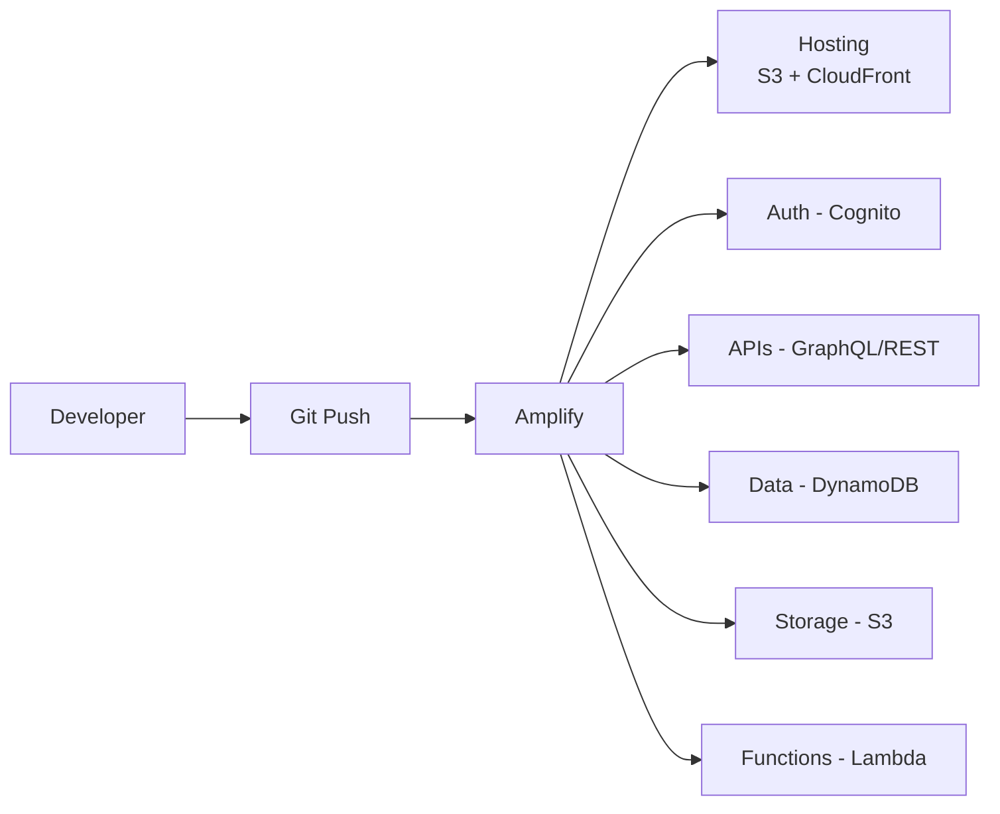
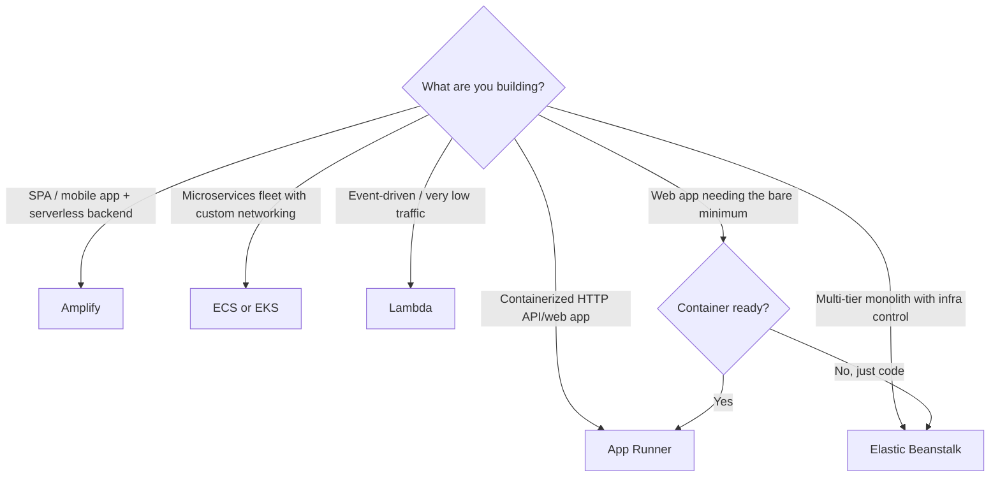

# PaaS on AWS — Beanstalk, App Runner, Amplify

> 🔥 **"Easiest deployment" questions point to these.** Know each one's sweet spot.

## Problem It Solves
Sometimes you don't want to architect VPCs, ALBs, ECS tasks, IAM roles, autoscaling groups. You just want to push code and have it run. These three Platform-as-a-Service offerings abstract the infrastructure.

## The Three PaaS Services



| | **Elastic Beanstalk** | **App Runner** | **Amplify** |
|---|---|---|---|
| Year introduced | 2011 (mature) | 2021 (modern) | 2018 |
| Compute | EC2 + ASG + ALB | Fargate-like serverless | Lambda + S3 + CloudFront |
| Best for | Java/.NET/Python/Node/Ruby/PHP/Go monoliths | Containerized HTTP APIs | Web/mobile frontend apps |
| Infrastructure visibility | High (you see EC2, ALB) | Low (fully managed) | Minimal |
| Deployment | Upload zip, Beanstalk handles | Push to ECR or GitHub | Connect Git repo |
| Modern verdict | Legacy-friendly | ⭐ Modern container PaaS | ⭐ Frontend specialist |

---

## Elastic Beanstalk



```
HOW IT WORKS:
─────────────────────────────────────────────
1. Upload code (zip, war, or Docker image)
2. Choose platform (Python, Node, Java, etc.)
3. Beanstalk provisions:
   - EC2 with chosen runtime
   - Auto Scaling Group
   - Application Load Balancer
   - Health monitoring
   - Optional: RDS DB
4. Push new versions to deploy

SUPPORTED PLATFORMS:
─────────────────────────────────────────────
- Java SE / Tomcat
- .NET on Windows / .NET Core
- Node.js
- PHP
- Python
- Ruby
- Go
- Docker (Single or Multi-container)
```

### Deployment Modes

```
ALL AT ONCE:
─────────────────────────────────────────────
Update all instances simultaneously
⚠️ Downtime during deployment
Fastest

ROLLING:
─────────────────────────────────────────────
Update batches in-place
Some capacity reduced during deployment
Default for many cases

ROLLING WITH ADDITIONAL BATCH:
─────────────────────────────────────────────
Launch extra batch first, then rolling update
Maintains full capacity throughout
✅ Better for production

IMMUTABLE:
─────────────────────────────────────────────
Launch new ASG with new version
If healthy, terminate old ASG
✅ Safest, zero capacity loss

BLUE/GREEN (via swap-CNAME):
─────────────────────────────────────────────
Two environments — swap DNS to switch
Easy rollback (swap back)
```

### Environment Types

```
WEB SERVER ENVIRONMENT:
─────────────────────────────────────────────
HTTP/HTTPS requests via ALB
Auto-scales based on load

WORKER ENVIRONMENT:
─────────────────────────────────────────────
Background processing
Reads from SQS queue
Scales based on queue depth
✅ For async jobs / background tasks
```

### Configuration via .ebextensions

```yaml
# .ebextensions/myconfig.config
option_settings:
  aws:autoscaling:asg:
    MinSize: 2
    MaxSize: 10

container_commands:
  01_migrate:
    command: "python manage.py migrate"
    leader_only: true
```

```
BEANSTALK CONFIGURATION:
─────────────────────────────────────────────
.ebextensions/ folder in app zip
- option_settings: configure environment
- container_commands: run during deploy
- packages: install OS packages
- files: place files on instances
```

### Beanstalk Verdict in 2026

```
WHEN TO USE BEANSTALK:
─────────────────────────────────────────────
✅ Legacy enterprise apps moving to AWS
✅ Need EC2 infrastructure visibility
✅ Customizable instance configuration
✅ Want managed ALB + ASG without writing IaC

WHEN NOT TO:
─────────────────────────────────────────────
❌ Greenfield modern apps → use App Runner / ECS / Lambda
❌ Containerized microservices → use ECS Fargate
❌ True serverless → use Lambda + API Gateway
```

---

## App Runner



```
APP RUNNER IS THE MODERN PAAS:
─────────────────────────────────────────────
✅ Fully serverless (Fargate under the hood)
✅ Build from GitHub OR run from ECR image
✅ Built-in load balancer
✅ Built-in HTTPS / TLS termination
✅ Auto-scales (set min/max instances + concurrency)
✅ Custom domains
✅ Per-second billing
✅ No VPC required (but can connect to VPC)

USE CASES:
─────────────────────────────────────────────
✅ Containerized HTTP API
✅ Web app on a container
✅ Don't want to manage ECS / Kubernetes
✅ Want simpler than Lambda for HTTP services
```

### App Runner Sources

```
SOURCE CODE (BUILD FROM REPO):
─────────────────────────────────────────────
- Connect GitHub repo
- App Runner builds your code
- Supports Python, Node.js, Java, .NET, Ruby, Go, PHP
- Auto-build + deploy on push

CONTAINER IMAGE (ECR):
─────────────────────────────────────────────
- Pre-built image from ECR
- App Runner just runs it
- Auto-deploy on image push (optional)
```

### App Runner VPC Connector

```
PRIVATE RESOURCE ACCESS:
─────────────────────────────────────────────
By default, App Runner runs in AWS-managed network
Use VPC Connector to reach:
- RDS in private subnets
- ElastiCache
- Internal services

How: Specify subnets and security groups
```

### App Runner vs ECS Fargate

```
APP RUNNER:
─────────────────────────────────────────────
✅ One-click deployment from Git or ECR
✅ Built-in everything (LB, TLS, auto-scaling)
✅ Simpler — less config
❌ HTTP only
❌ Less control

ECS FARGATE:
─────────────────────────────────────────────
✅ Any networking protocol
✅ Fine-grained config
✅ Multiple containers per task
✅ Service discovery, sidecars
❌ More setup (task def, service, ALB, etc.)
```

### App Runner vs Lambda + API Gateway

```
APP RUNNER:
─────────────────────────────────────────────
✅ Long-running container (no cold start)
✅ Persistent connections (WebSockets work great)
✅ Per-second billing while running
✅ Easier "lift" of containerized apps

LAMBDA + API GW:
─────────────────────────────────────────────
✅ True serverless (scales to zero)
✅ Pay per request (cheaper for variable traffic)
❌ Cold starts
❌ 15-minute limit
❌ Stateless
```

---

## AWS Amplify



```
AMPLIFY IS A FULL-STACK FRAMEWORK:
─────────────────────────────────────────────
Two main products:

AMPLIFY HOSTING:
✅ Static site hosting with CI/CD from Git
✅ Built on S3 + CloudFront
✅ Branch-based previews
✅ Custom domains + free TLS
✅ Pull request preview deploys

AMPLIFY BACKEND:
✅ Pre-built services for frontend devs:
   - Auth (Cognito under the hood)
   - APIs (GraphQL via AppSync, or REST via API Gateway+Lambda)
   - Database (DynamoDB)
   - Storage (S3)
   - Functions (Lambda)
   - Analytics (Pinpoint)
   - Notifications

✅ CLI generates infra for you
✅ Frontend SDK handles auth, API calls, file uploads

USE CASES:
─────────────────────────────────────────────
✅ Single-page apps (React, Vue, Angular, Next.js)
✅ Mobile apps (React Native, iOS, Android)
✅ Static site with serverless backend
✅ Rapid prototyping
✅ Frontend devs without DevOps support
```

### Amplify Hosting Features

```
GIT-BASED DEPLOYS:
─────────────────────────────────────────────
Connect repo → push to branch → auto-deploy
- Main branch → production
- Other branches → preview environments
- Pull requests → ephemeral preview environments

BUILD CONFIGURATION:
─────────────────────────────────────────────
amplify.yml defines build steps
Similar to buildspec.yml

EDGE FUNCTIONS:
─────────────────────────────────────────────
Lambda@Edge / CloudFront Functions
Server-side rendering for Next.js

PERFORMANCE:
─────────────────────────────────────────────
CloudFront-backed = global edge cache
HTTP/2, brotli compression
```

### Amplify Studio

```
VISUAL UI BUILDER:
─────────────────────────────────────────────
Build React components visually
Bind to data models (auto-generated CRUD)
Sync to code repo

USE: Designers + frontend devs collaborate
```

---

## Comparison Summary



### Decision by Workload

| Workload | Best PaaS |
|---|---|
| Java Spring Boot app, traditional 3-tier | **Beanstalk** |
| Containerized Python API | **App Runner** |
| React SPA with Cognito auth | **Amplify** |
| Mobile app backend + Cognito | **Amplify** |
| Node.js Express on EC2 lift-and-shift | **Beanstalk** |
| Dockerized FastAPI service | **App Runner** |
| Static marketing site | **Amplify Hosting** |
| GraphQL API with DDB | **Amplify (AppSync)** |
| Background worker | **Beanstalk Worker** or ECS |
| Internal microservice fleet | **ECS / EKS** (not PaaS) |
| Burst event processing | **Lambda** (not PaaS) |

---

## When NOT to Use PaaS

- ❌ Don't use PaaS if you need fine-grained networking (multiple subnets, complex routing) — use ECS / EKS
- ❌ Don't use Beanstalk for new container workloads — use ECS Fargate or App Runner
- ❌ Don't use Amplify for highly custom architectures — manage components yourself
- ❌ Don't use App Runner if you need non-HTTP protocols — use NLB-based services

## Trade-offs

| Choice | Gain | Sacrifice |
|---|---|---|
| Beanstalk over ECS | Quick start | Less flexible |
| App Runner over ECS Fargate | Even simpler | HTTP-only, less config |
| Amplify over building yourself | Speed, integrations | Vendor lock-in feel |
| PaaS over IaaS | Less ops work | Less customization |

## Real World Example

**A startup MVP:**
- **Amplify** for the React frontend + auth via Cognito
- **AppSync (via Amplify)** for the GraphQL API
- **DynamoDB** (via Amplify data model)
- Zero infrastructure code written
- Launched in 2 weeks

**An enterprise migrating a Java monolith:**
- Java Spring Boot app currently on-prem
- **Elastic Beanstalk** for lift-and-shift (Java SE platform)
- RDS attached via Beanstalk
- Eventually refactored to microservices on ECS Fargate

**An internal company tool:**
- Containerized Python FastAPI service
- **App Runner** for the API (5-min deploy from ECR)
- **CloudFront** in front for caching
- Aurora Serverless v2 via VPC Connector
- Replaces what would have been ECS + ALB + ASG complexity

## 🎯 Exam Soundbite

> "AWS offers three Platform-as-a-Service options. Elastic Beanstalk is the mature option supporting multiple language platforms with EC2 + ASG + ALB visibility — best for traditional web apps and lift-and-shift. App Runner is the modern serverless container PaaS — fully managed Fargate-style HTTP service deployment from GitHub or ECR with built-in load balancing, TLS, and auto-scaling. Amplify is a full-stack framework optimized for frontend developers — combines static hosting on CloudFront/S3 with serverless backends via Cognito, AppSync, DynamoDB, and Lambda. Pick Beanstalk for legacy, App Runner for modern containers, Amplify for SPAs/mobile apps."

---

## ⚡ Quick Recall Card

```
┌─────────────────────────────────────────────────┐
│ AWS PaaS CHOICES                                 │
├─────────────────────────────────────────────────┤
│ ELASTIC BEANSTALK                                │
│   Mature, multi-platform                         │
│   EC2 + ASG + ALB (you see the infra)            │
│   Worker env for SQS-based jobs                  │
│   Use: Legacy lift-and-shift                     │
│                                                  │
│ APP RUNNER                                       │
│   Modern container PaaS                          │
│   Build from Git or run ECR image                │
│   Built-in LB, TLS, auto-scaling                 │
│   Use: Containerized HTTP services               │
│                                                  │
│ AMPLIFY                                          │
│   Frontend specialist                            │
│   Hosting (S3 + CloudFront) + Git-based deploys  │
│   Backend: Auth, API, Data, Storage              │
│   Use: SPAs, mobile apps, full-stack JS          │
└─────────────────────────────────────────────────┘
```

## 🎓 Common Exam Patterns

> **"Want to deploy a containerized FastAPI app with minimum configuration. Connect to private RDS."**
>
> ✅ **App Runner** with VPC Connector to reach RDS. Built-in everything else.

> **"React SPA needs hosting + Cognito auth + GraphQL API + DynamoDB. Small team, fast launch."**
>
> ✅ **Amplify** — hosting + auth + AppSync + DDB all in one framework, deployable via CLI.

> **"Lift-and-shift Java Spring Boot app to AWS. Want to keep some control over EC2 instance configuration."**
>
> ✅ **Elastic Beanstalk** (Java SE or Tomcat platform). EC2 visibility, optional RDS, easy deployments.
