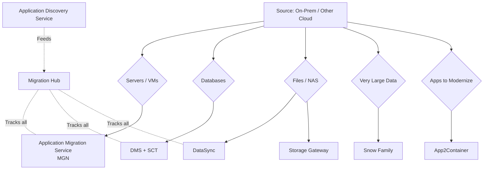
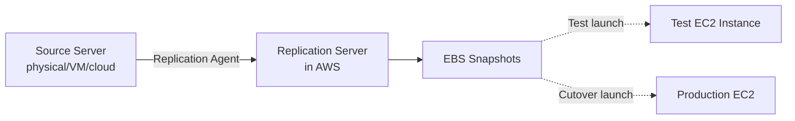
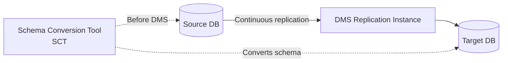
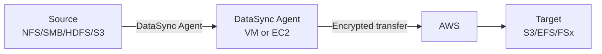
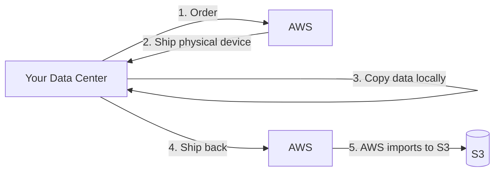
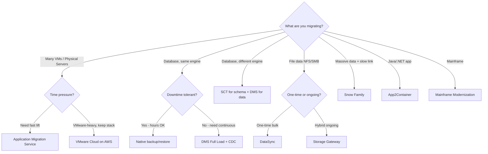

# Migration Services Toolbox

> 🔥 **Domain 4 (20% of exam) is all migration.** Know which service for which scenario.

## Problem It Solves
Moving existing workloads to AWS is a complex puzzle: servers, databases, files, container images, mainframes. Each needs different replication mechanics, different downtime tolerances, different cutover patterns. AWS provides a specialized service for each.

## How It Works — The Migration Toolbox



---

## Application Discovery Service (ADS)

```
PURPOSE:
─────────────────────────────────────────────
Inventory on-prem servers BEFORE migrating
Understand: what runs where, dependencies, utilization

TWO MODES:
─────────────────────────────────────────────
1. Agent-based discovery
   Install agent on each server
   Detailed: processes, network connections, performance
   
2. Agentless discovery (VMware-only)
   Deploy collector VM in vCenter
   Inventories VMs without per-server install

OUTPUTS:
─────────────────────────────────────────────
- Server inventory (CPU, RAM, disk)
- Application dependencies (network maps)
- Performance baselines
- Recommendations for instance sizing in AWS

USE:
─────────────────────────────────────────────
Before any large migration — "what do we even have?"
```

---

## AWS Application Migration Service (MGN)



```
THE LIFT-AND-SHIFT SERVICE:
─────────────────────────────────────────────
Continuously replicates source servers to AWS
Block-level replication (very efficient)
Successor to: SMS (Server Migration Service)
              CloudEndure Migration

WORKFLOW:
─────────────────────────────────────────────
1. Install replication agent on source server
2. Agent streams disk blocks to AWS Replication Server
3. AWS keeps EBS snapshots in sync continuously
4. TEST: Launch a test instance from snapshots (non-disruptive)
5. CUTOVER: Final sync + launch real instance
6. Decommission source

DOWNTIME:
─────────────────────────────────────────────
Minutes only — final delta sync + boot

USE:
─────────────────────────────────────────────
✅ Lift-and-shift many servers quickly
✅ Data center exit deadlines
✅ Don't want to refactor (yet)
```

---

## Database Migration Service (DMS)



### DMS Key Features

```
SOURCE/TARGET COMBINATIONS:
─────────────────────────────────────────────
Sources: MySQL, PG, Oracle, SQL Server, MariaDB,
         MongoDB, S3, Aurora, DocumentDB, Cassandra,
         IBM DB2, SAP ASE, Azure SQL, RDS

Targets: All RDS engines, Aurora, Redshift, S3,
         DynamoDB, OpenSearch, Kinesis, Kafka,
         DocumentDB, Neptune, Babelfish

MIGRATION TYPES:
─────────────────────────────────────────────
1. Full Load only      → One-time copy
2. CDC only            → Replicate ongoing changes
3. Full Load + CDC ⭐   → Initial copy then ongoing
   (Use this for zero-downtime migration)

CONTINUOUS REPLICATION:
─────────────────────────────────────────────
After full load, DMS replicates ongoing changes
Source DB keeps serving production traffic
Test target before cutover
Cutover = stop writes to source, wait for last
          changes, redirect app to target

ENGINE CHANGES:
─────────────────────────────────────────────
Same engine (MySQL → MySQL): no schema change
Different engine (Oracle → Aurora PG):
  Use SCT to convert schemas FIRST
  Then DMS migrates the data
```

### Schema Conversion Tool (SCT)

```
CONVERTS:
─────────────────────────────────────────────
- Tables, indexes, views
- Stored procedures, functions, triggers
- Identifies what cannot auto-convert
  → Generates assessment report

USE:
─────────────────────────────────────────────
✅ Oracle → Aurora PostgreSQL (very common!)
✅ SQL Server → Aurora MySQL/PG
✅ Oracle data warehouse → Redshift

OUTPUT:
─────────────────────────────────────────────
Migrated DDL scripts you apply to target
Plus a percentage of compatible objects
And manual conversion guidance for the rest
```

---

## DataSync — File Replication



```
PURPOSE:
─────────────────────────────────────────────
Move FILE data between storage systems
- On-prem NFS/SMB → S3/EFS/FSx
- S3 → EFS / FSx
- AWS region → AWS region
- HDFS → S3

KEY FEATURES:
─────────────────────────────────────────────
✅ 10x faster than open-source tools (proprietary protocol)
✅ Encryption in transit
✅ Bandwidth throttling
✅ Incremental transfers
✅ Schedule one-time or recurring
✅ File integrity verification
✅ Metadata preservation (POSIX, NTFS ACLs)
✅ Can connect via Direct Connect (faster)

USE:
─────────────────────────────────────────────
✅ Initial bulk migration of file shares
✅ Ongoing replication for HA/DR
✅ Periodic snapshots from S3 to FSx for ML training
```

### DataSync vs Storage Gateway

```
DATASYNC:
─────────────────────────────────────────────
✅ One-time / scheduled bulk transfer
✅ Move data INTO AWS
✅ For migrations and DR sync

STORAGE GATEWAY:
─────────────────────────────────────────────
✅ Ongoing hybrid access (read/write)
✅ On-prem app continues to use it
✅ Caches frequently-accessed data on-prem
✅ Types: File Gateway, Volume Gateway, Tape Gateway
```

---

## AWS Snow Family — Offline Data Transfer



### The Snow Family Lineup

| Device | Storage | Form Factor | Use Case |
|---|---|---|---|
| **Snowcone** | 8 TB HDD / 14 TB SSD | 2 kg portable | Edge compute, small data, IoT |
| **Snowcone SSD** | 14 TB SSD | 2 kg | Faster IO at edge |
| **Snowball Edge Storage Optimized** | 80 TB | 50 lb suitcase | Standard migration |
| **Snowball Edge Compute Optimized** | 39 TB + 52 vCPU + GPU | 50 lb suitcase | Edge ML inference |
| **Snowmobile** | 100 PB | 45 ft truck | Massive data center exit |

```
KEY DECISION:
─────────────────────────────────────────────
Calculate transfer time over your bandwidth.
If > weeks → Snow Family

Example:
  100 TB over 1 Gbps = ~10 days (theoretical)
  In practice = much longer (other traffic, contention)
  Snowball Edge: ~1 week round trip
  
  10 PB over 10 Gbps = months
  Snowmobile: weeks

SECURITY:
─────────────────────────────────────────────
✅ HSM (Hardware Security Module) for encryption
✅ Tamper-resistant + tamper-evident
✅ KMS for keys; AWS owned during transit
✅ E-ink display shows shipping label (no manual swap)
```

### Snowball Edge — Edge Compute

```
NOT JUST STORAGE — RUNS WORKLOADS:
─────────────────────────────────────────────
✅ EC2-compatible instances on the device
✅ Lambda functions on the device
✅ S3-compatible storage on the device

USE CASES:
─────────────────────────────────────────────
✅ Remote oil rigs / ships (no/intermittent connectivity)
✅ Military deployments
✅ Manufacturing floor edge ML
✅ Disconnected video editing
```

---

## App2Container (A2C) — Containerize Legacy Apps

```
PURPOSE:
─────────────────────────────────────────────
Analyzes Java or .NET apps running on Linux/Windows
Generates:
- Dockerfile
- Container image
- ECS/EKS deployment configs
- CloudFormation template

WORKFLOW:
─────────────────────────────────────────────
1. Run a2c init on the server
2. a2c inventory → finds apps
3. a2c analyze APP-ID → understands deps
4. a2c containerize → builds image
5. a2c generate → creates ECS/EKS configs
6. Deploy → modernize without rewriting

USE:
─────────────────────────────────────────────
✅ Tomcat / Jetty / JBoss Java apps
✅ .NET Framework apps on IIS
✅ Want to modernize without code changes
```

---

## Mainframe Modernization

```
AWS MAINFRAME MODERNIZATION:
─────────────────────────────────────────────
For migrating IBM z/OS or i Series workloads

TWO STRATEGIES:
─────────────────────────────────────────────
1. REPLATFORM (lift-and-shift):
   - Recompile COBOL apps to run on x86 Linux
   - AWS provides the runtime (BluAge or Micro Focus)
   - Mainframe-like environment without mainframe hardware

2. REFACTOR:
   - Convert COBOL → modern language (Java, .NET)
   - Auto-transformation tools (BluAge)
   - Then run as standard containers/EC2

USE:
─────────────────────────────────────────────
Banks, government, insurance with COBOL apps
Cost reduction from leaving mainframe
```

---

## Migration Hub — The Mission Control

```
PURPOSE:
─────────────────────────────────────────────
Single pane of glass for ALL your migrations
Tracks:
- Server migrations (MGN, SMS legacy)
- Database migrations (DMS)
- Refactor projects (Migration Hub Refactor Spaces)

FEATURES:
─────────────────────────────────────────────
✅ Discovery integration (ADS feeds here)
✅ Application portfolio mapping
✅ Migration progress dashboards
✅ Cost estimation (Migration Hub Strategy)
✅ Refactor Spaces — incremental microservice extraction
```

---

## Migration Decision Tree



## When to Use What

| Scenario | Service |
|---|---|
| 500 VMware VMs to AWS, no refactor | **MGN** (or **VMC**) |
| Oracle → Aurora PostgreSQL | **SCT + DMS** |
| MySQL → MySQL on Aurora | **DMS** (no SCT needed) |
| 500 TB on NetApp NAS → FSx for ONTAP | **DataSync** |
| Hybrid file share, ongoing use | **Storage Gateway** |
| Continuous DB replication for DR | **DMS CDC** |
| 5 PB to migrate, slow link | **Snowmobile** or **multiple Snowballs** |
| Edge compute in remote location | **Snowball Edge Compute** |
| Java Tomcat app → containers | **App2Container** |
| Inventory on-prem before migrating | **Application Discovery Service** |
| Track all migration projects | **Migration Hub** |
| Mainframe COBOL → AWS | **Mainframe Modernization** |

## When NOT to Use

- ❌ Don't use **MGN** for database migration — use **DMS** (MGN replicates filesystem, DMS understands data)
- ❌ Don't use **DataSync** for ongoing hybrid access — use **Storage Gateway**
- ❌ Don't use **Snow** when network transfer is faster — analyze bandwidth first
- ❌ Don't use **App2Container** for already-containerized apps — pointless

## Trade-offs

| Choice | Gain | Sacrifice |
|---|---|---|
| MGN over manual rebuild | Fast, low risk | No optimization happens automatically |
| DMS + SCT | Engine change, no licensing | Schema conversion may have manual work |
| DataSync over rsync | 10x faster | $ per GB transferred |
| Snow Family | Bandwidth-independent | Days-weeks logistics |
| Migration Hub | Centralized tracking | Setup overhead |

## Real World Example

**GE Power's** massive lift-and-shift:
- **ADS** to inventory 9,000+ servers
- **MGN** (then CloudEndure) for block-level continuous replication
- **DMS + SCT** for hundreds of Oracle → PostgreSQL conversions
- **DataSync** for petabytes of file shares
- **Snowball** for legacy systems with no DC connectivity
- **Migration Hub** for tracking it all
- Result: Data center exit on schedule

**A SaaS startup**:
- Greenfield rewrite in AWS-native — no migration tools needed!
- But for customer migrations: **DMS** to import customer Oracle DBs into Aurora multi-tenant

## 🎯 Exam Soundbite

> "For server lift-and-shift migrations, use AWS Application Migration Service (MGN) — block-level continuous replication with minimal downtime. For database migrations, use Database Migration Service (DMS) with Schema Conversion Tool (SCT) when changing engines like Oracle to Aurora PostgreSQL. For file data, DataSync handles bulk one-time and scheduled transfers; Storage Gateway provides ongoing hybrid access. For petabyte-scale data with bandwidth constraints, use the Snow Family. Track all migrations centrally with Migration Hub."

---

## ⚡ Quick Recall Card

```
┌─────────────────────────────────────────────────┐
│ MIGRATION SERVICE PICKER                         │
├─────────────────────────────────────────────────┤
│ Inventory on-prem        → Application Discovery │
│ Servers (any source)     → MGN                   │
│ Database same engine     → DMS                   │
│ Database different engine→ SCT + DMS             │
│ File data bulk           → DataSync              │
│ File data hybrid ongoing → Storage Gateway       │
│ Massive offline (PB+)    → Snow Family           │
│ Edge compute             → Snowball Edge Compute │
│ Java/.NET → containers   → App2Container         │
│ Mainframe COBOL          → Mainframe Modernization│
│ Track everything         → Migration Hub         │
└─────────────────────────────────────────────────┘
```

## 🎓 Common Exam Patterns

> **"Need to migrate Oracle DB to Aurora PostgreSQL with minimal downtime. Schema must be converted."**
>
> ✅ **SCT** to convert schema first, **DMS Full Load + CDC** to migrate data with ongoing replication, cut over with minutes of downtime.

> **"500 Linux VMs in on-prem VMware to be migrated to AWS in 3 months. Want minimum effort."**
>
> ✅ **AWS Application Migration Service (MGN)** for block-level replication. Test cutover before final cutover. Minimum downtime per server.

> **"On-prem NFS server with 2 PB of data, need to migrate to S3, 1 Gbps internet link."**
>
> ✅ **AWS Snowmobile** or **multiple Snowball Edge devices** in parallel. 2 PB / 1 Gbps would take months online; Snow is weeks.
