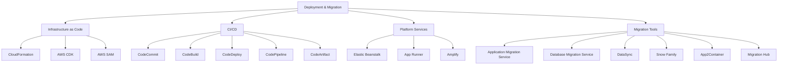

# 06 — Deployment & Migration

> **Exam weight:** ⭐⭐⭐⭐ — Domain 4 alone is 20%. CloudFormation, CI/CD patterns, and migration tools are very common.

---

## 🗺️ Topic Map



---

## 📚 Notes in This Section

| # | Topic | Priority |
|---|---|---|
| 01 | [CloudFormation Deep Dive](./01-cloudformation.md) | 🔥 |
| 02 | [CI/CD Pipelines on AWS](./02-cicd.md) | High |
| 03 | [Elastic Beanstalk & App Runner](./03-paas.md) | Medium |
| 04 | [Migration Services Toolbox](./04-migration-services.md) | 🔥 |

---

## 🎯 The 5 Deployment & Migration Concepts SAP-C02 Loves

```
1. CLOUDFORMATION STACKSETS
   - Deploy stacks across many accounts + regions
   - Self-managed vs service-managed permissions
   - Auto-deploy to new accounts via Organizations

2. DEPLOYMENT STRATEGIES
   - Rolling   = update batches in place
   - Blue/Green = full new env, switch traffic at once
   - Canary    = small % to new, watch metrics
   - Linear    = gradual % shift over time

3. CODE DEPLOY HOOKS
   - Pre/Post hooks for validation, smoke tests
   - Auto-rollback on alarm trigger
   - Works with Lambda, ECS, EC2, on-prem

4. AWS APPLICATION MIGRATION SERVICE (MGN)
   - Successor to SMS and CloudEndure
   - Block-level continuous replication
   - Minimal downtime cutover

5. DMS + SCT
   - DMS = data migration with continuous replication
   - SCT = schema conversion between engines
   - Together: zero-downtime DB migrations across engines
```
