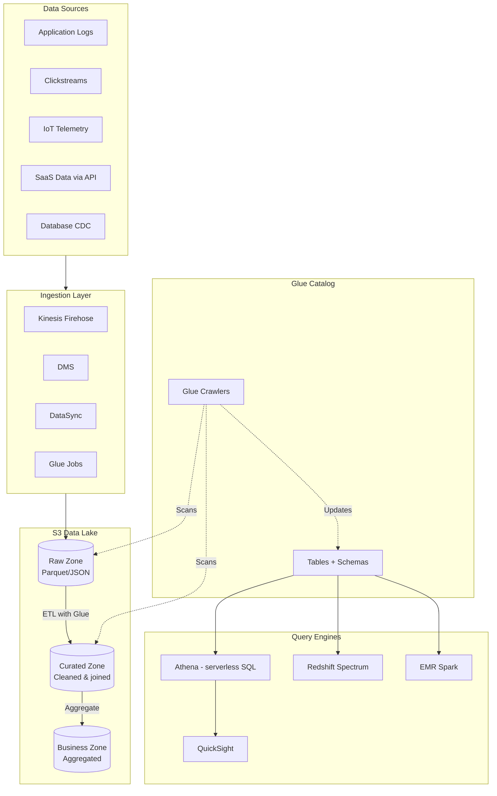
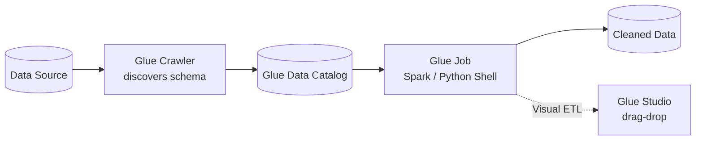
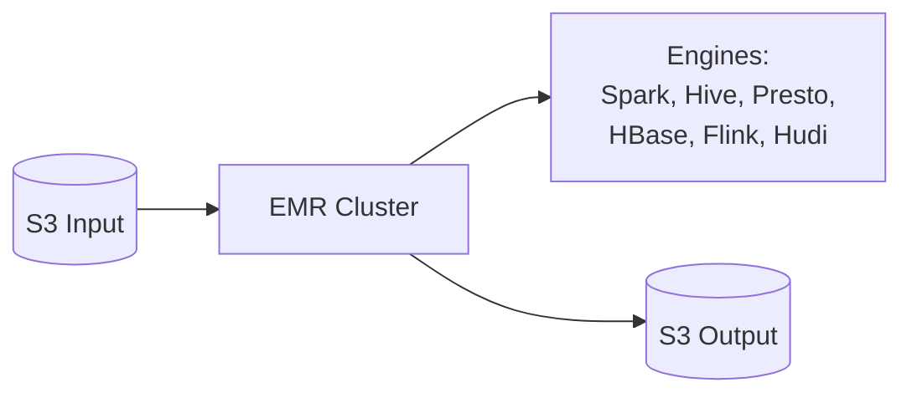
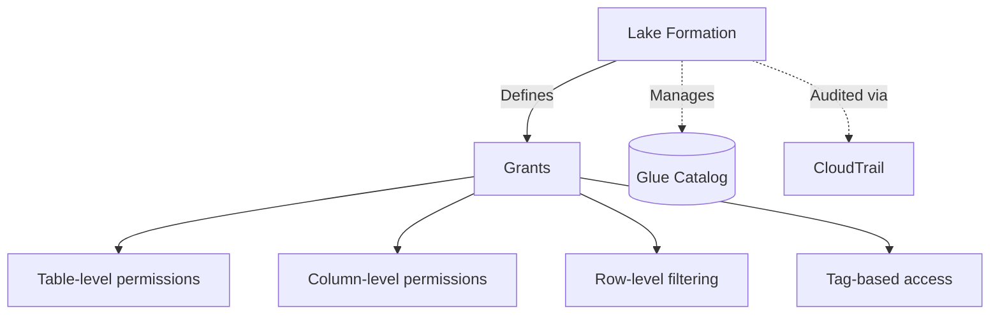
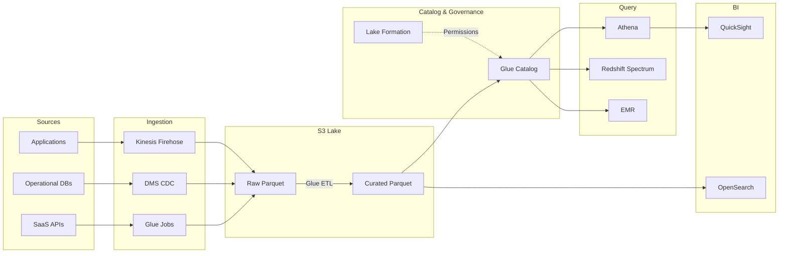

# Data Lake Architecture — S3 + Glue + Athena

> 🔥 **Modern analytics question staple.** Know the S3-based data lake pattern cold.

## Problem It Solves
Traditional data warehouses are expensive, require capacity planning, and hold structured data only. But businesses generate massive amounts of mixed data — logs, clickstreams, IoT, JSON APIs, images. A **data lake** stores raw data cheaply in S3 and lets you query it on-demand with multiple engines — all without copying or loading first.

## How It Works



### The Data Lake Layers (Medallion Architecture)

```
RAW / BRONZE ZONE:
─────────────────────────────────────────────
Raw data, exact format from source
JSON, CSV, logs as they arrive
Retention: long (audit trail, replay)
Cheap storage: Standard-IA or Glacier

CURATED / SILVER ZONE:
─────────────────────────────────────────────
Cleaned, normalized, validated
Schema enforced
Format: Parquet (columnar) for query performance
Typical: deduplicated, joined dimensions

BUSINESS / GOLD ZONE:
─────────────────────────────────────────────
Aggregated, ready for BI / ML
Pre-computed metrics
Used by dashboards directly
```

---

## AWS Glue — The Data Plumbing



### Glue Components

```
GLUE DATA CATALOG:
─────────────────────────────────────────────
Central metadata store — table definitions, schemas
Used by: Athena, Redshift Spectrum, EMR
"Hive metastore" compatible
Versioning of schema changes

GLUE CRAWLERS:
─────────────────────────────────────────────
Scans S3 (or DBs, DDB) to infer schema
Updates Catalog automatically
Schedule: hourly/daily/etc.
Detects partitions

GLUE JOBS:
─────────────────────────────────────────────
ETL execution engine
Spark-based (or Python shell for small jobs)
Auto-scales, serverless
Pay per DPU-hour

GLUE STUDIO:
─────────────────────────────────────────────
Visual ETL builder
Drag-drop transformations
Generates PySpark code

GLUE DATABREW:
─────────────────────────────────────────────
Visual data prep (no code)
For data analysts (not engineers)

GLUE STREAMING ETL:
─────────────────────────────────────────────
ETL on Kinesis / MSK streams in real-time
Spark Structured Streaming under the hood
```

---

## Athena — Serverless SQL on S3

```
PURPOSE:
─────────────────────────────────────────────
Run SQL queries directly against data in S3
- No infrastructure to provision
- Pay per TB scanned
- Uses Glue Catalog for schema

COMMON QUERIES:
─────────────────────────────────────────────
SELECT user_id, COUNT(*) 
FROM clickstream_curated
WHERE event_date BETWEEN '2026-01-01' AND '2026-01-31'
GROUP BY user_id;

PERFORMANCE OPTIMIZATIONS:
─────────────────────────────────────────────
✅ Use Parquet/ORC (columnar) — 30x faster than CSV
✅ Partition data (year=/month=/day=)
✅ Compress (gzip, snappy)
✅ Optimize file sizes (~128MB-1GB per file)
✅ Use CTAS to materialize results

COST:
─────────────────────────────────────────────
$5 per TB scanned (us-east-1)
Reducing data scanned = reducing cost
Partitioning is essential for cost control
```

### Athena Workgroups

```
Separate query environments with:
- Per-workgroup query history
- Per-workgroup cost limits
- Per-workgroup S3 output location
- Cross-account access control
```

---

## Redshift Spectrum vs Athena

```
ATHENA:
─────────────────────────────────────────────
- Pure serverless
- Best for ad-hoc, exploratory
- Pay per query
- Doesn't need an existing cluster

REDSHIFT SPECTRUM:
─────────────────────────────────────────────
- Extension of Redshift to query S3
- Requires Redshift cluster
- Joins S3 data with Redshift tables (hot + cold)
- Better for complex joins with warehouse data

USE BOTH:
─────────────────────────────────────────────
Athena for ad-hoc exploration
Redshift for production BI dashboards
Both use the same Glue Catalog!
```

---

## EMR — Big Data Processing



```
EMR USE CASES:
─────────────────────────────────────────────
✅ Massive batch processing (TB-PB)
✅ Spark workloads needing custom libraries
✅ ML feature engineering at scale
✅ Migrating Hadoop workloads from on-prem

DEPLOYMENT OPTIONS:
─────────────────────────────────────────────
1. EMR on EC2 - traditional clusters
2. EMR on EKS - run on Kubernetes
3. EMR Serverless - no cluster management ⭐
4. EMR Studio - notebooks (Jupyter)

EMR vs Glue:
─────────────────────────────────────────────
Glue   = managed, simpler, smaller jobs, serverless
EMR    = more powerful, custom libs, complex workflows,
         lower cost at huge scale
EMR Serverless = best of both worlds (modern)
```

---

## Lake Formation — Permission Layer



```
PURPOSE:
─────────────────────────────────────────────
Centralized data lake permissions and governance
Without Lake Formation: only S3 bucket policies
                        coarse-grained per-bucket
With Lake Formation: column/row level, easy to manage

FEATURES:
─────────────────────────────────────────────
✅ Column-level masking (hide PII columns)
✅ Row-level filtering (only show user's data)
✅ Tag-based access control
✅ Cross-account data sharing
✅ Auditing via CloudTrail

INTEGRATION:
─────────────────────────────────────────────
Applies to: Athena, Redshift Spectrum, EMR, Glue ETL
QuickSight respects Lake Formation grants
```

---

## End-to-End Pattern: Modern Data Lake



## When to Use What

| Need | Solution |
|---|---|
| Store raw data cheaply | **S3 + Glacier transitions** |
| Discover schema in S3 | **Glue Crawler + Catalog** |
| Run SQL on S3 ad-hoc | **Athena** |
| Combine S3 + Redshift | **Redshift Spectrum** |
| Massive Spark ETL | **EMR** (or Glue for simpler) |
| Real-time stream ETL | **Glue Streaming** or **Managed Flink** |
| Column/row-level access | **Lake Formation** |
| Build dashboards | **QuickSight** |
| Full-text search on lake data | **OpenSearch** |
| Stream events to lake | **Kinesis Firehose** to S3 in Parquet |

## When NOT to Use

- ❌ Don't use Athena for hot OLTP — it's batch-oriented
- ❌ Don't query CSV/JSON in S3 — convert to Parquet first (huge cost savings)
- ❌ Don't skip partitioning — Athena costs explode
- ❌ Don't use EMR for small/simple jobs — Glue is cheaper
- ❌ Don't expose raw zone to business users — go through curated layer

## Trade-offs

| Choice | Gain | Sacrifice |
|---|---|---|
| Data lake on S3 | Cheap, flexible, multi-engine | Need governance (Lake Formation) |
| Athena over Redshift | Serverless, pay per query | Slower for complex joins |
| Parquet over JSON | 30x query speed, smaller storage | One-time conversion cost |
| Lake Formation | Fine-grained access | Setup complexity |
| EMR over Glue | More flexibility, lower cost at scale | More ops |

## Real World Example

**Airbnb's** data lake architecture:
- All event data → **Kinesis Firehose → S3 in Parquet** (partitioned by date)
- **Glue Crawlers** discover schemas hourly
- **Glue Catalog** central metadata for all engines
- Data analysts use **Athena** for exploration
- ML/data engineering uses **EMR Spark** for feature pipelines
- BI dashboards run on **Redshift** (curated data) + **Redshift Spectrum** for older data still in S3
- **Lake Formation** controls who can see PII columns
- **QuickSight** dashboards for product/business teams

**Netflix's** Atlas (their data platform):
- Petabyte-scale S3 data lake
- Custom Iceberg table format (open standard)
- Both Spark on EMR and Trino (Presto) for queries
- Centralized Hive metastore (similar to Glue Catalog)

## 🎯 Exam Soundbite

> "A modern AWS data lake stores raw data cheaply in S3 (preferably in Parquet for query efficiency), uses Glue to discover schemas and maintain a central catalog, and queries the data with multiple engines — Athena for ad-hoc serverless SQL, Redshift Spectrum to extend warehouses, and EMR for heavy batch processing. Layer Lake Formation on top for column and row level access control. This architecture scales from gigabytes to petabytes without the cost and complexity of traditional warehouses."

---

## ⚡ Quick Recall Card

```
┌─────────────────────────────────────────────────┐
│ DATA LAKE STACK                                  │
├─────────────────────────────────────────────────┤
│ Storage         S3 (Parquet preferred)           │
│ Ingestion       Kinesis Firehose / DMS / Glue    │
│ Catalog         Glue Catalog + Crawlers          │
│ Governance      Lake Formation                   │
│ Ad-hoc SQL      Athena                           │
│ Warehouse +S3   Redshift Spectrum                │
│ Big batch       EMR (Spark)                      │
│ Real-time ETL   Glue Streaming / Managed Flink   │
│ Dashboards      QuickSight                       │
│ Full-text       OpenSearch                       │
└─────────────────────────────────────────────────┘
```

## 🎓 Common Exam Pattern

> **"Need ad-hoc SQL queries over 10 TB of JSON logs in S3. Pay-per-query is preferred. Some analysts also use Redshift for warehouse data."**
>
> ✅ Convert JSON → **Parquet** with **Glue ETL**, partition by date. **Glue Crawler** populates the **Catalog**. Analysts use **Athena** for ad-hoc. **Redshift Spectrum** uses the same catalog for joining warehouse + S3 data.
