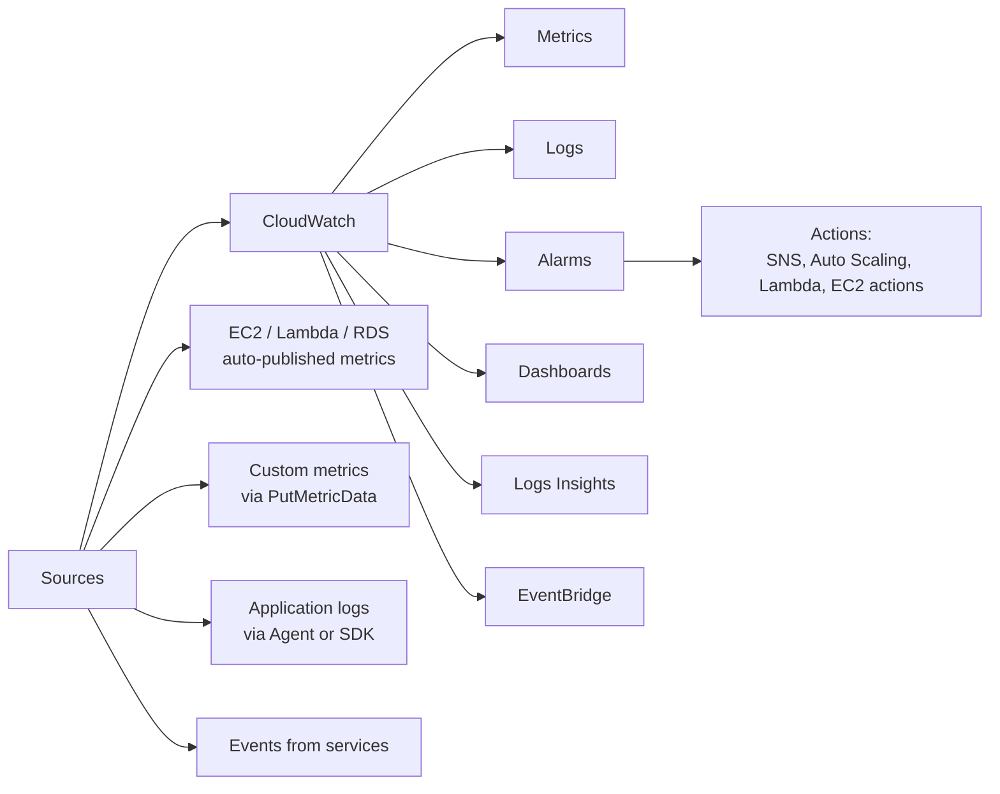
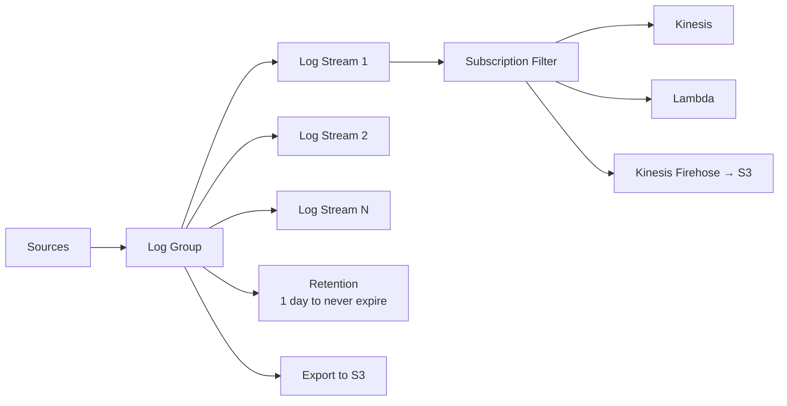

# CloudWatch Deep Dive

> 🔥 **Operational must-know.** Every monitoring scenario question expects CloudWatch fluency.

## Problem It Solves
Without observability, production systems are a black box. You need metrics (what's happening), logs (why it happened), alarms (notify before disaster), and dashboards (overall health). CloudWatch is the unified observability platform across all AWS services.

## How It Works



### The Five Pillars of CloudWatch

```
┌──────────────────────────────────────────────────────────┐
│ 1. METRICS                                                │
│    Time-series data (CPU, requests/sec, etc.)            │
│    AWS service metrics: free, auto-published            │
│    Custom metrics: via PutMetricData API                 │
│    Default resolution: 1 minute                          │
│    High-resolution: 1 second (extra cost)                │
├──────────────────────────────────────────────────────────┤
│ 2. LOGS                                                   │
│    Log groups → log streams → log events                 │
│    CloudWatch Agent on EC2 ships logs                    │
│    Lambda auto-logs to /aws/lambda/<function-name>       │
│    Encryption with KMS                                   │
│    Retention configurable (1 day to forever)             │
├──────────────────────────────────────────────────────────┤
│ 3. ALARMS                                                 │
│    Threshold-based or anomaly detection                  │
│    Trigger SNS, Auto Scaling, EC2 actions, Lambda        │
│    States: OK, ALARM, INSUFFICIENT_DATA                  │
├──────────────────────────────────────────────────────────┤
│ 4. DASHBOARDS                                             │
│    Visualize metrics, logs, and queries                  │
│    Cross-account, cross-region                           │
├──────────────────────────────────────────────────────────┤
│ 5. EVENTS (now EventBridge)                              │
│    React to AWS service state changes                    │
│    Schedule expressions (replace cron)                   │
└──────────────────────────────────────────────────────────┘
```

### Metric Resolution & Granularity

```
STANDARD RESOLUTION (1-minute):
─────────────────────────────────────────────
Most AWS service metrics
Free
Sufficient for 90% of use cases

HIGH RESOLUTION (1-second):
─────────────────────────────────────────────
Custom metrics with StorageResolution=1
$0.30 per metric per month (vs $0.30/metric standard)
Faster alarm response time (10s vs 1 min)
Use: Latency-sensitive monitoring

DETAILED MONITORING:
─────────────────────────────────────────────
For EC2 specifically — opt-in
Default EC2 metrics: 5-min intervals
Detailed: 1-minute intervals
Cost: $$ per instance per month
Recommended for production fleet
```

### CloudWatch Agent vs SSM Agent

```
CLOUDWATCH AGENT:
─────────────────────────────────────────────
Collects:
✅ Custom metrics from system (memory, disk — NOT in default EC2 metrics!)
✅ Application logs from files
✅ StatsD metrics
Configured via JSON file or SSM Parameter Store
Required for: Memory usage, disk usage, custom app metrics

SSM AGENT:
─────────────────────────────────────────────
For Systems Manager (run commands, patch mgmt)
Different purpose than CloudWatch
Modern AMIs have both pre-installed
```

⚠️ **Common exam trap**: EC2 default metrics do NOT include memory or disk usage. Need CloudWatch Agent.

### CloudWatch Alarms — Anatomy

```yaml
Alarm:
  Name: HighCPUAlarm
  Metric: CPUUtilization
  Namespace: AWS/EC2
  Dimensions:
    InstanceId: i-1234567890
  Statistic: Average
  Period: 60 seconds
  EvaluationPeriods: 3       # Need 3 datapoints
  DatapointsToAlarm: 2       # 2 out of 3 must breach
  Threshold: 80
  ComparisonOperator: GreaterThanThreshold
  TreatMissingData: notBreaching
  Actions:
    - SNS topic ARN
    - Auto Scaling policy ARN
```

```
ALARM STATES:
─────────────────────────────────────────────
OK                 → Metric is within threshold
ALARM              → Metric breached
INSUFFICIENT_DATA  → Not enough data to decide

TREAT MISSING DATA:
─────────────────────────────────────────────
- notBreaching   → Treat as "OK" (default for most)
- breaching      → Treat as "ALARM" (paranoid)
- ignore         → Maintain current state
- missing        → INSUFFICIENT_DATA state
```

### Composite Alarms

```
SCENARIO:
─────────────────────────────────────────────
"Alert ONLY if BOTH the load balancer AND backend
are unhealthy" (not just one)

COMPOSITE ALARM:
─────────────────────────────────────────────
AlarmRule: ALARM("LB-5XXs") AND ALARM("Backend-5XXs")
Combines multiple alarms with boolean logic
Reduces alarm fatigue
```

### Anomaly Detection

```
INSTEAD OF FIXED THRESHOLD:
─────────────────────────────────────────────
ML learns the normal pattern of your metric
Alerts when actual value falls outside the band

USE:
─────────────────────────────────────────────
Metrics with daily/weekly cycles (e.g., web traffic)
Where fixed threshold doesn't work
("CPU=80% is normal during business hours")
```

### CloudWatch Logs



### Log Subscription Filters

```
ROUTE LOGS IN REAL-TIME TO:
─────────────────────────────────────────────
Lambda      → Process each log event
Kinesis     → Stream to other systems
Firehose    → Batch to S3 / OpenSearch / Redshift
OpenSearch  → Direct delivery (now via Firehose)

USE:
─────────────────────────────────────────────
Centralized log archive in S3
Real-time SIEM via OpenSearch
Application alerting on log patterns
Cross-account log aggregation
```

### CloudWatch Logs Insights — SQL on Logs

```
Powerful query language for logs:

fields @timestamp, @message
| filter @message like /ERROR/
| stats count() by bin(5m)
| sort @timestamp desc

USES:
─────────────────────────────────────────────
✅ Investigate incidents
✅ Find error patterns
✅ Generate reports from logs
✅ No need to ship logs to OpenSearch for ad-hoc

COST:
─────────────────────────────────────────────
Per GB scanned (similar to Athena)
```

### Embedded Metric Format (EMF)

```
PROBLEM:
─────────────────────────────────────────────
Want to create custom metrics from logs?
PutMetricData API has limits + cost.

EMF SOLUTION:
─────────────────────────────────────────────
Write a structured JSON log entry with special fields.
CloudWatch automatically extracts metrics from logs.
No PutMetricData calls needed.

EXAMPLE:
{
  "_aws": {
    "Timestamp": 1738339200000,
    "CloudWatchMetrics": [{
      "Namespace": "MyApp",
      "Dimensions": [["Service"]],
      "Metrics": [{"Name": "Latency", "Unit": "Milliseconds"}]
    }]
  },
  "Service": "checkout",
  "Latency": 137
}

✅ Logs + Metrics from one call
✅ Lower cost than PutMetricData at scale
```

### Cross-Account & Cross-Region

```
CROSS-ACCOUNT METRIC SHARING:
─────────────────────────────────────────────
Monitoring account creates a cross-account observer
Source accounts grant permissions
See metrics from all accounts in one dashboard

CROSS-ACCOUNT LOG SUBSCRIPTIONS:
─────────────────────────────────────────────
Stream logs from many accounts → central logging account
Pattern: subscription filter → Kinesis → S3 (Firehose)
```

### CloudWatch Synthetics

```
SYNTHETIC MONITORING:
─────────────────────────────────────────────
Canaries — automated scripts that mimic users
Run periodically (every 1 min - hour)
Test:
- HTTP endpoints (alive?)
- Multi-step workflows (login, browse, checkout)
- API correctness
- Visual regression (UI changes)

USE:
─────────────────────────────────────────────
"Always know if production is up — from a user's perspective"
Detect issues before customers complain
```

### CloudWatch RUM (Real User Monitoring)

```
For frontend / browser apps:
─────────────────────────────────────────────
✅ Page load times
✅ Frontend errors (JS exceptions)
✅ User journeys
✅ Performance per geography
✅ Sessions, devices

Snippet of JS embedded in your app collects metrics
```

## When to Use What

| Need | Solution |
|---|---|
| EC2 CPU/network metrics | CloudWatch (auto) |
| EC2 memory/disk metrics | **CloudWatch Agent** required |
| Application logs | CloudWatch Logs |
| Threshold alerts | CloudWatch Alarms |
| Boolean alarm logic | **Composite Alarms** |
| Adaptive thresholds | **Anomaly Detection** |
| Real-time log routing | **Subscription Filters** |
| Ad-hoc log querying | **Logs Insights** |
| Custom metrics from logs | **EMF (Embedded Metric Format)** |
| Synthetic uptime checks | **Synthetics canaries** |
| Frontend monitoring | **CloudWatch RUM** |
| Centralize multi-account | Cross-account observer + log subscriptions |

## When NOT to Use

- ❌ Don't rely on default EC2 metrics for memory/disk — install Agent
- ❌ Don't store logs forever — set retention, archive to S3
- ❌ Don't poll metrics from app code — use PutMetricData or EMF
- ❌ Don't write giant log lines without metric extraction — use EMF

## Trade-offs

| Choice | Gain | Sacrifice |
|---|---|---|
| High-resolution metrics | Faster alarms | $$ per metric |
| Detailed monitoring (EC2) | 1-min granularity | $ per instance |
| Long log retention | Audit trail | Storage cost |
| Logs Insights | Powerful queries | Per-GB scanned cost |
| Centralized account | Single pane of glass | Setup work |

## Real World Example

**Stripe** uses CloudWatch extensively:
- Custom metrics via EMF (embedded in app logs)
- Composite alarms — alert ON-CALL only if BOTH error rate AND latency degrade
- Anomaly detection for daily/weekly traffic patterns
- Synthetics canaries hit checkout flow every minute
- Cross-account dashboards in central observability account
- Log subscription filters → central S3 + OpenSearch for incident investigation

## 🎯 Exam Soundbite

> "CloudWatch provides metrics, logs, alarms, and dashboards across all AWS services. For EC2 memory and disk metrics, you must install the CloudWatch Agent — these aren't included by default. Use Composite Alarms to combine multiple conditions and reduce alarm fatigue. Use Anomaly Detection for metrics with cyclical patterns. Stream logs in real-time to Lambda, Kinesis, or OpenSearch via Subscription Filters. For custom metrics at scale, the Embedded Metric Format generates metrics directly from structured logs without additional API calls."

---

## ⚡ Quick Recall Card

```
┌─────────────────────────────────────────────────┐
│ CLOUDWATCH KEY FACTS                             │
├─────────────────────────────────────────────────┤
│ Default EC2 metrics       5-min (not memory!)    │
│ Detailed monitoring       1-min ($ per instance) │
│ High-res custom           1-sec ($ per metric)   │
│ Logs retention            1 day to never expire  │
│ Logs encrypt              KMS supported          │
│ Subscription filters      Real-time routing      │
│ Logs Insights             SQL-like query         │
│ EMF                       Logs → Metrics auto    │
│ Composite alarms          AND/OR/NOT logic       │
│ Anomaly detection         ML-based threshold     │
│ Synthetics                Canary HTTP/Workflow   │
│ RUM                       Browser-side metrics   │
└─────────────────────────────────────────────────┘
```

## 🎓 Common Exam Pattern

> **"EC2 instances are exhausting memory but CloudWatch shows nothing. Why?"**
>
> ✅ Default EC2 metrics don't include memory. **Install the CloudWatch Agent** to publish memory and disk metrics.

> **"Want to centralize logs from 50 AWS accounts into one bucket for SIEM."**
>
> ✅ Each account configures **CloudWatch Logs Subscription Filter** → central **Kinesis Firehose** → S3 in the security account. Firehose delivers in batches with format conversion.
