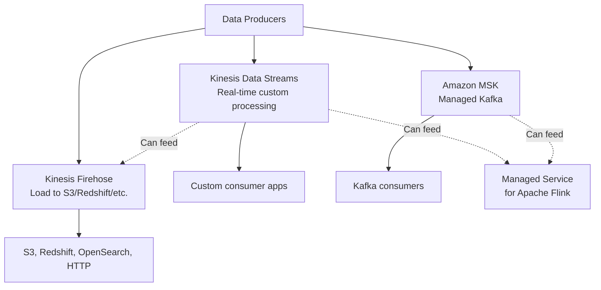
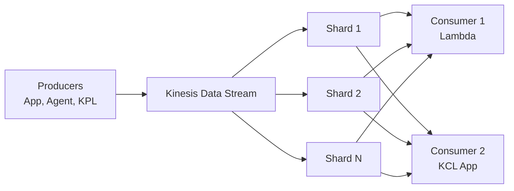
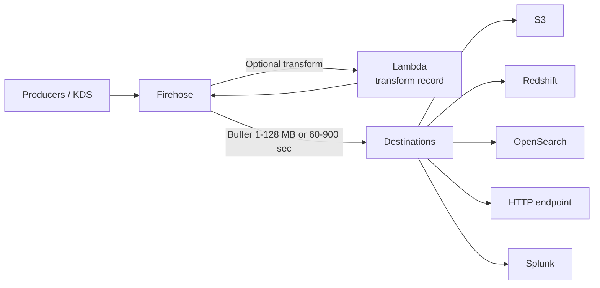
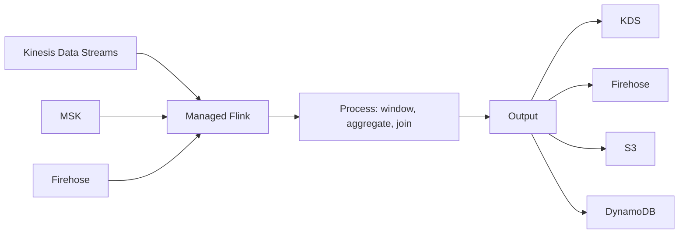
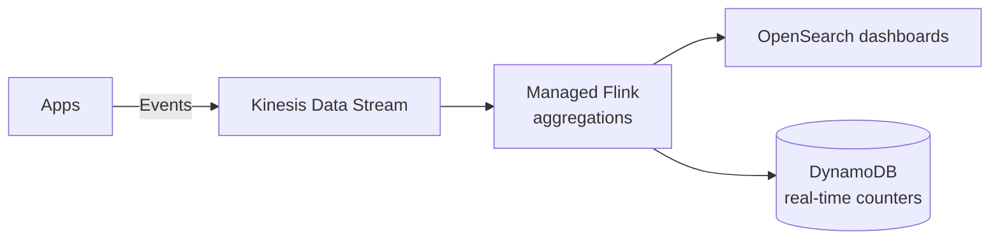
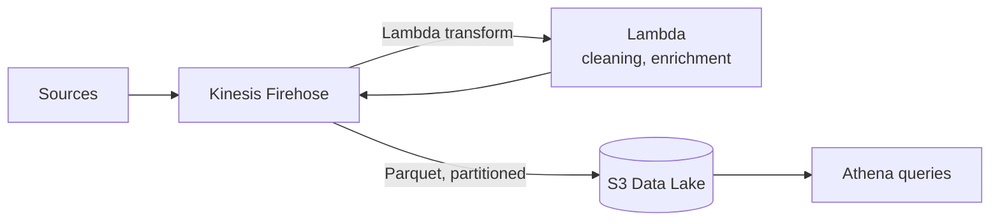
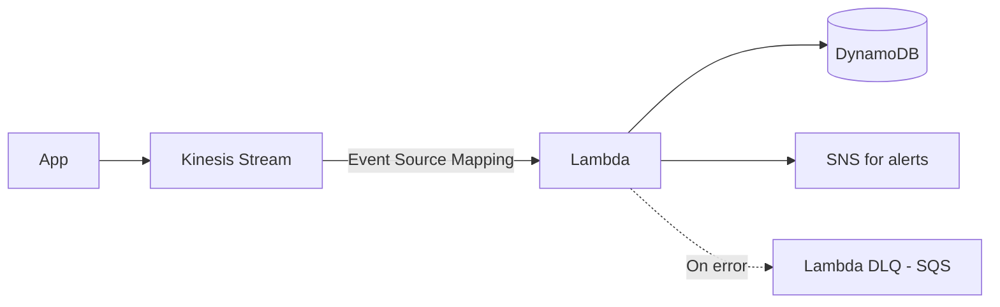
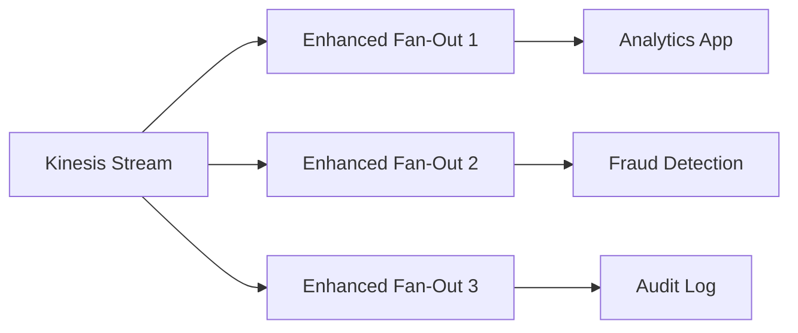

# Streaming — Kinesis Family & MSK

> 🔥 **Streaming questions appear in analytics and serverless scenarios.** Know Kinesis family + when MSK is right.

## Problem It Solves
Some workloads need **continuous data flow** rather than batch:
- Real-time analytics on clickstreams
- IoT telemetry processing
- Log aggregation
- Event-driven microservices
- Live dashboards

Batch tools (S3, Glue) wait for files. **Streaming tools process data as it arrives.**

## The Streaming Toolbox



| | **Kinesis Data Streams** | **Kinesis Firehose** | **MSK** |
|---|---|---|---|
| Purpose | Real-time stream with consumer flexibility | Stream → Storage delivery | Managed Kafka |
| Latency | < 1 sec | Buffers (min 60 sec or by size) | Configurable, ms |
| Storage | 24 hr (default) up to 365 days | None (delivery service) | Per topic retention |
| Replay | ✅ (within retention) | ❌ | ✅ |
| Custom consumers | ✅ Required | ❌ Delivery only | ✅ |
| Auto-scaling | On-Demand mode or manual shards | Auto-scales | Manual or Provisioned + Auto Scaling |
| Use case | Custom real-time pipelines | "Get data into S3/Redshift fast" | Kafka workload migration |

---

## Kinesis Data Streams



### Shards — The Unit of Throughput

```
PER SHARD CAPACITY:
─────────────────────────────────────────────
WRITES:    1 MB/sec OR 1000 records/sec (per shard)
READS:     2 MB/sec (shared across consumers in classic mode)

PARTITION KEY:
─────────────────────────────────────────────
Determines which shard a record goes to
hash(partitionKey) → shard
Same key → same shard → ORDERED within that shard

CAPACITY MODES:
─────────────────────────────────────────────
PROVISIONED: You manage shards (manual scaling)
ON-DEMAND:   Auto-scales (200 MB/sec write capacity default)
             Pay per GB ingested + retained
```

### Enhanced Fan-Out

```
CLASSIC CONSUMER:
─────────────────────────────────────────────
Multiple consumers share the 2 MB/sec per shard
4 consumers = 500 KB/sec each (bad)

ENHANCED FAN-OUT:
─────────────────────────────────────────────
Each consumer gets DEDICATED 2 MB/sec per shard
Push model (no polling)
Lower latency (~70 ms vs ~200 ms)
Costs extra per consumer + per shard

USE: Multiple consumers needing full throughput
```

### Kinesis Producer Library (KPL) & KCL

```
KINESIS PRODUCER LIBRARY (KPL):
─────────────────────────────────────────────
Batches records for efficient sending
Aggregates multiple records into one Kinesis record
Retries automatically
Java/C++ library

KINESIS CLIENT LIBRARY (KCL):
─────────────────────────────────────────────
Consumer-side library
Manages checkpointing (where you are in stream)
Coordinates multiple consumer instances (via DDB)
Java/Python/Node.js

KINESIS AGENT:
─────────────────────────────────────────────
Pre-built agent for streaming files
Tail logs and stream to Kinesis
No code needed
```

---

## Kinesis Data Firehose — Delivery Service



```
WHY USE FIREHOSE:
─────────────────────────────────────────────
✅ Fully managed (no shards)
✅ Auto-scales to throughput
✅ Optional Lambda transformation
✅ Built-in format conversion (JSON → Parquet/ORC)
✅ Built-in compression (gzip, snappy)
✅ Optional encryption
✅ Pay per GB processed only

TYPICAL USE:
─────────────────────────────────────────────
"I just want my data in S3 / Redshift"
✅ Application logs → S3 (data lake)
✅ Web clickstreams → Redshift
✅ Security events → Splunk

NOT FOR:
─────────────────────────────────────────────
❌ Real-time consumer apps (use KDS)
❌ Sub-minute latency (Firehose buffers)
```

### Firehose Buffer Configuration

```
BUFFER SIZE:    1 MB to 128 MB
BUFFER TIME:    60 sec to 900 sec
─────────────────────────────────────────────
Whichever fills first triggers delivery

EXAMPLES:
─────────────────────────────────────────────
S3 data lake:  64 MB / 300 sec (efficient batches)
Real-time-ish: 1 MB / 60 sec (lower latency)
```

### Firehose Dynamic Partitioning

```
PARTITION DATA AS IT'S DELIVERED TO S3:
─────────────────────────────────────────────
Instead of:
  s3://bucket/2026/05/27/data.parquet

Get partition keys from record content:
  s3://bucket/customer=abc/year=2026/month=05/data.parquet

✅ Athena queries faster (partition pruning)
✅ Lower cost
```

---

## Amazon MSK — Managed Kafka

```
MSK PROVISIONS APACHE KAFKA FOR YOU:
─────────────────────────────────────────────
✅ Multi-AZ broker deployment
✅ Auto-patching, scaling, monitoring
✅ Standard Kafka API (not AWS-proprietary)
✅ Compatible with existing Kafka tooling

DEPLOYMENT MODES:
─────────────────────────────────────────────

MSK PROVISIONED:
- You choose broker types and number
- Manual or auto-scaling
- Most control

MSK SERVERLESS:
- Auto-scales fully
- Pay per throughput + storage
- Simpler operations
- Newer offering

ZOOKEEPER:
- Now uses KRaft (Kafka Raft) — Zookeeper-less mode
- Modern Kafka standard

MSK CONNECT:
- Managed Kafka Connect (connectors to S3, RDS, etc.)
- Similar to Confluent Connect
```

### MSK vs Kinesis Data Streams

| | **Kinesis Data Streams** | **MSK** |
|---|---|---|
| API | AWS proprietary | Apache Kafka |
| Ecosystem | AWS-native (Firehose, Flink, etc.) | Open source ecosystem |
| Cost | Per shard-hour or per GB | Per broker-hour |
| Retention | 24 hr - 365 days | Configurable per topic |
| Scaling | Reshard (sometimes painful) or On-Demand | Add brokers (less common reshard) |
| Best for | New AWS-native pipelines | Existing Kafka workloads |

```
WHEN TO CHOOSE WHICH:
─────────────────────────────────────────────
✅ MSK: Migrating Kafka from on-prem
✅ MSK: Need Kafka-specific tooling (Schema Registry, etc.)
✅ MSK: Long retention with cheap storage tier
✅ MSK: Streaming to non-AWS destinations easier

✅ KDS: New AWS-native pipeline
✅ KDS: Tight Lambda / Firehose integration
✅ KDS: Smaller teams (less ops than Kafka)
✅ KDS: Sub-second consumer latency needs
```

---

## Managed Service for Apache Flink (Kinesis Data Analytics)



```
APACHE FLINK ON AWS:
─────────────────────────────────────────────
Stream processing engine
Stateful computations over streams
Sub-second latency
Windows (tumbling, sliding, session)

USE CASES:
─────────────────────────────────────────────
✅ Real-time fraud detection
✅ Live dashboards (count events/min)
✅ Continuous ETL transformation
✅ Anomaly detection on streams

WRITTEN AS:
─────────────────────────────────────────────
- SQL (Kinesis Data Analytics SQL — legacy)
- Apache Flink applications (Java/Scala/Python)
- Studio notebooks (interactive Flink development)
```

---

## Streaming Architecture Patterns

### Pattern 1: Real-Time Analytics



### Pattern 2: Data Lake Ingestion



### Pattern 3: Lambda Triggered by Stream



```
LAMBDA + KINESIS:
─────────────────────────────────────────────
Event Source Mapping polls Kinesis
Invokes Lambda with batches (default 100 records)
Configurable: batch size, max batch window
Parallelization factor: process multiple batches per shard concurrently
Retry on failure, eventually DLQ
```

### Pattern 4: Multi-Subscriber Fan-Out



---

## When to Use What

| Need | Solution |
|---|---|
| Custom real-time stream processing | **Kinesis Data Streams** |
| Get stream data into S3/Redshift | **Kinesis Firehose** |
| Migrate Kafka workload to AWS | **MSK** |
| Stateful streaming (windowing, joins) | **Managed Flink** |
| Lambda processes stream events | **KDS + Event Source Mapping** |
| Multiple consumers with full throughput | **KDS + Enhanced Fan-Out** |
| Convert JSON → Parquet for S3 | **Firehose format conversion** |
| Partition S3 data by content | **Firehose dynamic partitioning** |
| Kafka with managed brokers | **MSK Provisioned** |
| Kafka without capacity planning | **MSK Serverless** |
| Ordering per key, scale via shards | **KDS with good partition key** |

## When NOT to Use

- ❌ Don't use streams for batch workloads — use S3 + scheduled jobs
- ❌ Don't use Firehose if you need consumer flexibility — use KDS
- ❌ Don't use MSK if no Kafka ecosystem dependency — KDS simpler
- ❌ Don't use Kinesis if single-shard throughput isn't enough — partition smartly

## Trade-offs

| Choice | Gain | Sacrifice |
|---|---|---|
| KDS Provisioned | Lower cost at high steady load | Manual shard management |
| KDS On-Demand | No capacity planning | Higher cost at high load |
| Enhanced Fan-Out | Dedicated throughput per consumer | Extra cost per consumer |
| Firehose over KDS | Simpler, fully managed | Less consumer control, buffering latency |
| MSK over KDS | Kafka ecosystem | More ops overhead |
| MSK Serverless | No capacity planning | More expensive per unit |

## Real World Example

**Lyft's ride telemetry:**
- Driver/rider apps stream location events → **Kinesis Data Streams** (custom partition key = rideId)
- **Managed Flink** processes: ETA calculations, surge pricing, fraud
- Results to **DynamoDB** (real-time ride state) + **OpenSearch** (analytics)
- **Firehose** archives all events to **S3** for batch analytics
- **Athena/Redshift Spectrum** for historical analysis

**Stripe's events:**
- All payment events → **Kinesis Data Streams**
- **Firehose** to S3 (data lake) + Redshift (warehouse)
- **Lambda** consumers for real-time webhooks
- **MSK** alongside for some legacy systems migrated from Kafka

## 🎯 Exam Soundbite

> "Kinesis Data Streams is for real-time processing with custom consumer applications, sub-second latency, and configurable retention up to 365 days — use it when you need stream-based custom logic. Kinesis Firehose is a fully managed delivery service that buffers and writes to S3, Redshift, OpenSearch, or HTTP endpoints — use it for getting data into storage without managing infrastructure. MSK provides managed Apache Kafka — use it when migrating Kafka workloads or needing the Kafka ecosystem. For stateful stream processing with windows and joins, use Managed Service for Apache Flink on top of any of these."

---

## ⚡ Quick Recall Card

```
┌─────────────────────────────────────────────────┐
│ STREAMING TOOLBOX                                │
├─────────────────────────────────────────────────┤
│ KINESIS DATA STREAMS                             │
│   Shards: 1 MB/s in, 2 MB/s out (per shard)      │
│   Retention: 24 hr - 365 days                    │
│   Order: within shard (partition key)            │
│   Modes: Provisioned or On-Demand                │
│   Enhanced Fan-Out for dedicated throughput      │
│                                                  │
│ KINESIS FIREHOSE                                 │
│   Delivery service (no shards)                   │
│   Buffer: 1-128 MB or 60-900 sec                 │
│   Destinations: S3, Redshift, OpenSearch, HTTP   │
│   Lambda transform, format conversion            │
│   Dynamic partitioning                           │
│                                                  │
│ MSK                                              │
│   Managed Apache Kafka                           │
│   Provisioned or Serverless                      │
│   MSK Connect for connectors                     │
│                                                  │
│ MANAGED FLINK                                    │
│   Stateful stream processing                     │
│   SQL or Apache Flink apps                       │
│   Sub-second windows, joins, aggregations        │
└─────────────────────────────────────────────────┘
```

## 🎓 Common Exam Patterns

> **"Application logs need to land in S3 as Parquet files, partitioned by date, with PII fields scrubbed."**
>
> ✅ **Kinesis Firehose** with **Lambda transform** for PII scrubbing, **format conversion** (JSON → Parquet), and **dynamic partitioning** by date.

> **"Migrating a Kafka-based fraud detection system to AWS. Existing Kafka clients shouldn't change."**
>
> ✅ **MSK** — Apache Kafka API compatible, no client changes needed.

> **"Real-time leaderboard: count events per minute by user across 100K events/sec."**
>
> ✅ **Kinesis Data Streams** (partition by userId) + **Managed Flink** for tumbling window aggregation → **DynamoDB** for leaderboard reads.
