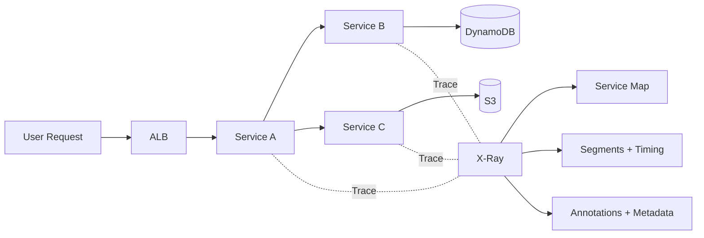
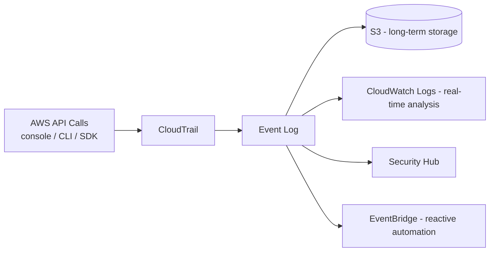
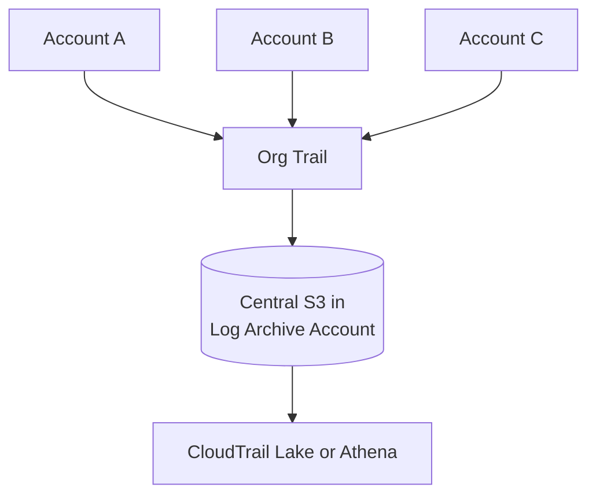
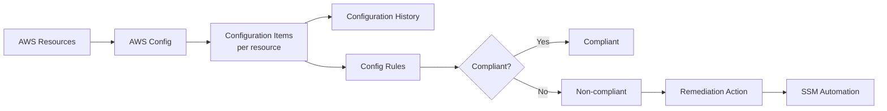
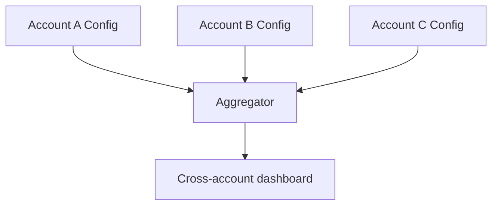
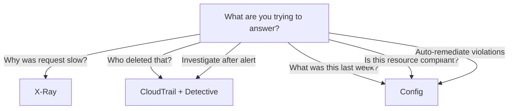

# Observability — X-Ray, CloudTrail, Config

> 🔥 **The three audit/observability pillars beyond CloudWatch.** Know what each is for.

## Problem It Solves
CloudWatch tells you **what** is happening (metrics, logs). But for full observability you also need:
- **Distributed traces** — how a request flows across microservices (X-Ray)
- **API audit** — who did what, when (CloudTrail)
- **Resource config history** — what did infrastructure look like at any past time (Config)

## The Three Specialists

| | **X-Ray** | **CloudTrail** | **Config** |
|---|---|---|---|
| Purpose | Distributed tracing | API audit | Resource config history |
| Question answered | "Why was this request slow?" | "Who deleted this bucket?" | "What did this DB look like 30 days ago?" |
| Data source | App instrumentation (SDK) | AWS API calls | Resource state snapshots |
| Latency | Real-time | ~15 minutes delivery | Continuous |
| Output | Trace map, segments | Event log | Configuration items + rules |

---

## AWS X-Ray — Distributed Tracing



```
HOW IT WORKS:
─────────────────────────────────────────────
1. App instrumented with X-Ray SDK
2. Each request gets a unique Trace ID
3. Trace ID propagates through HTTP headers (X-Amzn-Trace-Id)
4. Each service records "segments" (its work)
5. Segments contain "subsegments" (DB calls, HTTP calls)
6. All collected centrally → Service Map view

KEY TERMS:
─────────────────────────────────────────────
Trace        = End-to-end flow of one request
Segment      = One service's portion of a trace
Subsegment   = Operation within a segment (DB call, etc.)
Annotation   = Indexed key-value (searchable)
Metadata     = Non-indexed extra info
```

### What X-Ray Reveals

```
PERFORMANCE BOTTLENECKS:
─────────────────────────────────────────────
"Request took 2 sec — where was the time?"
- Service A: 50 ms
- Service A → Service B call: 100 ms latency
- Service B DDB call: 1800 ms ← THE PROBLEM!
- Service A → Service B response: 50 ms

DEPENDENCIES:
─────────────────────────────────────────────
Visualizes services calling other services
Find unexpected coupling

ERRORS:
─────────────────────────────────────────────
HTTP 4xx/5xx visualized on service map
Drill into failing requests
```

### Instrumentation

```python
# AWS SDK integration
from aws_xray_sdk.core import xray_recorder, patch_all
patch_all()  # Patches boto3, requests, etc.

@xray_recorder.capture('my_function')
def my_function():
    # Subsegment auto-created
    pass
```

```
INSTRUMENT THESE:
─────────────────────────────────────────────
- AWS SDK calls (auto-instrumented)
- HTTP outbound calls (requests/urllib)
- Database queries (SQL libraries)
- Custom segments for business logic

SAMPLING:
─────────────────────────────────────────────
Default: 1 req/sec + 5% of additional traffic
Customize via sampling rules
Trade-off: cost vs. visibility
```

### X-Ray on AWS Services

```
SERVICES WITH NATIVE X-RAY SUPPORT:
─────────────────────────────────────────────
✅ Lambda (enable in function config)
✅ API Gateway (enable per stage)
✅ ECS / Fargate (run X-Ray daemon)
✅ EC2 (install X-Ray daemon)
✅ EKS (sidecar X-Ray daemon)
✅ AppMesh (built-in tracing)
✅ Step Functions (auto trace)
✅ SNS, SQS (propagate trace IDs)
```

### CloudWatch ServiceLens

```
SERVICELENS:
─────────────────────────────────────────────
Combines X-Ray traces + CloudWatch metrics + logs in one view
✅ Unified observability dashboard
✅ Service map with metric overlays
✅ Click trace to see related logs

CLOUDWATCH SYNTHETICS + X-RAY:
─────────────────────────────────────────────
Synthetic canaries also trace via X-Ray
End-to-end testing with distributed visibility
```

---

## AWS CloudTrail — API Audit



```
WHAT CLOUDTRAIL LOGS:
─────────────────────────────────────────────
✅ Every AWS API call (default: management events)
✅ Console actions (translated to API calls)
✅ CLI / SDK / service-initiated calls
✅ Who (identity)
✅ What (action, resources)
✅ When (timestamp)
✅ Where (source IP, region)
✅ How (user agent)

WHAT IT DOESN'T LOG:
─────────────────────────────────────────────
❌ DATA events (object reads in S3, item gets in DDB)
   — must enable explicitly (expensive)
❌ Insider misuse if all logging disabled — but that itself is logged
```

### Trail Types

```
DEFAULT EVENT HISTORY (free):
─────────────────────────────────────────────
- Last 90 days
- Management events only
- Console-visible
- No S3 archive

CONFIGURED TRAIL:
─────────────────────────────────────────────
- Delivered to S3 (long retention)
- Optionally to CloudWatch Logs
- Configurable: management vs data events
- Multi-region (recommended)

ORGANIZATION TRAIL:
─────────────────────────────────────────────
- Single trail covers ALL Org accounts
- Logs aggregate in management account's S3
- Best practice for multi-account governance

CLOUDTRAIL LAKE:
─────────────────────────────────────────────
- Managed data lake for CloudTrail events
- SQL queries (like Athena but specifically for CT)
- 7-year retention
- Cross-account aggregation
```

### Management vs Data Events

```
MANAGEMENT EVENTS (default, free):
─────────────────────────────────────────────
- Create/modify/delete resources
- IAM changes
- Network config changes
- ~Most operational logging

DATA EVENTS (off by default, $):
─────────────────────────────────────────────
- S3 object level (GetObject, PutObject)
- Lambda function invocations
- DynamoDB item-level
- Volume of these can be huge
- Enable selectively (specific buckets, etc.)

INSIGHTS EVENTS ($):
─────────────────────────────────────────────
- Detects unusual API patterns
- E.g., sudden burst of resource creation
- ML-based anomaly detection
```

### CloudTrail Log Integrity

```
LOG FILE INTEGRITY VALIDATION:
─────────────────────────────────────────────
Enable to detect tampering
CloudTrail computes hash of each log file
Stored hashes are signed
Compare later to verify log not modified

USE: Compliance (PCI, HIPAA, SOX)
```

### Multi-Account CloudTrail Pattern



```
BEST PRACTICE:
─────────────────────────────────────────────
1. Create Organization Trail in management account
2. Deliver to S3 bucket in dedicated log archive account
3. Bucket policy allows CloudTrail writes
4. S3 Object Lock (Compliance) prevents tampering
5. Cross-region replication for DR
6. Athena tables for query
```

---

## AWS Config — Resource Configuration



```
WHAT CONFIG DOES:
─────────────────────────────────────────────
✅ Records every resource configuration change
✅ Maintains full history (point-in-time queries)
✅ Evaluates resources against rules (compliance)
✅ Auto-remediation via SSM Automation
✅ Resource relationship graph

EXAMPLE QUESTION CONFIG ANSWERS:
─────────────────────────────────────────────
- "What was this security group last week?"
- "When did this RDS become publicly accessible?"
- "Which buckets are non-compliant with encryption rule?"
```

### Config Rules

```
AWS MANAGED RULES (200+):
─────────────────────────────────────────────
Pre-built rules for common checks:
- s3-bucket-public-read-prohibited
- restricted-ssh
- root-account-mfa-enabled
- rds-storage-encrypted
- ec2-instance-no-public-ip
... etc.

CUSTOM RULES:
─────────────────────────────────────────────
Lambda function evaluates resource
Triggered on change or periodically
Return COMPLIANT / NON_COMPLIANT

CONFORMANCE PACKS:
─────────────────────────────────────────────
Bundles of rules for compliance frameworks:
- PCI DSS
- HIPAA
- NIST
- AWS Operational Best Practices
```

### Auto-Remediation

```yaml
ConfigRule:
  Name: s3-bucket-public-read-prohibited
  RemediationAction:
    DocumentName: AWS-DisableS3BucketPublicReadWrite
    Automatic: true
    MaximumAutomaticAttempts: 5
```

```
PATTERN:
─────────────────────────────────────────────
1. Config detects non-compliant resource
2. Triggers SSM Automation document
3. Doc executes remediation (remove public access)
4. Recheck rule — should be compliant now

EXAMPLES:
─────────────────────────────────────────────
- Public S3 bucket → automatically block public access
- Unencrypted EBS → automatic snapshot + encrypt + replace
- Unrestricted SG → close port 22 from 0.0.0.0/0
```

### Multi-Account Config



```
CONFIG AGGREGATOR:
─────────────────────────────────────────────
Central account aggregates findings from many accounts
Single dashboard for compliance
Cross-region aggregation supported
```

---

## Comparison & When to Use



| Need | Service |
|---|---|
| Why is one specific request slow | **X-Ray** |
| Visualize service dependencies | **X-Ray service map** |
| Who deleted my S3 bucket | **CloudTrail event history** |
| Compliance audit trail | **CloudTrail to S3 + Object Lock** |
| What was this SG yesterday | **Config configuration history** |
| Enforce encryption on all new buckets | **Config rule + remediation** |
| Cross-account compliance dashboard | **Config Aggregator** |
| Multi-account audit log | **Organization Trail to central S3** |
| Investigate suspicious API patterns | **CloudTrail Insights** |
| Long-term audit log retention (7 yr) | **CloudTrail Lake** |
| Detect tampered logs | **CloudTrail log file integrity** |

## When NOT to Use

- ❌ Don't enable CloudTrail Data Events for ALL S3 — cost explosion
- ❌ Don't use X-Ray for every request in high-traffic apps — sample aggressively
- ❌ Don't rely on Config for real-time alerting — it's eventual consistency
- ❌ Don't disable CloudTrail in any account — even temporarily

## Trade-offs

| Choice | Gain | Sacrifice |
|---|---|---|
| Full X-Ray sampling | Complete visibility | Higher cost |
| CloudTrail Data Events | Object-level audit | Significant cost |
| Config recording all types | Total compliance | Per-config-item cost |
| Org Trail vs per-account | Centralized | Single point of management |
| CloudTrail Lake | Powerful queries, long retention | Per-event ingest cost |

## Real World Example

**A bank's observability + audit setup:**
- **X-Ray** on all customer-facing services (auto-instrumented via SDK)
- **CloudWatch ServiceLens** unifies traces + metrics + logs
- **Organization Trail** → S3 in log archive account → **S3 Object Lock Compliance mode**
- **Athena** tables on CloudTrail logs for ad-hoc queries
- **CloudTrail Lake** for 7-year retention + SQL queries
- **Config Aggregator** in security account, all member accounts feeding
- **Conformance Pack** for PCI DSS applied to all accounts
- **Auto-remediation** Lambdas: any new public S3 bucket → instantly fixed
- **CloudTrail Insights** alerts on unusual API call volumes

## 🎯 Exam Soundbite

> "AWS provides three observability and audit services beyond CloudWatch metrics and logs. X-Ray provides distributed tracing — instrument your application to see how a request flows through microservices and identify bottlenecks. CloudTrail logs every AWS API call across the account, with optional Data Events for object-level S3 and Lambda visibility — use Organization Trail to a centralized S3 bucket for multi-account audit. AWS Config records resource configuration changes over time and evaluates compliance with rules, with optional auto-remediation via SSM Automation. Together, these give you the 'why was it slow', 'who did it', and 'what changed' answers."

---

## ⚡ Quick Recall Card

```
┌─────────────────────────────────────────────────┐
│ X-RAY                                            │
├─────────────────────────────────────────────────┤
│ Distributed tracing for apps                     │
│ Service map + segments + subsegments             │
│ Annotations indexed, metadata not                │
│ ServiceLens combines with CW + logs              │
│ Sample (default 1/sec + 5%)                      │
├─────────────────────────────────────────────────┤
│ CLOUDTRAIL                                       │
├─────────────────────────────────────────────────┤
│ Every AWS API call logged                        │
│ Management Events (free, default)                │
│ Data Events (paid, opt-in: S3 obj, Lambda)       │
│ Insights Events (anomaly detection $)            │
│ Organization Trail for Org-wide                  │
│ Log file integrity validation                    │
│ CloudTrail Lake for 7-yr SQL queries             │
├─────────────────────────────────────────────────┤
│ CONFIG                                           │
├─────────────────────────────────────────────────┤
│ Configuration Items per resource                 │
│ Continuous history                               │
│ Rules: AWS Managed or Custom (Lambda)            │
│ Conformance Packs (PCI, HIPAA, NIST)             │
│ Auto-remediation via SSM Automation              │
│ Aggregator for cross-account dashboards          │
└─────────────────────────────────────────────────┘
```

## 🎓 Common Exam Patterns

> **"Want to know why a specific API request took 5 seconds when it usually takes 100ms."**
>
> ✅ **AWS X-Ray** distributed tracing — drill into the trace, see segments per service, identify which subsegment (likely a DB call or downstream service) ate the time.

> **"Compliance audit asks: who deleted the production S3 bucket and when?"**
>
> ✅ **CloudTrail event history** — search for `DeleteBucket` events. Identity, source IP, timestamp all logged.

> **"Need to know what every Security Group rule was 14 days ago for a compliance investigation."**
>
> ✅ **AWS Config configuration history** — Config records every change. Query timeline view of the resource at any past time.

> **"Want any new public S3 bucket to be automatically made private."**
>
> ✅ **Config rule** `s3-bucket-public-read-prohibited` + **auto-remediation** via SSM Automation document `AWS-DisableS3BucketPublicReadWrite`.
