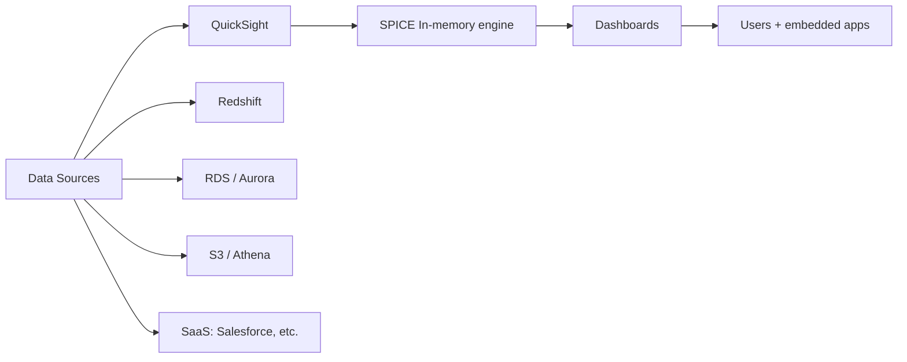
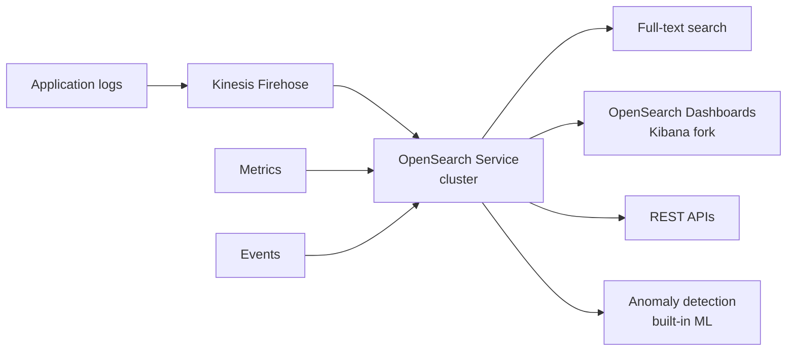
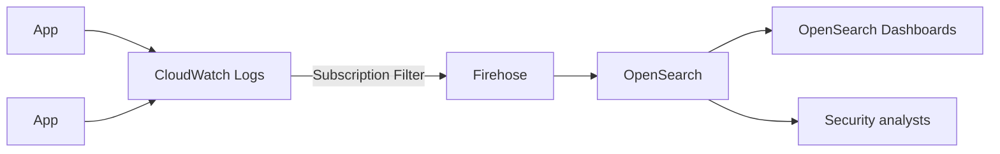
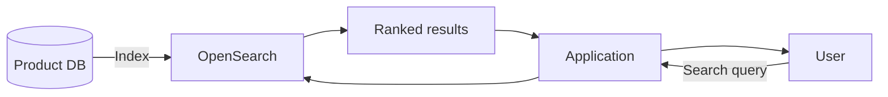
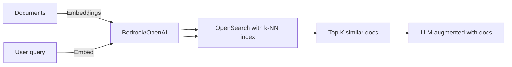

# QuickSight & OpenSearch

> 🔥 **Visualization + search are common analytics question elements.** Know each tool's role.

## QuickSight — BI Dashboards



```
QUICKSIGHT FEATURES:
─────────────────────────────────────────────
✅ Managed BI service (no infrastructure)
✅ SPICE — Super-fast, Parallel, In-memory Calculation Engine
✅ Connects to: Redshift, RDS, Aurora, Athena (S3), 
               DynamoDB, on-prem SQL, Salesforce, etc.
✅ ML Insights (auto anomaly detection, forecasting)
✅ Q — natural language queries ("show me sales by region")
✅ Embed dashboards in your app
✅ Per-user pricing (vs Tableau per-seat)
✅ Row-level security (different users see different data)
✅ Column-level security

EDITIONS:
─────────────────────────────────────────────
Standard:   $9/user/month — basic BI
Enterprise: $18/user/month — RLS, embedded, AD/Federated
            Q — $250/month for unlimited Q users
```

### QuickSight Use Cases

```
INTERNAL DASHBOARDS:
─────────────────────────────────────────────
✅ Replace Tableau/PowerBI for internal analytics
✅ Connect to Redshift/Athena (modern data stack)
✅ Department dashboards

EMBEDDED ANALYTICS:
─────────────────────────────────────────────
✅ SaaS companies embedding analytics in their product
✅ White-labeled dashboards
✅ Per-customer data isolation via RLS

ML INSIGHTS:
─────────────────────────────────────────────
✅ Auto-detect anomalies in time-series
✅ Forecasting (ARIMA/Prophet)
✅ "Why is this metric down?" — auto-narratives
```

### QuickSight Q (Natural Language)

```
QUICKSIGHT Q:
─────────────────────────────────────────────
Ask questions in plain English:
- "What were sales by region last quarter?"
- "Show top 10 products by revenue"
- "Compare this month to last year"

Builds a chart automatically.
Powered by ML / NLP.
```

### Row-Level Security (RLS)

```
RLS EXAMPLE:
─────────────────────────────────────────────
Dashboard shows sales data.
Sales rep should only see their own region.

SETUP:
─────────────────────────────────────────────
Create RLS dataset:
  user1@company.com | region | west
  user2@company.com | region | east

When user1 views dashboard, automatically filtered to west.
Same dashboard, different data per user.

✅ Critical for multi-tenant SaaS
```

---

## OpenSearch Service



```
OPENSEARCH SERVICE:
─────────────────────────────────────────────
Managed OpenSearch (Apache 2.0 fork of Elasticsearch)
Compatible with most Elasticsearch APIs (up to ES 7.10)
Plus newer OpenSearch versions

KEY FEATURES:
─────────────────────────────────────────────
✅ Full-text search at scale
✅ Real-time log analytics
✅ Time-series data
✅ Dashboards (OpenSearch Dashboards = Kibana)
✅ Vector search (k-NN, similarity)
✅ Anomaly detection (built-in)
✅ Alerting
✅ Multi-AZ deployments
✅ UltraWarm for cheaper storage of older indices
✅ Cold storage tier

USE CASES:
─────────────────────────────────────────────
✅ Centralized log analytics (SIEM-light)
✅ Application search (e-commerce, knowledge base)
✅ Operational dashboards
✅ Security analytics (replace Splunk)
✅ Real-time observability
✅ Geospatial search
✅ Vector embeddings for AI/RAG
```

### Storage Tiers

```
HOT TIER (default):
─────────────────────────────────────────────
Real-time data, frequent queries
Fast NVMe storage on cluster nodes

ULTRAWARM:
─────────────────────────────────────────────
Older indices, less-frequent queries
S3-backed, lower cost
Read-only, still queryable

COLD STORAGE:
─────────────────────────────────────────────
Even cheaper than UltraWarm
Detached from cluster
Attach when needed for queries
For compliance/archival
```

### OpenSearch Serverless

```
OPENSEARCH SERVERLESS:
─────────────────────────────────────────────
✅ No cluster management
✅ Auto-scales
✅ Separate compute for indexing vs search
✅ Pay per OCU-hour
✅ Newer offering

USE WHEN:
─────────────────────────────────────────────
✅ Variable workload
✅ Don't want to size clusters
✅ Smaller deployments
```

### Common Architectures

#### Log Aggregation (SIEM-Lite)



```
LOG AGGREGATION PATTERN:
─────────────────────────────────────────────
1. Apps log to CloudWatch Logs
2. Subscription Filter forwards to Firehose
3. Firehose delivers to OpenSearch
4. Dashboards show real-time logs
5. Alerts on anomalies
6. UltraWarm for older logs (cheaper)

USE: Operational + security observability
```

#### E-commerce Search



```
SEARCH PATTERN:
─────────────────────────────────────────────
1. Product database (e.g., Aurora) is source of truth
2. DMS or app-level sync → OpenSearch index
3. User searches → app queries OpenSearch
4. OpenSearch returns ranked results with highlighting
5. Faceted filters (price, brand, category)
6. Autocomplete via edge-ngram
```

#### Vector Search (RAG for LLMs)



```
RAG WITH OPENSEARCH:
─────────────────────────────────────────────
✅ k-NN (k-Nearest Neighbors) algorithm built-in
✅ Approximate search with FAISS / nmslib
✅ Hybrid: keyword + vector search
✅ Use for: RAG, image similarity, recommendation
```

---

## QuickSight vs OpenSearch Dashboards

```
QUICKSIGHT:
─────────────────────────────────────────────
✅ Business intelligence (KPIs, sales, finance)
✅ Pre-aggregated / curated data sources
✅ Per-user pricing
✅ Q (natural language)
✅ Better for non-technical users

OPENSEARCH DASHBOARDS:
─────────────────────────────────────────────
✅ Operational dashboards (logs, metrics, security)
✅ Real-time streaming data
✅ Geospatial, log search, exploration
✅ Free with OpenSearch cluster
✅ Better for technical users / SREs / security
```

---

## When to Use What

| Need | Solution |
|---|---|
| BI dashboards for business users | **QuickSight** |
| Natural language queries on data | **QuickSight Q** |
| Embedded analytics in SaaS app | **QuickSight Embedded** |
| Centralized log analytics | **OpenSearch** |
| Full-text search for app | **OpenSearch** |
| Vector / similarity search | **OpenSearch k-NN** |
| Security observability | **OpenSearch + GuardDuty/Sec Hub** |
| Real-time ops dashboard | **OpenSearch Dashboards** |
| ML insights on metrics | **QuickSight ML** or **OpenSearch anomaly detection** |
| Forecasting | **QuickSight ML Insights** |

## When NOT to Use

- ❌ Don't use OpenSearch for batch analytics — use Athena/Redshift
- ❌ Don't use QuickSight for log exploration — use OpenSearch
- ❌ Don't use OpenSearch as a primary database — use a real OLTP
- ❌ Don't use either if you have a simple use case — overkill

## Trade-offs

| Choice | Gain | Sacrifice |
|---|---|---|
| QuickSight over Tableau | AWS-native, per-user $$$ | Less mature ecosystem |
| OpenSearch over self-managed ES | Managed, multi-AZ | Locked to AWS-supported versions |
| Serverless OpenSearch | No cluster ops | Per-OCU cost |
| UltraWarm/Cold | Cheaper old data | Slower queries |

## Real World Example

**A SaaS company:**
- **QuickSight Embedded** in their customer-facing app
- Customer dashboards with row-level security (each customer sees own data)
- Backend data in **Aurora + Redshift**
- **OpenSearch** for application log analytics
- Engineers monitor with OpenSearch Dashboards
- **QuickSight** for internal BI on revenue, churn, growth

**An e-commerce site:**
- **OpenSearch** for product search (autocomplete + filters)
- **OpenSearch** also indexing customer behavior for personalization
- **QuickSight** for business KPI dashboards
- **Athena** for ad-hoc analytics (different tool, complementary)

## 🎯 Exam Soundbite

> "QuickSight is AWS's managed business intelligence service with per-user pricing, SPICE in-memory engine, ML Insights for anomaly detection and forecasting, natural language queries via Q, and embedded analytics with row-level security — use it for BI dashboards consumed by business users and for SaaS apps embedding customer-facing analytics. OpenSearch Service provides managed OpenSearch (Elasticsearch fork) for log analytics, full-text search, vector search via k-NN, and observability with OpenSearch Dashboards — use it for centralized logging, application search, and RAG vector storage. UltraWarm and Cold storage tiers let you store older indices cheaply on S3 while keeping them queryable."

---

## ⚡ Quick Recall Card

```
┌─────────────────────────────────────────────────┐
│ QUICKSIGHT                                       │
├─────────────────────────────────────────────────┤
│ Use: BI dashboards, embedded analytics           │
│ SPICE in-memory engine                           │
│ Sources: Redshift, RDS, Athena, S3, SaaS         │
│ Q: natural language queries                      │
│ ML Insights: anomaly + forecasting               │
│ RLS: row-level security                          │
│ Pricing: per user                                │
├─────────────────────────────────────────────────┤
│ OPENSEARCH                                       │
├─────────────────────────────────────────────────┤
│ Use: Log analytics, search, vector, observability│
│ Apache 2.0 fork of Elasticsearch                 │
│ OpenSearch Dashboards = Kibana                   │
│ Tiers: Hot, UltraWarm (S3), Cold (detach)        │
│ Serverless option                                │
│ k-NN for vector / similarity search              │
└─────────────────────────────────────────────────┘
```

## 🎓 Common Exam Patterns

> **"BI dashboards for 200 employees showing data from Redshift. Want embedded charts in our internal portal."**
>
> ✅ **QuickSight Enterprise** with embed feature, Redshift data source, per-user licensing.

> **"Centralize logs from 50 microservices for SRE team to search and visualize."**
>
> ✅ **OpenSearch** with OpenSearch Dashboards. Logs via Firehose. UltraWarm for older logs.

> **"Build RAG system for internal docs — store vector embeddings, retrieve by similarity."**
>
> ✅ **OpenSearch with k-NN index** — store embeddings, query by vector similarity. Combine with Bedrock for LLM responses.
