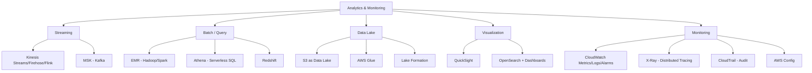

# 07 — Analytics & Monitoring

> **Exam weight:** ⭐⭐⭐ — Analytics architectures appear in scenarios; CloudWatch and X-Ray are operational must-knows.

---

## 🗺️ Topic Map



---

## 📚 Notes in This Section

| # | Topic | Priority |
|---|---|---|
| 01 | [Data Lake Architecture — S3 + Glue + Athena](./01-data-lake.md) | 🔥 |
| 02 | [CloudWatch Deep Dive](./02-cloudwatch.md) | 🔥 |
| 03 | [Kinesis vs MSK — Streaming](./03-streaming.md) | High |
| 04 | [Redshift Data Warehouse](../04-Databases-Caching/06-redshift.md) | High |
| 05 | [X-Ray, CloudTrail, Config](./05-observability.md) | High |
| 06 | [QuickSight & OpenSearch](./06-viz-search.md) | Medium |

---

## 🎯 The 4 Analytics Patterns Tested

```
PATTERN 1 — DATA LAKE ON S3
Source → Kinesis Firehose → S3 (Parquet)
       ↓
       Glue Catalog ← discovery
       ↓
       Athena (ad-hoc) / Redshift Spectrum / EMR


PATTERN 2 — REAL-TIME ANALYTICS
Sources → Kinesis Data Streams → Managed Flink
                                      ↓
                                 Aggregates → DDB/OpenSearch


PATTERN 3 — TRADITIONAL DATA WAREHOUSE
Sources → DMS / Glue → Redshift (RA3 + S3)
                          ↓
                       QuickSight dashboards


PATTERN 4 — OBSERVABILITY
EC2/Lambda/ECS → CloudWatch Logs / Metrics
              → X-Ray (distributed tracing)
              → CloudTrail (audit)
              → Centralized in Security Hub for security findings
```
