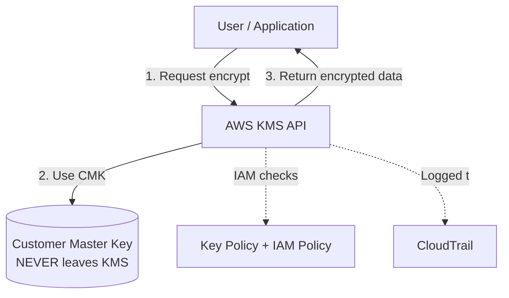
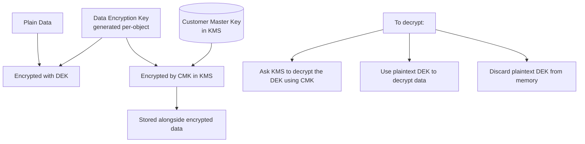
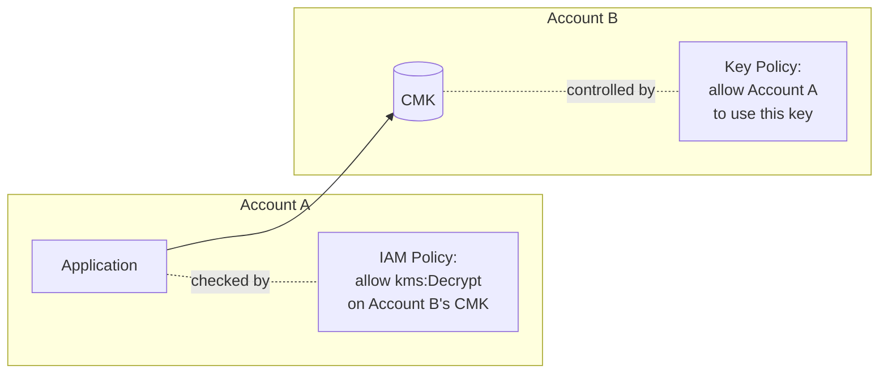

# KMS — Key Management Service

> 🔥 **KMS appears in virtually every encryption question on SAP-C02.** Know envelope encryption, key types, and cross-account access cold.

## Problem It Solves
Encryption is essential, but managing cryptographic keys is HARD:
- Where do you store them?
- Who can use them?
- How do you rotate them?
- How do you audit usage?
- How do you do cross-account encryption?

KMS provides a managed key service with audit logs, rotation, IAM-controlled access, and integration with 100+ AWS services.

## How It Works



> 🔑 **The single most important KMS fact:** the CMK (master key) **never leaves KMS in plaintext**. You never download it. Every encrypt/decrypt of the *master key* happens inside KMS. What leaves KMS is the **data key** — once in plaintext (briefly) and once encrypted (to store). This is why envelope encryption exists.

## Flow KMS Customer Managed Key


### The 4 Key Types

```
┌────────────────────────────────────────────────────────────┐
│ 1. AWS OWNED KEYS                                          │
│    - Used by AWS services on your behalf                   │
│    - You can't see, manage, or audit them                  │
│    - Free                                                  │
│    - Example: S3 default encryption (SSE-S3 / older)       │
│    - Keys are completely invisible                         │
├────────────────────────────────────────────────────────────┤
│ 2. AWS MANAGED KEYS (aws/<service>)                        │
│    - Created and managed by AWS for each service           │
│    - You can use them, but not modify policy/rotation      │
│    - Auto-rotation every year                              │
│    - Free                                                  │
│    - Example: aws/s3, aws/ebs, aws/rds                     │
│    - Keys ARE visible in your account's KMS                │
│    - AWS pre-configures the key policy so any account      │
│      principal with kms:* IAM permission can use them —    │
│      YOU never edit the key policy                         │
├────────────────────────────────────────────────────────────┤
│ 3. CUSTOMER MANAGED KEYS (CMKs)  ⭐ MOST FLEXIBLE         │
│    - YOU create, manage, control                           │
│    - YOU set the key policy (and must grant access in it)  │
│    - YOU enable/disable rotation                           │
│    - YOU can schedule deletion (7-30 day waiting period)   │
│    - $1/month per CMK + $0.03 per 10,000 requests          │
│    - Use: Compliance, fine-grained control, cross-account  │
├────────────────────────────────────────────────────────────┤
│ 4. AWS CLOUDHSM KEYS                                       │
│    - Stored in dedicated hardware HSM (you manage)         │
│    - For strict compliance (FIPS 140-2 Level 3)            │
│    - Most expensive                                        │
│    - Use: Banks, government, ultra-high-security           │
└────────────────────────────────────────────────────────────┘
```

> 🧠 **Owned vs Managed — the distinction people miss:** AWS *owned* keys are invisible and shared across many customers (you cannot audit them). AWS *managed* keys are visible in your KMS console, dedicated to your account, auto-rotate yearly, and show up in CloudTrail — but you still cannot edit their policy or rotation. Customer *managed* keys are the only ones where you own the key policy.

### Symmetric vs Asymmetric Keys

```
SYMMETRIC (most common):
─────────────────────────────────────────────
- Single key for encrypt + decrypt (AES-256)
- Never leaves KMS unencrypted
- Used by all AWS service integrations (S3 SSE-KMS, EBS, RDS...)
- Cheaper, faster
- Shared secret model — no public/private key pair needed

USE: Default for AWS service encryption


ASYMMETRIC:
─────────────────────────────────────────────
- Public key + Private key (RSA, ECC)
- Public key CAN be exported
- Private key NEVER leaves KMS
- Used for: signing/verifying, encrypt/decrypt outside AWS
- Slower, more expensive

USE: Sign software releases, JWT signing,
     encrypt data sent to AWS by external parties

⚠️ EXAM TRAP: S3 SSE-KMS only works with SYMMETRIC keys.
   S3 cannot use an asymmetric KMS key for object encryption.
```

### Envelope Encryption — The Core Pattern



```
WHY ENVELOPE ENCRYPTION? (memorise this — it was a known gap)
─────────────────────────────────────────────
The point: you do NOT encrypt large data with the master key directly.
Instead you encrypt the data with a small, fast DATA KEY, and use the
master key only to encrypt that tiny data key.

Reasons:
1. KMS Encrypt has a hard limit — max 4 KB per call. You physically
   cannot push a 5 GB file through it.
2. The master key never leaves KMS, so bulk data can't be sent to it anyway.
3. Local symmetric encryption with the DEK is fast; a round-trip to KMS
   per byte would be catastrophic for performance.
4. A unique DEK per object limits blast radius — compromise of one DEK
   exposes one object, not everything.
5. The expensive, protected master key stays in KMS doing one cheap job:
   wrapping/unwrapping small data keys.

Mental model:
- Master key (CMK)  = the lock on the safe, bolted to the wall (in KMS)
- Data key (DEK)    = the small key that actually encrypts your file
- You store the DEK locked inside the safe (encrypted DEK in metadata)
```

```
ENCRYPT FLOW (upload):
1. Call KMS GenerateDataKey for the CMK
2. KMS returns BOTH:
   - Plaintext DEK (use immediately to encrypt your data locally)
   - Encrypted DEK (the DEK wrapped by the CMK — store this)
3. Encrypt the data locally with the plaintext DEK
4. Store: encrypted data + encrypted DEK (in object metadata)
5. Discard the plaintext DEK from memory

DECRYPT FLOW (download):
1. Read the encrypted DEK from metadata
2. Send encrypted DEK to KMS → KMS uses the CMK to return plaintext DEK
3. Decrypt the data locally with the plaintext DEK
4. Discard the plaintext DEK from memory
```

### KMS API Operations You'll See on the Exam

```
GenerateDataKey:
─────────────────────────────────────────────
Returns: plaintext DEK + encrypted DEK
Use: Start of envelope encryption (this is what S3 calls on PutObject)

GenerateDataKeyWithoutPlaintext:
─────────────────────────────────────────────
Returns: ONLY the encrypted DEK
Use: Pre-generate keys to use later (still need Decrypt to use)

Encrypt:
─────────────────────────────────────────────
Encrypts up to 4 KB of data with a CMK
Use: Small payloads (e.g., a password, small token)

Decrypt:
─────────────────────────────────────────────
Decrypts data encrypted by KMS
KMS identifies which CMK from the ciphertext metadata

ReEncrypt:
─────────────────────────────────────────────
Decrypts ciphertext with one CMK, re-encrypts with another
Never exposes plaintext to caller
Use: Key rotation, region migration
```

### Key Policy vs IAM Policy

```
KMS uses BOTH:
─────────────────────────────────────────────

KEY POLICY (resource-based, attached to the CMK):
- REQUIRED — every CMK has one
- Default: grants the account root user full access
- Specifies which principals can use the key

IAM POLICY (attached to the user/role):
- Specifies which KMS actions the principal can perform


SAME ACCOUNT — the precise rule (corrected):
─────────────────────────────────────────────
IAM policies can grant KMS access ONLY IF the key policy first
delegates authority to IAM. This delegation is the default
"Enable IAM permissions" statement:

{
  "Effect": "Allow",
  "Principal": { "AWS": "arn:aws:iam::ACCOUNT:root" },
  "Action": "kms:*",
  "Resource": "*"
}

- WITH this statement present (the default): grant access via IAM
  policies as normal. This is the common path.
- WITHOUT this statement: IAM policies are powerless against the key;
  only principals named DIRECTLY in the key policy can use it.

So it is NOT "either/or." IAM works *because* the key policy opened
the door. The key policy is always the root of authority for a CMK.


CROSS-ACCOUNT (always needs BOTH, explicitly):
─────────────────────────────────────────────
Account A's principal wants to use Account B's CMK:
1. Account B's KEY POLICY must explicitly allow Account A's principal
2. Account A's IAM POLICY must allow kms:Decrypt (etc.) on B's key ARN
BOTH required — the root-delegation shortcut does NOT cross account
boundaries. You must name the external principal in the key policy.
```

> 💡 **Why does a customer managed key need an explicit grant in its key policy, but an AWS managed key doesn't?** Because with a CMK *you own the key policy* — nobody grants access for you, so if you don't add the principal, no one (except root-delegated IAM, same account only) can use it. With an AWS managed key, AWS owns and pre-populates the policy to allow account principals through IAM automatically, so there's nothing for you to edit. This was the "why only that specific case" question — the answer is ownership of the policy.

### Permissions Required for End-to-End SSE-KMS (the practical checklist)

```
SINGLE ACCOUNT, customer managed key:
─────────────────────────────────────────────
On the user/role IAM policy:
  - s3:GetObject   (download)  / s3:PutObject (upload)
  - kms:Decrypt    (download)  / kms:GenerateDataKey (upload)
On the CMK key policy:
  - A statement naming that role and allowing the same kms actions
    (because YOU own the CMK's policy)

SINGLE ACCOUNT, AWS managed key (aws/s3):
─────────────────────────────────────────────
On the user/role IAM policy:
  - s3:GetObject / s3:PutObject
  - kms:Decrypt / kms:GenerateDataKey
On the key policy:
  - NOTHING to do — AWS pre-grants account principals

⚠️ COMMON MISS: upload needs kms:GenerateDataKey, not just kms:Decrypt.
   Decrypt alone lets you read but not write SSE-KMS objects.
```

### The `kms:ViaService` Condition Key

```
kms:ViaService restricts use of a CMK so it can ONLY be called
through a specific AWS service in a specific region:

"Condition": {
  "StringEquals": { "kms:ViaService": "s3.us-east-1.amazonaws.com" }
}

Effect: the role can use the key for S3 operations, but cannot call
KMS directly to decrypt arbitrary ciphertext. Tightens least privilege.
Common in well-architected SSE-KMS setups.
```

### Cross-Account KMS Access Pattern



### Automatic Key Rotation

```
SYMMETRIC CMK ROTATION:
─────────────────────────────────────────────
- Enable in CMK settings
- Rotation: Every 365 days (annually) by default; can now set 90-2560 days
- OLD KEY VERSIONS RETAINED — for decrypting old data
- The key ID/ARN stays the same; only backing material rotates
- New encrypts use the new material automatically
- Transparent to applications

LIMITATIONS:
─────────────────────────────────────────────
- Cannot rotate AWS managed keys manually (auto, yearly, fixed)
- Asymmetric keys do NOT auto-rotate (manual: create new key)
- Imported keys (BYOK) do NOT auto-rotate (must re-import)
```

### KMS Grants — Temporary Permissions

```
GRANTS:
─────────────────────────────────────────────
Temporary, programmatic permissions on a CMK
Used by AWS services (e.g., RDS, EBS) to use your CMK on your behalf
Can be revoked
Lighter-weight than modifying the Key Policy

USE:
─────────────────────────────────────────────
"Let this EC2 instance use my key for the next 24 hours"
"Let this Lambda function decrypt during execution"

Grants vs Key Policy:
- Key Policy = long-term, declarative
- Grants = short-term, programmatic, and granular per-operation
```

### Multi-Region Keys Feature

```
MULTI-REGION KMS KEYS:
─────────────────────────────────────────────
Same key material across multiple regions (a primary + replicas)
Encrypted data can be decrypted in ANY of those regions
WITHOUT needing to re-encrypt
Default disabled (decided at creation — can't convert a single-region key)

USE:
─────────────────────────────────────────────
✅ Cross-region replication of encrypted data (S3, DDB)
✅ Active-active multi-region apps
✅ Disaster recovery

LIMITATION:
─────────────────────────────────────────────
Key Policy must be set per region (no auto-sync)
```

### Importing Your Own Key Material (BYOK)

```
BRING YOUR OWN KEY:
─────────────────────────────────────────────
Key material = the actual random number data that makes a key work.
- With a normal CMK, AWS generates this material inside its HSM.
- With BYOK, YOU generate it externally and import it.

Steps: generate externally → import into KMS → KMS uses it for crypto.
You can DELETE the imported material at any time
("delete material" disables the key immediately — no 7-30 day wait)

USE:
─────────────────────────────────────────────
✅ Compliance: keys must be generated in your facility
✅ Cryptographic key escrow with on-prem control
✅ Quick disable for emergency
```

### SSE-KMS vs SSE-S3 vs SSE-C (S3 encryption options — exam favourite)

| Option | Key managed by | Key policy / audit | Use when |
|---|---|---|---|
| **SSE-S3** (`AES256`) | AWS (owned key) | No control, no per-key audit | Simple at-rest encryption, no compliance need |
| **SSE-KMS** (`aws:kms`) | KMS (AWS managed or CMK) | Full audit via CloudTrail, key policy control with CMK | Need audit, access control, or cross-account |
| **SSE-C** | The customer supplies the key on every request | AWS never stores the key | You must retain full custody of keys outside AWS |
| **DSSE-KMS** | KMS, double-layer | As SSE-KMS, two layers | Strict regulatory double-encryption requirement |

> ⚠️ With SSE-KMS, very high request volumes can hit KMS request throttling. **S3 Bucket Keys** reduce KMS calls (one bucket-level key reduces per-object GenerateDataKey/Decrypt calls) — a common cost/throttling optimisation answer.

### KMS vs CloudHSM

| | **KMS** | **CloudHSM** |
|---|---|---|
| Tenancy | Multi-tenant | Single-tenant (your HSM) |
| Compliance | FIPS 140-2 Level 3 (now, for most operations) | FIPS 140-2 Level 3 |
| Management | AWS managed | You manage |
| Cost | $1/key/month | ~$1.40/hour per HSM (much more $$) |
| Use case | Most workloads | Banking, government, ultra-high security, single-tenant requirement |

## When to Use Customer Managed Keys

| Need | Use CMK |
|---|---|
| Audit who uses your encryption key | ✅ CMK |
| Set policy on which principals/IPs/conditions | ✅ CMK |
| Cross-account encrypted resource sharing | ✅ CMK |
| Schedule key deletion | ✅ CMK |
| Manual rotation (asymmetric, BYOK) | ✅ CMK |
| Multi-region replicas of same key | ✅ Multi-region CMK |
| Just encrypt at rest with defaults | AWS Managed Key (free) |

## When NOT to Use

- ❌ Don't use CloudHSM unless single-tenant / FIPS Level 3 dedicated HSM required — much more expensive
- ❌ Don't use Customer Managed Keys for every service if AWS Managed Keys suffice — costs money
- ❌ Don't encrypt > 4 KB directly with KMS — use envelope encryption
- ❌ Don't disable rotation on CMKs unless you must
- ❌ Don't forget kms:GenerateDataKey on the writer — Decrypt alone can't upload SSE-KMS

## Trade-offs

| Choice | Gain | Sacrifice |
|---|---|---|
| AWS Managed Key | Free, easy, auto-rotate | No policy control, can't cross-account |
| Customer Managed Key | Full control | $1/month + request fees |
| Multi-region CMK | Cross-region encryption | Per-region policy management |
| CloudHSM | FIPS L3, dedicated single-tenant HSM | High cost, more ops |
| BYOK | Compliance, control | Manual rotation, key escrow burden |

## Real World Example

**A bank's KMS strategy:**
- **CloudHSM** for keys used to sign customer financial transactions (single-tenant HSM required by regulation)
- **CMKs** for application-level encryption (logs, audit data) — per-environment, per-team
- **AWS Managed Keys** for things like S3 default encryption where audit-of-key is less critical
- **Multi-region CMKs** for cross-region replicated databases (DynamoDB Global Tables, Aurora Global)
- Cross-account: Audit account has read-only access to all CMK usage via key policies

**Stripe** uses extensive CMK strategy:
- Each service has its own CMK
- Key policy restricts which IAM roles can decrypt (least privilege)
- CloudTrail audit logs all KMS usage
- Auto-rotation enabled for all symmetric CMKs

## 🎯 Exam Soundbite

> "KMS provides managed encryption keys with three main types — AWS owned (invisible), AWS managed (per-service, auto-rotating, visible but not editable), and Customer managed CMKs that give you full control over policy, rotation, and cross-account access. The master key never leaves KMS; use envelope encryption with GenerateDataKey for any data over 4 KB. For cross-account encryption, both the key policy on the CMK and the IAM policy of the caller must allow the operation. Use multi-region keys for cross-region encrypted replication and CloudHSM only when a single-tenant, FIPS 140-2 Level 3 dedicated HSM is required."

---

## ⚡ Quick Recall Card

```
┌─────────────────────────────────────────────────┐
│ KMS KEY FACTS                                    │
├─────────────────────────────────────────────────┤
│ Master key (CMK)        NEVER leaves KMS         │
│ Encrypt max payload     4 KB                     │
│ Larger data             Use envelope encryption  │
│ DEK + CMK pattern       GenerateDataKey          │
│ Upload SSE-KMS needs    kms:GenerateDataKey      │
│ Download SSE-KMS needs  kms:Decrypt              │
│ CMK rotation            365 days (symmetric only)│
│ Key deletion            7-30 day wait period     │
│ Same-acct access        Key policy delegates→IAM │
│ Cross-account           Key Policy + IAM both    │
│ Multi-region            Multi-region CMKs        │
│ Single-tenant HSM       CloudHSM (not KMS)       │
│ BYOK                    Imported keys, no rotate │
│ Audit                   CloudTrail logs all use  │
│ Reduce KMS calls in S3  S3 Bucket Keys           │
└─────────────────────────────────────────────────┘
```

## 🎓 Things I Now Know (was: Things I don't Know)
1. **Why envelope encryption** — see the dedicated section above: KMS 4 KB limit, master key never leaves KMS, local DEK encryption is fast, per-object DEK limits blast radius, and the master key stays protected doing only the cheap wrap/unwrap job.
2. **Why only CMKs need an explicit key-policy grant** — because you own the CMK's key policy; AWS managed keys are pre-granted by AWS, so there is nothing to edit.
3. **Same-account is not "either/or"** — IAM only works because the key policy delegates to IAM via the root statement.

## 🎓 Common Exam Pattern

> **"S3 bucket in Account A needs to be encrypted with a customer-managed key. Account B's EC2 instances need to read those objects."**
>
> ✅ Account A creates **CMK** with key policy allowing Account B's role to call kms:Decrypt. Bucket policy in A allows Account B principal s3:GetObject. Account B's IAM policy allows kms:Decrypt on Account A's CMK ARN AND s3:GetObject on the bucket. All four parts required.

> **"Sensitive data encrypted in us-east-1 needs to be replicated to eu-west-1 and decrypted there. Don't want to re-encrypt during replication."**
>
> ✅ Use **Multi-region KMS Keys** — same key material in both regions, ciphertext encrypted in one is decryptable in the other.

> **"Uploads to an SSE-KMS bucket fail with AccessDenied even though the role can read existing objects."**
>
> ✅ The role has kms:Decrypt but is missing **kms:GenerateDataKey**, which SSE-KMS requires on PutObject.

> **"SSE-KMS S3 workload is hitting KMS request throttling / high KMS cost."**
>
> ✅ Enable **S3 Bucket Keys** to cut per-object KMS calls.
