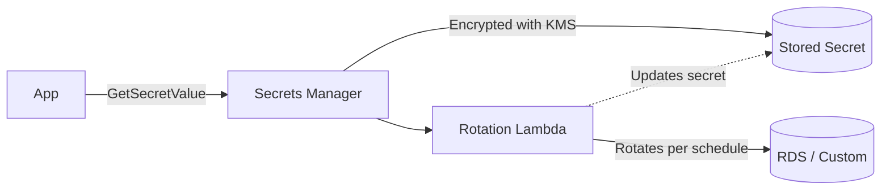
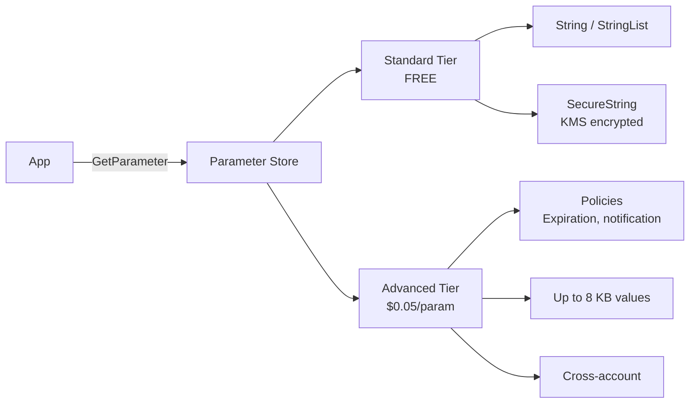
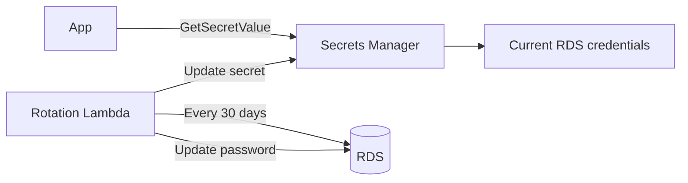

# Secrets Manager vs Parameter Store

> 🔥 **Common SAP-C02 question.** Know cost, features, and rotation differences.

## Problem It Solves
Apps need to handle:
- Database credentials
- API keys
- Tokens
- Config values (feature flags, URLs, thresholds)

Hardcoding = security disaster. Environment variables = better but still problematic (visible in console, no rotation). Both AWS services solve this — but differently.

## Side by Side

| | **Secrets Manager** | **Parameter Store (SSM)** |
|---|---|---|
| Primary purpose | Secret storage with rotation | Config + secrets storage |
| Auto-rotation | ✅ Native (RDS, Redshift, DocDB, custom Lambda) | ❌ Manual / custom Lambda |
| Cost (standard) | $0.40/secret/month + $0.05/10K API calls | FREE up to 10K parameters/account |
| Cost (advanced) | Same | Advanced parameters: $0.05/param/month |
| Max value size | 64 KB | Standard: 4 KB / Advanced: 8 KB |
| Cross-account | ✅ Via resource policy | ✅ Via resource policy (advanced only) |
| Encryption | ✅ Always KMS | ✅ Optional KMS (SecureString) |
| Versioning | ✅ Yes (AWSCURRENT, AWSPENDING, AWSPREVIOUS) | ✅ Yes |
| Hierarchical organization | Flat namespace | Hierarchical paths `/app/env/config` |
| CloudFormation reference | ✅ Dynamic reference | ✅ Dynamic reference |
| Better for | Database passwords with rotation | App config, hierarchical structure |

---

## AWS Secrets Manager



### Key Features

```
AUTOMATIC ROTATION:
─────────────────────────────────────────────
Built-in support for:
- RDS (MySQL, PostgreSQL, Oracle, SQL Server, MariaDB)
- Aurora
- DocumentDB
- Redshift

Custom rotation via Lambda for:
- Other databases (MongoDB, etc.)
- API keys
- Any other rotating secret

ROTATION CONFIGURATION:
─────────────────────────────────────────────
- Rotation schedule (e.g., every 30 days)
- Rotation Lambda function
- Two-secret pattern (old + new during transition)
- Apps fetch always — always get current

VERSION STAGES:
─────────────────────────────────────────────
AWSCURRENT  → The version apps should use
AWSPENDING  → Newly created, being tested
AWSPREVIOUS → Old version (for rollback)

During rotation:
1. Lambda creates new secret as AWSPENDING
2. Lambda tests it (e.g., connects to DB)
3. Promotes AWSPENDING to AWSCURRENT
4. Old AWSCURRENT becomes AWSPREVIOUS
```

### Cross-Account Access

```yaml
# Secret resource policy
{
  "Effect": "Allow",
  "Principal": {"AWS": "arn:aws:iam::OTHER_ACCOUNT:role/AppRole"},
  "Action": "secretsmanager:GetSecretValue",
  "Resource": "*"
}
```

```
ALSO REQUIRED:
─────────────────────────────────────────────
The KMS key used to encrypt the secret must also allow
the other account.
```

### Generating Random Passwords

```
GENERATE PASSWORD ON CREATION:
─────────────────────────────────────────────
GenerateRandomPassword API
- Specify length
- Exclude specific characters
- Require uppercase, lowercase, numbers, symbols
- Used by rotation Lambda
```

### Pricing Reality Check

```
EXAMPLE: 50 secrets, 1M GetSecretValue calls per month
─────────────────────────────────────────────
Storage:  50 × $0.40 = $20
API:      1M × $0.05/10K = $5
Total:    ~$25/month

For HEAVY usage: cache secrets in app (every 5 min) to
reduce API call cost.
```

---

## SSM Parameter Store



### Parameter Types

```
String:
─────────────────────────────────────────────
Plain text config (URLs, feature flags)

StringList:
─────────────────────────────────────────────
Comma-separated values (lists)

SecureString:
─────────────────────────────────────────────
Encrypted with KMS (use for secrets)
```

### Hierarchical Organization

```
PARAMETER STORE STRENGTH — HIERARCHIES:
─────────────────────────────────────────────

/myapp/production/database/host
/myapp/production/database/port
/myapp/production/database/password
/myapp/production/redis/host
/myapp/staging/database/host
...

GetParametersByPath:
─────────────────────────────────────────────
Fetch all parameters under a path
GetParametersByPath('/myapp/production/database/')
Returns all 3 in one API call
```

### Standard vs Advanced Tier

```
STANDARD (FREE):
─────────────────────────────────────────────
✅ 10,000 parameters per account per region
✅ 4 KB value size
✅ Free
✅ No policies (no expiration)

ADVANCED ($0.05/param/month):
─────────────────────────────────────────────
✅ 100,000 parameters
✅ 8 KB value size
✅ Parameter policies:
   - Expiration date
   - Expiration notification (EventBridge)
   - "No change" notification (catches stale params)
✅ Higher API throughput
```

### Public Parameters (AWS-Provided)

```
AWS PUBLISHES READ-ONLY PARAMETERS:
─────────────────────────────────────────────
/aws/service/ami-amazon-linux-latest/al2023-ami-kernel-default-x86_64
/aws/service/ami-windows-latest/Windows_Server-2022-English-Full-Base
/aws/service/eks/optimized-ami/1.30/amazon-linux-2/recommended/image_id

USE:
─────────────────────────────────────────────
✅ Always-current AMI IDs in CloudFormation
✅ Latest EKS optimized AMI
✅ Latest ECS-optimized AMI
✅ No manual updates needed
```

---

## Common Patterns

### Pattern 1: RDS Password Rotation



```
SETUP:
─────────────────────────────────────────────
1. Create Secret with RDS credentials
2. Enable rotation, choose rotation Lambda template
3. Schedule: every 30 days
4. App calls GetSecretValue every connection (or with cache)
5. App always has current credentials
✅ Zero downtime password rotation
```

### Pattern 2: App Config Without Rotation

```
USE CASE: API URLs, feature flags, rate limits
─────────────────────────────────────────────
Don't pay $0.40/secret each for non-rotating config

USE: Parameter Store (standard, FREE)
─────────────────────────────────────────────
Hierarchical:
  /myapp/prod/feature-flags/new-checkout = true
  /myapp/prod/rate-limit/api = 1000
  /myapp/prod/external-api/url = https://api.example.com

Fetch all on startup, cache in app.
```

### Pattern 3: Cross-Account Secret Sharing

```
SHARED SECRETS ACCOUNT:
─────────────────────────────────────────────
"Master" RDS credentials in central account A
Multiple workload accounts (B, C, D) need access

SETUP:
─────────────────────────────────────────────
1. Account A: Create secret + grant KMS access
2. Account A: Resource policy on secret allows B, C, D
3. Account A: KMS key policy allows B, C, D for decrypt
4. Account B/C/D: IAM role allows secretsmanager:GetSecretValue 
   on secret ARN + kms:Decrypt on key ARN
```

### Pattern 4: Lambda + Parameter Store

```python
import boto3
ssm = boto3.client('ssm')

def lambda_handler(event, context):
    # Fetch all under hierarchy
    params = ssm.get_parameters_by_path(
        Path='/myapp/prod/',
        Recursive=True,
        WithDecryption=True
    )
    config = {p['Name']: p['Value'] for p in params['Parameters']}
    
    # Use config
    db_url = config['/myapp/prod/database/url']
```

### Pattern 5: CloudFormation Dynamic References

```yaml
# Reference secret in CloudFormation
Resources:
  MyRDS:
    Type: AWS::RDS::DBInstance
    Properties:
      MasterUsername: '{{resolve:secretsmanager:my-secret:SecretString:username}}'
      MasterUserPassword: '{{resolve:secretsmanager:my-secret:SecretString:password}}'
  
  # Reference parameter store in CloudFormation
  MyEC2:
    Type: AWS::EC2::Instance
    Properties:
      ImageId: '{{resolve:ssm:/aws/service/ami-amazon-linux-latest/al2023-ami-kernel-default-x86_64}}'
```

---

## When to Use What

| Scenario | Solution |
|---|---|
| Database passwords with auto-rotation | **Secrets Manager** |
| Application config (URLs, flags) | **Parameter Store (free)** |
| Cross-account RDS credentials | **Secrets Manager** |
| Hierarchical config (per env) | **Parameter Store** |
| Latest AMI ID in CFN | **Parameter Store (public params)** |
| API keys (3rd party) with rotation | **Secrets Manager** with custom Lambda |
| Many small config values | **Parameter Store** (10k free) |
| Compliance requires audit trail of secret access | **Secrets Manager** (CloudTrail integration tighter) |
| Want value > 4 KB but cheap | **Parameter Store Advanced** ($0.05/param) |
| Stale parameter detection | **Parameter Store Advanced** policies |

## When NOT to Use

- ❌ Don't store secrets in plain Parameter Store (use SecureString)
- ❌ Don't use Secrets Manager for config that never rotates — overpaying
- ❌ Don't reference secrets in code without caching — burn through API call costs
- ❌ Don't store certificates in either — use ACM

## Trade-offs

| Choice | Gain | Sacrifice |
|---|---|---|
| Secrets Manager | Auto-rotation, easier compliance | $0.40/secret/month |
| Parameter Store | Free (standard tier) | Manual rotation |
| Parameter Store Advanced | Larger values, policies | $0.05/param/month |
| Caching secrets | Reduce API calls + cost | Slight staleness risk |
| Cross-account secrets | Single source of truth | Resource policy complexity |

## Real World Example

**Stripe-like SaaS:**
- **Secrets Manager** for:
  - All database credentials (with auto-rotation)
  - 3rd-party API keys (Stripe, Twilio) with custom rotation
  - Encryption keys for app-level encryption
- **Parameter Store** for:
  - Per-environment URLs (`/myapp/prod/api-gateway-url`)
  - Feature flags
  - Rate limit thresholds
  - Latest AMI references in CloudFormation
- App uses Secret Manager Cache library to reduce API calls

**A startup minimizing cost:**
- Only 3-4 secrets in Secrets Manager (RDS, master keys)
- Everything else in Parameter Store (free)
- Saves ~$50/month vs. putting everything in Secrets Manager

## 🎯 Exam Soundbite

> "AWS Secrets Manager is purpose-built for secrets requiring automatic rotation — natively supports RDS, Redshift, DocumentDB, and custom Lambda rotation for other secret types. Parameter Store is broader — designed for both application configuration and secrets, with a free standard tier for up to 10,000 parameters. Choose Secrets Manager for credentials needing rotation and Parameter Store for non-rotating config — or both used together in a typical app. Use Parameter Store's hierarchical paths to organize per-environment config."

---

## ⚡ Quick Recall Card

```
┌─────────────────────────────────────────────────┐
│ SECRETS MANAGER                                  │
├─────────────────────────────────────────────────┤
│ Use: Secrets with auto-rotation                  │
│ Cost: $0.40/secret/month + API calls             │
│ Auto-rotate: RDS, Redshift, DocDB, custom Lambda │
│ Max value: 64 KB                                 │
│ Versions: AWSCURRENT / AWSPENDING / AWSPREVIOUS  │
│ Cross-account: Resource policy + KMS policy      │
├─────────────────────────────────────────────────┤
│ PARAMETER STORE                                  │
├─────────────────────────────────────────────────┤
│ Use: Config + secrets (cheaper)                  │
│ Standard: FREE up to 10K params                  │
│ Advanced: $0.05/param/month, policies            │
│ Max value: 4 KB / 8 KB advanced                  │
│ Types: String, StringList, SecureString          │
│ Hierarchical paths                               │
│ Public params for latest AMI, EKS images         │
└─────────────────────────────────────────────────┘
```

## 🎓 Common Exam Patterns

> **"Database credentials must rotate every 30 days automatically with zero downtime."**
>
> ✅ **AWS Secrets Manager** with native RDS rotation enabled.

> **"Latest Amazon Linux 2023 AMI ID should be auto-referenced in CloudFormation."**
>
> ✅ **SSM Parameter Store public parameter**: `/aws/service/ami-amazon-linux-latest/al2023-ami-kernel-default-x86_64`. CloudFormation dynamic reference fetches latest.

> **"500 config values per environment, 3 environments. Free if possible."**
>
> ✅ **Parameter Store standard tier** — free up to 10K params (1500 used). Use hierarchical paths `/myapp/{env}/config/...`.
