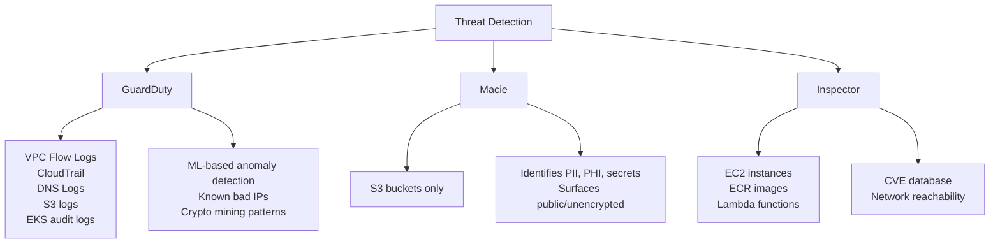
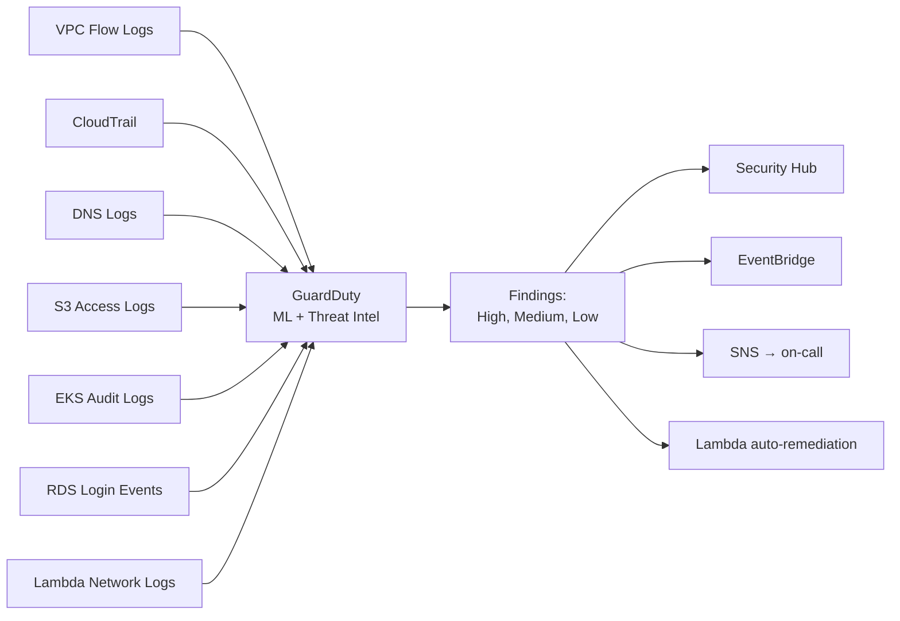
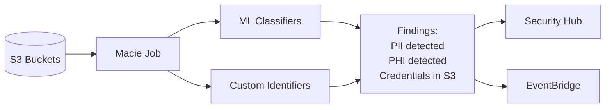
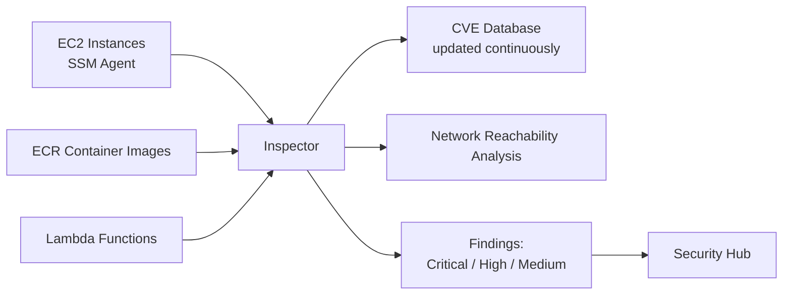
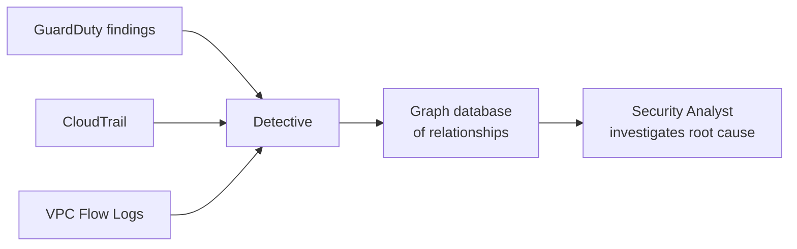
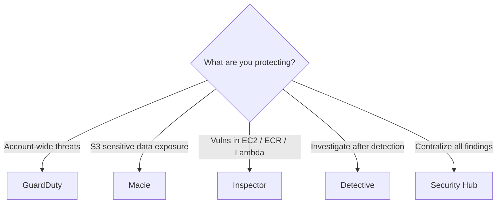

# GuardDuty, Macie, Inspector — Threat Detection

> 🔥 **Common exam pattern: pick the right detection service for the scenario.** Each has a specific domain — don't confuse them.

## Problem It Solves
After misconfigurations and IAM mistakes, the next threat layer is: **someone is already in your environment**. You need detection. AWS offers three complementary services — each scans a different part of your infrastructure for specific kinds of trouble.

## How They Work — At a Glance



### The Decision Matrix

| Service | Scans | Looks For | Trigger |
|---|---|---|---|
| **GuardDuty** | Account-wide logs (VPC Flow, CloudTrail, DNS) | Suspicious activity (compromised credentials, crypto mining, port scans) | Continuous |
| **Macie** | S3 buckets | Sensitive data (PII, credit cards, secrets) | Scheduled jobs |
| **Inspector** | EC2, ECR, Lambda | Known vulnerabilities (CVEs), network exposure | Continuous (auto) |
| **Detective** | After-the-fact | Investigate GuardDuty findings | On-demand |

---

## GuardDuty — The Always-On Threat Sentinel



### What GuardDuty Detects

```
COMPROMISED CREDENTIALS:
─────────────────────────────────────────────
✅ Unusual API calls from new geography
✅ IAM credentials used from suspicious IPs
✅ Console login from anonymous proxy / Tor
✅ Disabling of CloudTrail / Config

CRYPTO MINING:
─────────────────────────────────────────────
✅ EC2 communicating with known mining pools
✅ Unusual outbound traffic patterns

INSTANCE COMPROMISE:
─────────────────────────────────────────────
✅ EC2 communicating with known C&C servers
✅ Probing/scanning known bad domains
✅ Brute-force SSH attacks (incoming)

DATA EXFILTRATION:
─────────────────────────────────────────────
✅ Large data transfers to suspicious IPs
✅ S3 objects accessed from suspicious sources

EKS-SPECIFIC:
─────────────────────────────────────────────
✅ Kubernetes API access from anomalous IPs
✅ Privilege escalation in cluster

RDS-SPECIFIC:
─────────────────────────────────────────────
✅ Anomalous login patterns
✅ Suspicious data access patterns

MALWARE PROTECTION (Add-on):
─────────────────────────────────────────────
✅ Scans EBS volumes for malware
✅ Triggered by suspicious GuardDuty findings
```

### GuardDuty Key Facts

```
ENABLE:
─────────────────────────────────────────────
- Per region (enable in every region you use)
- Use Organizations for multi-account auto-enable
- Default delegated administrator pattern

NO AGENTS:
─────────────────────────────────────────────
Pulls from existing logs — no software to install
"Just turn it on" — no infrastructure work

ACTIONS ON FINDINGS:
─────────────────────────────────────────────
- View in console / API
- Send to Security Hub (centralized findings)
- Send to EventBridge → automated remediation
- Send to SNS for human alerts
- Isolation playbook: Lambda quarantines EC2

COST:
─────────────────────────────────────────────
Based on log volume processed
Per GB of CloudTrail, VPC Flow, DNS logs
Predictable but adds up at scale
```

### Real GuardDuty Pattern

```
INCIDENT FLOW:
─────────────────────────────────────────────
1. EC2 instance is compromised, starts crypto mining
2. GuardDuty detects communication with mining pool
3. Generates HIGH severity finding
4. EventBridge rule routes finding to Lambda
5. Lambda:
   - Attaches "Compromised" Security Group (no egress)
   - Snapshots EBS volume for forensics
   - Posts to SNS for on-call
   - Tags the instance
6. Detective enabled → SOC investigates 
   relationships, finds initial attack vector
```

---

## Macie — Sensitive Data Discovery in S3



### What Macie Detects

```
PII (Personally Identifiable Information):
─────────────────────────────────────────────
✅ Social Security Numbers
✅ Credit Card Numbers (validates Luhn)
✅ National IDs
✅ Names, addresses, phone numbers

CREDENTIALS:
─────────────────────────────────────────────
✅ AWS access keys in code/configs
✅ Private keys (RSA, SSH)
✅ Database connection strings
✅ API tokens

PROTECTED HEALTH INFO (PHI):
─────────────────────────────────────────────
✅ Medical record numbers
✅ HIPAA-relevant identifiers

FINANCIAL:
─────────────────────────────────────────────
✅ Bank account numbers
✅ Stripe/payment processor IDs

CUSTOM DATA IDENTIFIERS:
─────────────────────────────────────────────
You can define regex + keywords for company-specific
patterns (e.g., your customer ID format)
```

### Macie Pattern

```
COMMON USE:
─────────────────────────────────────────────
1. Enable Macie at the Organization level
2. Macie inventories all S3 buckets
3. Identifies:
   - Public buckets (immediate red flag)
   - Unencrypted buckets
   - Buckets accessible cross-account
4. Schedule discovery jobs to scan content
5. Sample-based scanning (don't scan everything)
6. Findings sent to Security Hub
```

### Macie Key Facts

```
S3-ONLY:
─────────────────────────────────────────────
Macie scans ONLY S3
For EC2 file scanning → use Inspector or 3rd party

JOB TYPES:
─────────────────────────────────────────────
- One-time job: scan once
- Scheduled job: daily/weekly/monthly

COST:
─────────────────────────────────────────────
Per GB scanned (sample-based to control cost)
Bucket inventory: free per month per account

INTEGRATION:
─────────────────────────────────────────────
Findings → Security Hub → unified view
Findings → EventBridge → automated response
```

---

## Inspector — Vulnerability Scanning



### What Inspector Scans

```
EC2 INSTANCES:
─────────────────────────────────────────────
✅ OS packages with known CVEs
✅ Software vulnerabilities (apt/yum packages)
✅ Requires SSM Agent (most modern AMIs have it)
✅ Continuous scanning — no scheduling needed
✅ Network reachability: which EC2 are reachable
   from the internet on which ports

ECR CONTAINER IMAGES:
─────────────────────────────────────────────
✅ Scans on push (enhanced scanning)
✅ Scans periodically (basic scanning)
✅ Identifies vulnerable packages in image layers
✅ OS + application package CVEs

LAMBDA FUNCTIONS:
─────────────────────────────────────────────
✅ Scans Lambda runtime + your code dependencies
✅ Identifies vulnerable packages

SEVERITY SCORING:
─────────────────────────────────────────────
Critical → Patch immediately
High → Patch within days
Medium → Patch within weeks
Inspector uses Inspector Severity Score, similar to CVSS
```

### Inspector Pattern

```
WORKFLOW:
─────────────────────────────────────────────
1. Enable Inspector (account or Organization-wide)
2. Inspector auto-discovers EC2 (via SSM), ECR, Lambda
3. Scans continuously
4. Findings appear with:
   - Vulnerability ID (CVE-2024-XXXX)
   - Affected resource
   - Suggested fix (upgrade package X to version Y)
5. Findings → Security Hub
6. Patch via Systems Manager Patch Manager
```

### Inspector vs Inspector Classic

```
INSPECTOR CLASSIC (DEPRECATED):
─────────────────────────────────────────────
Old agent-based service
Scheduled scans only
No ECR or Lambda support
Don't use for new deployments

INSPECTOR (current):
─────────────────────────────────────────────
SSM Agent based
Continuous, automatic
EC2 + ECR + Lambda support
This is what the exam means by "Inspector"
```

---

## Detective — Investigation Tool



```
DETECTIVE:
─────────────────────────────────────────────
Doesn't generate findings — uses GuardDuty's.
Builds a graph linking:
  - Findings
  - Resources (EC2, IAM users, etc.)
  - Activities (API calls)
  - Network flows

Used DURING INCIDENT RESPONSE to answer:
- "What did this compromised credential do?"
- "Which resources did the attacker access?"
- "What's the blast radius?"

NOT a replacement for GuardDuty — a complement.
```

---

## Service Choice Decision Tree



## When to Use What

| Scenario | Solution |
|---|---|
| Detect compromised IAM credentials | **GuardDuty** |
| Find PII in S3 buckets | **Macie** |
| Check EC2 for unpatched CVEs | **Inspector** |
| Scan container images before deploy | **Inspector (ECR)** |
| Investigate root cause of an alert | **Detective** |
| Detect crypto mining on EC2 | **GuardDuty** |
| Find unencrypted/public S3 buckets | **Macie** |
| Find Lambda functions with vulnerable deps | **Inspector** |
| Centralize all security findings | **Security Hub** (aggregator) |

## When NOT to Use

- ❌ Don't expect GuardDuty to find PII in S3 — that's **Macie's** job
- ❌ Don't use Macie for non-S3 storage — only S3
- ❌ Don't use Inspector for runtime threat detection — that's **GuardDuty**
- ❌ Don't rely solely on Inspector for compliance — it's vulnerability scanning, not config audit (use Config)

## Trade-offs

| Choice | Gain | Sacrifice |
|---|---|---|
| Enable all three | Defense in depth | Cost per service |
| GuardDuty | Always-on with no agent | Per-GB log processing cost |
| Macie | Catches data leaks early | Sample-based scanning may miss some |
| Inspector | CVE coverage automatically | Won't catch zero-days |
| Detective | Powerful investigation | Adds cost; needs analyst time |

## Real World Example

**A SaaS startup's security stack:**
- **GuardDuty** enabled in every region, every account, via Organization
- **Macie** scanning customer data buckets weekly for accidental PII leakage
- **Inspector** on the build pipeline — ECR scans on every push, block deploy of Critical findings
- **Detective** enabled for the security team to investigate findings
- **Security Hub** aggregates everything; on-call sees one dashboard

**A financial services company:**
- **GuardDuty** with **Malware Protection** add-on — EBS volume scans on suspicious findings
- **Macie** with custom data identifiers for account number patterns
- **Inspector** continuous on all EC2 + ECR + Lambda
- **AWS Config + Security Hub + Detective** for full audit trail

## 🎯 Exam Soundbite

> "GuardDuty is the always-on threat detection service that analyzes CloudTrail, VPC Flow Logs, and DNS logs across the entire account for compromised credentials, crypto mining, and command-and-control activity. Macie focuses on S3 to discover sensitive data like PII and PHI. Inspector continuously scans EC2 instances, ECR container images, and Lambda functions for known CVEs and network exposure. Aggregate findings from all three into Security Hub for a unified security posture view, and use Detective to investigate root causes after a finding is generated."

---

## ⚡ Quick Recall Card

```
┌─────────────────────────────────────────────────┐
│ DETECTION SERVICES — WHO DOES WHAT?              │
├─────────────────────────────────────────────────┤
│ GuardDuty  Account threats from logs (ML)        │
│            VPC Flow + CloudTrail + DNS           │
│            Crypto mining, compromised creds      │
│                                                  │
│ Macie      S3 buckets only                       │
│            Sensitive data discovery (PII, PHI)   │
│            Public/unencrypted bucket detection   │
│                                                  │
│ Inspector  EC2 + ECR + Lambda                    │
│            CVEs and network reachability         │
│            Continuous, no scheduling             │
│                                                  │
│ Detective  Investigation graph                   │
│            Uses GuardDuty findings + logs        │
│                                                  │
│ Security   Aggregates findings from all sources  │
│ Hub        Compliance standards (CIS, PCI, etc.) │
└─────────────────────────────────────────────────┘
```

## 🎓 Common Exam Patterns

> **"Company suspects an EC2 instance is compromised — it's making unusual network connections at odd hours. Which service detects this?"**
>
> ✅ **GuardDuty** — analyzes VPC Flow Logs for unusual outbound communication patterns.

> **"Audit found that a developer accidentally uploaded a CSV with thousands of customer credit cards to an S3 bucket. How to detect this kind of leak going forward?"**
>
> ✅ **Macie** — sensitive data discovery in S3, including credit card patterns.

> **"Need to ensure all ECR images are scanned for vulnerabilities BEFORE they're deployed."**
>
> ✅ **Inspector** with ECR enhanced scanning — scans on every push, can integrate with build pipeline to block Critical findings.
