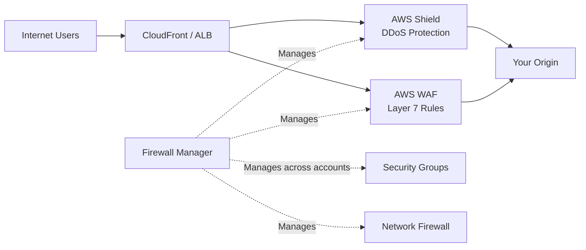
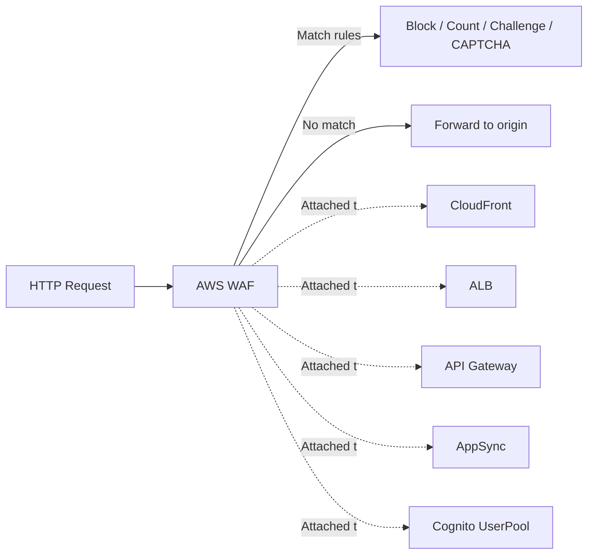
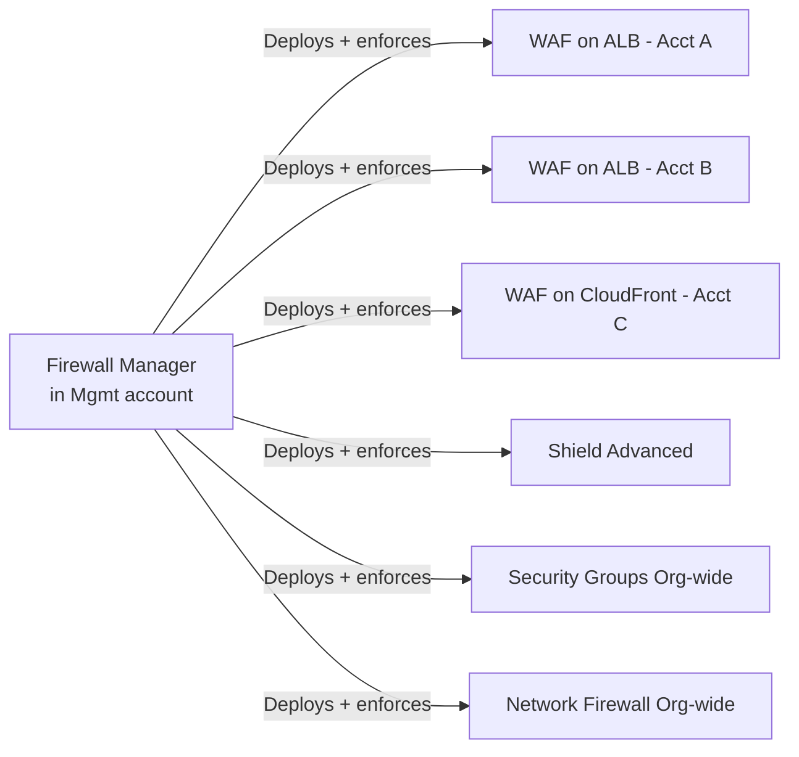
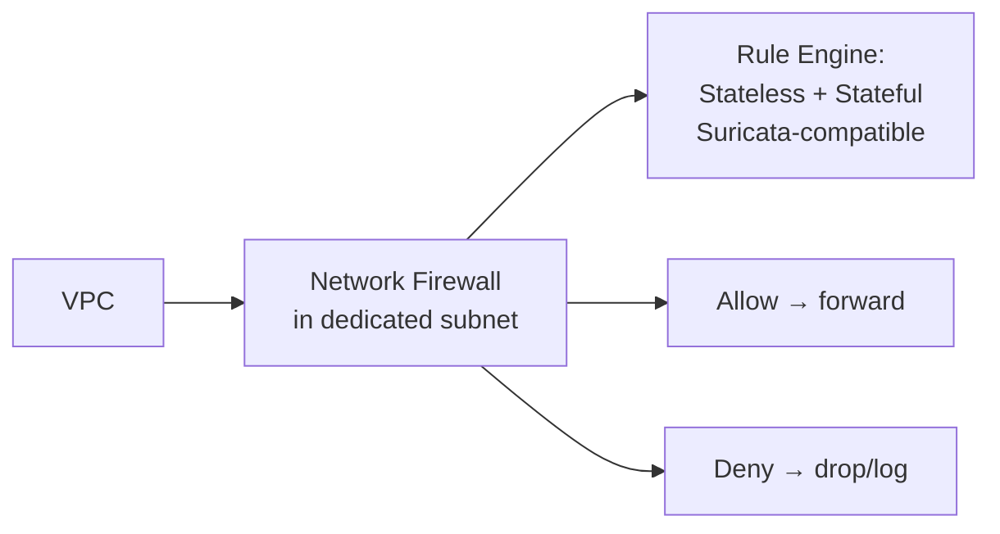
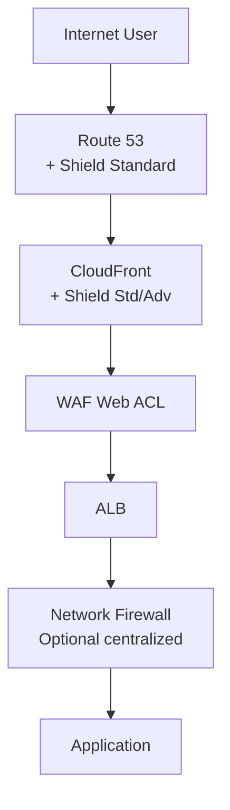

# Shield, WAF, Firewall Manager — DDoS & WAF Defense

> 🔥 **Hot SAP-C02 topic.** Know what each service does and how they compose at the edge.

## Problem It Solves
The public-facing edge of your application faces three categories of attacks:
1. **Volumetric attacks** — flood your bandwidth or compute (DDoS)
2. **Application-layer attacks** — SQL injection, XSS, bad bots
3. **Configuration drift** — security rules forgotten on some resources

AWS Shield handles DDoS, WAF handles Layer 7 application attacks, and Firewall Manager keeps it all consistent across accounts.

## How They Work Together



---

## AWS Shield

```
SHIELD STANDARD (free, automatic):
─────────────────────────────────────────────
✅ Always enabled, no cost
✅ Protects against common volumetric DDoS
   (SYN floods, UDP reflection)
✅ Layer 3 / Layer 4 protection
✅ Covers ALL AWS customers
✅ Mitigated automatically


SHIELD ADVANCED ($3,000/month per Org):
─────────────────────────────────────────────
✅ Everything in Standard +
✅ Advanced DDoS protection (Layer 3/4/7)
✅ DDoS Response Team (DRT) — 24/7 humans
✅ Cost protection — AWS refunds the cost spike
   from a DDoS-related autoscale event
✅ Global threat dashboard
✅ Real-time attack visibility
✅ Health-based detection of L7 attacks
✅ Includes AWS WAF (no extra WAF cost)
✅ Protects: CloudFront, Route 53, ELB, Global Accelerator, EIPs
✅ Application Layer DDoS automatic mitigation
```

### When to Use Shield Advanced

```
USE CASES:
─────────────────────────────────────────────
✅ Public-facing, mission-critical apps
✅ History of being targeted (high-profile)
✅ Compliance/SLA requires DDoS protection
✅ Want bill-shock protection from attack-induced scale
✅ Need 24/7 DRT support during incidents

DON'T NEED IT:
─────────────────────────────────────────────
❌ Internal apps (not internet-facing)
❌ Low-risk profile
❌ Standard tier protects most common attacks anyway
```

---

## AWS WAF



### What WAF Protects Against

```
OWASP TOP 10:
─────────────────────────────────────────────
✅ SQL Injection
✅ Cross-Site Scripting (XSS)
✅ Broken access control
✅ Security misconfiguration

BOT ATTACKS:
─────────────────────────────────────────────
✅ Scraping
✅ Brute force login attempts
✅ Credential stuffing

RATE LIMITING:
─────────────────────────────────────────────
✅ Block IPs sending too many requests
✅ Geographic-based restrictions

EXPLOIT ATTEMPTS:
─────────────────────────────────────────────
✅ Known CVE payloads
✅ Bad user-agents
✅ Suspicious request patterns
```

### WAF Rule Types

```
1. MANAGED RULES (AWS / Marketplace vendors):
─────────────────────────────────────────────
- AWS Managed Rules: OWASP Top 10, Anonymous IPs, Bot Control
- Marketplace: Imperva, F5, Fortinet, etc.
- Auto-updated as new threats emerge
- Easiest to deploy
- Most common choice ✅

2. RATE-BASED RULES:
─────────────────────────────────────────────
- Count requests from a source IP over 5 mins
- Block if exceeds threshold
- Example: > 1000 requests/5 min = block for 5 min
- Use: Rudimentary DDoS, brute-force protection

3. CUSTOM RULES (you write):
─────────────────────────────────────────────
- Match by: URL, header, body, query string, IP, geo
- Combine with AND/OR/NOT
- Use: Custom business rules
   e.g., block /admin/* from outside corporate IPs

4. IP SETS:
─────────────────────────────────────────────
- Allowlist or blocklist of IPs
- Manage IPs separately from rules

5. CAPTCHA / CHALLENGE:
─────────────────────────────────────────────
Instead of block — present a challenge
Bots fail, humans pass
Use: Less disruptive than outright block
```

### WAF Pricing Model

```
Web ACL:           $5/month
Per rule:          $1/month
Per million requests: $0.60

A typical config: ~$20-50/month + per-request

Bot Control (managed rule group): $10/month + $1/M req
```

### Common WAF Patterns

```
PATTERN 1: Block by Geography
─────────────────────────────────────────────
Only allow traffic from approved countries
Block sanctioned countries (compliance)

PATTERN 2: Rate Limit Login Endpoint
─────────────────────────────────────────────
Rate-based rule on /login URL
> 5 attempts per 5 min per IP → block 5 min
Stops credential stuffing

PATTERN 3: Block by User-Agent
─────────────────────────────────────────────
Block "PostmanRuntime" UA on production endpoint
Block known scraping UAs

PATTERN 4: Bot Control
─────────────────────────────────────────────
AWS Managed Bot Control rule group
Detects scrapers, account creation bots, etc.
CAPTCHA challenge instead of outright block
```

---

## AWS Firewall Manager



```
PURPOSE:
─────────────────────────────────────────────
Centrally manage:
✅ WAF rules across many accounts/resources
✅ Shield Advanced subscriptions across accounts
✅ Security Groups baseline policies
✅ Network Firewall policies
✅ Route 53 Resolver DNS Firewall

REQUIREMENTS:
─────────────────────────────────────────────
- AWS Organizations with All Features mode
- AWS Config enabled in target accounts
- Firewall Manager Admin account designated

USE:
─────────────────────────────────────────────
✅ Enforce WAF on EVERY ALB in EVERY account
✅ Apply uniform "block bad IPs" rules org-wide
✅ Detect non-compliant resources (no WAF attached)
✅ Auto-remediate (add WAF if missing)
```

---

## Network Firewall — Deep Packet Inspection in VPC



```
NETWORK FIREWALL FEATURES:
─────────────────────────────────────────────
✅ Layer 3-7 inspection
✅ Stateless rules (5-tuple filtering)
✅ Stateful rules (Suricata-compatible signatures)
✅ Web filtering by domain/SNI
✅ IPS/IDS — detect + block known malicious patterns
✅ Integration with Transit Gateway for central inspection
✅ Logging to CloudWatch / Kinesis Firehose

USE CASES:
─────────────────────────────────────────────
✅ Egress filtering (don't allow EC2 to call random domains)
✅ Compliance: deep packet inspection requirement
✅ Centralized inspection VPC (with Transit Gateway)
✅ Block known C2 (Command & Control) traffic
```

### Network Firewall vs Security Groups vs NACLs

| | **Security Group** | **NACL** | **Network Firewall** |
|---|---|---|---|
| Layer | 4 | 4 | 3-7 |
| Scope | ENI/instance | Subnet | VPC |
| Stateful | ✅ | ❌ | ✅ |
| Allow/Deny | Allow only | Allow + Deny | Allow + Deny |
| Deep inspection | ❌ | ❌ | ✅ |
| Domain filtering | ❌ | ❌ | ✅ |
| Cost | Free | Free | $$ per hour + GB |

---

## Edge Protection Stack — Putting It All Together



```
LAYERED DEFENSE:
─────────────────────────────────────────────
Layer 1: Route 53 (Shield Standard protects DNS)
Layer 2: CloudFront (caches, absorbs L3/L4 floods)
Layer 3: WAF (Layer 7 rules at CloudFront edge)
Layer 4: Shield Advanced (if subscribed) — 
         premium DDoS mitigation
Layer 5: ALB / API Gateway with TLS termination
Layer 6: Network Firewall in VPC (egress + east-west)
Layer 7: Security Groups (instance-level)
Layer 8: GuardDuty (detection if all else fails)
```

---

## When to Use What

| Need | Service |
|---|---|
| Free DDoS protection | **Shield Standard** (automatic) |
| Premium DDoS for critical apps | **Shield Advanced** |
| Block SQL injection, XSS on web app | **WAF** |
| Rate-limit login attempts | **WAF rate-based rule** |
| Block specific countries | **WAF geo-match rule** |
| Filter bot traffic | **WAF Bot Control** |
| Enforce same WAF across all ALBs | **Firewall Manager** |
| Block egress to suspicious domains | **Network Firewall** |
| Inspect East-West traffic | **Network Firewall + Transit Gateway** |
| Bill protection during DDoS | **Shield Advanced** |
| Subscribe to commercial threat feeds | **WAF Marketplace rules** |

## When NOT to Use

- ❌ Don't pay for Shield Advanced if app isn't internet-facing or high-risk
- ❌ Don't use Network Firewall for instance-level — Security Groups are free and sufficient
- ❌ Don't write custom WAF rules from scratch when AWS Managed Rules cover OWASP
- ❌ Don't use Firewall Manager without AWS Organizations — requires it

## Trade-offs

| Choice | Gain | Sacrifice |
|---|---|---|
| Shield Advanced | Premium protection, DRT, cost protection | $3,000/month per Org |
| WAF | Layer 7 protection | Per-request cost adds up at scale |
| Network Firewall | DPI + egress filtering | $ per hour + per GB |
| Firewall Manager | Central management | Requires Organizations |
| Aggressive WAF rules | Block more attacks | False positives → real users blocked |

## Real World Example

**A media company** (potentially DDoS-targeted):
- **Shield Advanced** subscription org-wide ($3K/month)
- **CloudFront + WAF** with AWS Managed Rules for OWASP Top 10
- **WAF Bot Control** with CAPTCHA challenge instead of block
- **Rate-based rule** on /login and /api/* endpoints
- **Firewall Manager** enforces WAF on every internet-facing ALB across accounts
- **Route 53** + **Global Accelerator** in front to absorb floods

**A regulated bank:**
- **Shield Advanced** for compliance
- **WAF** with custom rules + managed rules
- **Network Firewall** in centralized inspection VPC (via Transit Gateway)
- **DNS Firewall** to block egress to known bad domains
- **Firewall Manager** enforces baseline across all 100+ accounts
- **All findings → Security Hub** for SOC

## 🎯 Exam Soundbite

> "AWS Shield Standard provides automatic, free DDoS protection at Layer 3/4 for all customers. Shield Advanced adds Layer 7 protection, a 24/7 DDoS Response Team, cost protection during attacks, and the included use of AWS WAF — for mission-critical internet-facing workloads. WAF protects against application-layer attacks like SQL injection and XSS, and supports managed rules for OWASP, rate-based rules for brute force, and CAPTCHA challenges for bot mitigation. Use AWS Firewall Manager to enforce consistent WAF and Shield policies across many accounts in an Organization, and Network Firewall for deep packet inspection and egress filtering within VPCs."

---

## ⚡ Quick Recall Card

```
┌─────────────────────────────────────────────────┐
│ DEFENSE LAYERS                                   │
├─────────────────────────────────────────────────┤
│ Shield Standard    Free L3/L4 DDoS — automatic   │
│ Shield Advanced    Premium DDoS + L7 + DRT       │
│ WAF                Layer 7 rules (SQLi, XSS, etc)│
│ Firewall Manager   Central mgmt across accounts  │
│ Network Firewall   In-VPC L3-7 + egress filter   │
│ Security Groups    Instance-level (free)         │
│ NACLs              Subnet-level (free)           │
├─────────────────────────────────────────────────┤
│ WAF ATTACHMENTS                                  │
│ CloudFront, ALB, API Gateway, AppSync, Cognito   │
├─────────────────────────────────────────────────┤
│ SHIELD ADVANCED COST                             │
│ $3000/month per Organization + data transfer     │
└─────────────────────────────────────────────────┘
```

## 🎓 Common Exam Patterns

> **"E-commerce site was DDoS'd last Black Friday. The auto-scaling triggered by the attack cost them $50,000 extra in EC2. Want protection that includes financial reimbursement."**
>
> ✅ **Shield Advanced** — includes "DDoS cost protection" — AWS will refund the autoscaling cost spike caused by a DDoS attack.

> **"Need to apply the same set of WAF rules consistently across 50+ ALBs in 20+ AWS accounts. Some teams keep accidentally removing the WAF."**
>
> ✅ **AWS Firewall Manager** — centrally enforces WAF policies; auto-remediates non-compliant ALBs (re-attaches WAF if removed).

> **"Compliance mandates inspection of all outbound traffic to detect data exfiltration. Want to allow only approved domains."**
>
> ✅ **AWS Network Firewall** with domain/SNI filtering — block egress to anything except an approved allowlist.
