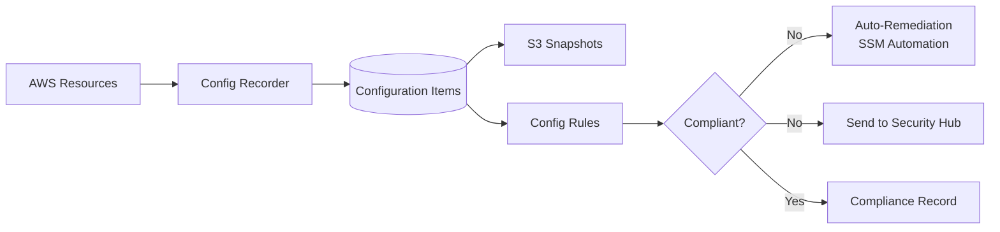
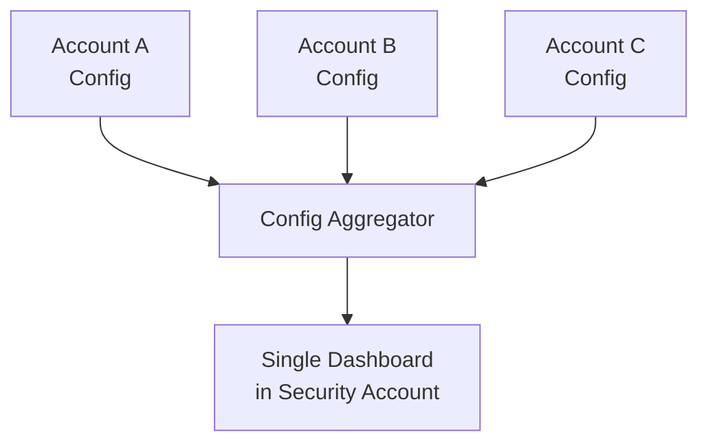
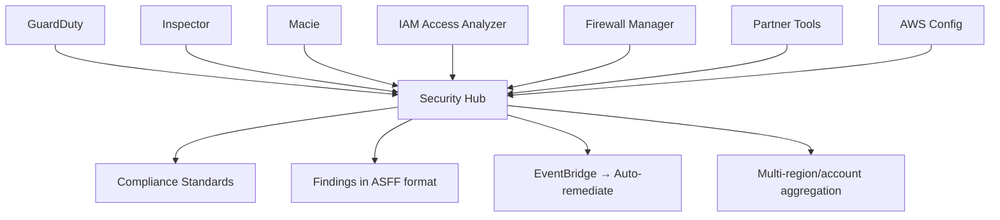
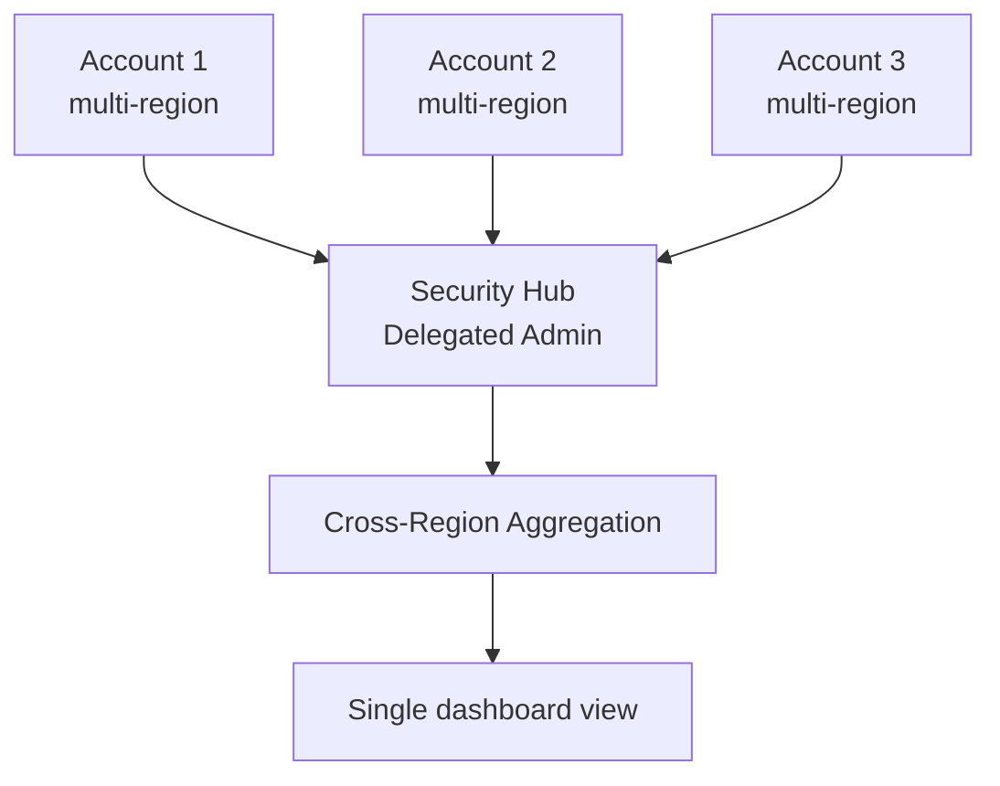
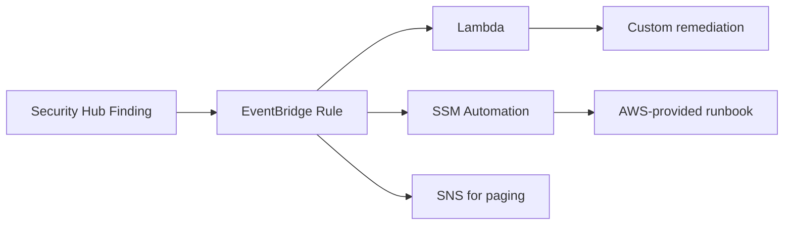

# Security Hub & AWS Config — Governance

> 🔥 **The governance one-two punch.** Know how they complement each other.

## Problem It Solves
At organizational scale, you need to:
- See compliance posture across all accounts and regions in one place
- Continuously verify resource configurations meet policy
- Auto-remediate violations as they're detected
- Generate compliance evidence for auditors

These two services work together: **Config detects, Security Hub aggregates + scores.**

## Quick Mental Model

```
AWS CONFIG:
─────────────────────────────────────────────
"What does this resource look like and is it compliant?"
Per-account, per-region engine

SECURITY HUB:
─────────────────────────────────────────────
"Across all my accounts and security tools, what should I worry about?"
Aggregator + standards scoring + automation hub
```

---

## AWS Config (Refresher + Governance Focus)



### Conformance Packs

```
A "CONFORMANCE PACK" =
A bundled set of Config Rules with remediations
Deploy as a single CloudFormation template
─────────────────────────────────────────────

AWS PROVIDES SAMPLES FOR:
- CIS AWS Foundations
- PCI DSS
- HIPAA Security Rule
- NIST 800-53
- NIST 800-171
- GDPR
- AWS Operational Best Practices

CUSTOM CONFORMANCE PACKS:
─────────────────────────────────────────────
Build your company's "Production Baseline":
- All RDS encrypted
- No public S3
- All ALBs use HTTPS
- Tags on all EC2
- Etc.

DEPLOY WITH STACKSETS:
─────────────────────────────────────────────
✅ Apply to all accounts in OU
✅ Auto-deploy to new accounts
✅ Centralized policy enforcement
```

### Config Rule Types

```
AWS MANAGED RULES (200+):
─────────────────────────────────────────────
Pre-built common checks:
- s3-bucket-public-read-prohibited
- restricted-ssh (no 0.0.0.0/0 on 22)
- root-account-mfa-enabled
- rds-storage-encrypted
- ec2-instance-no-public-ip
- iam-password-policy
- vpc-flow-logs-enabled
... etc.

CUSTOM RULES — TWO FLAVORS:
─────────────────────────────────────────────

1. LAMBDA-BACKED CUSTOM RULES:
   Write Lambda that evaluates a resource
   Return COMPLIANT, NON_COMPLIANT, or NOT_APPLICABLE
   Triggered on change or periodic

2. CUSTOM POLICY RULES (newer):
   Define rule in Guard DSL (CloudFormation Guard)
   No Lambda needed
   Easier and cheaper
```

### Multi-Account Aggregation



```
SETUP:
─────────────────────────────────────────────
1. Create Aggregator in central account (security or audit)
2. Authorize source accounts (or all Org accounts)
3. View aggregated compliance from one place
4. Multi-region aggregation also supported

QUERY THE AGGREGATED DATA:
─────────────────────────────────────────────
SELECT * 
FROM aws_config_aggregator
WHERE resourceType = 'AWS::S3::Bucket'
AND configuration.encryption IS NULL
```

### Config + Remediation

```yaml
ConfigRule:
  Name: s3-bucket-public-read-prohibited
  Remediation:
    DocumentName: AWS-DisableS3BucketPublicReadWrite
    Automatic: true
    MaximumAutomaticAttempts: 5
    Parameters:
      BucketName: {ResourceId: "${RESOURCE_ID}"}
```

```
HOW AUTO-REMEDIATION FLOWS:
─────────────────────────────────────────────
1. Config detects non-compliant resource
2. Triggers SSM Automation document
3. Automation executes remediation steps
4. Config re-evaluates → now compliant
5. CloudTrail logs the remediation activity

COMMON REMEDIATIONS:
─────────────────────────────────────────────
- Public S3 → remove public ACL
- Unrestricted SG → close port 22 from internet
- Unencrypted EBS → snapshot + replace (more complex)
- Missing tag → add tag from related resource
```

---

## AWS Security Hub



### Security Standards

```
FREE TO ENABLE:
─────────────────────────────────────────────
✅ AWS Foundational Security Best Practices
   (~200 checks across all services)

✅ CIS AWS Foundations Benchmark
   (~50 checks, industry standard)

✅ PCI DSS v3.2.1
   (~50 checks for payment card environments)

✅ NIST 800-53 Rev 5
   (Federal security framework, ~200+ checks)

EACH STANDARD = SET OF CONTROLS
EACH CONTROL = CONFIG RULE BEHIND THE SCENES
```

### ASFF — AWS Security Finding Format

```json
{
  "SchemaVersion": "2018-10-08",
  "Id": "finding-uuid",
  "ProductArn": "arn:aws:securityhub:::product/aws/guardduty",
  "Title": "Recon:EC2/Portscan",
  "Severity": {"Label": "HIGH", "Normalized": 70},
  "Resources": [...],
  "ComplianceStatus": "FAILED"
}
```

```
ASFF UNIFIES FINDINGS:
─────────────────────────────────────────────
Every finding (regardless of source) follows same schema:
- GuardDuty findings
- Inspector findings
- Macie findings
- Config Rule violations
- Partner findings (Sumo, Splunk, Sysdig, etc.)

✅ One format = one query pattern
✅ Easy automation (EventBridge rules)
✅ Consistent dashboard
```

### Security Hub Aggregation



```
ORGANIZATION ADMIN PATTERN:
─────────────────────────────────────────────
1. Designate Delegated Admin (security account)
2. Auto-enable Security Hub in all Org accounts
3. All findings aggregate to Delegated Admin
4. Cross-region aggregation: pick a "linking" region
   → Findings from all regions flow there

EXAM SIGNAL:
─────────────────────────────────────────────
"Single security dashboard across many accounts and regions"
→ Security Hub with delegated admin + cross-region aggregation
```

### Automated Response & Remediation (ASR)



```
SECURITY HUB + EVENTBRIDGE PATTERNS:
─────────────────────────────────────────────
"Critical finding from any product" → SNS to on-call

"S3 bucket public" finding → SSM doc to remove public access

"Failed root MFA check" → Email security team + log to JIRA

"GuardDuty cryptomining" → Auto-isolate instance (SG change)
```

### Custom Insights

```
INSIGHTS = SAVED QUERIES:
─────────────────────────────────────────────
"All critical findings older than 7 days"
"All findings on production-tagged resources"
"All findings from Account X"

✅ Dashboards / reports built on these
```

---

## Config vs Security Hub — Mental Model

```
CONFIG IS BUILT FOR DETECTION:
─────────────────────────────────────────────
"This S3 bucket is public — violation of rule X"
"This SG has port 22 open to internet"
Resource-centric
Configuration history + drift detection

SECURITY HUB IS BUILT FOR AGGREGATION + SCORING:
─────────────────────────────────────────────
"Across all our accounts:
 - 5 buckets public (from Config)
 - 3 EC2s with critical CVEs (from Inspector)
 - 1 IAM key compromised (from GuardDuty)
 - PCI compliance score: 87%"

WORK TOGETHER:
─────────────────────────────────────────────
Config Rules → Security Hub standards
Security Hub uses Config under the hood for many standards
```

---

## Integration with Other Governance Services

### AWS Audit Manager

```
WHAT IT DOES:
─────────────────────────────────────────────
Continuous evidence collection for compliance audits
Pre-built frameworks: PCI, HIPAA, GDPR, SOC 2, NIST...

HOW IT WORKS:
─────────────────────────────────────────────
- Maps controls to AWS services + resources
- Auto-collects evidence (CloudTrail logs, Config snapshots)
- Generates assessment reports
- Reduces audit prep from weeks to days

USE:
─────────────────────────────────────────────
Already have Security Hub? Audit Manager builds on it
For formal audit preparation
```

### AWS Artifact

```
DOWNLOAD AWS'S OWN COMPLIANCE REPORTS:
─────────────────────────────────────────────
- SOC 1/2/3
- ISO 27001/27017/27018
- PCI DSS AOC
- GDPR Code of Conduct
- HIPAA BAA

USE:
─────────────────────────────────────────────
Auditors ask: "Prove AWS is compliant"
Download from Artifact (NDA required for some)
```

### Trusted Advisor

```
BEST-PRACTICE CHECKS:
─────────────────────────────────────────────
Categories: Cost, Performance, Security, Fault Tolerance,
            Service Limits

SECURITY CHECKS:
─────────────────────────────────────────────
- MFA on root
- IAM password policy
- Security Groups open to internet
- Public S3 buckets
- IAM key rotation

ACCESS:
─────────────────────────────────────────────
Basic: All accounts (free)
Full: Business/Enterprise Support plan
```

---

## When to Use What

| Need | Solution |
|---|---|
| Configuration history of resources | **Config** |
| Detect non-compliant resources continuously | **Config + Rules** |
| Auto-remediate compliance violations | **Config Remediation (SSM)** |
| Single security dashboard | **Security Hub** |
| Continuous compliance scoring (PCI, CIS, etc.) | **Security Hub Standards** |
| Aggregate findings from many tools | **Security Hub (ASFF format)** |
| Multi-account compliance view | **Security Hub Delegated Admin + Config Aggregator** |
| Auditor evidence collection | **Audit Manager** |
| Download AWS's own SOC/ISO reports | **AWS Artifact** |
| Best-practice quick scan | **Trusted Advisor** |
| Custom compliance framework | **Conformance Packs (Config) or Security Hub custom standards** |

## When NOT to Use

- ❌ Don't enable Config for ALL resource types in dev accounts — cost adds up
- ❌ Don't enable Security Hub without acting on findings — alert fatigue
- ❌ Don't use Config for real-time alerting (eventual consistency) — use GuardDuty
- ❌ Don't manually triage all findings — automate with EventBridge

## Trade-offs

| Choice | Gain | Sacrifice |
|---|---|---|
| Config in all accounts | Full posture | Per-CI cost |
| All Security Hub standards | Thorough coverage | More check cost |
| Auto-remediation | Fast response | Risk of mis-remediation if bug |
| Custom rules | Tailored compliance | Lambda dev/maintenance |
| Audit Manager | Audit-ready | Per-active-control cost |

## Real World Example

**A regulated financial company:**
- **Config** in every account, every region
- **Config Conformance Packs** for: PCI DSS, NIST 800-53, internal "production baseline"
- **Config Aggregator** in security account
- **Security Hub** delegated admin, all accounts auto-enrolled
- Standards enabled: AWS Foundational, CIS, PCI DSS
- **Cross-region aggregation** in us-east-1
- **EventBridge** auto-remediation:
   - Public S3 → instant fix
   - Unrestricted SG → quarantine + page security
   - Cryptomining (GuardDuty) → isolate instance
- **Audit Manager** with PCI DSS framework → quarterly audit reports
- **AWS Artifact** for AWS's SOC 2 reports

## 🎯 Exam Soundbite

> "AWS Config records resource configurations continuously and evaluates them against rules — use Conformance Packs to deploy compliance frameworks like PCI DSS or CIS as bundled rule sets, and auto-remediate violations via SSM Automation. AWS Security Hub aggregates findings from Config, GuardDuty, Macie, Inspector, IAM Access Analyzer, and partner tools into a single ASFF format, with continuous compliance scoring against industry standards. For multi-account architectures, designate a security account as the delegated administrator for both services and aggregate findings via Config Aggregator and Security Hub cross-region aggregation. For formal audits, AWS Audit Manager automates evidence collection."

---

## ⚡ Quick Recall Card

```
┌─────────────────────────────────────────────────┐
│ CONFIG                                           │
├─────────────────────────────────────────────────┤
│ Records resource configurations                  │
│ Configuration history per resource               │
│ Rules: AWS Managed, Lambda, Policy (Guard DSL)   │
│ Conformance Packs (PCI, CIS, HIPAA, NIST)        │
│ Auto-remediation via SSM Automation              │
│ Aggregator for cross-account/region              │
├─────────────────────────────────────────────────┤
│ SECURITY HUB                                     │
├─────────────────────────────────────────────────┤
│ Aggregates findings (ASFF format)                │
│ Standards: AWS FSBP, CIS, PCI, NIST              │
│ Continuous compliance scoring                    │
│ Custom Insights (saved queries)                  │
│ EventBridge for auto-remediation                 │
│ Delegated admin for Org-wide                     │
│ Cross-region aggregation                         │
├─────────────────────────────────────────────────┤
│ AUDIT MANAGER                                    │
│   Continuous audit evidence collection           │
│                                                  │
│ ARTIFACT                                         │
│   Download AWS's compliance reports              │
│                                                  │
│ TRUSTED ADVISOR                                  │
│   Best-practice checks (Cost, Sec, Perf, FT)     │
└─────────────────────────────────────────────────┘
```

## 🎓 Common Exam Patterns

> **"30 AWS accounts. Need a single dashboard showing PCI DSS compliance posture across all accounts and regions."**
>
> ✅ **Security Hub with delegated admin** in security account, **PCI DSS standard** enabled, **auto-enabled in all Org accounts**, **cross-region aggregation** to one linking region.

> **"Any new S3 bucket must have versioning + encryption. Currently devs forget."**
>
> ✅ **Config rules**: `s3-bucket-versioning-enabled` + `s3-bucket-server-side-encryption-enabled`. **Auto-remediation** via SSM Automation documents that enable both settings when violations detected.

> **"Auditors require continuous evidence collection for SOC 2 controls."**
>
> ✅ **AWS Audit Manager** with SOC 2 framework. Auto-collects evidence from CloudTrail, Config, Security Hub.
