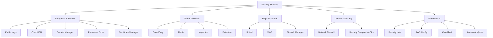

# 08 — Security

> **Exam weight:** ⭐⭐⭐⭐ — Security is in EVERY domain. KMS, GuardDuty, Macie, Shield, WAF — all common.

---

## 🗺️ Topic Map



---

## 📚 Notes in This Section

| # | Topic | Priority |
|---|---|---|
| 01 | [KMS — Key Management Service](./01-kms.md) | 🔥 |
| 02 | [Secrets Manager vs Parameter Store](./02-secrets-vs-parameters.md) | 🔥 |
| 03 | [GuardDuty, Macie, Inspector — Threat Detection](./03-threat-detection.md) | 🔥 |
| 04 | [Shield, WAF, Firewall Manager — DDoS & WAF](./04-shield-waf.md) | 🔥 |
| 05 | [Security Hub & Config — Governance](./05-security-hub-config.md) | High |

---

## 🎯 The Security Services Map (Memorize)

```
┌──────────────────────────────────────────────────────────┐
│ "WHAT HAPPENED?" — Audit & Compliance                     │
│   CloudTrail   → All API calls (who did what when)        │
│   Config       → Resource configuration history           │
│   Detective    → Investigation tool (drill down on alerts)│
├──────────────────────────────────────────────────────────┤
│ "AM I UNDER ATTACK?" — Threat Detection                   │
│   GuardDuty    → ML-based anomaly detection (account-wide)│
│   Macie        → Sensitive data in S3 (PII detection)     │
│   Inspector    → Vulnerability scanning (EC2, ECR, Lambda)│
├──────────────────────────────────────────────────────────┤
│ "HOW TO BLOCK ATTACKS?" — Active Defense                  │
│   WAF          → Layer 7 web application firewall         │
│   Shield Std   → Free DDoS protection (always on)         │
│   Shield Adv   → Premium DDoS + 24/7 response team        │
│   Network FW   → Layer 3-7 network firewall (in VPC)      │
│   Firewall Mgr → Central management across accounts       │
├──────────────────────────────────────────────────────────┤
│ "HOW TO PROTECT SECRETS & KEYS?"                          │
│   KMS          → Managed encryption keys                  │
│   CloudHSM     → Dedicated hardware HSM                   │
│   Secrets Mgr  → Secrets with rotation                    │
│   Param Store  → Config + secret storage (cheaper)        │
│   ACM          → TLS/SSL certificates                     │
├──────────────────────────────────────────────────────────┤
│ "OVERALL POSTURE?" — Unified View                         │
│   Security Hub → Aggregates findings from all sources     │
│   Access Analyzer → External access analysis              │
│   Trusted Advisor → Best practice checks                  │
└──────────────────────────────────────────────────────────┘
```

---

## 🎯 The 5 Most-Tested Security Concepts

```
1. KMS KEY TYPES & ROTATION
   AWS managed keys (auto-rotate, can't be deleted by you)
   Customer managed keys (you control rotation, deletion, policy)
   AWS owned keys (used by services internally, invisible)
   Symmetric vs Asymmetric
   Auto-rotation: yearly (CMK only)

2. ENVELOPE ENCRYPTION
   Data encrypted by Data Encryption Key (DEK)
   DEK encrypted by Customer Master Key (CMK)
   CMK never leaves KMS
   Pattern used everywhere in AWS

3. CROSS-ACCOUNT KMS ACCESS
   Key Policy must allow the other account's principal
   Plus IAM policy in caller's account must allow kms:Decrypt
   Both required (intersection)

4. GUARDDUTY vs MACIE vs INSPECTOR
   GuardDuty: account-wide threat detection (network, IAM)
   Macie:     S3-focused sensitive data discovery
   Inspector: vulnerabilities in EC2, ECR images, Lambda

5. SECRETS MANAGER vs PARAMETER STORE
   Secrets Manager: auto-rotation, $$ per secret/month
   Parameter Store: free for standard, no auto-rotation
                    Advanced parameters cost less than SM
```
