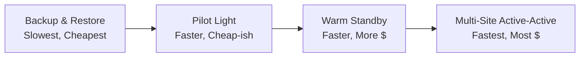
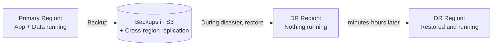
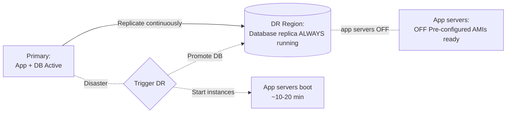
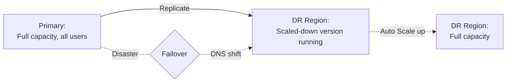
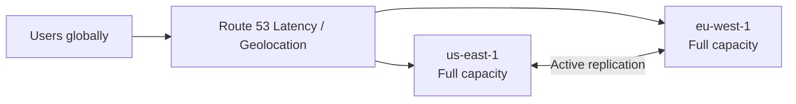
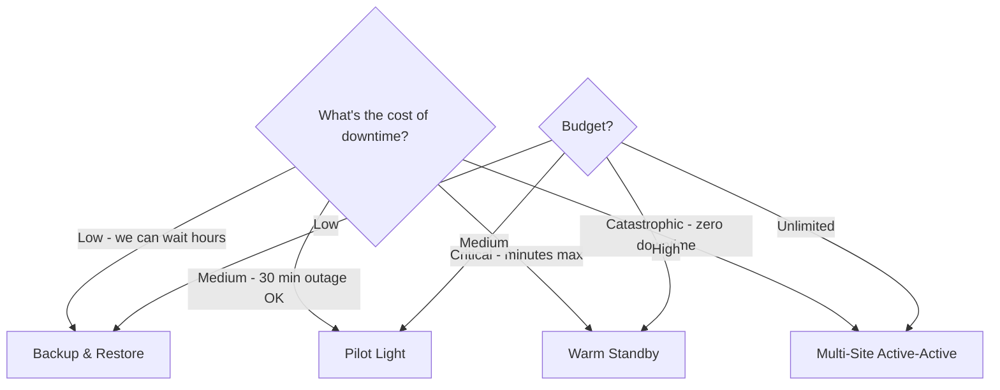

# Disaster Recovery (DR) Strategies — Cheat Sheet

> 🔥 **One of the TOP SAP-C02 exam topics.** Know the 4 strategies and their RTO/RPO trade-offs cold.

---

## 🎯 The Two Critical Metrics

```
┌──────────────────────────────────────────────────────────┐
│ RTO — Recovery Time Objective                             │
│   "How long until the service is back up?"               │
│   Measured in: seconds, minutes, hours, days             │
│   Lower RTO = More money + complexity                    │
├──────────────────────────────────────────────────────────┤
│ RPO — Recovery Point Objective                            │
│   "How much data loss is acceptable?"                    │
│   Measured in: seconds, minutes, hours                   │
│   Lower RPO = More frequent replication                  │
└──────────────────────────────────────────────────────────┘
```

```
        RPO            ←   Disaster   →           RTO
         │                  occurs                  │
         ▼                    │                     ▼
   ────────────────────────┴────────────────────────
   Data backed up         FAILURE              Service back up
   How much was lost?                          How long was the outage?
```

---

## 🏆 The 4 DR Strategies (Memorize the Order!)



### The DR Strategies Matrix

| Strategy | RTO | RPO | DR Region | Cost | Complexity |
|---|---|---|---|---|---|
| **Backup & Restore** | Hours | Hours | Nothing pre-built | $ | Low |
| **Pilot Light** | 10s of mins | Minutes | Minimal (data only) | $$ | Medium |
| **Warm Standby** | Minutes | Seconds-Minutes | Scaled-down replica | $$$ | High |
| **Multi-Site Active-Active** | ~Real-time | ~0 | Full replica live | $$$$ | Very High |

---

## Strategy 1: Backup & Restore



```
COMPONENTS:
─────────────────────────────────────────────
✅ EBS snapshots → cross-region copy
✅ AMIs → cross-region copy  
✅ RDS snapshots → cross-region copy
✅ S3 Cross-Region Replication (CRR)
✅ DynamoDB on-demand backups → cross-region
✅ CloudFormation templates for infra
✅ Glacier vault locks for compliance

RECOVERY PROCESS:
─────────────────────────────────────────────
1. Detect disaster
2. Spin up infrastructure (CloudFormation)
3. Restore data from backups
4. Restore applications
5. Switch DNS

RTO: Hours-days (depends on data size, automation)
RPO: Equal to backup interval (typically hours)

COST: Very low — mostly S3 storage for backups
USE: Non-critical workloads, dev/test, low budget
```

---

## Strategy 2: Pilot Light



```
COMPONENTS:
─────────────────────────────────────────────
✅ DATABASE is always running and replicating in DR region
   - Aurora Global Database (cross-region read replica)
   - RDS Cross-Region Read Replica
   - DynamoDB Global Tables
✅ APP servers are NOT running (AMIs ready)
✅ Networking pre-built
✅ Auto Scaling Groups defined but min=0

RECOVERY PROCESS:
─────────────────────────────────────────────
1. Detect disaster
2. Update ASG min/desired to launch instances
3. Promote DB replica to primary
4. Switch DNS (Route 53 failover)

RTO: 10s of minutes
RPO: Minutes (depends on replication lag)

COST: Just the standby DB + storage
USE: Critical workloads with moderate RTO/RPO
```

---

## Strategy 3: Warm Standby



```
COMPONENTS:
─────────────────────────────────────────────
✅ Full architecture in DR region but small
   - Smaller instance types
   - Lower auto-scaling minimums
   - Maybe 10-20% of prod capacity
✅ Database actively replicating
✅ Application running and serving (perhaps internally tested)
✅ Auto Scaling can ramp up immediately

RECOVERY PROCESS:
─────────────────────────────────────────────
1. Detect disaster
2. Route 53 failover to DR endpoints
3. Auto Scaling ramps DR to full capacity
4. Promote DB to primary

RTO: Minutes
RPO: Seconds-minutes

COST: Significant (full architecture, just smaller)
USE: Important workloads needing fast failover
```

---

## Strategy 4: Multi-Site Active-Active



```
COMPONENTS:
─────────────────────────────────────────────
✅ FULL infrastructure in ALL regions
✅ All regions serve traffic actively
✅ Active-active database
   - DynamoDB Global Tables
   - Aurora Global Database (writes one region, but reads everywhere)
✅ Route 53 latency-based or weighted routing
✅ Stateless apps (or session sharing across regions)
✅ Globally distributed users

RECOVERY PROCESS:
─────────────────────────────────────────────
On disaster, no recovery needed!
Just remove failed region from Route 53.
Other regions absorb traffic.

RTO: Near zero (DNS TTL only)
RPO: Near zero (continuous replication)

COST: Highest — 2x or more production capacity
USE: Mission-critical, global apps (banking, ecom giants)
```

---

## 🌟 Quick Decision Tree



---

## 🛠️ Key AWS Services for DR

```
DATA REPLICATION:
─────────────────────────────────────────────
S3 Cross-Region Replication (CRR)
   → Object-level, async, region-to-region

EBS Snapshot Copy (Cross-Region)
   → Periodic, point-in-time

AWS Backup
   → Centralized backup orchestration

DynamoDB Global Tables
   → Active-active multi-region

Aurora Global Database
   → Active-passive, < 1s lag

RDS Cross-Region Read Replicas
   → For non-Aurora RDS engines

DMS - Database Migration Service
   → Continuous replication

DataSync
   → On-prem ↔ AWS file replication

Storage Gateway
   → Hybrid backup gateway


COMPUTE PREPARATION:
─────────────────────────────────────────────
AMI Cross-Region Copy
   → Pre-baked images for DR

CloudFormation StackSets
   → Multi-region infrastructure templates

Lambda Cross-Region (deploy via CFN)

Container images in ECR
   → Cross-region replication


FAILOVER MECHANISMS:
─────────────────────────────────────────────
Route 53 Failover Routing
   → Health checks drive DNS switch

Route 53 Application Recovery Controller (ARC)
   → Coordinated failover for complex apps

Global Accelerator
   → Instant failover via Anycast IPs

CloudFront Origin Failover
   → Automatic origin switch
```

---

## 🚨 Common Exam Scenarios

### Scenario 1: Lowest Cost DR

> **"Critical compliance app needs DR. Cost is paramount. RTO of 12 hours is acceptable."**

✅ **Backup & Restore**
- EBS + RDS snapshots replicated cross-region
- CloudFormation templates ready
- Glacier for long-term retention
- RTO 12h is plenty for snapshot restore

---

### Scenario 2: Aurora-Based DR

> **"PostgreSQL DB, multi-region DR, RPO < 1 sec, RTO < 1 min. Cost OK."**

✅ **Pilot Light or Warm Standby with Aurora Global Database**
- Aurora Global gives < 1 sec cross-region lag
- Manual promotion < 1 min RTO
- Web tier can be Pilot Light (off) or Warm Standby (running small)

---

### Scenario 3: Active-Active Global App

> **"Mobile app with users worldwide, writes from any region, RPO ≈ 0, RTO ≈ 0."**

✅ **Multi-Site Active-Active with DynamoDB Global Tables**
- Global Tables for active-active writes
- Route 53 latency routing
- All regions handle traffic
- Last-writer-wins acceptable

---

### Scenario 4: Lift-and-Shift Legacy App

> **"On-prem app being migrated. DR was tape backups. Now want cloud DR with RTO 30 min."**

✅ **Pilot Light**
- Storage Gateway for hybrid backup
- AMIs of legacy servers pre-built in DR
- RDS Multi-AZ + cross-region replica
- ASG min=0 in DR, spin up on failover

---

### Scenario 5: Failover Without Manual Intervention

> **"Don't trust ops to make failover decision under pressure. Want fully automated."**

✅ **Warm Standby with Route 53 Failover + Auto Scaling**
- Health checks drive Route 53 record changes
- Auto Scaling already running, just scales up
- No manual button-press needed

---

## 🎯 Final Exam Soundbite

> "AWS DR strategies range across four tiers — Backup & Restore (cheapest, hours of RTO), Pilot Light (database running, app off, RTO 10s of minutes), Warm Standby (scaled-down running, RTO minutes), and Multi-Site Active-Active (full capacity in multiple regions, near-zero RTO/RPO). Choose based on your RTO/RPO and budget. Critical AWS services for DR include Aurora Global Database, DynamoDB Global Tables, S3 Cross-Region Replication, Route 53 health-checked failover, and AWS Backup for centralized orchestration."

---

## ⚡ Final Quick Recall Card

```
┌─────────────────────────────────────────────────┐
│ DR STRATEGY PICKER                               │
├─────────────────────────────────────────────────┤
│ Hours OK, cheapest        → Backup & Restore     │
│ Minutes OK, moderate $    → Pilot Light          │
│ Minutes max, more $       → Warm Standby         │
│ Near-zero, max $          → Multi-Site Active    │
├─────────────────────────────────────────────────┤
│ DB CROSS-REGION OPTIONS                          │
│ Aurora Global         Active-Passive, < 1s lag   │
│ DDB Global Tables     Active-Active, < 1s lag    │
│ RDS Read Replica      Async, manual promote      │
│ DMS                   Continuous replication      │
├─────────────────────────────────────────────────┤
│ FAILOVER MECHANISMS                              │
│ Route 53 Failover     Health-check driven        │
│ Route 53 ARC          Coordinated, complex apps  │
│ Global Accelerator    Instant Anycast IP shift   │
│ CloudFront Origin     Origin failover automatic  │
└─────────────────────────────────────────────────┘
```
