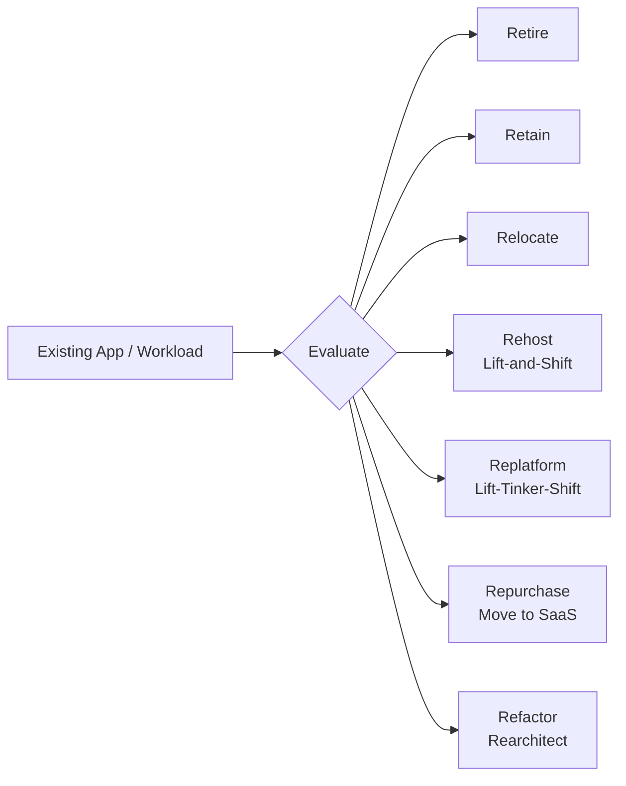
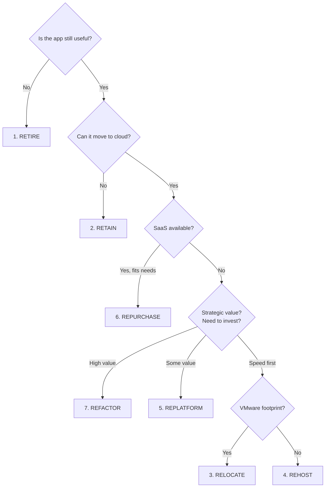
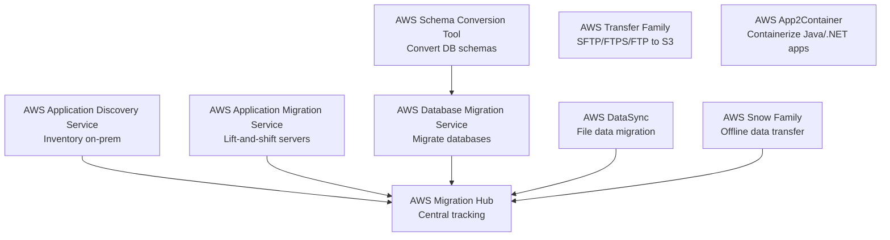

# 7 R's of Migration — Cheat Sheet

> 🔥 **Domain 4 (20% of exam) is all about migration.** Memorize the 7 R's and when to use each.

---

## 🎯 The 7 R's at a Glance



| # | Strategy | What | Effort | Cloud Benefit |
|---|---|---|---|---|
| 1 | **Retire** | Decommission entirely | None | None — saves money |
| 2 | **Retain** | Keep on-prem for now | None | None yet |
| 3 | **Relocate** | Move VMs as-is (VMware Cloud) | Lowest | Minimal |
| 4 | **Rehost** | Lift-and-shift to EC2 | Low | Some |
| 5 | **Replatform** | Lift-and-tinker (e.g. RDS) | Medium | Better |
| 6 | **Repurchase** | Buy SaaS replacement | Medium | High |
| 7 | **Refactor** | Rewrite cloud-native | Highest | Highest |

---

## 1. RETIRE 🗑️

```
WHAT:
─────────────────────────────────────────────
Turn off the application entirely. Stop paying for it.

WHEN:
─────────────────────────────────────────────
✅ App is no longer used
✅ Better alternative already in use (duplicate functionality)
✅ Discovery showed forgotten/orphaned workloads
✅ Compliance allows decommission

EXAMPLE:
─────────────────────────────────────────────
Discovery (AWS Application Discovery Service) finds
14 servers running an old reporting app that
3 users access once a year. Retire it.

SAVINGS:
─────────────────────────────────────────────
Often 10-20% of portfolio servers can be retired
```

## 2. RETAIN ⏸️

```
WHAT:
─────────────────────────────────────────────
Keep the app where it is — for now. No migration.

WHEN:
─────────────────────────────────────────────
✅ Recently invested heavily on-prem (depreciation period)
✅ Compliance requires on-prem (data sovereignty)
✅ Legacy app on mainframe / unique hardware
✅ Vendor doesn't support cloud
✅ Migration cost > business value

EXAMPLE:
─────────────────────────────────────────────
Mainframe COBOL banking app — keep on-prem
until vendor offers cloud equivalent (or refactor later).
```

## 3. RELOCATE 🚚

```
WHAT:
─────────────────────────────────────────────
Move VMs as-is from on-prem hypervisor to AWS
without any conversion.

KEY SERVICE:
─────────────────────────────────────────────
VMware Cloud on AWS
   On-prem ESXi VMs → AWS-hosted ESXi (no conversion)
   Same vSphere tools, vCenter
   No OS changes, no application changes

WHEN:
─────────────────────────────────────────────
✅ Heavy VMware footprint already
✅ Want quickest migration (hours-days vs months)
✅ No appetite for refactoring yet
✅ Data center exit deadline

CAVEAT:
─────────────────────────────────────────────
You pay for VMware Cloud (not native EC2)
Still need to integrate with AWS services separately
```

## 4. REHOST (Lift-and-Shift) 🚀

```
WHAT:
─────────────────────────────────────────────
Move app to EC2 as-is. No code changes.
"Lift" the workload from on-prem and "shift" to AWS.

KEY SERVICES:
─────────────────────────────────────────────
AWS Application Migration Service (MGN) ⭐ primary tool
   - Block-level replication from on-prem to AWS
   - Continuously syncs while you test
   - Minimal cutover downtime
   - Successor to: AWS Server Migration Service (SMS)
   - Successor to: CloudEndure (CE)

WHEN:
─────────────────────────────────────────────
✅ Fast migration needed (data center exit deadline)
✅ Don't want to change the app yet
✅ Will optimize AFTER migration
✅ Need to migrate hundreds-thousands of servers quickly

BENEFITS:
─────────────────────────────────────────────
✅ Fast (often weeks vs months)
✅ Low risk (no code changes)
✅ Foundation for future optimization

LIMITATIONS:
─────────────────────────────────────────────
❌ Doesn't capture full cloud benefits
❌ Still managing OS, patching, scaling
❌ Often expensive (no cloud-native optimization)

EXAMPLE:
─────────────────────────────────────────────
GE migrated 9000+ workloads via lift-and-shift
to meet a data center exit deadline.
Optimization happened post-migration.
```

## 5. REPLATFORM (Lift-Tinker-Shift) 🔧

```
WHAT:
─────────────────────────────────────────────
Move to AWS WITH some changes that leverage 
managed services — but no major code rewrite.

COMMON REPLATFORMS:
─────────────────────────────────────────────
On-prem MySQL → AWS RDS for MySQL
   (Same DB engine, but managed)
   
On-prem MS SQL Server → RDS SQL Server
   OR → Aurora PostgreSQL via Babelfish

On-prem Apache web servers → AWS Elastic Beanstalk
   OR → ECS containerized

On-prem file shares → FSx for Windows
   (instead of Windows file server VMs)

On-prem cron jobs → EventBridge + Lambda

WHEN:
─────────────────────────────────────────────
✅ Want some cloud benefit without rewriting
✅ Database, OS, middleware can be replaced
✅ Time and budget for moderate changes

KEY MIGRATION TOOL:
─────────────────────────────────────────────
AWS DMS - Database Migration Service
   - Migrate between DB engines (e.g., Oracle → Aurora)
   - Continuous replication (low downtime)
   - Schema conversion via SCT (Schema Conversion Tool)

EXAMPLE:
─────────────────────────────────────────────
Move Oracle DB → Aurora PostgreSQL using DMS + SCT
The app code mostly works (with some SQL tweaks)
You stop paying Oracle licensing fees ✅
```

## 6. REPURCHASE (Drop-and-Shop) 💳

```
WHAT:
─────────────────────────────────────────────
Replace the application entirely with a SaaS
or commercial off-the-shelf (COTS) product.

EXAMPLES:
─────────────────────────────────────────────
Custom CRM → Salesforce
Custom HR system → Workday
Self-hosted email → Microsoft 365 / Google Workspace
Custom ticketing → Zendesk / ServiceNow
Self-hosted file sharing → Dropbox Business / Box
On-prem analytics → Tableau Online

WHEN:
─────────────────────────────────────────────
✅ Commodity functionality (no competitive advantage)
✅ Maintenance burden is high
✅ SaaS alternative is mature
✅ Data export/import is feasible

BENEFITS:
─────────────────────────────────────────────
✅ Zero infrastructure management
✅ Latest features automatically
✅ Predictable subscription cost

CAVEATS:
─────────────────────────────────────────────
❌ Data migration can be tricky
❌ Lock-in to SaaS vendor
❌ Customizations may be lost
```

## 7. REFACTOR (Re-architect) 🏗️

```
WHAT:
─────────────────────────────────────────────
Significantly redesign the app to be cloud-native.
Microservices, serverless, managed services.

EXAMPLES:
─────────────────────────────────────────────
Monolith VM app → Microservices on ECS/EKS
Single DB → Polyglot persistence (DDB + Aurora + Redis)
Synchronous web → Event-driven (SNS + SQS + Lambda)
Custom batch → Step Functions + Lambda
File-based logs → CloudWatch Logs / OpenSearch

WHEN:
─────────────────────────────────────────────
✅ Existing app has scaling bottlenecks
✅ Cost is unacceptable on current architecture
✅ Need rapid feature velocity going forward
✅ Mobile/global expansion requires modern arch
✅ Business case justifies the investment

BENEFITS:
─────────────────────────────────────────────
✅ Maximum cloud benefits (cost, scale, speed)
✅ Modern dev experience
✅ Reduced operational burden

COSTS:
─────────────────────────────────────────────
❌ Most expensive in time + money
❌ Highest risk
❌ Requires deepest cloud expertise

EXAMPLE:
─────────────────────────────────────────────
Capital One refactored core banking from
data centers to AWS — full cloud-native rewrite
took years but enabled rapid product innovation.
```

---

## 🎯 Decision Framework



---

## 🛠️ Key Migration Services



### Service Quick Reference

| Service | Use For |
|---|---|
| **Migration Hub** | Central tracking of all migrations |
| **Application Discovery Service** | Inventory on-prem servers, dependencies |
| **Application Migration Service (MGN)** | Server lift-and-shift (replaces SMS) |
| **Database Migration Service (DMS)** | DB-to-DB migration, with or without engine change |
| **Schema Conversion Tool (SCT)** | Convert Oracle → PostgreSQL etc. schemas |
| **DataSync** | Big file transfers (NFS, SMB, S3, EFS, FSx) |
| **Snowball Edge** | Offline data transfer (TBs) |
| **Snowmobile** | Massive offline (100 PB in a truck) |
| **Transfer Family** | Managed SFTP/FTPS/FTP to S3/EFS |
| **App2Container** | Take a Java/.NET app, output container image |
| **Mainframe Modernization** | Mainframe to AWS replatform/refactor |

---

## 📊 Snow Family Comparison

| | **Snowcone** | **Snowball Edge** | **Snowmobile** |
|---|---|---|---|
| Capacity | 8 TB HDD / 14 TB SSD | 80 TB / 210 TB (compute-optimized) | 100 PB |
| Form factor | 2.1 kg device | 50 lb suitcase | 45-ft truck |
| Use | Edge / small data | Standard data migration | Massive data center exit |
| Edge compute | Limited | Yes (EC2-compatible, GPU options) | N/A |

```
EXAMPLE: 100 TB to migrate
─────────────────────────────────────────────
Over a 1 Gbps link = ~10 days continuous transfer
With Snowball Edge = ship device, transfer in days,
                     mail back to AWS, ~1 week end-to-end
WINNER: Snowball if bandwidth is constrained

EXAMPLE: 100 PB (entire data center)
─────────────────────────────────────────────
Snowball: would need 500+ devices, months of logistics
Snowmobile: One truck pulls up, transfers in days
WINNER: Snowmobile (it's literally a truck-sized HD)
```

---

## 🚨 Common Exam Patterns

### Pattern 1: Heavy VMware Footprint

> **"Customer has 3000 VMware VMs. Wants to exit data center in 6 months. Doesn't want to refactor anything yet."**

✅ **RELOCATE via VMware Cloud on AWS**
- Fastest path off on-prem
- Same vSphere management
- Refactor later, post-migration

---

### Pattern 2: Database Migration Between Engines

> **"Migrating Oracle DB to AWS, away from Oracle licensing. Minimal downtime acceptable."**

✅ **REPLATFORM with DMS + SCT**
- SCT converts Oracle schema to PostgreSQL/Aurora
- DMS continuously replicates while testing
- Cut over with minimal downtime
- Off Oracle licensing forever

---

### Pattern 3: Bulk File Migration

> **"50 TB of files on NetApp NAS on-prem. Need to move to FSx for ONTAP in AWS."**

✅ **DataSync** for the bulk + ongoing sync
- Manages bandwidth, retries
- Encrypted in transit
- Source: NFS/SMB/etc., Target: FSx ONTAP

---

### Pattern 4: Bandwidth-Constrained Migration

> **"Customer has 500 TB to migrate but only a 100 Mbps internet link. Need cost-effective transfer."**

✅ **Snowball Edge** (multiple devices)
- Calculate: 500 TB / 100 Mbps = ~14 months online
- Snowball Edge: weeks
- Cheaper than upgrading the link

---

### Pattern 5: Java/.NET App to Containers

> **"Have legacy Java EE app on Tomcat. Want to containerize without rewriting."**

✅ **AWS App2Container (A2C)**
- Analyzes app, generates Dockerfile + ECS/EKS configs
- Deploy on ECS/EKS Fargate
- No code changes (in most cases)

---

### Pattern 6: Continuous Replication During Cutover

> **"Need to migrate 200 production servers. Cutover window is one weekend."**

✅ **AWS Application Migration Service (MGN)**
- Continuous block-level replication
- Test cutover before final cutover
- Minimal downtime — actual cutover is a quick boot of replicated instances

---

## ⚡ Final Quick Recall Card

```
┌─────────────────────────────────────────────────┐
│ THE 7 R's                                        │
├─────────────────────────────────────────────────┤
│ Retire      → Turn off                           │
│ Retain      → Keep on-prem                       │
│ Relocate    → VMware Cloud on AWS                │
│ Rehost      → Lift-and-shift to EC2 (MGN)        │
│ Replatform  → Lift-tinker (RDS, FSx, etc.)       │
│ Repurchase  → Move to SaaS                       │
│ Refactor    → Cloud-native rewrite               │
├─────────────────────────────────────────────────┤
│ KEY TOOLS                                        │
│ Discovery  → Application Discovery Service       │
│ Servers    → Application Migration Service (MGN) │
│ Databases  → DMS + SCT                           │
│ Files      → DataSync                            │
│ Offline    → Snow Family                         │
│ Containers → App2Container                       │
│ Tracking   → Migration Hub                       │
└─────────────────────────────────────────────────┘
```
