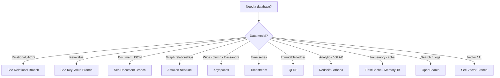
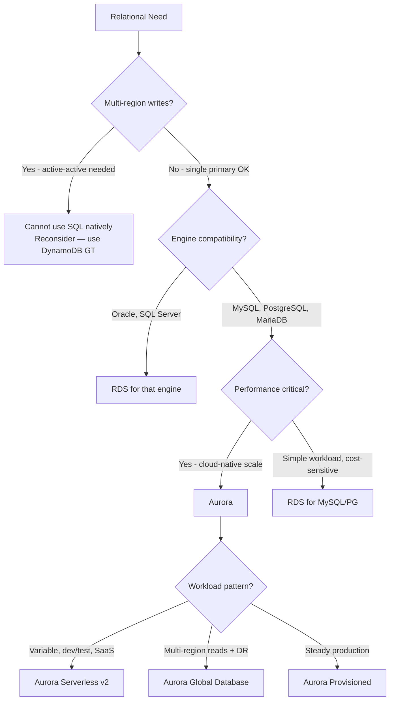
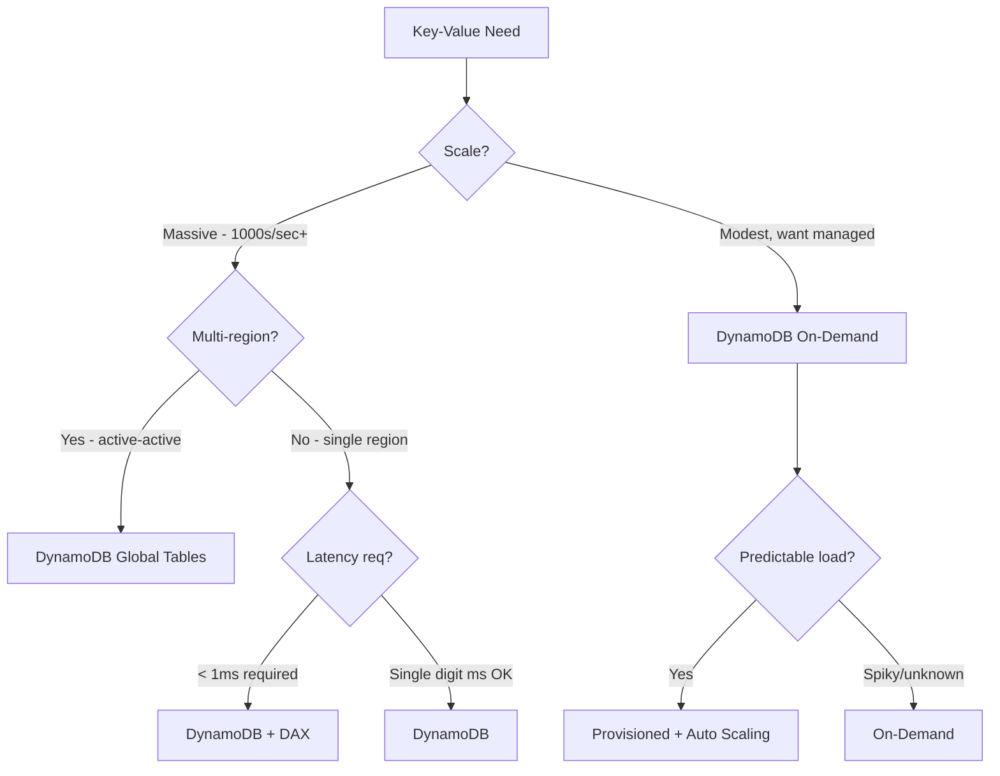
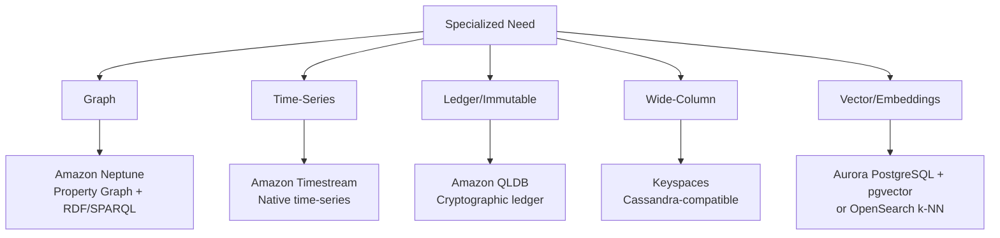
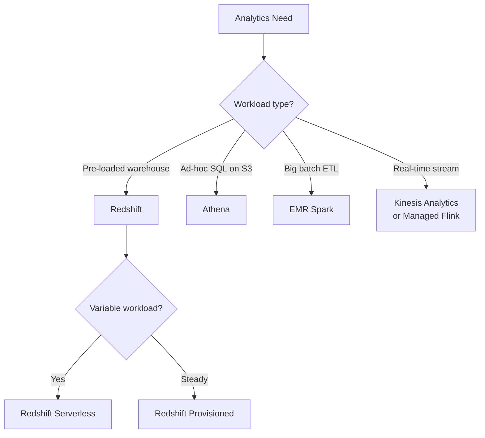

# Database Decision Tree — Cheat Sheet

> 🔥 **Recurring SAP-C02 question: "Which database service?"** Walk this tree to win every time.

---

## 🌳 The Master Decision Tree



---

## 🗄️ Relational Branch



```
QUICK PICK:
─────────────────────────────────────────────
Need Oracle features         → RDS Oracle
Need SQL Server              → RDS SQL Server
Migrating off Oracle         → Aurora PostgreSQL (with Babelfish)
                               or Aurora MySQL
Modern PG/MySQL              → Aurora
Variable workload            → Aurora Serverless v2
Multi-region active-passive  → Aurora Global Database
Simple, cheap                → RDS for MySQL or PG
On-prem migration            → RDS same engine first, optimize later
```

---

## 🔑 Key-Value Branch



```
QUICK PICK:
─────────────────────────────────────────────
General serverless KV         → DynamoDB
Multi-region active-active    → DynamoDB Global Tables
Microsecond reads             → DynamoDB + DAX
Pure cache (no source needed) → ElastiCache Redis
Cache that must be durable    → MemoryDB for Redis
```

---

## 📄 Document Branch

```
DOCUMENT DATABASES:
─────────────────────────────────────────────
DynamoDB           → Schema-flexible, key-value or doc up to 400KB
                     ✅ AWS-native, cheap, scales
                     
DocumentDB         → MongoDB API compatible
                     ✅ For workloads expecting MongoDB
                     ⚠️ Not 100% MongoDB feature parity
                     
DynamoDB vs DocumentDB:
─────────────────────────────────────────────
Use DynamoDB if greenfield (better, cheaper, more scalable)
Use DocumentDB if you must keep MongoDB compatibility
```

---

## 🔍 Specialized Database Branch



### Specialized DBs At a Glance

| Database | Best For | Real-World Use |
|---|---|---|
| **Neptune** | Relationships, traversals | Fraud detection, recommendation engines, knowledge graphs |
| **Timestream** | Time-stamped data | IoT telemetry, app monitoring, industrial sensors |
| **QLDB** | Immutable history | Financial ledgers, supply chain, regulatory audit |
| **Keyspaces** | Cassandra workloads | High-throughput writes, IoT, gaming leaderboards |
| **Vector (Aurora/OpenSearch)** | Embeddings, semantic search | RAG for LLMs, image similarity, recommendations |

---

## 📊 OLTP vs OLAP

```
OLTP — Online Transaction Processing:
─────────────────────────────────────────────
- Many small transactions
- Read AND write heavy
- Latency-sensitive
- Examples: e-commerce, banking
- Services: RDS, Aurora, DynamoDB

OLAP — Online Analytical Processing:
─────────────────────────────────────────────
- Few large queries scanning lots of data
- Read-heavy (writes are batch loads)
- Complex aggregations, joins
- Examples: BI dashboards, data warehouses
- Services: Redshift, Athena, EMR
```

---

## 📈 Analytics Branch



---

## 🎯 Common SAP-C02 Scenarios

### Scenario 1: Multi-Region Active-Active OLTP

> "Globally distributed app, users write from any continent, eventual consistency OK."

✅ **DynamoDB Global Tables**
- True active-active, < 1 sec lag
- Aurora Global is active-passive — wrong

---

### Scenario 2: Migrating from Oracle, Want PostgreSQL

> "Off Oracle licensing, similar SQL functionality, multi-region DR."

✅ **Aurora PostgreSQL** + Aurora Global Database
- DMS + SCT to migrate
- Possibly **Babelfish** if app uses T-SQL features

---

### Scenario 3: Spiky SaaS Multi-Tenant

> "B2B SaaS, each tenant has its own DB, traffic varies by tenant."

✅ **Aurora Serverless v2**
- Sub-second scaling, can be 0.5 ACU when idle
- Per-tenant DB pattern works well

---

### Scenario 4: IoT Telemetry at Scale

> "Millions of devices sending readings every minute."

✅ **DynamoDB On-Demand** (PK = DeviceId) for low latency lookups
✅ **Timestream** for time-series analytics on the data
✅ Or **Keyspaces** if migrating from Cassandra

---

### Scenario 5: Recommendation Engine

> "Need to model relationships: users → products → similar products → similar users."

✅ **Amazon Neptune** (property graph)
- Cypher or Gremlin queries
- Built for relationship traversal

---

### Scenario 6: Banking Ledger

> "Need provable, immutable transaction history for audit."

✅ **Amazon QLDB**
- Cryptographically verifiable
- Append-only, never updated/deleted
- Compliance-friendly

---

### Scenario 7: Gaming Leaderboard

> "Show top 100 players globally, updated every second."

✅ **ElastiCache Redis** (Sorted Sets) backed by DynamoDB
- Sorted Set ZADD + ZRANGE — perfect fit
- Redis multi-AZ replication for HA

---

### Scenario 8: Embeddings / RAG for LLM

> "Storing 1M vector embeddings for semantic search."

✅ **Aurora PostgreSQL + pgvector extension**
- Or **OpenSearch** with k-NN
- Or **Aurora Serverless v2 + pgvector** for variable cost

---

### Scenario 9: Existing Cassandra Workload

> "Lift-and-shift Cassandra to managed service."

✅ **Amazon Keyspaces**
- CQL-compatible
- Serverless or provisioned modes

---

## ⚡ The Master Quick Recall Card

```
┌─────────────────────────────────────────────────┐
│ DATABASE PICKER ULTRA-QUICK                      │
├─────────────────────────────────────────────────┤
│ RELATIONAL                                       │
│   Oracle/SQLServer           → RDS               │
│   MySQL/PG modern            → Aurora            │
│   Variable workload          → Aurora Serverless │
│   Multi-region read/DR       → Aurora Global     │
├─────────────────────────────────────────────────┤
│ NoSQL                                            │
│   Key-Value at scale         → DynamoDB          │
│   DDB multi-region writes    → DDB Global Tables │
│   DDB microsecond reads      → DAX               │
│   MongoDB API                → DocumentDB        │
│   Cassandra API              → Keyspaces         │
├─────────────────────────────────────────────────┤
│ SPECIALIZED                                      │
│   Graph                      → Neptune           │
│   Time-series                → Timestream        │
│   Immutable ledger           → QLDB              │
│   Vector / embeddings        → Aurora pgvector   │
├─────────────────────────────────────────────────┤
│ ANALYTICS                                        │
│   Data warehouse             → Redshift          │
│   Ad-hoc SQL on S3           → Athena            │
│   Big Spark/Hadoop           → EMR               │
│   Real-time stream SQL       → Managed Flink     │
├─────────────────────────────────────────────────┤
│ CACHE / SPEED                                    │
│   General cache              → ElastiCache Redis │
│   Cache that's durable       → MemoryDB          │
│   Simple multi-thread cache  → ElastiCache Memcached│
├─────────────────────────────────────────────────┤
│ SEARCH                                           │
│   Full-text / log analytics  → OpenSearch        │
└─────────────────────────────────────────────────┘
```
