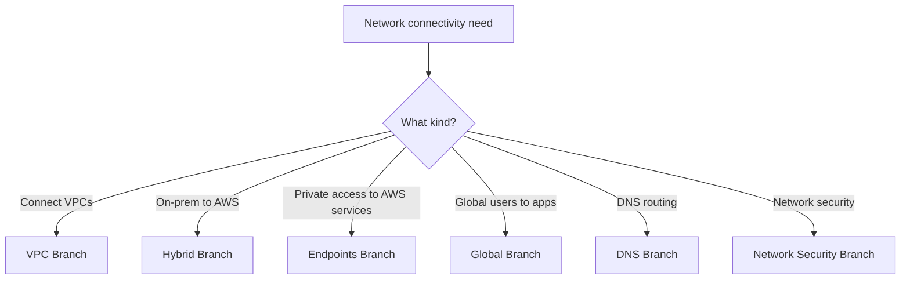
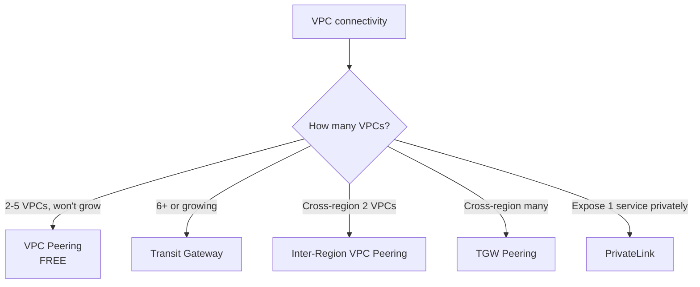
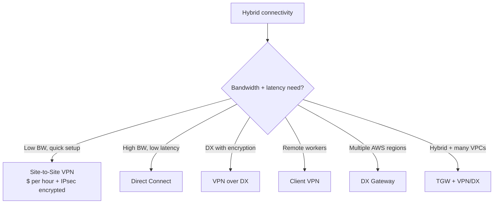
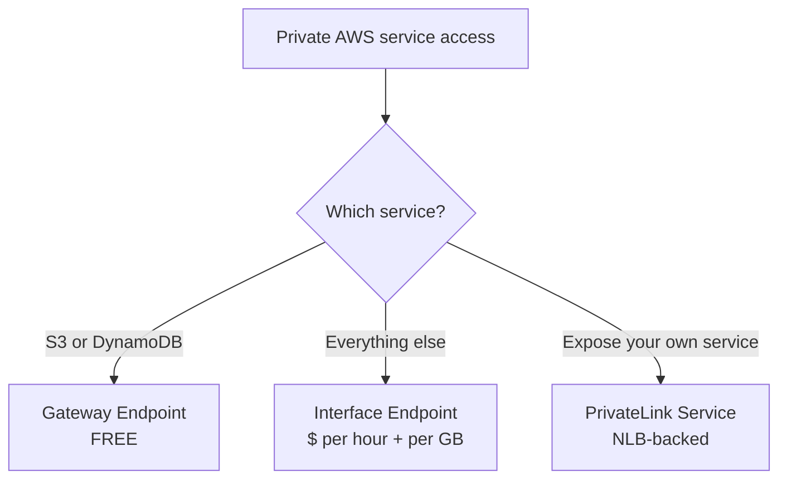
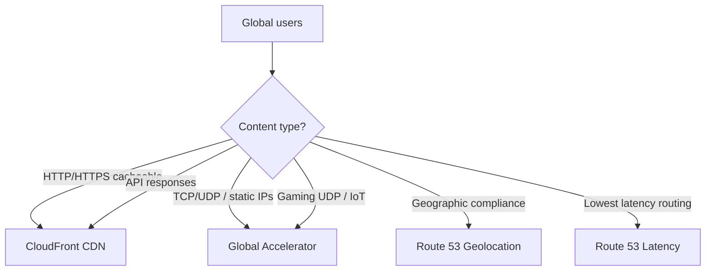
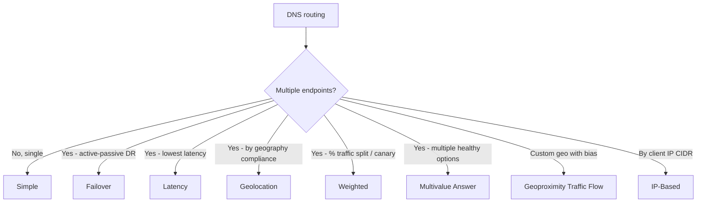
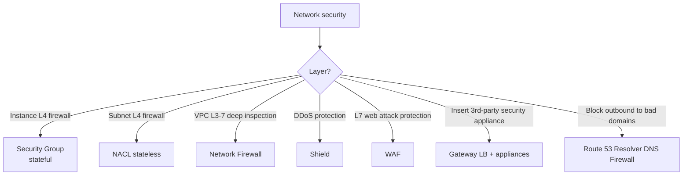

# Network Connectivity Picker — Cheat Sheet

> 🔥 **Network architecture is in every domain.** Pick the right service for each scenario.

---

## 🌳 The Master Network Decision Tree



---

## 🔗 VPC-to-VPC Branch



```
QUICK PICK:
─────────────────────────────────────────────
2-5 VPCs                      → VPC Peering (free)
Many VPCs                     → Transit Gateway
Hybrid + many VPCs            → TGW + VPN/DX attached
Cross-region 1 VPC ↔ 1 VPC    → Inter-Region Peering
Cross-region many VPCs        → TGW Peering
Expose service to other VPCs  → PrivateLink
Sub-overlapping CIDRs?        → PrivateLink (allows overlap)
```

### Transitive Routing Trap

```
PEERING:    NOT transitive (A↔B + B↔C ≠ A↔C)
TGW:        Transitive by default
```

---

## 🌉 Hybrid Branch (On-Prem ↔ AWS)



### Hybrid Comparison

| | **Site-to-Site VPN** | **Direct Connect** |
|---|---|---|
| Type | IPsec over internet | Dedicated physical line |
| Bandwidth | Up to 1.25 Gbps per tunnel | 1, 10, or 100 Gbps |
| Latency | Variable (internet) | Predictable, low |
| Encryption | ✅ IPsec built-in | ❌ Not encrypted (use MACsec or VPN over DX) |
| Setup | Minutes | Weeks-months |
| Cost | Cheap | Expensive |
| HA Pattern | 2 tunnels per connection | 2 DX at 2 locations + VPN backup |

### HA Best Practices (Hybrid)

```
LEVEL 1 — Single VPN ❌ Not production-ready

LEVEL 2 — VPN + 2 customer gateways ✅ Better

LEVEL 3 — Single Direct Connect + VPN backup ✅ Common

LEVEL 4 — 2 Direct Connect at 2 locations + VPN backup ✅✅ Production tier

LEVEL 5 — Multi-region DX → DXGW → multiple TGWs ✅✅✅ Global enterprise
```

---

## 🔌 VPC Endpoints Branch



```
WHY USE ENDPOINTS:
─────────────────────────────────────────────
✅ Traffic stays inside AWS network (private)
✅ Doesn't traverse NAT (cost savings!)
✅ Doesn't need internet access
✅ Better security (no public endpoint exposure)

GATEWAY ENDPOINT (FREE):
─────────────────────────────────────────────
S3, DynamoDB only
Adds entry to route table
Same-region only

INTERFACE ENDPOINT (PrivateLink, $):
─────────────────────────────────────────────
ENI in your subnet with private IP
100+ services supported
Cross-account, cross-VPC service exposure
```

---

## 🌍 Global Branch (Global Users to Apps)



### CloudFront vs Global Accelerator

```
CLOUDFRONT:
─────────────────────────────────────────────
✅ HTTP/HTTPS content delivery (CDN)
✅ Caching at edge locations
✅ Best for: websites, static content, video, APIs
✅ Layer 7 (application)
✅ Integrates with: S3, ALB, EC2, custom origins
✅ Lambda@Edge for compute at edge
✅ Free SSL certs (ACM)

GLOBAL ACCELERATOR:
─────────────────────────────────────────────
✅ Static Anycast IPs (2 per accelerator)
✅ Routes via AWS backbone (not internet)
✅ Best for: TCP/UDP, gaming, IoT, real-time
✅ Layer 4 (network)
✅ Health-checked failover in seconds
✅ Routes to NLB, ALB, EC2, EIPs
✅ No caching (just routing)
```

### When to Use Both Together

```
PATTERN:
─────────────────────────────────────────────
Users → CloudFront (cached content)
     ↘
       Global Accelerator (dynamic / API)
                ↓
         ALB/NLB origins
```

---

## 🌐 DNS Branch (Route 53)



### Quick Pick

```
Single endpoint                       → Simple
Active-passive DR                     → Failover
Multi-region active-active            → Latency
GDPR / data residency                 → Geolocation
Blue/Green deploy                     → Weighted
Up to 8 healthy answers               → Multivalue
Custom geo control                    → Geoproximity
ISP-specific routing                  → IP-Based
```

---

## 🛡️ Network Security Branch



---

## 🎯 Common SAP-C02 Network Patterns

### Pattern 1: Many VPCs, Hybrid, Central Inspection

> "30+ VPCs across 5 accounts + on-prem via VPN. Want centralized routing and traffic inspection."

✅ **Transit Gateway** shared via **RAM** + inspection VPC with **GWLB** or **Network Firewall**

---

### Pattern 2: Need Static IP, but ALB Doesn't Have One

> "Customer firewall requires whitelist. App is HTTP with path routing."

✅ **NLB in front of ALB**. NLB gives static IPs (or EIPs). NLB forwards to ALB. ALB does path routing.

---

### Pattern 3: Massive Egress to S3 over NAT

> "EC2 in private subnets read 100s of TB from S3 monthly. NAT costs are huge."

✅ Replace NAT with **Gateway VPC Endpoint for S3** (free). Removes data processing charges.

---

### Pattern 4: Multi-Region Active-Active App

> "Users worldwide, lowest latency for everyone, instant failover."

✅ **Route 53 Latency** + **Global Accelerator** + **DynamoDB Global Tables**
- Latency routing for DNS
- Global Accelerator for instant failover on health check
- Active-active databases

---

### Pattern 5: Cross-Region Encrypted Replication

> "Sensitive data in us-east-1 → eu-west-1. Cannot traverse public internet."

✅ **Direct Connect** between regions via **DXGW**, or **VPN** as backup
- For S3: CRR over PrivateLink for S3 (no internet)

---

### Pattern 6: On-Prem Servers Need to Reach AWS Privately

> "On-prem app calls S3 and DynamoDB. Don't want public internet path."

✅ **Direct Connect** with **Public VIF** (private connection, AWS public services)
- Or VPN + VPC + Gateway Endpoints from VPC

---

### Pattern 7: SaaS Vendor Wants to Expose Service Privately

> "SaaS company wants customers to access their API without going through internet."

✅ **PrivateLink Service** — vendor exposes via NLB, customer creates **Interface Endpoint** in their VPC pointing to vendor's service

---

### Pattern 8: Hybrid DNS

> "On-prem AD resolves internal.corp.com, AWS has private hosted zone internal.aws.corp.com. Need bidirectional DNS."

✅ **Route 53 Resolver Inbound & Outbound Endpoints**
- Inbound: on-prem queries AWS DNS
- Outbound: AWS resources query on-prem DNS
- Use Forwarding Rules + Resolver Endpoints

---

## ⚡ The Master Network Quick Recall Card

```
┌─────────────────────────────────────────────────┐
│ VPC-TO-VPC                                       │
├─────────────────────────────────────────────────┤
│ 2-5 VPCs                  → VPC Peering          │
│ Many / scaling            → Transit Gateway      │
│ Cross-region 1↔1          → Inter-region peering │
│ Cross-region many         → TGW Peering          │
│ Expose service privately  → PrivateLink          │
├─────────────────────────────────────────────────┤
│ HYBRID                                           │
├─────────────────────────────────────────────────┤
│ Quick + cheap             → Site-to-Site VPN     │
│ High BW + low latency     → Direct Connect       │
│ Hybrid + encryption       → VPN over DX or MACsec│
│ Many regions              → Direct Connect Gateway│
│ Many VPCs + hybrid        → TGW + DX/VPN         │
│ Remote employees          → Client VPN           │
├─────────────────────────────────────────────────┤
│ PRIVATE AWS ACCESS                               │
├─────────────────────────────────────────────────┤
│ S3 / DynamoDB             → Gateway Endpoint     │
│ Other AWS services        → Interface Endpoint   │
├─────────────────────────────────────────────────┤
│ GLOBAL DELIVERY                                  │
├─────────────────────────────────────────────────┤
│ HTTP cacheable            → CloudFront           │
│ TCP/UDP static IPs        → Global Accelerator   │
│ Geo routing               → Route 53 Geolocation │
│ Lowest latency            → Route 53 Latency     │
├─────────────────────────────────────────────────┤
│ SECURITY                                         │
├─────────────────────────────────────────────────┤
│ Instance L4               → Security Group       │
│ Subnet L4                 → NACL                  │
│ Deep packet inspection    → Network Firewall     │
│ DDoS                      → Shield Std / Adv      │
│ Web app attacks           → WAF                   │
│ 3rd-party security        → GWLB                  │
└─────────────────────────────────────────────────┘
```
