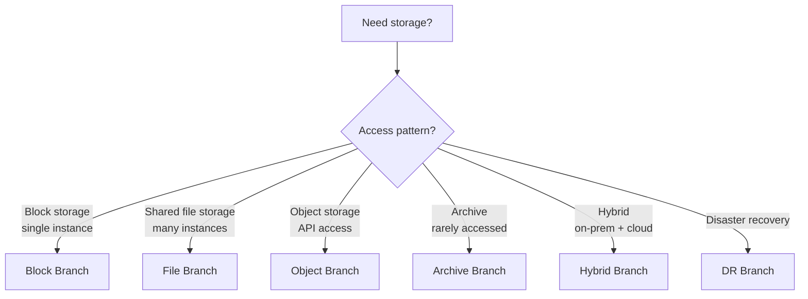
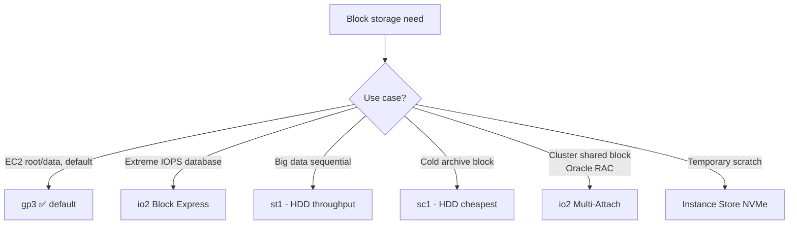
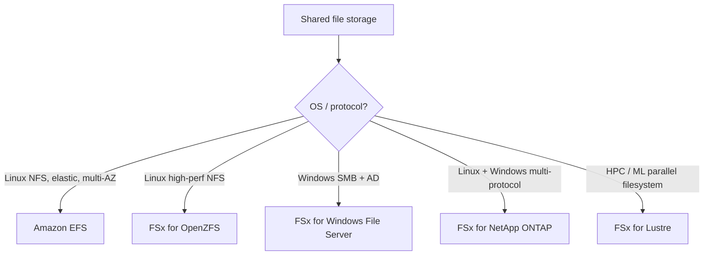
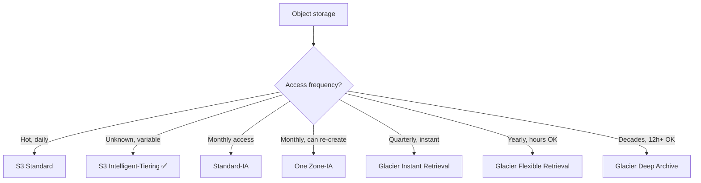
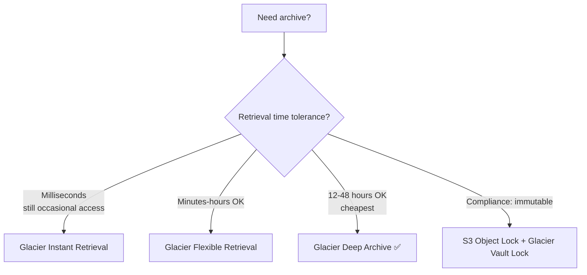
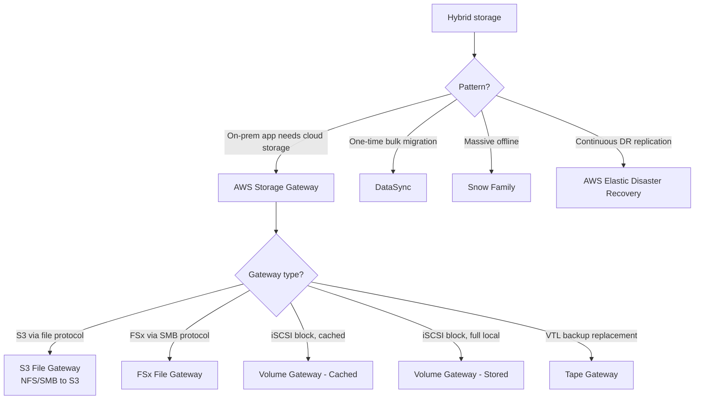

# Storage Decision Tree — Cheat Sheet

> 🔥 **One of the most common SAP-C02 questions: "Which storage service?"** Walk this tree to win.

---

## 🌳 The Master Storage Decision Tree



---

## 🧱 BLOCK Branch (one instance attaches)



```
QUICK PICK:
─────────────────────────────────────────────
Default for everything           → gp3
Modern boot volume               → gp3
Mission-critical DB              → io2 Block Express
Big data Hadoop                  → st1
Cold rarely-read block           → sc1
Shared block (Oracle RAC)        → io2 Multi-Attach
Highest IO, temporary            → Instance Store
```

---

## 📁 FILE Branch (multiple instances share)



```
QUICK PICK:
─────────────────────────────────────────────
General Linux NFS               → EFS
WordPress / CMS multi-instance  → EFS
Windows SMB shares              → FSx for Windows
Mixed Linux + Windows NFS+SMB   → FSx for ONTAP
HPC / Spark / ML training       → FSx for Lustre (S3 linked)
High-perf NFS, cheaper than ONTAP→ FSx for OpenZFS
Container shared volume         → EFS (ECS/EKS supported)
```

### EFS Storage Classes

```
EFS STANDARD            Multi-AZ, hot
EFS STANDARD-IA         Multi-AZ, cold (cheaper)
EFS ONE ZONE            Single AZ, hot
EFS ONE ZONE-IA         Single AZ, cold (cheapest)

Lifecycle management auto-transitions based on access pattern.
```

---

## 📦 OBJECT Branch (S3)



### S3 Storage Class Costs (relative)

```
$$$$$  S3 Standard
$$$$   S3 Standard-IA
$$$    S3 One Zone-IA
$$     S3 Glacier Instant Retrieval
$      S3 Glacier Flexible Retrieval
¢      S3 Glacier Deep Archive  (~23x cheaper than Standard)
```

### S3 Minimum Storage Duration

```
Standard / Int-Tier         None
Standard-IA / One Zone-IA   30 days
Glacier Instant             90 days
Glacier Flexible            90 days
Glacier Deep Archive        180 days

⚠️ Delete before minimum = charged full duration anyway
```

---

## 🗄️ ARCHIVE Branch



```
GLACIER VAULT LOCK:
─────────────────────────────────────────────
WORM (Write Once Read Many) compliance
Locks objects so no one can delete
Required by some financial regulations
SEC Rule 17a-4(f) compliant

S3 OBJECT LOCK (newer, recommended):
─────────────────────────────────────────────
Same WORM concept but native to S3
Governance Mode: special permissions can override
Compliance Mode: NO ONE can delete (even root)
```

---

## 🌉 HYBRID Branch (on-prem + AWS)



### Storage Gateway Types

```
S3 FILE GATEWAY:
─────────────────────────────────────────────
NFS/SMB on-prem → S3 objects in cloud
Files appear as S3 objects (one-to-one)
Local cache for performance
Use: Lift-and-shift file servers to S3

FSx FILE GATEWAY:
─────────────────────────────────────────────
SMB on-prem → FSx for Windows in cloud
For Windows file shares that should live in cloud
Local cache for low-latency reads

VOLUME GATEWAY - CACHED:
─────────────────────────────────────────────
iSCSI block volumes
Primary data in S3, frequently-accessed cached on-prem
Use: Cloud-backed local storage with low latency

VOLUME GATEWAY - STORED:
─────────────────────────────────────────────
iSCSI block volumes
Primary data on-prem, async snapshots to AWS
Use: Local primary with cloud DR

TAPE GATEWAY:
─────────────────────────────────────────────
Replaces physical tape backups
Backup software writes to "virtual tapes"
Tapes auto-archived to Glacier
Use: Eliminate tape library
```

---

## 🚛 BULK / OFFLINE Branch (Snow Family)

```
SNOWCONE        8 TB / 14 TB SSD
                Edge + small data
                Portable

SNOWBALL EDGE   80 TB (storage) or 39 TB + compute
                Standard data migration
                Suitcase size

SNOWBALL EDGE   Includes GPUs and EC2-compatible instances
COMPUTE         Edge ML inference, remote sites

SNOWMOBILE      100 PB
                Truck-based
                Massive data center exit
```

---

## 🎯 Common SAP-C02 Storage Patterns

### Pattern 1: Lift-and-Shift Windows File Server

> "On-prem Windows file server with 5 TB of data and AD authentication. Moving to AWS."

✅ **FSx for Windows File Server** (managed SMB + AD)
- DataSync for initial bulk migration
- Or **FSx File Gateway** if some users stay on-prem

---

### Pattern 2: PB-Scale Data Lake

> "10 PB of varied data — logs, images, JSON. Many access patterns."

✅ **S3 with Intelligent-Tiering** for unknown access patterns
- Lifecycle policies for known archive data
- **Lake Formation** for governance
- **Athena / EMR / Redshift Spectrum** for query

---

### Pattern 3: Database Backups for 7 Years

> "RDS snapshots must be retained 7 years for compliance. Retrieval rare."

✅ Export to **S3 + Glacier Deep Archive** with **S3 Object Lock** in Compliance Mode
- Object Lock prevents deletion even by root
- Deep Archive at $0.001/GB-month

---

### Pattern 4: Shared Files for Auto Scaling Web Tier

> "Web fleet behind ALB. Files (uploads, themes) need to be shared across all instances."

✅ **EFS** mounted on all instances
- Auto-scales, multi-AZ
- All Linux EC2 see same files

---

### Pattern 5: HPC Training Data

> "10 TB of training images in S3. Need parallel access from 100 GPU instances."

✅ **FSx for Lustre linked to S3 bucket**
- Hundreds of GB/s parallel throughput
- Pay for the FSx only during training, delete after

---

### Pattern 6: Replace Tape Backups

> "Eliminate the on-prem tape library. Backup software still writes to tape."

✅ **AWS Storage Gateway - Tape Gateway**
- Virtual Tape Library (VTL) interface
- Virtual tapes auto-archived to Glacier

---

### Pattern 7: Move 500 TB to AWS in Limited Bandwidth

> "Limited 100 Mbps internet link. Need 500 TB in S3 within a month."

✅ **AWS Snowball Edge** (multiple devices in parallel)
- Online transfer: ~50 days theoretical, more in practice
- Snowball: 1-2 weeks logistics

---

### Pattern 8: Multi-Region Backup

> "Backups must survive region disaster."

✅ **S3 Cross-Region Replication (CRR)** to a DR region bucket
- Optional: enable Replication Time Control (RTC) for <15 min lag
- **AWS Backup** can orchestrate cross-region copies for RDS, EBS, EFS, etc.

---

## ⚡ The Master Storage Quick Recall Card

```
┌─────────────────────────────────────────────────┐
│ BY ACCESS PATTERN                                │
├─────────────────────────────────────────────────┤
│ One EC2 attaches block       → EBS               │
│ Many EC2 share files (NFS)   → EFS               │
│ Windows file shares          → FSx for Windows   │
│ HPC parallel filesystem      → FSx for Lustre    │
│ Multi-protocol enterprise    → FSx for ONTAP     │
│ Object storage / API         → S3                │
│ Backup, immutable            → S3 + Object Lock  │
│ Archive (rarely accessed)    → S3 Glacier tiers  │
├─────────────────────────────────────────────────┤
│ BY USE CASE                                      │
├─────────────────────────────────────────────────┤
│ Default for new workloads    → S3 + gp3 + EFS    │
│ Container shared volume      → EFS               │
│ ML training data             → S3 + FSx Lustre   │
│ Compliance archive 7+ yr     → Glacier Deep      │
│ Lift-shift file server       → FSx + DataSync    │
│ Hybrid block access          → Volume Gateway    │
│ Cloud-backed file gateway    → S3/FSx File GW    │
│ Replace tape library         → Tape Gateway      │
│ Mass offline transfer        → Snow Family       │
└─────────────────────────────────────────────────┘
```
