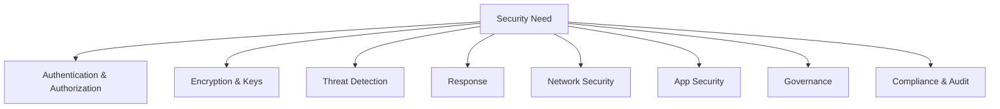

# Security Services Map — Cheat Sheet

> 🔥 **Which security service for which problem?** Memorize this single page.

---

## 🗺️ The Map



---

## 🔐 BY CATEGORY

### Authentication & Authorization

```
IAM                        Users, Groups, Roles, Policies
IAM Identity Center        SSO across many accounts (formerly SSO)
Cognito User Pools         User authentication for apps
Cognito Identity Pools     Federated AWS access for mobile/web
Directory Service          Managed AD / AD Connector / Simple AD
SAML / OIDC Federation     Bring corporate IdP (Okta, Azure AD)
STS                        Temporary credentials
Permission Boundaries      Cap max permissions for a user/role
SCPs                       Org-wide guardrails (no grant, only deny)
RAM                        Resource Access Manager — share resources
Access Analyzer            Find unintended external access
```

---

### Encryption & Keys

```
KMS                        Managed encryption keys
CloudHSM                   FIPS 140-2 Level 3 dedicated HSM
Secrets Manager            Secrets with auto-rotation
Parameter Store (SSM)      Config + secrets (cheaper)
ACM                        Free TLS/SSL certificates
ACM Private CA             Internal certificate authority
S3 SSE-S3 / SSE-KMS        Object encryption at rest
EBS Encryption (KMS)       Block encryption at rest
RDS / Aurora Encryption    Database encryption at rest
```

---

### Threat Detection

```
GuardDuty                  ML-based threat detection (account-wide)
                           VPC Flow + CloudTrail + DNS + S3 + EKS
                           
Macie                      Sensitive data discovery in S3
                           PII, PHI, credit cards, secrets
                           
Inspector                  Vulnerability scanning
                           EC2 (via SSM), ECR images, Lambda
                           Continuous, CVE-based
                           
Detective                  Investigation tool
                           Graph of relationships from GuardDuty findings
                           
Security Hub               Aggregates findings from above + compliance
                           Standards: AWS Foundational, CIS, PCI DSS, NIST
```

---

### Response

```
EventBridge                React to security events (auto-remediation)
Lambda                     Programmatic response
Systems Manager Automation Predefined runbooks
SNS                        Page on-call
Step Functions             Multi-step incident response
GuardDuty Malware Protection EBS volume scan on suspicious findings
```

---

### Network Security

```
Security Groups            Stateful instance firewall
NACLs                      Stateless subnet firewall
Network Firewall           VPC L3-7 firewall with DPI
Shield Standard            Free L3/L4 DDoS protection (automatic)
Shield Advanced            Premium DDoS + L7 + 24/7 DRT + cost protection
WAF                        Layer 7 web app firewall (SQLi, XSS, bots)
Firewall Manager           Central WAF/Shield/SG/NFW across accounts
Route 53 Resolver DNS Firewall  Block DNS to malicious domains
VPC Flow Logs              Network traffic logs
GuardDuty                  Detect suspicious network behavior
```

---

### Application Security

```
WAF                        Web app firewall
AppFabric                  SaaS-to-SaaS security data integration
CodeGuru Security          SAST for code (Java, Python)
Inspector (ECR)            Container image vulnerability scanning
Inspector (Lambda)         Lambda code dependency scanning
Cognito                    Auth, MFA, federation for apps
```

---

### Governance

```
Organizations              Multi-account structure + SCPs
Control Tower              Account vending + landing zone + guardrails
Service Catalog            Approved templates for self-service
Tag Policies               Enforce tagging across Org
SCPs                       Service Control Policies (deny lists)
RAM                        Share resources across accounts
Resource Explorer          Search resources across accounts/regions
```

---

### Compliance & Audit

```
CloudTrail                 API audit logs (who did what, when)
Config                     Resource configuration history + compliance
Audit Manager              Continuous compliance evidence collection
Artifact                   Download AWS compliance reports (SOC, ISO)
Trusted Advisor            Best-practice checks
Security Hub               Continuous compliance dashboard
Macie                      Data classification for compliance
```

---

## 🎯 Service-to-Scenario Quick Map

| Scenario | Primary Service |
|---|---|
| "Detect compromised IAM credentials" | **GuardDuty** |
| "Find PII in S3" | **Macie** |
| "Scan EC2 for unpatched CVEs" | **Inspector** |
| "Investigate alert root cause" | **Detective** |
| "Aggregate security findings" | **Security Hub** |
| "Block SQL injection" | **WAF** |
| "Free DDoS protection" | **Shield Standard** |
| "Premium DDoS with refund" | **Shield Advanced** |
| "Inspect East-West traffic" | **Network Firewall + TGW** |
| "Enforce WAF across all accounts" | **Firewall Manager** |
| "Manage encryption keys" | **KMS** (or CloudHSM for FIPS L3) |
| "Auto-rotate DB passwords" | **Secrets Manager** |
| "Store app config" | **Parameter Store** |
| "Free TLS certs" | **ACM** |
| "Track API calls" | **CloudTrail** |
| "Track resource config changes" | **Config** |
| "Continuous compliance reporting" | **Audit Manager** |
| "Download SOC 2 report" | **Artifact** |
| "Block accounts from leaving Org" | **SCP with deny on LeaveOrganization** |
| "Find unintended external access" | **Access Analyzer** |
| "Set up new accounts with guardrails" | **Control Tower** |
| "User auth for mobile app" | **Cognito User Pools** |
| "AWS access for mobile users" | **Cognito Identity Pools** |
| "SSO across many AWS accounts" | **IAM Identity Center** |
| "Federation from corporate AD" | **SAML 2.0 + IAM Role** |

---

## 🎯 Common SAP-C02 Patterns

### Pattern 1: Security Posture Across Many Accounts

> "Org with 50 accounts. Need unified security view."

✅ Stack:
- **GuardDuty** in every account (delegated admin pattern)
- **Macie** for S3 protection
- **Inspector** for vulnerability scanning
- **AWS Config** + **Security Hub** to aggregate
- **Firewall Manager** to enforce baseline WAF / SG / Shield
- **CloudTrail Organization Trail** → central log archive S3 bucket
- **Control Tower** to provision new accounts with all baseline

---

### Pattern 2: Compliance Reporting (PCI, HIPAA, SOC)

> "Auditor needs continuous evidence of controls."

✅ Stack:
- **AWS Config** rules for each control
- **Security Hub** with PCI/CIS/NIST standards enabled
- **Audit Manager** for evidence collection
- **Artifact** for downloading AWS's own SOC/ISO reports

---

### Pattern 3: Defense in Depth at Edge

> "Internet-facing app — protect against DDoS, web attacks, and probing."

✅ Stack:
- **Route 53 + Shield Standard** (DNS protection, free)
- **CloudFront + Shield Advanced** (edge DDoS + caching)
- **WAF** with AWS Managed Rules (OWASP) + custom rate-based rules
- **Origin in private subnet** (no direct internet access)
- **Security Groups** restrict ALB-to-instance traffic only
- **GuardDuty** detects post-compromise activity

---

### Pattern 4: Secrets Management Across Accounts

> "Shared service account holds RDS credentials. Other accounts' apps need access."

✅ Stack:
- **Secrets Manager** with resource policy allowing cross-account reads
- **CMK** for the secret with cross-account key policy
- **VPC Interface Endpoint** for Secrets Manager (no internet path)
- **IAM role** in consumer accounts allows GetSecretValue + Decrypt

---

### Pattern 5: New Account Onboarding

> "Need every new AWS account to have baseline security from day 1."

✅ Stack:
- **Control Tower** sets up the account
- **StackSets (service-managed)** auto-deploys:
   - CloudTrail Org trail (already from Control Tower)
   - GuardDuty enabled
   - Config enabled
   - Default IAM roles
   - SCPs from OU
- New account = secure from the moment it exists

---

## ⚡ Security Services Quick Recall Card

```
┌──────────────────────────────────────────────────────────┐
│ DETECT → INVESTIGATE → RESPOND → AGGREGATE                │
├──────────────────────────────────────────────────────────┤
│ DETECT                                                    │
│   GuardDuty   = account-wide threats (network, CT, DNS)  │
│   Macie       = S3 sensitive data                        │
│   Inspector   = vulnerabilities (EC2/ECR/Lambda)         │
│                                                           │
│ INVESTIGATE                                               │
│   Detective   = graph of relationships                   │
│                                                           │
│ RESPOND                                                   │
│   EventBridge → Lambda / SSM Automation                  │
│                                                           │
│ AGGREGATE                                                 │
│   Security Hub = central findings + compliance           │
├──────────────────────────────────────────────────────────┤
│ PROTECT (edge)                                            │
│   Shield Std (free) / Shield Adv ($3K/mo per Org)        │
│   WAF (L7) + Firewall Manager (Org-wide)                 │
│   Network Firewall (in-VPC L3-7)                         │
├──────────────────────────────────────────────────────────┤
│ KEYS & SECRETS                                            │
│   KMS = managed keys                                     │
│   CloudHSM = FIPS L3                                     │
│   Secrets Manager = auto-rotate                          │
│   Parameter Store = cheap config + secrets               │
│   ACM = free TLS certs                                   │
├──────────────────────────────────────────────────────────┤
│ AUDIT                                                     │
│   CloudTrail = API calls                                 │
│   Config = resource config history                       │
│   Audit Manager = compliance evidence                    │
│   Artifact = AWS-side compliance reports                 │
└──────────────────────────────────────────────────────────┘
```
