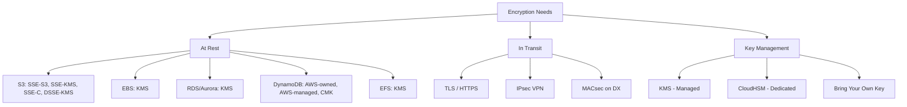
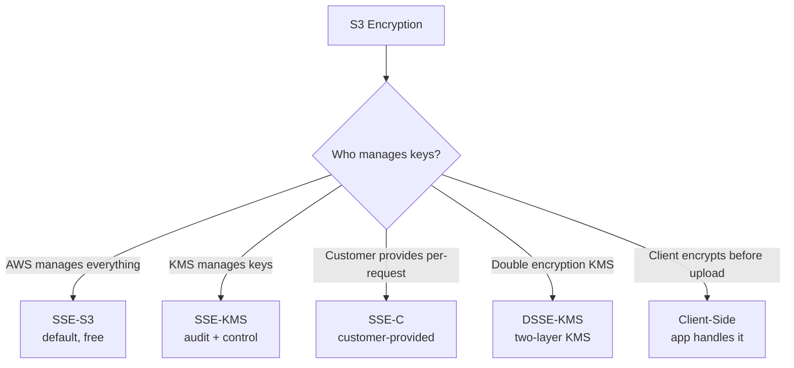

# Encryption Options — Cheat Sheet

> 🔥 **Encryption questions span KMS, S3 encryption types, in-transit options, and cross-account scenarios.**

---

## 🔐 The Encryption Landscape



---

## 🔑 KMS Key Types Summary

```
┌──────────────────────────────────────────────────────────┐
│ AWS OWNED KEYS                                            │
│   Invisible, AWS-managed, free                            │
│   Default for some services                               │
├──────────────────────────────────────────────────────────┤
│ AWS MANAGED KEYS (aws/<service>)                          │
│   Auto-rotating yearly, free                              │
│   Per-service (aws/s3, aws/ebs, aws/rds...)               │
│   You can't modify policy                                 │
├──────────────────────────────────────────────────────────┤
│ CUSTOMER MANAGED KEYS (CMK) ⭐ Most flexible              │
│   You control policy, rotation, deletion                  │
│   $1/month + $0.03 per 10K requests                       │
│   Required for cross-account access                       │
│   Required for multi-region (Multi-Region CMK)            │
├──────────────────────────────────────────────────────────┤
│ CLOUDHSM KEYS                                             │
│   FIPS 140-2 Level 3 (vs KMS = Level 2)                   │
│   Dedicated hardware HSM                                  │
│   You manage entirely                                     │
│   Most expensive                                          │
└──────────────────────────────────────────────────────────┘
```

---

## 📦 S3 Encryption Options



### S3 Encryption Detail

```
SSE-S3 (Default since 2023):
─────────────────────────────────────────────
- AWS S3-managed keys (AES-256)
- No key control by you
- Free
- Automatic for all new objects
- Use: Default for most workloads

SSE-KMS:
─────────────────────────────────────────────
- Uses KMS keys (AWS Managed or CMK)
- AUDIT TRAIL via CloudTrail (who decrypted what)
- Cross-account access controllable
- KMS API call cost per object access
- Bucket Key feature reduces KMS calls (& cost)
- Use: Need audit, compliance, control

SSE-C (Customer-Provided):
─────────────────────────────────────────────
- Customer sends key with each request
- S3 doesn't store the key
- HTTPS required
- Use: Specific compliance needs

DSSE-KMS (Dual-Layer):
─────────────────────────────────────────────
- DOUBLE encryption with two KMS operations
- Slower, more expensive
- Use: Top Secret compliance (DoD, intel)

CLIENT-SIDE ENCRYPTION:
─────────────────────────────────────────────
- App encrypts before uploading
- Can use KMS keys or own keys
- S3 sees only ciphertext
- Use: Maximum control, AWS never sees plaintext
```

### S3 Bucket Key — Cost Optimization

```
WITHOUT BUCKET KEY:
─────────────────────────────────────────────
Every object access = 1 KMS API call ($)
Heavy access = HUGE KMS bill

WITH BUCKET KEY (SSE-KMS):
─────────────────────────────────────────────
S3 generates a "bucket-level" key from CMK
Bucket key encrypts the per-object DEKs
Reduces KMS API calls by ~99%
✅ Massive cost savings, no security loss

ENABLE: At bucket level, free, recommended
```

---

## 💾 EBS Encryption

```
EBS ENCRYPTION:
─────────────────────────────────────────────
✅ Account-level "default encryption" setting
   When enabled, ALL new volumes are encrypted
✅ Uses KMS (CMK or AWS Managed)
✅ Encrypts both at rest AND in transit (EC2 ↔ EBS)
✅ Snapshots inherit encryption status
✅ AMIs from encrypted snapshots = encrypted AMIs

UNENCRYPTING:
─────────────────────────────────────────────
Cannot directly remove encryption from a volume.
Workaround:
1. Snapshot the volume (encrypted)
2. Copy the snapshot WITHOUT encryption (specify no KMS)
3. Create volume from unencrypted snapshot

CROSS-ACCOUNT ENCRYPTED SNAPSHOT SHARING:
─────────────────────────────────────────────
Source account: snapshot encrypted with CMK
1. Share snapshot with target account
2. Share CMK with target account (key policy)
3. Target account can copy snapshot using their own CMK
```

---

## 🗄️ Database Encryption

```
RDS / AURORA:
─────────────────────────────────────────────
✅ Enable at CREATION (can't enable later directly)
✅ Uses KMS
✅ Encrypts data, snapshots, automated backups, replicas
✅ TLS in-transit (force_ssl parameter)

To encrypt an existing unencrypted DB:
1. Create encrypted snapshot copy
2. Restore from encrypted snapshot
3. Promote new instance

DYNAMODB:
─────────────────────────────────────────────
✅ ALWAYS encrypted at rest (no off-switch)
✅ Default: AWS-owned key (free)
✅ Can switch to AWS-managed or CMK
✅ TLS in-transit always

REDSHIFT:
─────────────────────────────────────────────
✅ Optional encryption with KMS or HSM
✅ Enable at cluster creation
✅ Re-encrypt via cluster snapshot + restore
```

---

## 📁 File System Encryption

```
EFS:
─────────────────────────────────────────────
✅ Encryption at rest at file system creation (KMS)
✅ Encryption in transit via TLS (mount option)

FSx (all variants):
─────────────────────────────────────────────
✅ Encryption at rest by default
✅ KMS-managed keys
✅ In-transit: SMB encryption (Windows), NFS over Kerberos
```

---

## 🌐 In-Transit Encryption

```
TLS (HTTPS):
─────────────────────────────────────────────
✅ All AWS service APIs use TLS by default
✅ ALB / CloudFront handle TLS termination
✅ Use ACM for free certificates
✅ Force HTTPS via ALB redirect or S3 bucket policy
   (deny if aws:SecureTransport = false)

VPN (Site-to-Site):
─────────────────────────────────────────────
✅ IPsec encryption built-in
✅ Two tunnels per VPN connection (HA)

DIRECT CONNECT:
─────────────────────────────────────────────
❌ NOT encrypted by default!
Options:
   1. IPsec VPN over Public VIF (DX = bandwidth, VPN = encryption)
   2. MACsec — wire-level encryption on Dedicated 10G/100G
   3. App-level encryption (TLS)

WITHIN VPC:
─────────────────────────────────────────────
Traffic between AZs in same VPC is encrypted at the wire
on Nitro instances (most modern). 
For older instances, must do app-level encryption.
```

---

## 🔐 ACM — Certificate Manager

```
ACM:
─────────────────────────────────────────────
✅ FREE public TLS certificates
✅ Auto-renewal (no expiry surprises)
✅ Used by ALB, CloudFront, API Gateway, App Runner

ACM PRIVATE CA:
─────────────────────────────────────────────
✅ Internal certificate authority (paid)
✅ Issue certs for internal services
✅ Browser doesn't trust by default (need to trust the CA)

VALIDATION:
─────────────────────────────────────────────
- DNS validation (recommended, automatic renewal)
- Email validation (manual)
```

---

## 🔑 Secrets Manager vs Parameter Store

| | **Secrets Manager** | **Parameter Store (SSM)** |
|---|---|---|
| Purpose | Secrets | Config + secrets |
| Auto-rotation | ✅ Built-in (RDS, Redshift, DocumentDB, custom) | ❌ Manual / custom |
| Cost | $0.40/secret/month + API calls | Standard: free / Advanced: $0.05/param/month |
| Max value size | 64 KB | Standard 4 KB / Advanced 8 KB |
| Cross-account | ✅ Resource policy | ✅ Via Resource policy |
| KMS encryption | ✅ Always | ✅ Optional |
| Versioning | ✅ | ✅ |

```
USE SECRETS MANAGER:
─────────────────────────────────────────────
✅ Database credentials with rotation
✅ Need automatic rotation
✅ Cross-account secret sharing

USE PARAMETER STORE:
─────────────────────────────────────────────
✅ App config (non-secret)
✅ Secrets without rotation needs (cheap)
✅ Cost-sensitive
✅ Hierarchical config (/app/env/feature)
```

---

## 🎯 Common SAP-C02 Encryption Patterns

### Pattern 1: Cross-Account Encrypted Resource

> "S3 in Account A, encrypted with KMS, accessed by EC2 in Account B."

✅ Requires:
1. **Bucket policy in A** allows Account B principal s3:GetObject
2. **CMK key policy in A** allows Account B principal kms:Decrypt
3. **IAM policy in B** allows kms:Decrypt on A's CMK AND s3:GetObject on bucket

---

### Pattern 2: Compliance Says "No Unencrypted S3"

> "How to enforce all S3 buckets are encrypted?"

✅ **S3 default encryption** at account level (since 2023, all new objects auto-encrypted)
✅ **Bucket policy** denying PutObject without encryption
✅ **AWS Config rule** detects non-compliant buckets
✅ **SCP** denies disabling encryption

---

### Pattern 3: Encryption Without Internet Exposure

> "Need to use KMS from a VPC with no internet route."

✅ Create **KMS VPC Interface Endpoint** (PrivateLink)
- KMS API calls stay within VPC
- No NAT or IGW required

---

### Pattern 4: Database Credentials Auto-Rotation

> "MySQL password must rotate every 30 days. App should always get current password."

✅ **Secrets Manager** with automatic rotation
- Lambda rotation function (template provided by AWS for RDS)
- App fetches latest secret from Secrets Manager API
- No code changes needed when password rotates

---

### Pattern 5: Cross-Region Encrypted Replication

> "S3 bucket replicates to another region. Both encrypted with KMS."

✅ Two options:
1. **Multi-region KMS Key** — same key in both regions, ciphertext works in either
2. **Different CMKs per region** — replication re-encrypts at destination

Pick: Multi-region key for simplicity. Different keys for stricter region isolation.

---

### Pattern 6: FIPS 140-2 Level 3 Required

> "Government compliance requires hardware HSM."

✅ **CloudHSM** (KMS is Level 2 — not enough)
- Customer-controlled HSM cluster
- More expensive but compliant
- Can integrate with KMS as a custom key store

---

## ⚡ Encryption Quick Recall Card

```
┌─────────────────────────────────────────────────┐
│ AT REST                                          │
├─────────────────────────────────────────────────┤
│ S3 default              SSE-S3 (free)            │
│ S3 with audit           SSE-KMS                  │
│ S3 cost-optimize KMS    Enable Bucket Key        │
│ EBS                     KMS (account default ON) │
│ RDS/Aurora              KMS at creation only     │
│ DynamoDB                Always encrypted         │
│ EFS / FSx               KMS                       │
├─────────────────────────────────────────────────┤
│ IN TRANSIT                                       │
├─────────────────────────────────────────────────┤
│ HTTPS to AWS APIs       TLS (default)            │
│ ALB / CloudFront        TLS via ACM cert         │
│ VPN                     IPsec built-in           │
│ Direct Connect          NOT encrypted (use MACsec│
│                         or VPN over DX)          │
├─────────────────────────────────────────────────┤
│ KEY MANAGEMENT                                   │
├─────────────────────────────────────────────────┤
│ Default for most        AWS-managed key (free)   │
│ Need policy control     CMK ($1/mo + $/req)      │
│ Cross-region            Multi-region CMK         │
│ FIPS 140-2 Level 3      CloudHSM                 │
│ BYOK                    Import key material      │
├─────────────────────────────────────────────────┤
│ SECRETS                                          │
├─────────────────────────────────────────────────┤
│ Auto-rotation           Secrets Manager          │
│ Config / cheap          Parameter Store          │
│ TLS certs (free)        ACM                      │
│ Internal CA             ACM Private CA           │
└─────────────────────────────────────────────────┘
```

## 🎓 Common Exam Pattern

> **"S3 cross-region replication. Both buckets encrypted with KMS keys. Want to avoid managing two separate keys."**
>
> ✅ Use **Multi-region KMS keys** — same key material exists in both regions, encrypted data can be decrypted in either region without re-encryption.
