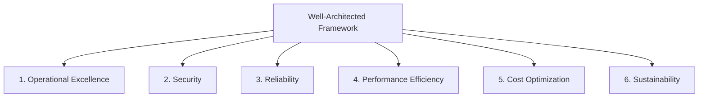

# AWS Well-Architected — The 6 Pillars

> 🔥 **Well-Architected language appears in many SAP-C02 questions.** Know what each pillar is about — answers usually align with one pillar's principles.

---

## 🏛️ The 6 Pillars



---

## 1. Operational Excellence

```
DEFINITION:
─────────────────────────────────────────────
Run and monitor systems to deliver business value
+ continually improve processes.

KEY PRACTICES:
─────────────────────────────────────────────
✅ Infrastructure as Code (CloudFormation, CDK)
✅ Make frequent, small, reversible changes
✅ Anticipate failure (game days, chaos engineering)
✅ Learn from operational failures (postmortems)
✅ Refine procedures (runbooks, playbooks)
✅ Operations as code (Lambda automation, SSM)

KEY SERVICES:
─────────────────────────────────────────────
CloudFormation / CDK     → IaC
CodePipeline / CodeDeploy → Automated deploys
Systems Manager          → Operations automation
CloudWatch + X-Ray       → Observability
EventBridge              → Event-driven ops
Health Dashboard         → Service health awareness
```

---

## 2. Security

```
DEFINITION:
─────────────────────────────────────────────
Protect information, systems, and assets while
delivering business value.

KEY PRACTICES:
─────────────────────────────────────────────
✅ Strong identity foundation (IAM, IDC, federation)
✅ Apply security at ALL LAYERS (defense in depth)
✅ Enable traceability (CloudTrail, Config, audit logs)
✅ Automate security best practices (Config Rules, SCPs)
✅ Protect data in transit AND at rest
✅ Keep people away from data (no SSH to production)
✅ Prepare for security events (incident response plan)

KEY SERVICES:
─────────────────────────────────────────────
IAM / Identity Center    → Identity
KMS / CloudHSM           → Encryption
Secrets Manager          → Secret handling
GuardDuty / Macie /      → Detection
  Inspector / Security Hub
WAF / Shield / Network FW→ Protection
CloudTrail / Config      → Audit
```

---

## 3. Reliability

```
DEFINITION:
─────────────────────────────────────────────
Workload performs its intended function correctly
and consistently when expected.

KEY PRACTICES:
─────────────────────────────────────────────
✅ Automate recovery from failure
✅ Test recovery procedures
✅ Scale horizontally to reduce blast radius
✅ Stop guessing capacity (use auto scaling)
✅ Manage change through automation
✅ Distribute across multiple AZs (and regions for critical)
✅ Plan for disaster recovery (RPO/RTO)

KEY SERVICES:
─────────────────────────────────────────────
Auto Scaling             → Scale automatically
Multi-AZ deployments     → AZ failure tolerance
Route 53 health checks   → Failover
Aurora / DynamoDB Global → Multi-region
AWS Backup               → Centralized backups
Elastic Disaster Recovery→ DR automation
Resilience Hub           → Continuous resilience analysis
```

---

## 4. Performance Efficiency

```
DEFINITION:
─────────────────────────────────────────────
Use compute resources efficiently to meet system
requirements + maintain that efficiency as demand
changes and technologies evolve.

KEY PRACTICES:
─────────────────────────────────────────────
✅ Democratize advanced tech (use managed services)
✅ Go global in minutes (multi-region, CDN)
✅ Use serverless when possible (Lambda, Fargate, DDB)
✅ Experiment more often (low cost of failure in cloud)
✅ Mechanical sympathy (right tool for the job)
✅ Right-size everything (Compute Optimizer)

KEY SERVICES:
─────────────────────────────────────────────
CloudFront + Global Accelerator → Edge / global
ElastiCache / DAX        → Caching
Aurora / DynamoDB        → Purpose-built data
Lambda / Fargate         → Serverless compute
ECS / EKS / EC2          → Right compute choice
S3 / EFS / FSx / EBS     → Right storage choice
```

---

## 5. Cost Optimization

```
DEFINITION:
─────────────────────────────────────────────
Avoid unnecessary costs.

KEY PRACTICES:
─────────────────────────────────────────────
✅ Implement Cloud Financial Management (FinOps)
✅ Adopt a consumption model (pay only for what you use)
✅ Measure overall efficiency (cost per unit of work)
✅ Stop spending on undifferentiated heavy lifting
   (use managed services)
✅ Analyze and attribute expenditure (Cost Allocation Tags)
✅ Use Savings Plans / Reserved / Spot wisely
✅ Right-size and rightsize regularly

KEY SERVICES:
─────────────────────────────────────────────
Cost Explorer            → Analysis
AWS Budgets              → Limits + Actions
Cost & Usage Report (CUR)→ Detailed data
Compute Optimizer        → Right-sizing
Trusted Advisor          → Best-practice checks
Savings Plans / RIs      → Long-term commits
Spot Instances           → Variable workloads
S3 Lifecycle policies    → Storage tiering
```

---

## 6. Sustainability

```
DEFINITION:
─────────────────────────────────────────────
Minimize the environmental impacts of running
cloud workloads.

KEY PRACTICES:
─────────────────────────────────────────────
✅ Understand your impact (sustainability metrics)
✅ Establish sustainability goals
✅ Maximize utilization (right-size, consolidate)
✅ Anticipate and adopt new, more-efficient
   hardware / software (Graviton, modern instance types)
✅ Use managed services (better utilization on AWS side)
✅ Reduce downstream impact (less data transferred,
   less data stored)

KEY SERVICES:
─────────────────────────────────────────────
Graviton instances       → ~20% better energy efficiency
S3 Intelligent-Tiering   → Don't store hot what's cold
Auto Scaling             → Don't run idle capacity
Customer Carbon Footprint Tool → Visibility
```

---

## 🎯 Pillar Trade-offs (The Reality)

```
SOMETIMES PILLARS CONFLICT:
─────────────────────────────────────────────

Reliability ⟷ Cost Optimization:
  Multi-region active-active is reliable but costly
  Single-region with backups is cheaper but less reliable
  → Decide based on RTO/RPO requirements

Performance ⟷ Cost:
  More memory = faster Lambda but more cost
  Bigger DB instances = faster queries but more cost
  → Find the right balance for the workload

Security ⟷ Operational Excellence:
  Strict break-glass workflows are secure but slow
  Easy automated access is operationally smooth but riskier
  → Defense in depth + auditability

THE EXAM TESTS YOUR ABILITY TO BALANCE THESE.
```

---

## 🎯 Common Exam Phrasing → Pillar

| Phrasing | Pillar |
|---|---|
| "minimize cost" | Cost Optimization |
| "highly available" | Reliability |
| "disaster recovery" | Reliability |
| "fastest response" | Performance Efficiency |
| "automated deployment" | Operational Excellence |
| "audit log all access" | Security |
| "encrypt data at rest" | Security |
| "no manual intervention" | Operational Excellence + Reliability |
| "scale automatically" | Performance + Reliability |
| "manageable as it grows" | Operational Excellence |
| "right-size resources" | Cost + Performance |
| "carbon footprint" | Sustainability |

---

## 🛠️ Well-Architected Tool

```
AWS Well-Architected Tool (free):
─────────────────────────────────────────────
✅ Review your workloads against the 6 pillars
✅ Self-assessment via guided questions
✅ Generates report with improvement plan
✅ Lenses for specific domains:
   - Serverless Lens
   - SaaS Lens
   - HPC Lens
   - Machine Learning Lens
   - IoT Lens
   - Data Analytics Lens
   - Government Lens
   - Hybrid Networking Lens

WHEN TO USE:
─────────────────────────────────────────────
✅ Before major launches
✅ Periodic reviews of existing workloads
✅ Identify gaps for prioritization
```

---

## ⚡ Quick Recall Card

```
┌─────────────────────────────────────────────────┐
│ THE 6 PILLARS                                    │
├─────────────────────────────────────────────────┤
│ 1. Operational Excellence                        │
│    IaC, automation, observability, runbooks      │
│                                                  │
│ 2. Security                                      │
│    Identity, encryption, detection, audit        │
│    Defense in depth, least privilege             │
│                                                  │
│ 3. Reliability                                   │
│    Multi-AZ, auto-recover, DR, scale horizontal  │
│                                                  │
│ 4. Performance Efficiency                        │
│    Right service, right size, serverless, cache  │
│                                                  │
│ 5. Cost Optimization                             │
│    SP/RI/Spot, right-size, tiered storage, tags  │
│                                                  │
│ 6. Sustainability                                │
│    Graviton, utilization, manage services       │
├─────────────────────────────────────────────────┤
│ EXAM TIP: When answers conflict between pillars, │
│ the question usually gives you constraints       │
│ (cost-sensitive, must-be-HA, etc.) that point    │
│ to the right pillar to favor.                    │
└─────────────────────────────────────────────────┘
```
