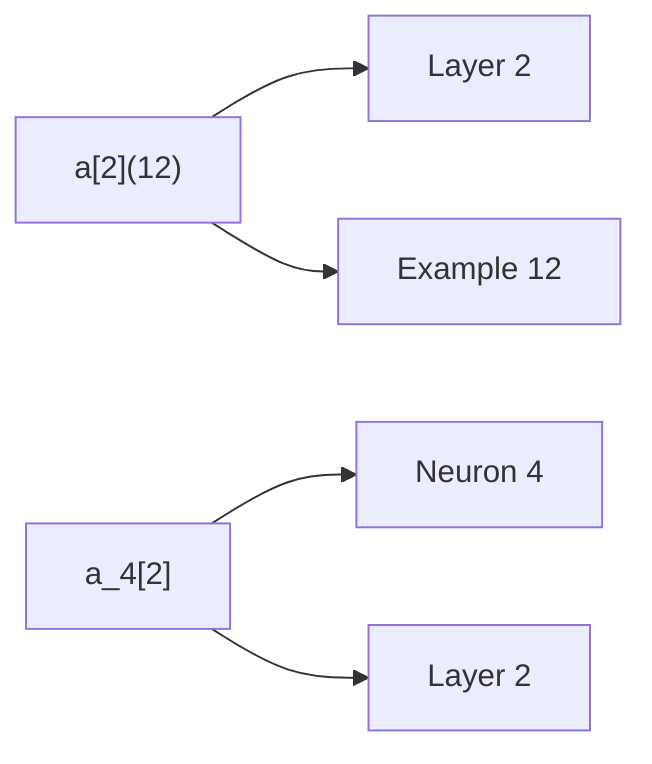

# Neural Network Notation & Matrix Shapes

## Problem It Solves
Neural networks use very specific notation. Mixing up `[l]`, `(i)`, and subscripts leads to wrong calculations and broken code. Mastering shapes is essential — almost every neural network bug is a shape mismatch.

## How It Works

**Notation system:**
- `[L]` (square brackets) = LAYER number
- `(i)` (round brackets) = TRAINING EXAMPLE number
- subscript `j` = NEURON number within layer
- `T` = transpose

**Example:** `a_4^[2](12)` means: 4th neuron, of 2nd layer, for 12th training example



## The Golden Rule of Shapes

```
W[L] shape = (neurons in layer L, neurons in layer L-1)
b[L] shape = (neurons in layer L, 1)
z[L] shape = (neurons in layer L, m)    ← m = training examples
a[L] shape = (neurons in layer L, m)    ← same as z[L]
```

## Visual: How X Is Structured

```
X shape = (features, samples) = (n[0], m)

           Example1  Example2  ...  ExampleM
feature1 [   x        x        ...    x    ]
feature2 [   x        x        ...    x    ]
feature3 [   x        x        ...    x    ]
                                            
   ↑ rows = features
   ↑ columns = training examples
```

## When to Use
- **Every time** you write neural network code
- Before debugging shape errors
- When implementing forward/backward pass

## When NOT to Use
- This convention is for VECTORIZED implementations
- For loop-based code (one example at a time), shapes differ

## Trade-offs
- **Pro:** Once learned, makes ALL deep learning papers readable
- **Pro:** Catches bugs early (shape assertions)
- **Con:** Initially confusing — `(features, samples)` is opposite of normal data tables

## Real World Example
**Google Brain papers, OpenAI papers** — all use this notation. Reading any deep learning paper requires understanding this.

## Decision Tree: Quick Shape Check

```
Is matrix multiplication W·X working?
│
├─ Check: W columns == X rows?
│   ├─ YES → proceed, result shape = (W rows, X cols)
│   └─ NO  → SHAPE MISMATCH! Transpose one of them
│
└─ Is result shape what next layer expects?
    ├─ YES → ✅ continue
    └─ NO  → re-check W shape definition
```

## Complete Example: 3 → 4 → 5 → 3 → 1 Network

| Variable | Shape | Why |
|----------|-------|-----|
| X        | (3, m) | 3 input features, m examples |
| W[1]     | (4, 3) | 4 neurons × 3 inputs |
| b[1]     | (4, 1) | 4 biases (broadcasts) |
| Z[1]     | (4, m) | 4 neurons × m examples |
| A[1]     | (4, m) | same as Z[1] |
| W[2]     | (5, 4) | 5 neurons × 4 prev inputs |
| Z[2], A[2] | (5, m) | |
| W[3]     | (3, 5) | 3 neurons × 5 prev inputs |
| Z[3], A[3] | (3, m) | |
| W[4]     | (1, 3) | 1 output neuron × 3 prev |
| Z[4], ŷ | (1, m) | m predictions |

## Interview Soundbite
> "Each column of X is one training example. W[L] always has shape (neurons in current layer, neurons in previous layer). This makes matrix multiplication clean: W[L]·A[L-1] gives shape (current neurons, m examples)."

## Common Bugs

❌ **Bug 1:** X shape (samples, features) instead of (features, samples)
✅ **Fix:** `X = X_raw.T`

❌ **Bug 2:** Forgetting `keepdims=True` when summing biases
✅ **Fix:** `db = np.sum(dZ, axis=1, keepdims=True)`

❌ **Bug 3:** Swapping W shape rows and columns
✅ **Fix:** Remember: rows = THIS layer, columns = PREVIOUS layer
