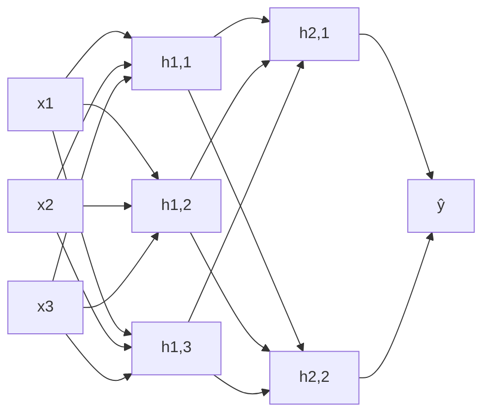

# Neural Network Architecture

## Problem It Solves
We need a way to organize neurons into layers so the network can learn complex patterns. The architecture (how many layers, how many neurons) determines what the network can learn.

## How It Works

A neural network has 3 types of layers:
1. **Input layer** — receives raw features (no computation, just data)
2. **Hidden layers** — learn intermediate representations (1 or many)
3. **Output layer** — produces final prediction

Each neuron does the same 2-step calculation:
- **Linear step:** `z = w·x + b` (weighted sum)
- **Activation step:** `a = g(z)` (non-linearity)

## Visual Architecture



## Depth vs Width

| Property | Wide (few layers, many neurons) | Deep (many layers, fewer neurons) |
|----------|--------------------------------|-----------------------------------|
| Parameters | Many | Fewer (often) |
| Learning capacity | Memorizes patterns | Learns hierarchical features |
| Training | Easier | Harder (vanishing gradients) |
| Modern preference | ❌ Outdated | ✅ Default |

## When to Use Each Architecture

```
Simple classification (small data)
   → 1-2 hidden layers, 10-50 neurons each

Image recognition
   → 10-100+ layers (CNN architectures: ResNet, VGG)

Language tasks
   → Transformers: 12-96 layers (BERT, GPT)

Tabular data
   → 2-5 hidden layers usually enough
```

## When NOT to Use Deep Networks
- **Tiny data (<1000 examples)** — overfits badly, use simpler models
- **Tabular data with clear patterns** — XGBoost often beats deep nets
- **No GPU** — too slow to train

## Trade-offs

| Adding more layers/neurons | Effect |
|----------------------------|--------|
| ✅ More learning capacity | ❌ Slower training |
| ✅ Better on complex patterns | ❌ Risk overfitting |
| ✅ Less feature engineering | ❌ Needs more data |
| ✅ Reusable representations | ❌ Harder to debug |

## Real World Examples

| Architecture | Real System | Layers |
|--------------|-------------|--------|
| AlexNet | First deep network for images (2012) | 8 |
| VGG-19 | Image classification | 19 |
| ResNet-152 | ImageNet winner | 152 |
| GPT-3 | Language model | 96 |
| BERT-Large | NLP tasks | 24 |

## Decision Tree: How Many Layers?

```
What is the problem?
│
├─ Simple regression/classification (tabular)?
│   → 2-3 hidden layers, 32-128 neurons
│
├─ Images?
│   → Use CNN, 10-50 layers depending on complexity
│
├─ Sequential/text data?
│   → Use RNN/LSTM/Transformer
│
└─ Reinforcement learning?
    → Match architecture to state space
```

## Interview Soundbite
> "Deep networks learn hierarchical features — early layers detect edges, middle layers detect parts, later layers detect objects. This is why depth matters more than width for complex problems."

## Hyperparameter Choices

| Hyperparameter | Common Values | Notes |
|----------------|--------------|-------|
| Number of layers | 2-10 (start small) | Too deep without skip connections = vanishing gradient |
| Neurons per layer | Powers of 2 (32, 64, 128, 256) | Convention only |
| Layer width pattern | Decreasing toward output | e.g., [128, 64, 32, 1] |
| Activation (hidden) | ReLU | Default |
| Activation (output) | Depends on problem | Sigmoid (binary), Softmax (multi-class), Linear (regression) |
