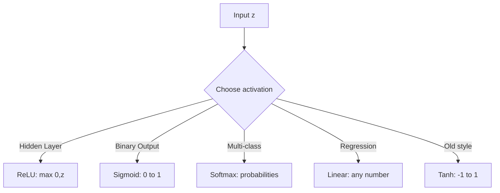

# Activation Functions — Complete Reference

## Problem It Solves
Without activation functions, all layers of a neural network collapse into one linear equation `y = Wx + b`. Activations add **non-linearity**, enabling networks to learn complex patterns like images, language, and curves.

## How It Works

Each neuron applies an activation function `g()` to its linear output:
```
z = W·x + b    (linear step)
a = g(z)       (activation step)
```

## The 5 Main Activation Functions

| Function | Formula | Output Range | When to Use |
|----------|---------|--------------|-------------|
| **ReLU** | `max(0, z)` | [0, +∞) | **Hidden layers (DEFAULT)** |
| **Sigmoid** | `1/(1+e⁻ᶻ)` | (0, 1) | Binary output |
| **Softmax** | `eᶻⁱ/Σeᶻʲ` | (0, 1), sums to 1 | Multi-class output |
| **Tanh** | `(eᶻ-e⁻ᶻ)/(eᶻ+e⁻ᶻ)` | (-1, +1) | Hidden layers (rare) |
| **Linear** | `z` | (-∞, +∞) | Regression output |

## Visual Comparison



## Shape of Each Function

```
ReLU:                    Sigmoid:
    │     /                  │     ____
    │    /                   │   /
  0 │___/____ z          0.5 │__/
    │       0                │ /
                          0  │/_____ z
                             

Tanh:                    Linear:
  1 │    ____               │       /
    │   /                   │      /
  0 │__/_____ z           0 │_____/____ z
    │ /                     │    /
 -1 │/                      │   /
```

## When to Use Which Activation

### ReLU (90% of cases for hidden layers)
✅ **Use when:** building any modern neural network's hidden layers
✅ **Pros:** Fast, no vanishing gradient (for z>0), simple
❌ **Cons:** "Dying ReLU" — neurons can output always 0

### Sigmoid
✅ **Use when:** Binary classification output (Cat vs Not-Cat)
✅ **Pros:** Output is a probability (0-1)
❌ **Cons:** Vanishing gradient at extremes, slow

### Softmax
✅ **Use when:** Multi-class classification output (Cat/Dog/Bird)
✅ **Pros:** All probabilities sum to 1
❌ **Cons:** Only for OUTPUT layer

### Tanh
✅ **Use when:** RNNs/LSTMs (legacy), zero-centered hidden layers
❌ **Cons:** Vanishing gradient, ReLU is usually better

### Linear (no activation)
✅ **Use when:** Regression output (predict price, temperature)
❌ **Cons:** NEVER use in hidden layers (network collapses to 1 layer)

## Decision Tree: Which Activation?

```
Where in network?
│
├─ Hidden layer?
│   ├─ Default? → ReLU ✅
│   ├─ Dead neurons problem? → Leaky ReLU
│   └─ Old RNN code? → Tanh
│
└─ Output layer?
    ├─ Binary (1/0)? → Sigmoid
    ├─ Multi-class? → Softmax
    └─ Real number? → Linear
```

## Trade-offs Summary

| Activation | Speed | Vanishing Gradient | Use in Hidden? | Use in Output? |
|------------|-------|-------------------|----------------|----------------|
| ReLU | ⚡ Fast | ✅ No (z>0) | ✅ YES | ❌ Rarely |
| Sigmoid | 🐢 Slow | ❌ Yes | ❌ Avoid | ✅ Binary |
| Softmax | 🐢 Slow | ❌ Yes | ❌ Never | ✅ Multi-class |
| Tanh | 🐢 Slow | ❌ Yes | ⚠️ Sometimes | ❌ Rarely |
| Linear | ⚡ Fast | N/A | ❌ NEVER | ✅ Regression |

## Real World Examples

| System | Hidden Activation | Output Activation |
|--------|------------------|-------------------|
| ImageNet CNNs | ReLU | Softmax (1000 classes) |
| BERT/GPT | GELU (modern ReLU variant) | Softmax (vocab probs) |
| Spam detection | ReLU | Sigmoid |
| House price prediction | ReLU | Linear |
| MNIST digits | ReLU | Softmax (10 digits) |

## Code Snippets

```python
import numpy as np

# ReLU
def relu(z):
    return np.maximum(0, z)

# Sigmoid
def sigmoid(z):
    return 1 / (1 + np.exp(-z))

# Tanh
def tanh(z):
    return np.tanh(z)

# Softmax (for multi-class)
def softmax(z):
    exp_z = np.exp(z - np.max(z))  # numerical stability
    return exp_z / np.sum(exp_z, axis=0, keepdims=True)

# Linear (no-op)
def linear(z):
    return z
```

## Interview Soundbite
> "ReLU is the default for hidden layers because it's fast, doesn't saturate (for positive z), and solves the vanishing gradient problem that plagued sigmoid and tanh. For output, match the activation to the problem: sigmoid for binary, softmax for multi-class, linear for regression."

## Common Mistakes

❌ Using Sigmoid for hidden layers → vanishing gradient
✅ Use ReLU for hidden layers

❌ Using Linear activation everywhere → network collapses to 1 layer
✅ Linear only for regression OUTPUT

❌ Sigmoid for multi-class output → probabilities don't sum to 1
✅ Use Softmax for multi-class
