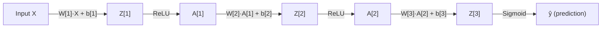

# Forward Propagation — The Forward Pass

## Problem It Solves
Forward propagation is how a neural network makes a PREDICTION. Given inputs, it computes outputs by passing data through each layer, applying weights and activations.

## How It Works

For each layer L (from 1 to last):
```
Z[L] = W[L] · A[L-1] + b[L]    ← LINEAR step
A[L] = g(Z[L])                  ← ACTIVATION step
```

Where `A[0] = X` (input data), and `A[last] = ŷ` (prediction).

## Visual Flow



## Step-by-Step Example

**Network:** Input(3) → Hidden(4) → Hidden(3) → Output(1)

**Input:** `X = [0.5, 0.0, 1.0]` (shape (3,1))

### Layer 1 (4 neurons, ReLU)

```
W[1] shape = (4, 3)
b[1] shape = (4, 1)

Z[1] = W[1]·X + b[1]
       (4,3) · (3,1) + (4,1) = (4,1) ✅

A[1] = ReLU(Z[1])
       shape (4,1)
```

### Layer 2 (3 neurons, ReLU)

```
W[2] shape = (3, 4)
b[2] shape = (3, 1)

Z[2] = W[2]·A[1] + b[2]
       (3,4) · (4,1) + (3,1) = (3,1) ✅

A[2] = ReLU(Z[2])
       shape (3,1)
```

### Output Layer (1 neuron, Linear or Sigmoid)

```
W[3] shape = (1, 3)
b[3] shape = (1, 1)

Z[3] = W[3]·A[2] + b[3]
       (1,3) · (3,1) + (1,1) = (1,1) ✅

ŷ = g(Z[3])  ← Sigmoid for binary, Linear for regression
```

## What Each Neuron Computes

```
ONE neuron's job (the "chef analogy"):

  Inputs: x1, x2, x3
  Weights (this neuron's recipe): w1, w2, w3
  Bias (this neuron's salt): b

  Step 1: z = (x1·w1) + (x2·w2) + (x3·w3) + b
  Step 2: a = activation(z)

  Output: a (this neuron's signal to next layer)
```

## Vectorized vs Looped

| Approach | Speed | Code | Use Case |
|----------|-------|------|----------|
| **Loop (one example)** | 🐢 Slow | Easy to read | Learning the concept |
| **Vectorized (batch)** | ⚡ Fast | Compact | Production code |

For M training examples:
- Loop: Process X[0], then X[1], then X[2]... (M iterations)
- Vectorized: Process ALL examples at once using matrix math

## Decision Tree: How to Implement Forward Pass

```
Building from scratch to learn?
   → Loop-based, one example at a time
   → Easy to debug

Production/training?
   → Vectorized (matrix operations)
   → 10-100x faster

Using a framework (PyTorch/TF)?
   → Use built-in layers (already vectorized)
```

## Trade-offs

| Saving cache during forward pass | Not saving cache |
|----------------------------------|-----------------|
| ✅ Backward pass is fast | ✅ Less memory |
| ❌ Uses more memory | ❌ Must recompute (slow) |

## Real World Implementation

In PyTorch/TensorFlow:
```python
# What happens internally on .forward()
x = input
for layer in self.layers:
    z = layer.weights @ x + layer.bias    # linear
    x = layer.activation(z)                # activation
output = x
```

## Cache for Backpropagation

During forward pass, save:
- `(A_prev, W, b)` from linear step → needed for `dW`
- `Z` from activation step → needed for `dZ`

```python
cache = (linear_cache, activation_cache)
# linear_cache = (A_prev, W, b)
# activation_cache = Z
```

## Common Bugs

❌ **Bug:** Forgetting to use ReLU activation between layers → network becomes linear
✅ **Fix:** Apply activation to EVERY hidden layer

❌ **Bug:** Shape mismatch in `W·A + b`
✅ **Fix:** Check shapes: (n[L], n[L-1]) · (n[L-1], m) → (n[L], m)

❌ **Bug:** Using Sigmoid in hidden layers
✅ **Fix:** Use ReLU for hidden layers, Sigmoid only for output

## Interview Soundbite
> "Forward propagation is a chain of matrix multiplications interleaved with non-linear activations. Each layer transforms inputs to outputs via Z = W·A + b followed by activation. The caches saved during forward pass are essential for efficient backward pass."
