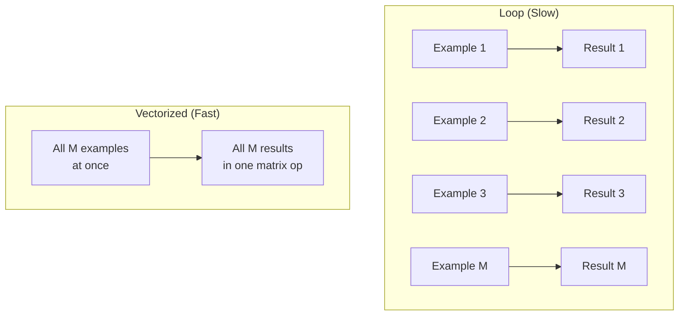

# Vectorization — Process All Examples at Once

## Problem It Solves
Training on millions of examples one-by-one is impossibly slow. Vectorization uses matrix math to process ALL examples in parallel — 10-100x faster on CPUs and 1000x faster on GPUs.

## The Core Idea

Instead of:
```python
for i in range(m):              # m examples
    z[i] = w · x[i] + b         # one example at a time
```

Do this:
```python
Z = W · X + b                   # ALL m examples at once
```

The math is IDENTICAL. The speed is dramatically different.

## Visual: Loop vs Vectorized



## How Shapes Change for Batch Processing

**One example (loop version):**
```
x shape  = (n[0], 1)
W shape  = (n[1], n[0])
z shape  = (n[1], 1)
```

**M examples (vectorized version):**
```
X shape  = (n[0], M)    ← stack examples as columns
W shape  = (n[1], n[0]) ← SAME as before
Z shape  = (n[1], M)    ← M outputs at once
```

The W shape doesn't change! Only X gets wider (more columns).

## Vectorized Forward Pass

```python
import numpy as np

# 5 training examples, 3 features each
X = np.array([
    [0.5, 0.5,  0.5,  0.5,  0.5 ],   # feature 1
    [0.0, 0.0,  0.5,  0.25, 1.0 ],   # feature 2
    [1.0, 0.0,  0.0,  0.0,  0.0 ]    # feature 3
])  # shape (3, 5)

W1 = np.random.randn(4, 3) * 0.01    # 4 hidden neurons
b1 = np.zeros((4, 1))                # broadcasts to (4, 5)

# ONE LINE processes all 5 examples
Z1 = W1 @ X + b1                     # shape (4, 5)
A1 = np.maximum(0, Z1)               # ReLU, shape (4, 5)
```

## Why Broadcasting Works

```
W·X result shape = (4, 5)
b shape           = (4, 1)

NumPy broadcasts b:
   (4, 1)  becomes  (4, 5) automatically
   Each column gets the same bias added

Result: (4, 5) + (4, 5) = (4, 5) ✅
```

## Speed Comparison

```python
# Loop version: ~10 seconds for 10,000 examples
for i in range(m):
    z = W @ X[:, i:i+1] + b
    a = relu(z)

# Vectorized version: ~0.01 seconds for 10,000 examples  
Z = W @ X + b
A = relu(Z)

# ~1000x faster!
```

## When to Use Vectorization

✅ **Always** in production code
✅ When training on >100 examples
✅ When using GPU (which loves parallel operations)

## When NOT to Use

❌ When debugging tiny examples (loops easier to inspect)
❌ When learning the concept for the first time

## Decision Tree: Loop or Vectorize?

```
Is m > 10?
├─ NO → Either is fine
└─ YES → ALWAYS vectorize

Using GPU?
├─ YES → MUST vectorize (otherwise GPU sits idle)
└─ NO  → Vectorize anyway for 10-100x speedup
```

## Trade-offs

| Vectorized | Loop |
|------------|------|
| ⚡ Very fast | 🐢 Very slow |
| 📦 More memory (whole batch in RAM) | 💾 Lower memory |
| 🤔 Harder to read | 👀 Easier to read |
| 🐛 Shape bugs common | 🐛 Index bugs common |
| ✅ Standard practice | ⚠️ Only for learning |

## Real World Examples

**ImageNet training:** Vectorized over batches of 256 images per GPU. Without vectorization, training would take years instead of days.

**GPT-3 training:** Batches of 3.2 million tokens at once. Loop-based code would be impossible.

## Backward Pass is Also Vectorized

Same idea for gradients:
```python
# Loop version
for i in range(m):
    dw_i = compute_gradient(x[i], y[i])
    dW += dw_i

# Vectorized
dW = (1/m) * dZ @ A_prev.T       # all gradients at once
```

## Interview Soundbite
> "Vectorization replaces explicit loops with matrix operations. The math is identical, but modern CPUs/GPUs execute matrix operations in parallel, giving 10-1000x speedup. Every production deep learning code is vectorized."

## Common Bugs

❌ **Bug:** Forgetting `keepdims=True` in `np.sum`
✅ **Fix:** `db = np.sum(dZ, axis=1, keepdims=True)` (keeps shape (n,1))

❌ **Bug:** Shape mismatch (samples vs features confusion)
✅ **Fix:** X shape = (features, samples), each COLUMN is one example

❌ **Bug:** Using `*` instead of `@` for matrix multiplication
✅ **Fix:** `*` = element-wise, `@` = matrix multiply (use `np.dot` too)
