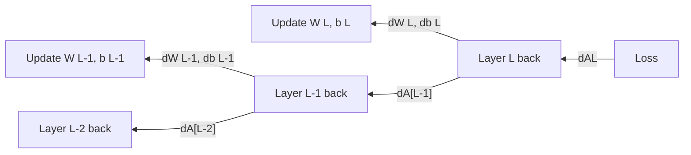

# Backpropagation — The Backward Pass

## Problem It Solves
After forward pass produces a prediction, we need to figure out HOW WRONG each weight is, so we can fix them. Backpropagation uses the chain rule of calculus to compute gradients efficiently — working BACKWARDS from output to input.

## The Core Idea

```
Forward:  Input → Layer 1 → Layer 2 → ... → Output → Loss

Backward: Loss → ... ← Layer 2 ← Layer 1 ← Input
          (compute "blame" for each weight)
```

## How It Works — High Level

For each layer, we compute 3 things:
1. **dW** — gradient w.r.t. weights (how to update W)
2. **db** — gradient w.r.t. bias (how to update b)
3. **dA_prev** — gradient to pass back to previous layer

## Visual Flow



## The Formulas (Memorize These!)

### Output Layer (start here)
```
dZ[L] = ŷ - y                    (for sigmoid + cross-entropy)
     OR
dZ[L] = 2(ŷ - y)                 (for linear + MSE)
```

### For Each Layer (going backwards)
```
dW[L]   = (1/m) · dZ[L] · A[L-1].T
db[L]   = (1/m) · sum(dZ[L], axis=1, keepdims=True)
dA[L-1] = W[L].T · dZ[L]
dZ[L-1] = dA[L-1] * g'(Z[L-1])     ← Element-wise multiply!
```

### Activation Derivatives
```
ReLU':    g'(z) = 1 if z > 0, else 0
Sigmoid': g'(z) = sigmoid(z) · (1 - sigmoid(z))
Tanh':    g'(z) = 1 - tanh(z)²
Linear':  g'(z) = 1
```

## Why It's Called "Back" Propagation

Errors flow BACKWARD through the network:
```
Output error
   ↓ (blame the last weights)
Layer L-1 error
   ↓ (blame those weights)
Layer L-2 error
   ↓ ...
Layer 1 error
```

Each layer asks: **"Given the error coming from above, what error did I cause?"**

## Step-by-Step Example

**Network:** Input(3) → H1(4) → H2(3) → Output(1)

After forward pass: ŷ = 0.595, true y = 1.0, Loss = 0.164

### Output Layer Backward
```
dZ[3] = 2 × (0.595 - 1.0) = -0.810     shape (1,1)
dW[3] = dZ[3] · A[2].T                 shape (1,3)
db[3] = dZ[3]                          shape (1,1)
dA[2] = W[3].T · dZ[3]                 shape (3,1)
```

### Layer 2 Backward
```
ReLU'(Z[2]) = [1, 1, 1]  (all positive)
dZ[2] = dA[2] * ReLU'(Z[2])             shape (3,1)
dW[2] = dZ[2] · A[1].T                  shape (3,4)
db[2] = dZ[2]                           shape (3,1)
dA[1] = W[2].T · dZ[2]                  shape (4,1)
```

### Layer 1 Backward
```
ReLU'(Z[1]) = [1, 1, 1, 1]  (all positive)
dZ[1] = dA[1] * ReLU'(Z[1])             shape (4,1)
dW[1] = dZ[1] · X.T                     shape (4,3)
db[1] = dZ[1]                           shape (4,1)
```

## When ReLU Gradient is 0

```
ReLU'(z) = 1  if z > 0   → gradient passes through ✅
ReLU'(z) = 0  if z ≤ 0   → gradient BLOCKED ❌

When neuron output was 0 (negative z):
   dZ for that neuron = 0
   dW for incoming weights = 0
   Those weights DON'T update!

This is the "Dying ReLU" problem.
```

## Decision Tree: Computing Gradients

```
At output layer?
├─ Sigmoid + Cross-Entropy → dZ = ŷ - y
├─ Linear + MSE           → dZ = 2(ŷ - y)
└─ Softmax + Cross-Entropy → dZ = ŷ - y

At hidden layer?
└─ Get dA from next layer (W[L].T · dZ[L])
   Multiply by activation derivative
   → dZ = dA * g'(Z)
```

## Trade-offs

| Backprop in detail | Skip details (use library) |
|--------------------|---------------------------|
| ✅ Full understanding | ❌ Black-box magic |
| ✅ Can debug gradient bugs | ✅ Fast development |
| ❌ Time-consuming | ❌ Bugs are mysterious |
| ✅ Required for research | ✅ Fine for applications |

## Real World Implementation

In PyTorch:
```python
loss.backward()    # Auto-computes ALL gradients!
                   # Uses computational graph
```

In raw NumPy (educational):
```python
dZL = AL - Y                           # output gradient
dWL = (1/m) * dZL @ A_prev.T          # weight gradient
dbL = (1/m) * np.sum(dZL, axis=1, keepdims=True)
dA_prev = WL.T @ dZL                   # gradient to previous layer
```

## Common Bugs

❌ **Bug:** Forgetting `keepdims=True` in db calculation
✅ **Fix:** `db = (1/m) * np.sum(dZ, axis=1, keepdims=True)`

❌ **Bug:** Using `@` (matrix mult) for activation derivative
✅ **Fix:** Use `*` (element-wise) for `dA * g'(Z)`

❌ **Bug:** Missing `.T` (transpose) in `dZ · A_prev.T`
✅ **Fix:** A_prev shape is (n_prev, m), need to transpose

❌ **Bug:** Forgetting (1/m) factor
✅ **Fix:** Always divide by m for AVERAGE gradient over batch

## Interview Soundbite
> "Backpropagation is the chain rule applied systematically: starting from the loss, we compute the gradient w.r.t. each parameter by chaining derivatives backwards through the network. The key insight is that we can reuse partial computations (dA[L-1]) as we go layer by layer."

## Connecting Forward and Backward

```
FORWARD (caches saved):              BACKWARD (uses caches):
  Z[L] = W·A[L-1] + b                  dW[L] uses A[L-1]
  cache (A_prev, W, b)                 dA_prev uses W
                                       
  A[L] = g(Z[L])                       dZ[L] uses g'(Z[L])
  cache (Z)                            
```

Without caches → recompute forward each time → 2x slower
