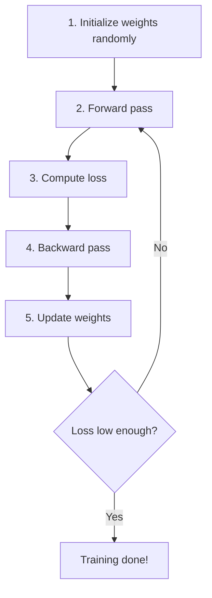

# Weight Updates — Gradient Descent

## Problem It Solves
After backpropagation gives us gradients, we need to use them to actually IMPROVE the weights. Gradient descent is the algorithm that nudges each weight in the right direction.

## The Update Rule

```
W_new = W_old - α × dW
b_new = b_old - α × db
```

Where:
- `α` (alpha) = **learning rate** (small number like 0.01)
- `dW`, `db` = gradients from backprop

## Why SUBTRACT the Gradient?

```
Gradient points UPHILL (toward higher loss)
We want to go DOWNHILL (toward lower loss)
   → Move in OPPOSITE direction of gradient
   → SUBTRACT it ✅
```

## Visual: Walking Downhill

```
Loss
  │
  │  ●  ← starting point (high loss)
  │   \
  │    \
  │     \
  │      ●  ← after one step
  │       \
  │        \
  │         ●  ← after many steps
  │          \
  │           \___●  ← minimum (best weights)
  └─────────────────  Weight value

Each step: W = W - α × dW
Step size controlled by α
```

## The Learning Rate (α) — Critical Choice

| α value | Effect | Result |
|---------|--------|--------|
| Too small (0.00001) | Tiny steps | Painfully slow |
| Just right (0.001-0.01) | Moderate steps | Converges nicely |
| Too large (0.5) | Huge steps | Overshoots, unstable |
| Way too large (10) | Massive steps | Diverges (loss grows!) |

## Visual: Effect of Learning Rate

```
α too small:           α just right:          α too large:
Loss                   Loss                   Loss
  │  ●                   │  ●                   │  ●     ●
  │  ●                   │   \                  │   \   /
  │   ●                  │    \                 │    \ /
  │   ●                  │     ●                │     ●
  │   ●                  │      \               │    / \
  │    ●                 │       \              │   /   \
  │ ...VERY SLOW         │        ●_____        │  ●     ● ...DIVERGES
```

## Hyperparameter: Choosing α

```
Standard values to try:
   0.1, 0.01, 0.001, 0.0001

Strategy:
   1. Start with α = 0.01
   2. If loss decreases nicely → keep it
   3. If loss explodes → decrease α (try 0.001)
   4. If loss decreases very slowly → increase α (try 0.1)
```

## Step-by-Step Example

```
Current weights:    W = 0.5, b = 0.1
Gradients (from backprop):  dW = -0.4, db = -0.2
Learning rate:      α = 0.01

UPDATE:
   W_new = 0.5 - 0.01 × (-0.4) = 0.5 + 0.004 = 0.504
   b_new = 0.1 - 0.01 × (-0.2) = 0.1 + 0.002 = 0.102

Interpretation:
   Gradient was NEGATIVE → weight needed to INCREASE
   So new weight is bigger than old weight ✅
```

## The Complete Training Loop



## Variants of Gradient Descent

### 1. Batch Gradient Descent
- Uses ALL training examples to compute gradient
- Slow but smooth
- Use when: dataset is small

### 2. Stochastic Gradient Descent (SGD)
- Uses ONE example at a time
- Fast but noisy
- Use when: dataset is huge

### 3. Mini-Batch Gradient Descent ⭐ (default!)
- Uses small batches (32-256 examples)
- Best of both worlds
- Use when: anything modern

```
Mini-batch sizes (typical):
   32, 64, 128, 256, 512 (powers of 2)
```

### 4. Adam Optimizer (modern default)
- Adaptive learning rates per weight
- Includes momentum
- Usually outperforms vanilla gradient descent

## Decision Tree: Which Optimizer?

```
Just learning concepts?
   → Plain gradient descent (this page)

Building a real model?
   → Adam (default)

Image classification competition?
   → SGD with momentum (sometimes better)

Very large model?
   → AdamW (Adam + decoupled weight decay)
```

## Trade-offs

| Plain GD | Adam |
|----------|------|
| ✅ Simple, easy to understand | ✅ Auto-adjusts learning rate |
| ❌ One learning rate for all | ✅ Per-parameter adaptation |
| ❌ Needs careful α tuning | ✅ Works with default α=0.001 |
| ✅ Less memory | ❌ Stores moving averages |
| ⚠️ Educational use | ✅ Production use |

## Real World Examples

**Plain Gradient Descent:** Used in Coursera assignments (educational)

**Adam Optimizer:** Used by virtually every modern model:
- BERT, GPT, ChatGPT
- ImageNet classifiers
- All Hugging Face models

## Code Snippets

```python
# Plain Gradient Descent
def update_parameters(parameters, grads, learning_rate):
    L = len(parameters) // 2  # number of layers
    for l in range(1, L + 1):
        parameters[f'W{l}'] -= learning_rate * grads[f'dW{l}']
        parameters[f'b{l}'] -= learning_rate * grads[f'db{l}']
    return parameters

# Used inside training loop:
for epoch in range(num_iterations):
    AL, caches = forward(X, parameters)
    cost = compute_cost(AL, Y)
    grads = backward(AL, Y, caches)
    parameters = update_parameters(parameters, grads, learning_rate=0.01)
```

## Interview Soundbite
> "Gradient descent updates each weight by subtracting the learning rate times its gradient. The learning rate controls step size — too large causes divergence, too small causes slow convergence. Modern training uses Adam, which adapts the learning rate per parameter."

## Common Bugs

❌ **Bug:** Forgetting to use `copy.deepcopy` when modifying parameters
✅ **Fix:** `parameters = copy.deepcopy(params)` before updates

❌ **Bug:** Using same learning rate for huge and tiny gradients
✅ **Fix:** Use Adam optimizer, or normalize inputs

❌ **Bug:** Learning rate too large → loss explodes (NaN)
✅ **Fix:** Decrease α, check if data is normalized

❌ **Bug:** Updating during forward pass instead of after backward
✅ **Fix:** Update AFTER full backprop, with all gradients computed
