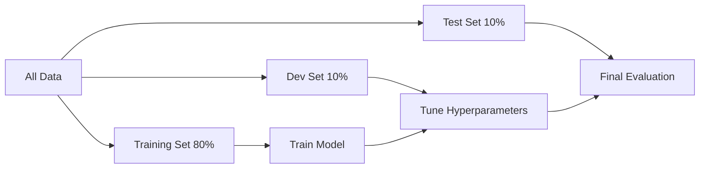

# Training, Dev, and Test Sets

## Problem It Solves
We need an honest way to evaluate models. If we train and test on the same data, we can't tell if the model truly learned or just memorized. Splitting data into 3 sets gives us tools to diagnose problems.

## The 3-Set Framework

```
TRAINING SET ─→ Model learns from this (sees many times)
                Weights are updated based on training error

DEV SET ──────→ Model tunes hyperparameters here
                (validation set, no weight updates)
                Pick which model is best

TEST SET ─────→ Final honest evaluation
                Look at it ONCE, never tune on it
```

## The Exam Analogy

```
📚 TRAINING SET = Textbooks & practice problems
                  Study from these every day
                  See answers, learn from mistakes

📝 DEV SET = Mock tests
              Self-test to see your progress
              Adjust study strategy based on results

📋 TEST SET = THE ACTUAL EXAM
              See only on exam day
              No going back to change preparation
```

## Visual Flow



## How to Split?

### Traditional Split (small datasets, <10,000 examples)
```
Training:  60-80%
Dev:       10-20%
Test:      10-20%
```

### Modern Split (millions of examples)
```
Training:  98%
Dev:        1%   (10,000 examples is plenty for evaluation)
Test:       1%   (10,000 examples is plenty for evaluation)
```

## Why Three Sets, Not Two?

**Why not just train + test?**
```
If we tune hyperparameters by looking at test set:
   1. We try learning rates: 0.01, 0.001, 0.0001
   2. We pick the one with best TEST score
   3. We have now LEAKED test info into our model!
   4. Test set no longer gives honest evaluation ❌
```

**Solution:** Dev set lets us tune freely. Test set stays sacred.

## Decision Tree: How Much Data for Each Set?

```
How big is your dataset?
│
├─ <1,000 examples
│   → 60/20/20 split (or use k-fold cross-validation)
│
├─ 1,000 - 100,000 examples
│   → 70/15/15 or 80/10/10
│
├─ 100,000 - 1,000,000 examples
│   → 90/5/5
│
└─ >1,000,000 examples
    → 98/1/1 (1% of 1M = 10K is plenty)
```

## When to Use Each Set

| Activity | Use Which Set? |
|----------|---------------|
| Training (forward/back/update) | Training ✅ |
| Picking learning rate | Dev ✅ |
| Picking # of layers | Dev ✅ |
| Picking regularization strength | Dev ✅ |
| "How does my model perform?" | Dev (during dev) |
| "Final paper/report number" | Test (ONCE) |

## Trade-offs

| 3-set split | Alternative: k-fold CV |
|-------------|------------------------|
| ✅ Fast (single split) | ❌ Slower (train k times) |
| ❌ Less data for training | ✅ Uses all data |
| ✅ Standard in deep learning | ⚠️ Common in classical ML |
| ⚠️ Sensitive to which examples in test | ✅ More reliable estimate |

## Real World Examples

**ImageNet:**
- Training: 1.28 million images
- Validation: 50,000 images
- Test: 100,000 images (labels hidden!)

**Kaggle competitions:**
- Public leaderboard: ~50% of test data
- Private leaderboard: ~50% (revealed at end)

**Coursera Cat Classifier:**
- Training: 209 images
- Test: 50 images

## Mismatched Distributions

⚠️ **Critical:** Dev and Test should come from SAME distribution!

```
Bad example:
   Training: dog photos from Google
   Dev: cat photos from Instagram
   Test: bird photos from your phone
   → Model trained on dogs won't work on cats/birds!

Good example:
   All from same distribution
   Random split → 80/10/10
```

## Train-Dev Set (Bonus Technique)

When training data and real-world data have different distributions:
```
1. Mix training data
2. Create a "training-dev set" from same dist as training
3. Compare:
   - Training error vs Train-Dev error → variance issue?
   - Train-Dev error vs Dev error → data mismatch issue?
```

## Interview Soundbite
> "Three sets enable honest evaluation: training updates weights, dev guides hyperparameter choices, test gives final unbiased performance. With big data, dev/test can be just 1% each — even 10K examples is plenty for evaluation."

## Common Bugs

❌ **Bug:** Tuning on test set
✅ **Fix:** Use dev set for ALL tuning; touch test only at the end

❌ **Bug:** Dev/test from different distribution than training
✅ **Fix:** Ensure all three come from same source

❌ **Bug:** Data leakage (same example in train AND test)
✅ **Fix:** Split BEFORE any preprocessing; check for duplicates

❌ **Bug:** Random shuffle on time-series data
✅ **Fix:** Use TIME-based split (train on past, test on future)
