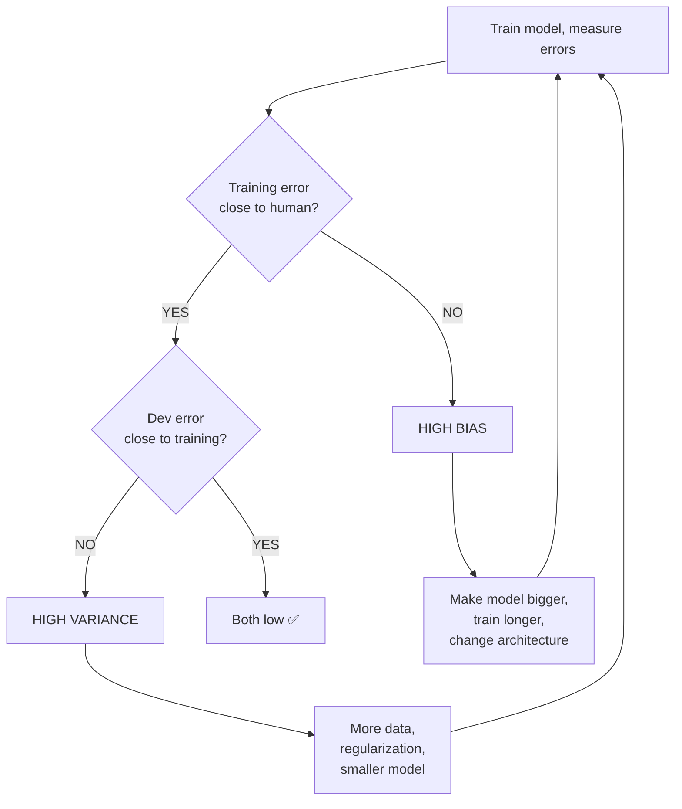

# Bias and Variance

## Problem It Solves
When a model performs poorly, we need to know WHY. Is it too simple (high bias)? Is it memorizing (high variance)? The bias-variance framework gives us a systematic way to diagnose AND fix model problems.

## Core Definitions

```
BIAS     = How far off predictions are from truth
           Caused by: Model too SIMPLE
           Effect: Underfitting

VARIANCE = How much predictions vary across different data
           Caused by: Model too COMPLEX
           Effect: Overfitting
```

## The Dartboard Analogy

```
HIGH BIAS:                     HIGH VARIANCE:
(missing the target)           (scattered everywhere)

   ○ ○ ○                          ●        ●
         ↑                            ●  ●
   ○ ○                          ●  [🎯]
   ○ ○                              ●        ●
                                        ●  ●

PERFECT (LOW BIAS + LOW VARIANCE):
   
   ●●
   ●[🎯]●
   ●●
```

## How to Detect From Errors

```
KEY METRICS:
   Human-level error  ≈ Bayes error (best possible)
   Training error     → tells about BIAS
   Dev error          → tells about VARIANCE
   
DIAGNOSE:
   BIAS     = Training error - Human-level error
   VARIANCE = Dev error - Training error
```

## The 4 Cases (Memorize These!)

### Case 1: High Bias (Underfitting)
```
Human:    1%
Training: 16%   ← high!
Dev:      17%   ← close to training

BIAS     = 16% - 1% = 15%  HIGH ❌
VARIANCE = 17% - 16% = 1%   low

Diagnosis: Model is too simple
```

### Case 2: High Variance (Overfitting)
```
Human:    1%
Training: 1%    ← perfect!
Dev:      16%   ← terrible gap

BIAS     = 1% - 1% = 0%     low ✅
VARIANCE = 16% - 1% = 15%   HIGH ❌

Diagnosis: Model memorized training data
```

### Case 3: Both High (Worst Case)
```
Human:    1%
Training: 15%
Dev:      30%

BIAS     = 14%   HIGH ❌
VARIANCE = 15%   HIGH ❌

Diagnosis: Model has problems everywhere
```

### Case 4: Perfect (GOAL!)
```
Human:    1%
Training: 2%
Dev:      3%

BIAS     = 1%    LOW ✅
VARIANCE = 1%    LOW ✅

Ship it! 🚀
```

## Diagnosis Flowchart



## The Fix Table

| Problem | Symptoms | Solutions |
|---------|----------|-----------|
| **High Bias** | Training error high | • Bigger network<br>• More layers/neurons<br>• Train longer<br>• Better architecture |
| **High Variance** | Dev >> Training error | • More training data<br>• L1/L2 regularization<br>• Dropout<br>• Smaller network<br>• Early stopping |
| **Both High** | Both errors high + gap | Fix bias FIRST, then variance |
| **Both Low** | Errors low + small gap | Ship it! 🎉 |

## Why "Fix Bias First"?

```
If you have BOTH problems:
   1. A model that can't even learn training data
   2. AND it doesn't generalize
   
First, solve "can it learn at all?":
   → Make it BIGGER until training error is low
   → Now you have high variance (memorized)
   → Then add regularization
   
This order works because: regularization HURTS bias slightly.
You can't add regularization to a model that's already too simple.
```

## Trade-offs: The Bias-Variance Tradeoff

```
Classical ML thinking:
   Reduce bias → increase variance
   Reduce variance → increase bias
   (Trade-off!)

Modern deep learning thinking:
   With enough data, you can reduce BOTH:
   - Bigger model → less bias
   - More data → less variance
   - Regularization → less variance with minimal bias hit
```

## Decision Tree: Diagnose Your Model

```
Step 1: Check training error
   ├─ HIGH (>5% above human)? → Bias problem
   │   Action: Bigger model, train longer
   │
   └─ LOW (close to human)? → Bias OK ✅
       Continue to step 2

Step 2: Check gap (dev - training)
   ├─ LARGE (>3%)? → Variance problem
   │   Action: More data, regularization
   │
   └─ SMALL → Variance OK ✅
       Ship the model!
```

## Real World Examples

### Cat Classifier (Coursera Course 1)
```
2-Layer Network:
   Training: ~99.9%  → Error 0.1%
   Test:      72%    → Error 28%
   Human:     1%
   
   BIAS:     0% (great)
   VARIANCE: 28% (TERRIBLE, overfitting)
   
   Action: More data, regularization (covered in Course 2)
```

### Self-Driving Cars
```
Training:  99% accurate
Real road: 95% accurate
Human:     99% accurate

   BIAS:     0% ✅
   VARIANCE: 4% (acceptable for road testing)
```

## Trade-offs by Solution

| Solution | Reduces | Side Effect |
|----------|---------|-------------|
| Bigger network | Bias | More compute, may overfit |
| More data | Variance | Hard/expensive to get |
| L2 Regularization | Variance | Slightly hurts bias |
| Dropout | Variance | Adds noise during training |
| Early stopping | Variance | Less optimal training |
| Smaller network | Variance | Increases bias |

## Code Example

```python
# After training a model, compute these:
train_pred = model.predict(X_train)
dev_pred   = model.predict(X_dev)

train_error = compute_error(train_pred, y_train)
dev_error   = compute_error(dev_pred, y_dev)
human_error = 0.01  # estimated baseline

bias     = train_error - human_error
variance = dev_error  - train_error

print(f"Bias:     {bias*100:.1f}%")
print(f"Variance: {variance*100:.1f}%")

if bias > 0.05:
    print("→ HIGH BIAS: try bigger model, train longer")
if variance > 0.03:
    print("→ HIGH VARIANCE: more data, regularize, smaller model")
```

## Interview Soundbite
> "High bias means the model can't learn even training data — increase model capacity. High variance means it memorized training but fails on dev — get more data or regularize. With deep learning and enough data, we can reduce both simultaneously, breaking the classical bias-variance trade-off."

## Common Mistakes

❌ Comparing models on TEST set (should be DEV)
✅ Use dev for choices, test only for final number

❌ Adding regularization when bias is the problem
✅ Fix bias FIRST (model too simple), then variance

❌ Assuming low training error = good model
✅ Always check dev error too (variance check)
