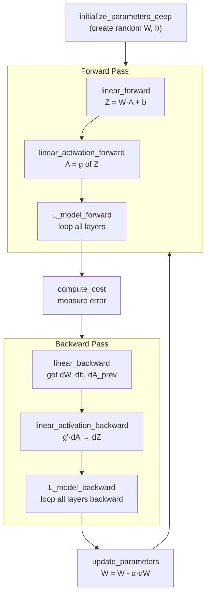

# Building a Deep Neural Network — Complete Implementation Pattern

## Problem It Solves
Once you understand the concepts, you need to know HOW to actually build a network from scratch. This is the modular pattern used in the Coursera Deep Learning Specialization and in production codebases.

## The 10-Function Architecture



## The 10 Functions Pattern

### Stage 1: Initialization (Functions 1-2)

```python
# Function 1: 2-layer network init
def initialize_parameters(n_x, n_h, n_y):
    W1 = np.random.randn(n_h, n_x) * 0.01
    b1 = np.zeros((n_h, 1))
    W2 = np.random.randn(n_y, n_h) * 0.01
    b2 = np.zeros((n_y, 1))
    return {"W1": W1, "b1": b1, "W2": W2, "b2": b2}

# Function 2: L-layer (any depth)
def initialize_parameters_deep(layer_dims):
    parameters = {}
    L = len(layer_dims)
    for l in range(1, L):
        parameters[f'W{l}'] = np.random.randn(layer_dims[l], 
                                                layer_dims[l-1]) * 0.01
        parameters[f'b{l}'] = np.zeros((layer_dims[l], 1))
    return parameters
```

### Stage 2: Forward Propagation (Functions 3-5)

```python
# Function 3: Linear step only
def linear_forward(A, W, b):
    Z = np.dot(W, A) + b
    cache = (A, W, b)
    return Z, cache

# Function 4: Linear + activation
def linear_activation_forward(A_prev, W, b, activation):
    Z, linear_cache = linear_forward(A_prev, W, b)
    if activation == "sigmoid":
        A, activation_cache = sigmoid(Z)
    elif activation == "relu":
        A, activation_cache = relu(Z)
    cache = (linear_cache, activation_cache)
    return A, cache

# Function 5: Full L-layer forward
def L_model_forward(X, parameters):
    caches = []
    A = X
    L = len(parameters) // 2
    
    # L-1 ReLU layers
    for l in range(1, L):
        A_prev = A
        A, cache = linear_activation_forward(
            A_prev, parameters[f'W{l}'], parameters[f'b{l}'], "relu")
        caches.append(cache)
    
    # Last layer: Sigmoid
    AL, cache = linear_activation_forward(
        A, parameters[f'W{L}'], parameters[f'b{L}'], "sigmoid")
    caches.append(cache)
    
    return AL, caches
```

### Stage 3: Cost (Function 6)

```python
def compute_cost(AL, Y):
    m = Y.shape[1]
    cost = -(1/m) * np.sum(Y*np.log(AL) + (1-Y)*np.log(1-AL))
    cost = np.squeeze(cost)
    return cost
```

### Stage 4: Backward Propagation (Functions 7-9)

```python
# Function 7: Linear backward
def linear_backward(dZ, cache):
    A_prev, W, b = cache
    m = A_prev.shape[1]
    
    dW = (1/m) * np.dot(dZ, A_prev.T)
    db = (1/m) * np.sum(dZ, axis=1, keepdims=True)
    dA_prev = np.dot(W.T, dZ)
    
    return dA_prev, dW, db

# Function 8: Linear-activation backward
def linear_activation_backward(dA, cache, activation):
    linear_cache, activation_cache = cache
    
    if activation == "relu":
        dZ = relu_backward(dA, activation_cache)
    elif activation == "sigmoid":
        dZ = sigmoid_backward(dA, activation_cache)
    
    dA_prev, dW, db = linear_backward(dZ, linear_cache)
    return dA_prev, dW, db

# Function 9: Full L-layer backward
def L_model_backward(AL, Y, caches):
    grads = {}
    L = len(caches)
    Y = Y.reshape(AL.shape)
    
    # Initialize: derivative of cost w.r.t. AL
    dAL = -(np.divide(Y, AL) - np.divide(1-Y, 1-AL))
    
    # Last layer: Sigmoid
    current_cache = caches[L-1]
    dA_prev, dW, db = linear_activation_backward(dAL, current_cache, "sigmoid")
    grads[f'dA{L-1}'] = dA_prev
    grads[f'dW{L}'] = dW
    grads[f'db{L}'] = db
    
    # Remaining layers: ReLU
    for l in reversed(range(L-1)):
        current_cache = caches[l]
        dA_prev, dW, db = linear_activation_backward(
            grads[f'dA{l+1}'], current_cache, "relu")
        grads[f'dA{l}'] = dA_prev
        grads[f'dW{l+1}'] = dW
        grads[f'db{l+1}'] = db
    
    return grads
```

### Stage 5: Update (Function 10)

```python
def update_parameters(params, grads, learning_rate):
    parameters = copy.deepcopy(params)
    L = len(parameters) // 2
    
    for l in range(L):
        parameters[f'W{l+1}'] -= learning_rate * grads[f'dW{l+1}']
        parameters[f'b{l+1}'] -= learning_rate * grads[f'db{l+1}']
    
    return parameters
```

## The Complete Training Loop

```python
def L_layer_model(X, Y, layers_dims, learning_rate=0.0075, num_iterations=3000):
    # 1. Initialize
    parameters = initialize_parameters_deep(layers_dims)
    costs = []
    
    # 2. Training loop
    for i in range(num_iterations):
        # Forward
        AL, caches = L_model_forward(X, parameters)
        
        # Cost
        cost = compute_cost(AL, Y)
        
        # Backward
        grads = L_model_backward(AL, Y, caches)
        
        # Update
        parameters = update_parameters(parameters, grads, learning_rate)
        
        if i % 100 == 0:
            print(f"Iteration {i}: cost = {cost}")
            costs.append(cost)
    
    return parameters, costs

# 3. Use trained model
def predict(X, Y, parameters):
    AL, _ = L_model_forward(X, parameters)
    predictions = (AL > 0.5).astype(int)
    accuracy = np.mean(predictions == Y)
    return predictions, accuracy
```

## Why This Modular Design?

```
INSTEAD OF: one giant 500-line function
   ❌ Hard to debug
   ❌ Hard to test
   ❌ Hard to modify
   
USE: 10 small focused functions
   ✅ Each function does ONE thing
   ✅ Easy to test in isolation
   ✅ Easy to add new features (e.g., regularization)
   ✅ Reusable for different architectures
```

## Trade-offs

| This Modular Pattern | Monolithic Code |
|----------------------|-----------------|
| ✅ Maintainable | ❌ Hard to change |
| ✅ Testable | ❌ Bugs hard to isolate |
| ✅ Reusable | ❌ Copy-paste forever |
| ❌ Slightly more verbose | ✅ Compact |
| ✅ Production-ready | ⚠️ Toy projects only |

## Decision Tree: Building From Scratch vs Library?

```
Goal?
│
├─ Learning fundamentals?
│   → Build from scratch (NumPy) ✅
│
├─ Research/custom architecture?
│   → PyTorch (autograd, GPU support)
│
├─ Production application?
│   → PyTorch or TensorFlow
│
└─ Quick prototype?
    → Keras / Hugging Face (pre-trained models)
```

## Cache Pattern — Why It Matters

```
Forward pass SAVES:
   (A_prev, W, b)  ← for linear_backward
   Z               ← for activation_backward

Backward pass USES these to compute gradients
WITHOUT recomputing the forward pass.

This is the key efficiency trick!
```

## Real World Translation

```
NumPy from-scratch implementation:
   → Coursera Deep Learning Specialization
   → Teaches the math behind frameworks

PyTorch translation:
   class Net(nn.Module):
       def __init__(self):
           super().__init__()
           self.fc1 = nn.Linear(12288, 20)   # = W1, b1
           self.fc2 = nn.Linear(20, 7)        # = W2, b2
           self.fc3 = nn.Linear(7, 5)         # = W3, b3
           self.fc4 = nn.Linear(5, 1)         # = W4, b4
       
       def forward(self, x):
           x = F.relu(self.fc1(x))
           x = F.relu(self.fc2(x))
           x = F.relu(self.fc3(x))
           return torch.sigmoid(self.fc4(x))
   
   # All 10 functions handled by PyTorch automatically!
```

## Interview Soundbite
> "A neural network implementation has 10 core functions across 5 stages: initialization, linear forward, activation forward, cost, linear backward, activation backward, full forward/backward orchestration, and parameter updates. Frameworks like PyTorch automate this, but understanding the pattern is essential for debugging and customization."

## Common Mistakes

❌ Forgetting to save caches during forward pass → can't do backprop
✅ Always: `cache = (linear_cache, activation_cache)`

❌ Using same activation for hidden and output
✅ ReLU for hidden, Sigmoid/Softmax/Linear for output

❌ Updating parameters with old gradients
✅ Compute ALL gradients first, then update

❌ Mutating parameters in place during training
✅ Use `copy.deepcopy` when needed
