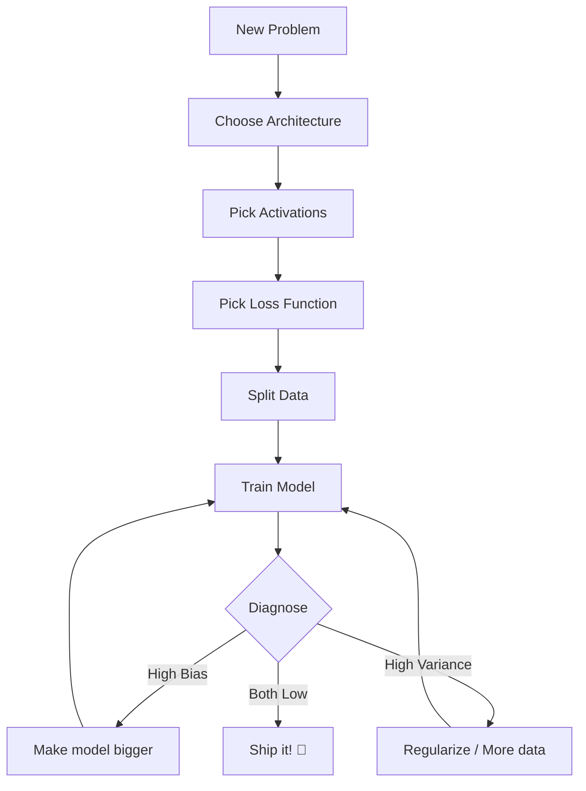

# Decision Trees — The Architect's Secret Weapon

> Don't memorize facts — memorize **decision frameworks**.
> These trees are what interviewers love. They show your thinking process.

---

## 🌳 Tree 1: Which Activation Function?

```
┌──────────────────────────────────────────────────────┐
│  Where in the network are you?                       │
├──────────────────────────────────────────────────────┤
│                                                      │
│  Hidden layer?                                       │
│   │                                                  │
│   ├─ Default? → ReLU ✅                              │
│   ├─ Dying ReLU problem? → Leaky ReLU                │
│   ├─ RNN/LSTM? → Tanh                                │
│   └─ Modern transformer? → GELU                      │
│                                                      │
│  Output layer?                                       │
│   │                                                  │
│   ├─ Binary classification (yes/no)? → Sigmoid       │
│   ├─ Multi-class (cat/dog/bird)? → Softmax           │
│   ├─ Regression (predict number)? → Linear (none)    │
│   └─ Probability? → Sigmoid                          │
└──────────────────────────────────────────────────────┘
```

---

## 🌳 Tree 2: Which Loss Function?

```
┌──────────────────────────────────────────────────────┐
│  What kind of output?                                │
├──────────────────────────────────────────────────────┤
│                                                      │
│  Continuous number?                                  │
│   │                                                  │
│   ├─ Outliers in data? → MAE (robust)                │
│   └─ Clean data? → MSE (default) ✅                  │
│                                                      │
│  Binary (2 classes)?                                 │
│   → Binary Cross-Entropy                             │
│      Pair with: Sigmoid output                       │
│                                                      │
│  Multi-class (3+ classes)?                           │
│   │                                                  │
│   ├─ One label per example? → Categorical CE         │
│   └─ Multiple labels? → Multi-label Binary CE        │
│                                                      │
│  Sequence prediction (each step)?                    │
│   → Cross-Entropy per time step                      │
└──────────────────────────────────────────────────────┘
```

---

## 🌳 Tree 3: Diagnose Model Problems

```
┌──────────────────────────────────────────────────────┐
│  Train your model, measure errors                    │
├──────────────────────────────────────────────────────┤
│                                                      │
│  Training error close to Bayes/Human error?          │
│   │                                                  │
│   NO  ──→ HIGH BIAS                                  │
│   │       Action:                                    │
│   │       • Bigger network                           │
│   │       • Train longer                             │
│   │       • Better architecture                      │
│   │       • Better features                          │
│   │                                                  │
│   YES ──→ Continue to variance check                 │
│           │                                          │
│           Dev error close to Training error?         │
│            │                                         │
│            NO  ──→ HIGH VARIANCE                     │
│            │       Action:                           │
│            │       • Get more training data          │
│            │       • L2 regularization               │
│            │       • Dropout                         │
│            │       • Smaller network                 │
│            │       • Early stopping                  │
│            │       • Data augmentation               │
│            │                                         │
│            YES ──→ ✅ DONE!                          │
└──────────────────────────────────────────────────────┘
```

---

## 🌳 Tree 4: How to Split Data?

```
┌──────────────────────────────────────────────────────┐
│  How much data do you have?                          │
├──────────────────────────────────────────────────────┤
│                                                      │
│  Less than 1,000 examples?                           │
│   → Use k-fold cross-validation                      │
│     (60/40 train/test, k=5 folds)                    │
│                                                      │
│  1,000 - 10,000 examples?                            │
│   → 60/20/20 split                                   │
│                                                      │
│  10,000 - 1,000,000 examples?                        │
│   → 70/15/15 or 80/10/10                             │
│                                                      │
│  More than 1,000,000 examples?                       │
│   → 98/1/1 (1% = 10K is plenty for dev/test)         │
│                                                      │
│  Time-series data?                                   │
│   → TIME-based split (train past, test future)       │
│     Never shuffle!                                   │
└──────────────────────────────────────────────────────┘
```

---

## 🌳 Tree 5: Should I Add Regularization?

```
┌──────────────────────────────────────────────────────┐
│  Is your model overfitting?                          │
│  (Train error LOW, Dev error MUCH higher)            │
├──────────────────────────────────────────────────────┤
│                                                      │
│  No overfitting? → Don't add regularization          │
│                    Focus on bias (model capacity)    │
│                                                      │
│  Slight overfitting?                                 │
│   → Start with L2, λ = 0.01                          │
│                                                      │
│  Severe overfitting?                                 │
│   │                                                  │
│   ├─ Have more data available? → Get more data FIRST │
│   │                                                  │
│   ├─ Feature selection needed? → L1 regularization   │
│   │                                                  │
│   └─ Deep network? → Dropout (0.3-0.5) + L2          │
│                                                      │
│  Images?                                             │
│   → Data augmentation + Dropout (best for images)    │
└──────────────────────────────────────────────────────┘
```

---

## 🌳 Tree 6: Which Optimizer?

```
┌──────────────────────────────────────────────────────┐
│  What's your training scenario?                      │
├──────────────────────────────────────────────────────┤
│                                                      │
│  Learning concepts from scratch?                     │
│   → Plain Gradient Descent (simple, educational)     │
│                                                      │
│  Building any modern application?                    │
│   → Adam (default, works well out of the box)        │
│                                                      │
│  Image classification competition?                   │
│   → SGD with Momentum (sometimes finds better        │
│     solutions than Adam)                             │
│                                                      │
│  Large language model (BERT, GPT)?                   │
│   → AdamW (Adam + decoupled weight decay)            │
│                                                      │
│  Resource constrained (memory)?                      │
│   → SGD (less memory than Adam)                      │
└──────────────────────────────────────────────────────┘
```

---

## 🌳 Tree 7: Network Architecture Choice

```
┌──────────────────────────────────────────────────────┐
│  What kind of problem?                               │
├──────────────────────────────────────────────────────┤
│                                                      │
│  Tabular data (rows of features)?                    │
│   │                                                  │
│   ├─ Small data? → XGBoost/LightGBM (often better)   │
│   └─ Big data? → MLP (Multi-Layer Perceptron)        │
│                  2-4 hidden layers, 64-256 neurons   │
│                                                      │
│  Image data?                                         │
│   │                                                  │
│   ├─ Small images (MNIST)? → Small CNN               │
│   ├─ Standard images? → ResNet, EfficientNet         │
│   └─ State-of-the-art? → Vision Transformer (ViT)    │
│                                                      │
│  Text/sequence data?                                 │
│   │                                                  │
│   ├─ Simple task? → LSTM                             │
│   ├─ Modern? → Transformer (BERT, GPT)               │
│   └─ Pre-trained? → Use HuggingFace                  │
│                                                      │
│  Time series?                                        │
│   → LSTM, GRU, or Transformer with positional enc.   │
│                                                      │
│  Speech/audio?                                       │
│   → CNN on spectrograms + LSTM/Transformer           │
└──────────────────────────────────────────────────────┘
```

---

## 🌳 Tree 8: Learning Rate Tuning

```
┌──────────────────────────────────────────────────────┐
│  What's happening with loss?                         │
├──────────────────────────────────────────────────────┤
│                                                      │
│  Loss = NaN or exploding?                            │
│   → α too HIGH → divide by 10                        │
│                                                      │
│  Loss decreasing very slowly?                        │
│   → α too LOW → multiply by 10                       │
│                                                      │
│  Loss bouncing up and down?                          │
│   → α slightly too high → reduce by 50%              │
│                                                      │
│  Loss smooth and decreasing? ✅                      │
│   → α is good, keep training                         │
│                                                      │
│  Loss decreasing then increasing?                    │
│   → Overfitting OR α too high near minimum           │
│   → Add regularization OR reduce α                   │
│                                                      │
│  STANDARD VALUES TO TRY:                             │
│  0.1, 0.01, 0.001, 0.0001                            │
│  (always grid search)                                │
└──────────────────────────────────────────────────────┘
```

---

## 🌳 Tree 9: Build From Scratch or Use Library?

```
┌──────────────────────────────────────────────────────┐
│  What's your goal?                                   │
├──────────────────────────────────────────────────────┤
│                                                      │
│  Learning fundamentals?                              │
│   → Build from scratch (NumPy) ✅                    │
│     Maximum educational value                        │
│                                                      │
│  Research/novel architecture?                        │
│   → PyTorch (most flexible, autograd)                │
│                                                      │
│  Production system?                                  │
│   │                                                  │
│   ├─ Mobile deployment? → TensorFlow Lite            │
│   ├─ Web deployment? → ONNX                          │
│   ├─ Server inference? → PyTorch or TF Serving       │
│   └─ Research → Production? → PyTorch with TorchServe│
│                                                      │
│  Quick prototype?                                    │
│   → Keras + pre-trained models (transfer learning)   │
│                                                      │
│  Using NLP?                                          │
│   → Hugging Face Transformers (instant SOTA)         │
└──────────────────────────────────────────────────────┘
```

---

## 🌳 Tree 10: When to Stop Training?

```
┌──────────────────────────────────────────────────────┐
│  Is dev error still decreasing?                      │
├──────────────────────────────────────────────────────┤
│                                                      │
│  YES → Keep training                                 │
│                                                      │
│  NO (plateaued)?                                     │
│   │                                                  │
│   ├─ Train error also high? → Underfitting           │
│   │   Try: bigger model, lower learning rate          │
│   │                                                  │
│   └─ Train error low? → Likely converged             │
│       Save model checkpoint                          │
│                                                      │
│  Dev error INCREASING while train decreasing?        │
│   → OVERFITTING starts                               │
│   → Use early stopping (revert to best dev)          │
│                                                      │
│  RULE OF THUMB:                                      │
│  • Save model every N epochs                         │
│  • Keep version with lowest dev loss                 │
│  • Stop when dev loss hasn't improved in 10 epochs   │
└──────────────────────────────────────────────────────┘
```

---

## 🎯 Master Decision Sequence



---

## 🏆 Pro Tips

1. **Start simple**: 1-2 hidden layers first, then go deeper if needed
2. **Verify shapes first**: 90% of bugs are shape mismatches
3. **One change at a time**: When debugging, modify ONE thing
4. **Track everything**: Plot train AND dev loss every epoch
5. **Save checkpoints**: You can always go back
6. **Don't optimize prematurely**: Get a working model first, optimize later
7. **Use real metrics**: Loss is for optimization, but track accuracy too
