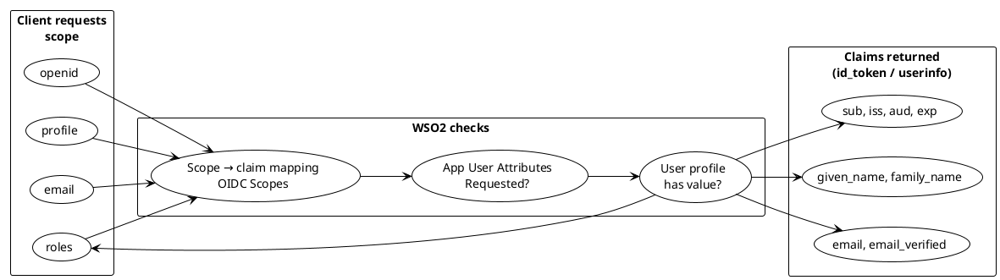
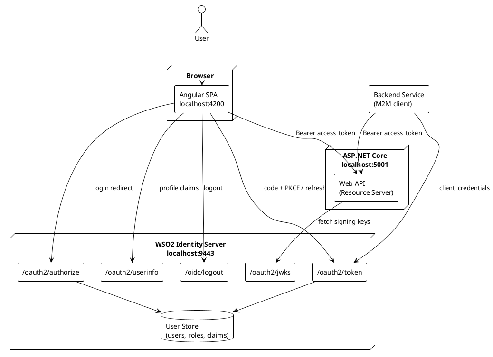
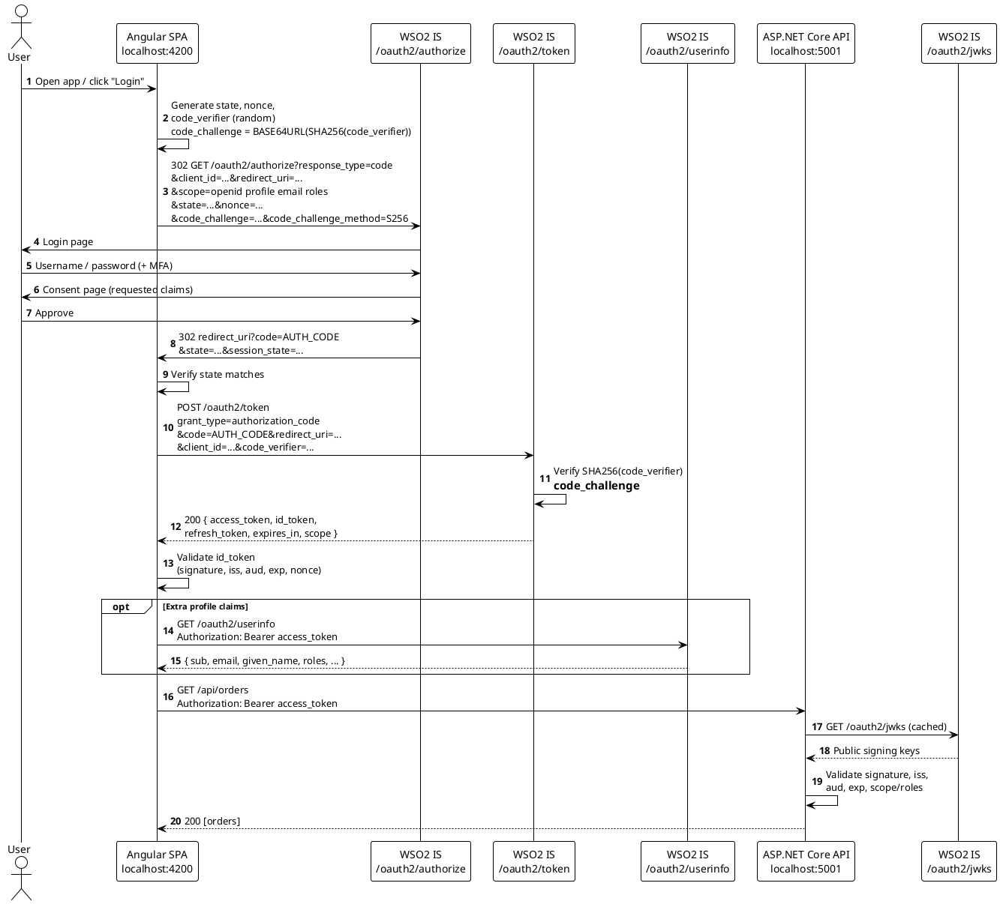
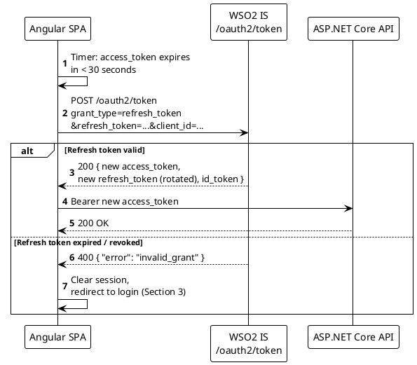
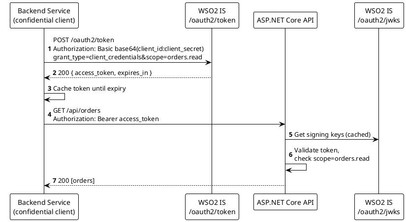
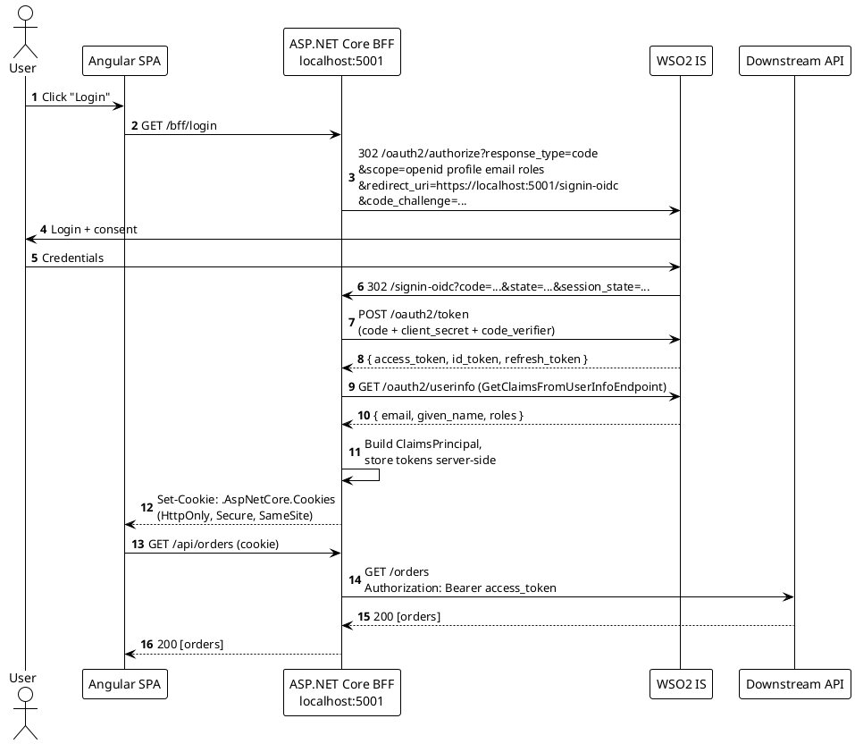
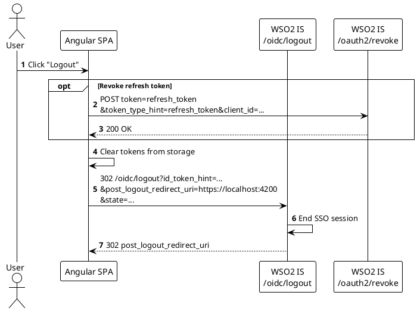

# OAuth 2.0 / OpenID Connect with WSO2 Identity Server and Angular

A practical reference covering components, flows (as PlantUML sequence diagrams), scopes, claims, example requests/responses, and the Angular + ASP.NET Core setup.

---

## Core concepts: what each part is for

### OAuth 2.0 vs OpenID Connect

**OAuth 2.0** is an *authorization* framework. It answers the question "is this app allowed to call this API on the user's behalf?" It issues an **access token** but says nothing standard about who the user is.

**OpenID Connect (OIDC)** is an *authentication* layer built on top of OAuth 2.0. It answers "who is the user?" It adds the `openid` scope, the **ID token**, the **UserInfo endpoint**, and a standard set of identity claims.

In practice you use both together: OIDC to log the user into Angular, and the OAuth access token to call your API.

### The four OAuth roles

| Role | Purpose | In this setup |
|---|---|---|
| **Resource Owner** | The person who owns the data and grants permission | The logged-in user |
| **Client** | The application that wants access to the data | Angular SPA (or ASP.NET Core BFF, or a backend service) |
| **Authorization Server** | Authenticates the user, gets consent, and issues tokens | WSO2 Identity Server |
| **Resource Server** | Hosts the protected data and accepts tokens | ASP.NET Core API |

The key idea is **delegation**: the user never gives their password to the client or the API. They log in only at WSO2, and the client receives a limited, expiring token instead.

### Scope: what the client is asking to do

A **scope** is a permission the client *requests*. It defines the boundary of what a token can be used for.

The purpose of scopes is to give **least privilege** and **user consent**. An app that only needs to read orders asks for `orders.read`, not full access. The user (or an admin policy) sees and approves these permissions on the consent screen, and the resulting access token carries only the scopes that were granted.

Scopes fall into two kinds. **OIDC identity scopes** (`openid`, `profile`, `email`, `phone`, `address`) control which user *claims* are released. **API scopes** (`orders.read`, `orders.write`) control what the access token is allowed to do at your API, which checks them before serving a request.

Think of a scope as a request on a form: "I'd like access to your email and to read your orders."

### Claims: facts about the user or the token

A **claim** is a single name/value statement inside a token or the UserInfo response, such as `"email": "priya@example.com"` or `"exp": 1790000000`.

The purpose of claims is to deliver **information** so the client and API don't need to look it up again. They fall into three groups:

| Claim type | Purpose | Examples |
|---|---|---|
| **Identity claims** | Describe the user, for display and personalisation | `sub`, `name`, `given_name`, `email`, `phone_number` |
| **Authorization claims** | Drive access decisions | `roles`, `groups`, `scope` |
| **Token / protocol claims** | Let the receiver verify the token is genuine, current, and meant for it | `iss` (who issued it), `aud` (who it's for), `exp` / `iat` (validity), `nonce`, `azp`, `jti` |

Think of claims as the answers filled in on that form: "email = priya@example.com, roles = admin."

### How scopes and claims relate

Scopes are **requested**, claims are **returned**. Each OIDC scope is a bundle of claims, and WSO2 releases a claim only when its scope was requested *and* the attribute is enabled for the application *and* the user actually has a value.



### Scope vs role vs claim

These three are often confused:

| | Scope | Role | Claim |
|---|---|---|---|
| **Answers** | What may this *app* do for the user? | What is this *user* allowed to do? | What is true about the user/token? |
| **Decided by** | Client requests, user consents | Admin assigns in WSO2 | Issued by WSO2 |
| **Example** | `orders.read` | `admin` | `"roles": ["admin"]` |
| **Checked by API** | "Was this token granted `orders.read`?" | "Is this user an admin?" | Both checks read claims |

A role reaches the API *as a claim* (`roles`), and granted scopes reach it *as a claim* (`scope`). Use both: scopes limit the app, roles limit the user.

### Tokens

| Token | Purpose | Audience | Lifetime |
|---|---|---|---|
| **Authorization code** | One-time ticket returned in the redirect, exchanged for tokens. Keeps tokens out of the browser URL | Token endpoint | Very short (seconds to minutes), single use |
| **ID token** (OIDC) | Proves who the user is and how/when they logged in. For the *client* only | The client (`aud` = client_id) | Short |
| **Access token** | Key to call the API. Carries scopes (and often roles) | The resource server (API) | Short (e.g. 5–60 min) |
| **Refresh token** | Gets new access tokens without making the user log in again | Token endpoint only | Long; revoke on logout |

A common mistake is sending the ID token to the API. The API should only accept **access tokens**; the ID token is for the client to know who logged in.

### Request parameters and supporting pieces

| Item | Purpose |
|---|---|
| `client_id` | Identifies which registered application is asking |
| `client_secret` | Proves the client's identity. Only for **confidential** clients (servers); never in Angular |
| `redirect_uri` | Where WSO2 sends the user back. Must match the registered value exactly, which stops codes being sent to attacker sites |
| `response_type=code` | Asks for the Authorization Code flow |
| `grant_type` | Tells the token endpoint how the client is proving it deserves a token (`authorization_code`, `refresh_token`, `client_credentials`) |
| `state` | Random value echoed back on redirect. Protects against CSRF and lets the app restore where the user was |
| `nonce` | Random value placed in the ID token. Protects against token replay |
| `code_verifier` / `code_challenge` (**PKCE**) | Proves the app that redeems the code is the same one that started the login. Replaces the secret for public clients like Angular |
| `session_state` | Lets the client detect when the user's WSO2 SSO session changes (session management) |
| **Consent** | User approval of the requested scopes/claims |
| **Discovery document** | `/.well-known/openid-configuration`; lets libraries find all endpoints and supported features automatically |
| **JWKS** | Public keys the API uses to verify the token signature without calling WSO2 on every request |
| **Introspection** | Endpoint the API can call to check opaque (non-JWT) tokens or revocation status |
| **Revocation** | Endpoint to invalidate a refresh/access token, e.g. on logout |

### Public vs confidential clients

A **public client** (Angular SPA, mobile app) runs on the user's device and cannot keep a secret, so it relies on PKCE. A **confidential client** (ASP.NET Core BFF, backend service) runs on a server, can keep a `client_secret`, and can safely hold refresh tokens. This is why the BFF pattern in Section 6 is more secure for browser apps.

---

## 1. Components

| Component | Role | Example URL |
|---|---|---|
| **User / Browser** | Resource owner, logs in | – |
| **Angular SPA** | Public OIDC client (no secret), uses Authorization Code + PKCE | `https://localhost:4200` |
| **WSO2 Identity Server** | Authorization Server / OpenID Provider | `https://localhost:9443` |
| **ASP.NET Core API** | Resource Server, validates JWT access tokens | `https://localhost:5001/api` |
| **ASP.NET Core BFF** *(optional)* | Confidential client, handles `/signin-oidc`, keeps tokens server-side | `https://localhost:5001` |
| **Backend service / job** | Machine-to-machine client (Client Credentials) | – |

### WSO2 endpoints

| Endpoint | Path |
|---|---|
| Discovery | `/oauth2/token/.well-known/openid-configuration` |
| Authorize | `/oauth2/authorize` |
| Token | `/oauth2/token` |
| UserInfo | `/oauth2/userinfo` |
| JWKS | `/oauth2/jwks` |
| Introspect | `/oauth2/introspect` |
| Revoke | `/oauth2/revoke` |
| Logout (end session) | `/oidc/logout` |

> The **issuer / authority** in WSO2 IS is `https://<host>:9443/oauth2/token`.

### Component diagram



---

## 2. Scopes and claims

Scopes are requested by the client. WSO2 maps each OIDC scope to a set of claims, and only releases claims that are **also** selected under the application's *User Attributes* (Requested attributes).

| Scope | Purpose | Claims returned (typical) |
|---|---|---|
| `openid` | **Required** for OIDC; returns `id_token` | `sub`, `iss`, `aud`, `exp`, `iat`, `nonce`, `auth_time`, `at_hash` |
| `profile` | Basic profile | `name`, `given_name`, `family_name`, `preferred_username`, `picture`, `locale`, `updated_at` |
| `email` | Email | `email`, `email_verified` |
| `phone` | Phone | `phone_number`, `phone_number_verified` |
| `address` | Postal address | `address` (JSON object) |
| `roles` / `groups` | Authorization info (WSO2-specific; name depends on IS version) | `roles`, `groups` |
| Custom (e.g. `orders.read`) | API permission | Appears in access token `scope` claim |

### Example: decoded `id_token`

```json
{
  "iss": "https://localhost:9443/oauth2/token",
  "sub": "c8a1f2d4-7b3e-4a8e-9f12-3b6d5e7a9c01",
  "aud": "Xk3pL9mQ2wR7tY5u",
  "azp": "Xk3pL9mQ2wR7tY5u",
  "exp": 1790000000,
  "iat": 1789996400,
  "auth_time": 1789996390,
  "nonce": "a9f3c1e7b2",
  "at_hash": "kR2vT8xP1qW4nM6z",
  "given_name": "Priya",
  "family_name": "Sharma",
  "email": "priya.sharma@example.com",
  "email_verified": true,
  "roles": ["admin", "order-manager"]
}
```

### Example: decoded `access_token` (JWT format)

```json
{
  "iss": "https://localhost:9443/oauth2/token",
  "sub": "c8a1f2d4-7b3e-4a8e-9f12-3b6d5e7a9c01",
  "aud": "Xk3pL9mQ2wR7tY5u",
  "client_id": "Xk3pL9mQ2wR7tY5u",
  "scope": "openid profile email roles orders.read",
  "exp": 1789997300,
  "iat": 1789996400,
  "jti": "5e1d8f7a-2c4b-4d9e-8a3f-6b7c9d0e1f23"
}
```

> In WSO2, set the application's **Access Token type to JWT** so the API can validate tokens locally via JWKS. With opaque tokens, the API must call `/oauth2/introspect`.

---

## 3. Flow: Authorization Code + PKCE (recommended for Angular)

Used by the SPA as a **public client** (no client secret). PKCE prevents stolen authorization codes from being redeemed.



### Example requests

**Authorize request** (built by the Angular library):

```
GET https://localhost:9443/oauth2/authorize
  ?response_type=code
  &client_id=Xk3pL9mQ2wR7tY5u
  &redirect_uri=https%3A%2F%2Flocalhost%3A4200%2Fcallback
  &scope=openid%20profile%20email%20roles
  &state=7d2a9c4e1b
  &nonce=a9f3c1e7b2
  &code_challenge=p9K_6JeKyCMvI_E5xRY6xAIhnm5OYa3vGV9JA_f4qy8
  &code_challenge_method=S256
```

**Callback** (what you saw in your browser):

```
https://localhost:4200/callback?code=6f2be6f3-....&state=7d2a9c4e1b&session_state=31f1bd....
```

**Token request:**

```http
POST https://localhost:9443/oauth2/token
Content-Type: application/x-www-form-urlencoded

grant_type=authorization_code
&code=6f2be6f3-dbc1-31b0-929a-e13a9d7b4a24
&redirect_uri=https://localhost:4200/callback
&client_id=Xk3pL9mQ2wR7tY5u
&code_verifier=dBjftJeZ4CVP-mJ92K9n6UTsPIXbHeKwCGGKXgE1yKk
```

**Token response:**

```json
{
  "access_token": "eyJ4NXQiOi...",
  "refresh_token": "a1b2c3d4-e5f6-...",
  "id_token": "eyJ4NXQiOi...",
  "scope": "openid profile email roles",
  "token_type": "Bearer",
  "expires_in": 3600
}
```

---

## 4. Flow: Refresh token (silent renew)



> In WSO2, enable the **Refresh Token** grant type on the application. WSO2 issues refresh tokens based on that setting; `offline_access` is not required.

---

## 5. Flow: Client Credentials (service-to-service)

No user involved. Used by backend jobs or microservices calling the API. **Never use this from Angular** (it requires a client secret).



```bash
curl -k -X POST https://localhost:9443/oauth2/token \
  -u "SVC_CLIENT_ID:SVC_CLIENT_SECRET" \
  -d "grant_type=client_credentials&scope=orders.read"
```

---

## 6. Flow: BFF pattern with ASP.NET Core (`/signin-oidc`)

Alternative to a pure SPA: ASP.NET Core is a **confidential client** that handles the code exchange at `/signin-oidc` and keeps tokens server-side. Angular only gets an HttpOnly session cookie. This is the most secure option for browser apps.



---

## 7. Flow: Logout (RP-initiated)



> The Implicit flow (`response_type=token`) and Resource Owner Password grant are deprecated by OAuth 2.0 Security BCP. Use Authorization Code + PKCE instead.

---

## 8. WSO2 Identity Server setup

**WSO2 IS 7.x Console** (IS 5.x/6.x Management Console has equivalent screens under *Service Providers*):

1. **Applications → New Application → Single-Page Application.**
   - Name: `angular-app`
   - Authorized redirect URL: `https://localhost:4200/callback` (and `https://localhost:4200` for logout)
2. **Protocol tab:**
   - Allowed grant types: `Authorization Code`, `Refresh Token`
   - Public client: **enabled** (no secret)
   - PKCE: **Mandatory**, `S256` only
   - Allowed origins (CORS): `https://localhost:4200`
   - Access token type: **JWT**
   - Note the generated **Client ID**
3. **User Attributes tab:** select `email`, `given_name`, `family_name`, `roles`; mark as *Requested* (or *Mandatory*). Choose the subject attribute.
4. **User Attributes & Stores → Attributes → OpenID Connect → Scopes:** confirm the claims are mapped to the scopes you request (e.g. `roles` scope includes the `roles` claim).
5. **Roles:** create roles (e.g. `admin`, `order-manager`) and assign them to users.
6. **Test user:** make sure the user profile actually has values for email and names.

For **Client Credentials**: create a separate **Standard-Based (OIDC)** application with the `Client Credentials` grant and a secret.

---

## 9. Angular setup (`angular-auth-oidc-client`)

### Install

```bash
npm install angular-auth-oidc-client
```

### `src/app/app.config.ts` (standalone, Angular 17+)

```typescript
import { ApplicationConfig } from '@angular/core';
import { provideRouter } from '@angular/router';
import { provideHttpClient, withInterceptors } from '@angular/common/http';
import { authInterceptor, LogLevel, provideAuth } from 'angular-auth-oidc-client';
import { routes } from './app.routes';
import { environment } from '../environments/environment';

export const appConfig: ApplicationConfig = {
  providers: [
    provideRouter(routes),
    provideHttpClient(withInterceptors([authInterceptor()])),
    provideAuth({
      config: {
        authority: environment.auth.authority,          // https://localhost:9443/oauth2/token
        clientId: environment.auth.clientId,
        redirectUrl: `${window.location.origin}/callback`,
        postLogoutRedirectUri: window.location.origin,
        responseType: 'code',                            // Authorization Code + PKCE
        scope: 'openid profile email roles',
        silentRenew: true,
        useRefreshToken: true,
        renewTimeBeforeTokenExpiresInSeconds: 30,
        autoUserInfo: true,                              // call /oauth2/userinfo
        secureRoutes: [environment.apiUrl],              // interceptor adds Bearer token only here
        logLevel: environment.production ? LogLevel.Error : LogLevel.Debug,
      },
    }),
  ],
};
```

### `src/environments/environment.ts`

```typescript
export const environment = {
  production: false,
  apiUrl: 'https://localhost:5001/api',
  auth: {
    authority: 'https://localhost:9443/oauth2/token',
    clientId: 'Xk3pL9mQ2wR7tY5u',
  },
};
```

### `src/app/app.routes.ts`

```typescript
import { Routes } from '@angular/router';
import { autoLoginPartialRoutesGuard } from 'angular-auth-oidc-client';
import { HomeComponent } from './home/home.component';
import { CallbackComponent } from './callback/callback.component';
import { roleGuard } from './auth/role.guard';

export const routes: Routes = [
  { path: '', component: HomeComponent },
  { path: 'callback', component: CallbackComponent },
  {
    path: 'orders',
    canActivate: [autoLoginPartialRoutesGuard],          // redirects to WSO2 if not logged in
    loadComponent: () => import('./orders/orders.component').then(m => m.OrdersComponent),
  },
  {
    path: 'admin',
    canActivate: [autoLoginPartialRoutesGuard, roleGuard('admin')],
    loadComponent: () => import('./admin/admin.component').then(m => m.AdminComponent),
  },
];
```

### `src/app/app.component.ts`

```typescript
import { Component, OnInit, inject } from '@angular/core';
import { RouterOutlet } from '@angular/router';
import { AsyncPipe, JsonPipe } from '@angular/common';
import { OidcSecurityService } from 'angular-auth-oidc-client';

@Component({
  selector: 'app-root',
  standalone: true,
  imports: [RouterOutlet, AsyncPipe, JsonPipe],
  template: `
    @if (isAuthenticated) {
      <p>Welcome {{ (userData$ | async)?.userData?.given_name }}</p>
      <button (click)="logout()">Logout</button>
    } @else {
      <button (click)="login()">Login</button>
    }
    <router-outlet />
  `,
})
export class AppComponent implements OnInit {
  private readonly oidc = inject(OidcSecurityService);
  readonly userData$ = this.oidc.userData$;
  isAuthenticated = false;

  ngOnInit(): void {
    // Handles the ?code=...&state=... callback and restores existing sessions
    this.oidc.checkAuth().subscribe(({ isAuthenticated, userData, accessToken, idToken }) => {
      this.isAuthenticated = isAuthenticated;
      console.log('claims', userData);
    });
  }

  login(): void {
    this.oidc.authorize();
  }

  logout(): void {
    this.oidc.logoff().subscribe();
  }
}
```

### `src/app/callback/callback.component.ts`

```typescript
import { Component } from '@angular/core';

@Component({
  selector: 'app-callback',
  standalone: true,
  template: `<p>Signing you in…</p>`,
})
export class CallbackComponent {}
```

### `src/app/auth/role.guard.ts` (authorize using the `roles` claim)

```typescript
import { inject } from '@angular/core';
import { CanActivateFn, Router } from '@angular/router';
import { OidcSecurityService } from 'angular-auth-oidc-client';
import { map } from 'rxjs';

export const roleGuard = (requiredRole: string): CanActivateFn => () => {
  const oidc = inject(OidcSecurityService);
  const router = inject(Router);

  return oidc.userData$.pipe(
    map(({ userData }) => {
      const roles: string[] = Array.isArray(userData?.roles)
        ? userData.roles
        : userData?.roles ? [userData.roles] : [];   // WSO2 may send a single string
      return roles.includes(requiredRole) ? true : router.parseUrl('/');
    }),
  );
};
```

### Calling the API

```typescript
import { Injectable, inject } from '@angular/core';
import { HttpClient } from '@angular/common/http';
import { environment } from '../../environments/environment';

@Injectable({ providedIn: 'root' })
export class OrdersService {
  private readonly http = inject(HttpClient);

  // authInterceptor adds "Authorization: Bearer <access_token>" because URL matches secureRoutes
  getOrders() {
    return this.http.get<Order[]>(`${environment.apiUrl}/orders`);
  }
}

export interface Order { id: number; total: number; }
```

---

## 10. ASP.NET Core API setup (Resource Server)

```csharp
// Program.cs
using Microsoft.AspNetCore.Authentication.JwtBearer;

var builder = WebApplication.CreateBuilder(args);

builder.Services.AddAuthentication(JwtBearerDefaults.AuthenticationScheme)
    .AddJwtBearer(options =>
    {
        options.Authority = "https://localhost:9443/oauth2/token";   // discovery + JWKS
        options.Audience  = "Xk3pL9mQ2wR7tY5u";                      // WSO2 sets aud = client_id
        options.MapInboundClaims = false;                            // keep "roles", "sub" as-is
        options.TokenValidationParameters.RoleClaimType = "roles";
        options.TokenValidationParameters.NameClaimType = "sub";
        // Dev only, for WSO2's self-signed certificate:
        // options.BackchannelHttpHandler = new HttpClientHandler {
        //     ServerCertificateCustomValidationCallback = (_, _, _, _) => true };
    });

builder.Services.AddAuthorization(o =>
{
    o.AddPolicy("orders.read", p => p.RequireAssertion(ctx =>
        ctx.User.FindFirst("scope")?.Value.Split(' ').Contains("orders.read") == true));
});

builder.Services.AddCors(o => o.AddDefaultPolicy(p =>
    p.WithOrigins("https://localhost:4200").AllowAnyHeader().AllowAnyMethod()));

var app = builder.Build();
app.UseCors();
app.UseAuthentication();
app.UseAuthorization();

app.MapGet("/api/orders", () => new[] { new { id = 1, total = 250 } })
   .RequireAuthorization();

app.MapGet("/api/admin", () => "admin only")
   .RequireAuthorization(p => p.RequireRole("admin"));

app.Run();
```

---

## 11. Troubleshooting

| Symptom | Likely cause / fix |
|---|---|
| Only `sub` in token / userinfo | Claims not selected under the app's **User Attributes**, or not mapped to the requested OIDC scope, or user profile has no value |
| `roles` claim missing | Request the `roles` (or `groups`) scope and add the roles attribute to the app |
| CORS error on `/oauth2/token` | Add `https://localhost:4200` to the app's **Allowed origins** in WSO2 |
| `invalid_grant` on code exchange | Code reused/expired, `redirect_uri` mismatch, or wrong `code_verifier` |
| `redirect_uri` mismatch | Must exactly match the registered URL (scheme, port, path, trailing slash) |
| API returns 401 | Wrong `Authority`/`Audience`, opaque token instead of JWT, or self-signed cert not trusted |
| `IDX10205` issuer validation failed | Issuer in token differs from `Authority` (e.g. `localhost` vs hostname) |
| Discovery fails in Angular | Self-signed WSO2 certificate: open `https://localhost:9443` once in the browser and trust it (dev) |

### Rendering the diagrams

- VS Code: install the **PlantUML** extension and press `Alt+D` to preview.
- CLI: `java -jar plantuml.jar oauth-oidc-angular-wso2.md` (extracts every `@startuml` block).
- Online: paste a block into <https://www.plantuml.com/plantuml>.
