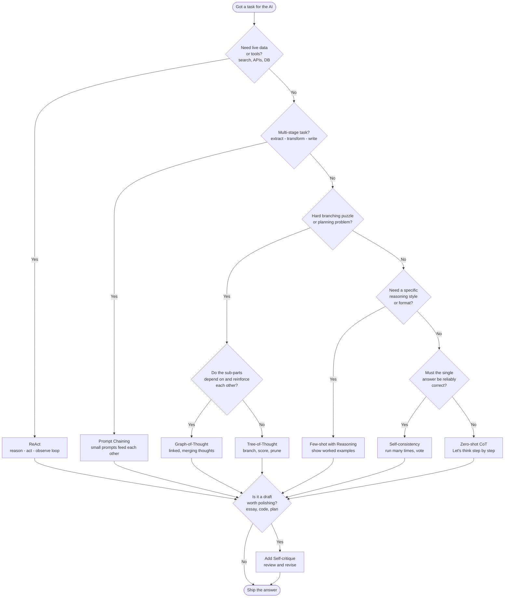

# Prompting Techniques — Feynman Notes

> **Feynman style** = explain it so simply a 12-year-old gets it, using a plain
> everyday analogy, before adding the technical layer.

---

## What is prompting? (and why it matters)

**Purpose**
Prompting is *how you talk to an AI model to get the answer you actually want.*
The model can't read your mind — the way you phrase, structure, and frame your
request directly shapes the quality of the output. Good prompting is the
difference between a vague, wrong, or rambling answer and a precise, useful one.
These techniques are simply *proven patterns* for framing requests so the model
reasons better, hallucinates less, and stays on task.

---

## 1. Zero-shot CoT (Chain-of-Thought)

**Purpose**
Get the model to reason through a problem step by step — instead of guessing an
instant answer — without giving it any examples.

**Feynman explanation**
Imagine asking a friend a tricky riddle. If they shout the first answer that pops
into their head, they often get it wrong. But if you say *"slow down, think it
through out loud,"* they usually get it right. Zero-shot CoT is exactly that — you
add the magic phrase **"Let's think step by step,"** and the model reasons out
loud instead of blurting. No examples needed; the phrase alone flips the switch.

**Example**
```
Prompt (zero-shot — no examples given):
"I'm travelling to Delhi from Mumbai. What's the best route? Let's think step
by step."

Output:
Options are flight, train, or road. Flight is fastest (~2 hrs) but priciest.
Train (~16 hrs) is cheaper and scenic. Road is most flexible but longest.
For a busy traveller, best route = flight. Answer: fly Mumbai → Delhi.
```
(Notice: no examples were shown — just the question plus "think step by step.")

**Pros**
- Almost zero effort — one sentence.
- Big accuracy boost on math, logic, multi-step word problems.
- No examples to write or maintain.

**Cons**
- Makes answers longer and slower.
- Reasoning can be confidently wrong (looks logical but isn't).
- Weaker than few-shot on highly specialized tasks.

**When to use**
- Quick reasoning tasks where you have no examples ready.
- Math, logic puzzles, "how many," "what's the total" questions.
- Your first thing to try before reaching for anything fancier.

---

## 2. Few-shot with Reasoning

**Purpose**
Teach the model the *exact reasoning pattern and format* you want by showing it a
few fully worked-out examples first.

**Feynman explanation**
Think of teaching a kid long division. You don't just show the final answers —
you show *how* you got each one, working it out on the board a couple of times.
Then you hand them a new problem and they copy your *method*, not just your
format. Few-shot with reasoning gives the model 2–3 worked examples that include
the thinking, so it imitates the reasoning style.

**Example**
```
Prompt (few-shot — showing the reasoning pattern you want):
Q: Travelling to Bangalore. Best route?
A: Flight is best — it's the fastest way and time matters most. Answer: flight.

Q: Travelling to Goa. Best route?
A: Train is best — it's scenic and cheap, great for a relaxed trip. Answer: train.

Q: Travelling to Delhi from Mumbai. Best route?
A:

Output:
Flight is best — long distance and time matters, so speed wins. Answer: flight.
```
(The two worked examples teach the model both the *format* and the *reasoning
style* — pick a mode, then justify why — which it copies for the new question.)

**Pros**
- Teaches both the format *and* the reasoning pattern you want.
- More reliable than zero-shot on tricky or domain-specific tasks.
- You control the exact reasoning style (concise, verbose, structured).

**Cons**
- You must write good examples (effort + skill).
- Examples eat up context window space.
- Bad examples teach bad habits — quality matters a lot.

**When to use**
- You want a specific *style, format, or pattern* copied — this is the main
  reason, and it applies to simple tasks too, not just complex ones.
- The task has a specific reasoning pattern you want imitated.
- Zero-shot CoT gives messy or inconsistent reasoning.
- Specialized domains (legal, medical, financial logic).

---

## 3. Self-consistency

**Purpose**
Boost the reliability of a reasoning answer by generating several independent
attempts and taking the answer the majority agree on.

**Feynman explanation**
Imagine asking three smart friends the same hard question separately, then going
with the answer most of them agree on. Even if one friend slips up, the majority
keeps you right. Self-consistency runs the *same* reasoning prompt several times
(with a little randomness so each run differs), then takes the **majority vote**.

**Example**
```
Prompt (same question, run 3 times, each reasoning its own way):
"A shirt costs ₹100 with a 20% discount. What's the final price?
Think step by step."

Run 1: Discount first → 20% of 100 = ₹20. 100 − 20 = ₹80.       → 80
Run 2: Pay 80% of price → 0.8 × 100 = ₹80.                      → 80
Run 3: 20% off means keep 4/5 → 100 × 4/5 = ₹80.                → 80

Majority vote → Answer: ₹80
(All three took different mental paths but landed on 80 → high confidence.
If one had drifted to ₹120, the majority 80 still wins.)
```

**Pros**
- Noticeably more accurate than a single CoT run.
- Catches and outvotes one-off reasoning mistakes.
- Simple idea — just run it a few times and tally.

**Cons**
- Expensive — you pay for 3, 5, or more full runs.
- Slower (multiple passes before you get an answer).
- Only helps tasks with a clear "correct" answer to vote on.

**When to use**
- High-stakes reasoning where accuracy beats cost.
- Math/logic problems with one right answer.
- NOT for open-ended creative writing (no "majority" to vote on).

**Common misconception (clarified in discussion)**
Self-consistency is *not* "different conditions giving different outcomes." It's
the **same question, asked several times**, letting each run reason its own way,
then taking the majority answer.

**Relationship to Chain-of-Thought**
Self-consistency usually *wraps* CoT — each run is a CoT run, and you vote across
them. It *can* run without CoT (just plain answers voted on), but that's weak: if
the model is confidently wrong, it'll be wrong the same way every time and the
vote just confirms the mistake. CoT inside each run is what makes the vote
meaningful.

---

## 4. ReAct (Reason + Act)

**Purpose**
Let the model solve tasks that need external information or tools by interleaving
its reasoning with real actions (searches, API calls) and feeding results back in.

**Feynman explanation**
Picture a detective solving a case. They don't sit and think the whole thing
through in one go — they think a bit ("I should check the alibi"), *do* something
(go interview a witness), *see* what they learn, then think again based on that.
Reason → Act → Observe, in a loop. ReAct lets the model interleave its thinking
with real actions like web searches or tool calls, using each result to decide
the next step.

**Example**
```
Question: Who is the current CEO of the company that makes the iPhone,
and how old are they?

Thought: First I need which company makes the iPhone.
Action: Search["company that makes iPhone"]
Observation: Apple Inc.

Thought: Now I need Apple's current CEO.
Action: Search["Apple current CEO"]
Observation: <current CEO from the live search>.

Thought: Now I need that CEO's age.
Action: Search["<CEO name> age"]
Observation: <value from the live search>.

Thought: I have everything.
Answer: <CEO name>, age <value>.
```

> **Note:** the names/ages above are placeholders on purpose. The whole point of
> ReAct is that the model does NOT rely on memorised facts — it fetches them live
> in the *Action* step. So don't hardcode "the answer" into a ReAct example;
> whatever the search returns at run time is the answer. (Real-world facts like
> "who is CEO" change over time — which is exactly why ReAct beats plain CoT here.)

**Pros**
- Connects reasoning to the real world (live data, tools, APIs).
- Reduces hallucination — it looks things up instead of guessing.
- Transparent: you see the thought trail and every action.

**Cons**
- Needs tools/infrastructure wired up (not just a text box).
- Can loop, stall, or call the wrong tool.
- More complex to build and debug.

**When to use**
- Tasks needing fresh or external info (search, databases, calculators).
- Agents that take actions, not just answer questions.
- Anything where the model shouldn't rely on memory alone.

---

## 5. Tree-of-Thought (ToT)

**Purpose**
Solve hard, branching problems by exploring multiple reasoning paths in parallel,
scoring them, abandoning dead ends, and expanding the most promising one.

**Feynman explanation**
Think of finding your way through a maze. A simple thinker walks one path and
hopes it works. A smart thinker stands back, considers several paths, mentally
walks a few steps down each, abandons the dead ends, and follows the most
promising one — and keeps doing this. Tree-of-Thought makes the model branch into
multiple ideas, score them, prune the weak ones, and expand the best.

**Example**
```
Problem: Plan the best way to get from Mumbai to Goa for a weekend trip.

Branch A (Highway drive): flexible, ~10 hrs, tiring, fuel + tolls cost.
   Score: medium — good if you want stops, bad on time. Keep, low priority.
Branch B (Coastal route drive): scenic, ~12 hrs, slower but beautiful.
   Score: low for a short weekend — eats too much time. ✗ prune.
Branch C (Flight + rent a car): ~1.5 hr flight, car for local travel.
   Score: high — saves time, flexible once there. ✓ expand this one.

Best branch: C. Answer: fly Mumbai → Goa, rent a car for getting around.
```
(Unlike chain-of-thought's single path, several routes are explored, scored, and
the weak ones pruned before committing.)

**Pros**
- Strong on puzzles, planning, and problems with many possible paths.
- Recovers from dead ends instead of committing to a bad first guess.
- Mimics genuine exploratory problem-solving.

**Cons**
- The most compute-heavy and complex technique here.
- Often needs orchestration code, not just a single prompt.
- Overkill for straightforward questions.

**When to use**
- Puzzles, games, planning, search-style problems (e.g., "make 24").
- When the first reasoning path frequently fails.
- When you can afford extra compute for hard, branching problems.

---

## 6. Prompt Chaining

**Purpose**
Handle a big, multi-stage task by breaking it into a sequence of small focused
prompts, where each step's output becomes the next step's input.

**Feynman explanation**
Think of an assembly line. One worker installs the wheels, passes the car to the
next who paints it, who passes it to the next who inspects it. Each station does
*one* job well, and the output of one becomes the input of the next. Prompt
chaining breaks a big task into a sequence of small, focused prompts, feeding each
result into the following step instead of cramming everything into one giant
prompt.

**Example**
```
Step 1 → "Read this review and extract the 3 main complaints."
   Output: slow delivery, damaged packaging, poor support

Step 2 (fed Step 1's output) → "For each complaint, suggest one fix."
   Output: faster courier, reinforced boxes, 24h support SLA

Step 3 (fed Step 2's output) → "Write a polite apology email that
   acknowledges these complaints and mentions the fixes."
   Output: the final customer email.
```

**Pros**
- Each step is simple, focused, and easy to debug.
- You can inspect and fix the output at every stage.
- Handles complex workflows that one mega-prompt would fumble.

**Cons**
- More moving parts to build and maintain.
- Errors early in the chain snowball downstream.
- More total calls = more latency and cost.

**When to use**
- Multi-stage workflows (extract → transform → write).
- When one big prompt produces muddled, half-done results.
- When you need to validate or edit intermediate outputs.

---

## 7. Graph-of-Thought (GoT)

**Purpose**
Solve complex problems where partial ideas need to *connect, merge, and feed back
into each other* — not just branch out — by modelling reasoning as a network of
interlinked thoughts instead of a straight line or a tree.

**Feynman explanation**
Tree-of-Thought is like exploring separate paths in a maze — each branch goes its
own way. Graph-of-Thought is like a group of friends solving a jigsaw on the same
table: whatever *any* one of them discovers is instantly shared, so a clue found
in one corner helps everyone else. Thoughts aren't isolated branches — they link
sideways, combine, and loop back. When one line of thinking finds something
useful, other lines can reuse it, so the whole network gets smarter together.

**Example**
```
Problem: Plan the best 5-day vacation given destination, budget, and dates.

Node A (Destination): Goa is cheap and scenic.
Node B (Dates): July has fewer tourists + lower prices.
Node C (Budget): ₹30,000 cap.

Links (thoughts feed each other):
A → C: "Goa is cheap" tightens the budget estimate.
B → A: "July is off-season" makes Goa even cheaper → reinforces A.
C → B: "Budget is tight" favours the low-price July window.

Merged result: Goa, travel in July, ~₹24,000 — each factor informed the others.
```

**Pros**
- Handles problems where sub-answers depend on and reinforce each other.
- Can merge/aggregate partial results, not just pick one winning branch.
- More flexible and often more efficient than a strict tree.

**Cons**
- The most complex to orchestrate — needs real framework/graph code.
- Rarely doable in a single plain prompt.
- Overkill unless the problem genuinely has interconnected sub-parts.

**When to use**
- Complex planning/design where factors interact (trade-offs, dependencies).
- When Tree-of-Thought's separate branches keep needing the same information.
- Advanced/experimental setups where you can afford the orchestration overhead.

---

## 8. Self-Critique / Reflection

**Purpose**
Improve an answer by having the model produce a first draft, then *review and
critique its own work* for errors or weaknesses, and revise based on that.

**Feynman explanation**
Think of writing an essay, then reading it back the next morning with a red pen —
you spot the clumsy sentences and mistakes you missed the first time, and fix
them. Self-critique is that "check your own homework" step: the model answers,
then you ask it *"now review that answer — is it correct? what's weak? improve
it,"* and it catches and repairs its own mistakes.

**Example**
```
Step 1 → "Write a function to check if a number is prime."
   Output: a function that (wrongly) returns True for 1.

Step 2 → "Review your function for bugs and edge cases. Fix any you find."
   Reflection: "1 is not prime; my function returns True for it. Also
   negatives should return False."
   Output: corrected function handling 1, 0, and negatives.
```

**Pros**
- Catches mistakes, gaps, and weak reasoning the first pass missed.
- Works on open-ended tasks (writing, code) where there's no majority to vote on.
- Simple to apply — just add a review-and-revise step.

**Cons**
- The model can "approve" its own wrong answer (blind to its own blind spots).
- Extra call(s) = more latency and cost.
- Diminishing returns after one or two reflection rounds.

**When to use**
- Drafting tasks: essays, emails, code, plans that benefit from a second pass.
- When correctness matters but there's no single "votable" right answer.
- As a cheap finishing step layered on top of other techniques.

---

## Quick Comparison Table

| Technique | Core idea (one line) | Effort | Cost | Best for |
|---|---|---|---|---|
| **Zero-shot CoT** | Add "think step by step" | Tiny | Low | Quick reasoning, no examples |
| **Few-shot w/ reasoning** | Show worked-out examples | Medium | Low–Med | Copying a reasoning style |
| **Self-consistency** | Run many times, vote | Low | High | High-stakes single-answer tasks |
| **ReAct** | Reason ↔ act ↔ observe loop | High | Med–High | Tool use, live data, agents |
| **Tree-of-Thought** | Branch, score, prune, expand | High | High | Puzzles, planning, hard search |
| **Prompt chaining** | Small prompts feed each other | Medium | Med | Multi-stage workflows |
| **Graph-of-Thought** | Thoughts link, merge, feed back | Very High | High | Interconnected planning/design |
| **Self-critique** | Draft, review self, revise | Low | Low–Med | Polishing drafts, code, plans |

---

## Rule of Thumb (the one-minute decision guide)

1. **Simple reasoning?** → Start with **Zero-shot CoT**.
2. **Need a specific style?** → **Few-shot with reasoning**.
3. **Answer must be right?** → Wrap CoT in **Self-consistency**.
4. **Need live data or tools?** → **ReAct**.
5. **Hard, branching puzzle?** → **Tree-of-Thought**.
6. **Interconnected sub-parts that inform each other?** → **Graph-of-Thought**.
7. **Big task, many stages?** → **Prompt chaining**.
8. **Want to polish a draft?** → Add **Self-critique** as a finishing step.

> Combine freely: e.g., a **prompt chain** where one step uses **ReAct** and
> another uses **self-consistency**, finished with a **self-critique** pass, is
> common in real production systems.

---

## Decision Diagram (which prompt technique to use)



